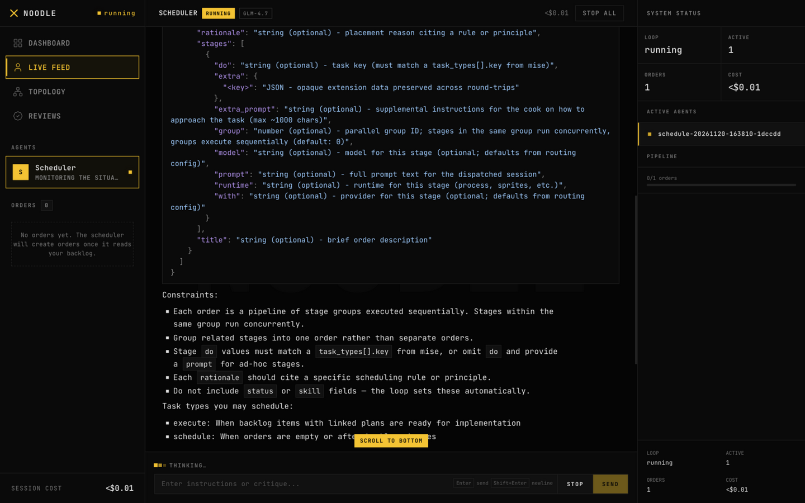
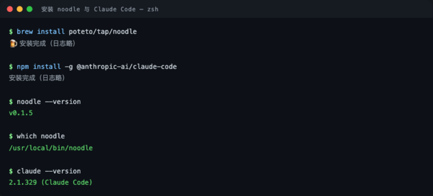
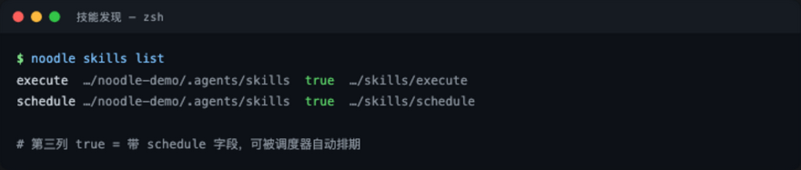
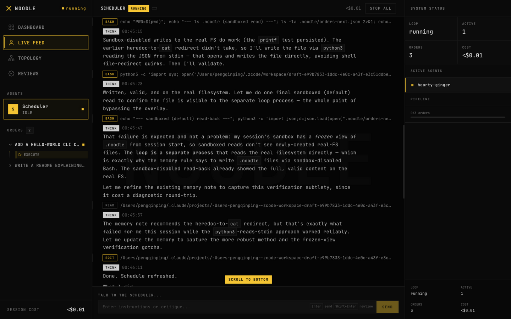
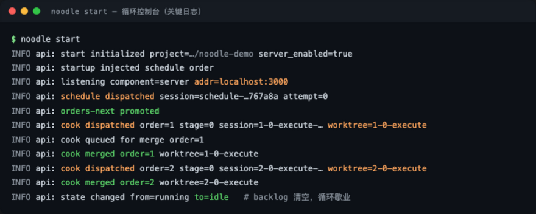
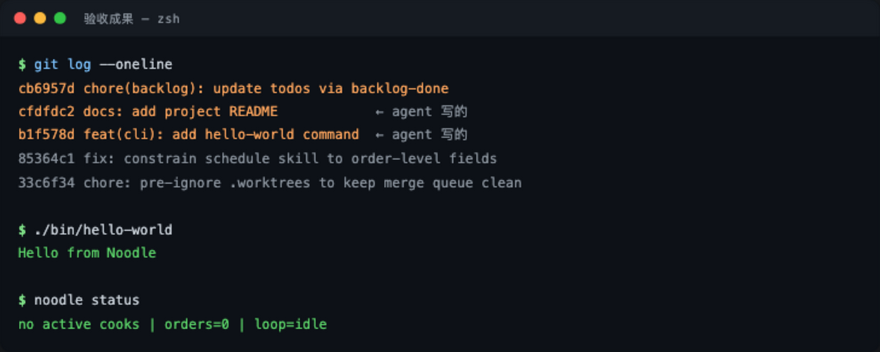
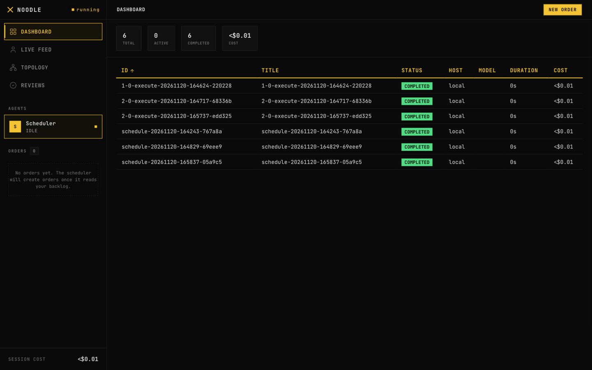
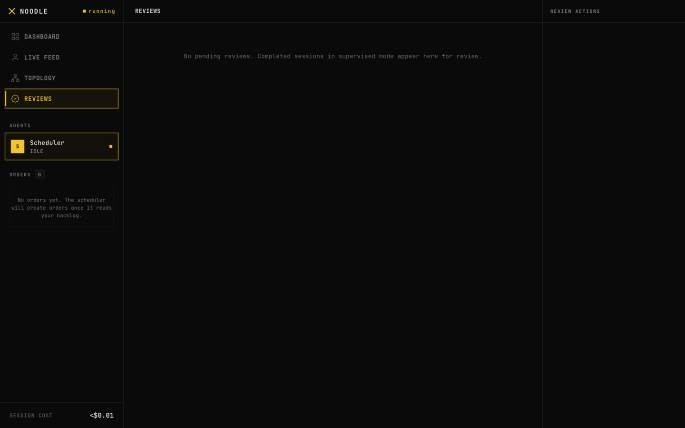

# 4 个文件 + 1 毛钱不到：我让 AI Agent 自己排队干了半天活

> 上手实录 | Noodle——一个"技能自动编排器"，来自 Ember.js 核心团队前成员 Lauren Tan



## 一、Noodle 是个啥？

最近 AI 编程工具的卷法变了：卷完模型卷 CLI，卷完 CLI 卷"编排"。

GitHub 上有个项目叫 [poteto/noodle](https://github.com/poteto/noodle)，作者是 Lauren Tan——如果你写过 Ember.js 或者看过 React Conf，大概率听说过她。她给 Noodle 的定位只有一句话：

> **Skill-based agent orchestration. Built in Go.**（基于技能的 Agent 编排器，Go 写的）

啥意思？你肯定写过这种 Markdown：`SKILL.md`，告诉 Claude Code / Codex "提交代码要遵守什么规范"、"改完跑哪些测试"。问题是——**这些技能要你手动喊 agent 去执行**。

Noodle 的答案是：给技能加一个 `schedule:` 字段，写上"什么时候该跑我"，然后剩下的全部交给一个循环：

```yaml
---
name: review
description: 严格的代码审查
schedule: After finishing complex tasks
---
```

1. **调度（Schedule）**：一个调度 agent 读 backlog（待办清单）和所有带 `schedule:` 的技能，决定接下来干啥，写出"工单"（orders）
2. **执行（Execute）**：Noodle 给每张工单开一个独立的 git worktree，派一个 agent（Noodle 里叫 cook，厨师）照着技能干活、提交
3. **合并（Merge）**：干完的分支排队合并回主干，互不踩脚
4. 循环往复，**直到 backlog 清空**，循环自动歇业（idle）

整个过程有个本地 Web UI 可以实时围观，黑底黄字的黑客风，相当带感。

听起来很美好？我决定装一个试试，顺便把踩的坑全记下来。

## 二、安装：两条命令的事

先交代环境：macOS + Homebrew，底层 agent 用的是 **Claude Code CLI + 智谱 GLM 接口**（国内直连，便宜）。



```sh
# 装 noodle 本体
brew install poteto/tap/noodle

# 装 Claude Code（noodle 只是个调度器，干活的是它）
npm install -g @anthropic-ai/claude-code
```

noodle 是个 Go 编译的单一二进制，brew 拉下来就能用：

```sh
$ noodle --version
v0.1.5
$ noodle --help   # 子命令一览
start / status / skills / schema / worktree / event / reset
```

然后给 Claude Code 接上 GLM。按智谱官方文档，写 `~/.claude/settings.json`（Key 就是你 GLM Coding 套餐的 API Key）：

```json
{
  "env": {
    "ANTHROPIC_AUTH_TOKEN": "<你的GLM Key>",
    "ANTHROPIC_BASE_URL": "https://open.bigmodel.cn/api/anthropic",
    "ANTHROPIC_DEFAULT_HAIKU_MODEL": "glm-4.7",
    "ANTHROPIC_DEFAULT_SONNET_MODEL": "glm-4.7",
    "ANTHROPIC_DEFAULT_OPUS_MODEL": "glm-4.7",
    "CLAUDE_CODE_DISABLE_NONESSENTIAL_TRAFFIC": "1",
    "API_TIMEOUT_MS": "3000000"
  },
  "hasCompletedOnboarding": true
}
```

## 三、最小的 Noodle 项目：4 个文件

官方 Cookbook 给了个 "Minimal Noodle Loop"，核心就 4 个文件。我建了个 `noodle-demo` 仓库照着写：

**1️⃣ `.noodle.toml`**——总配置：

```toml
mode = "auto"            # auto 全自动 / supervised 合并前人工审 / manual 全手动
max_concurrency = 1      # 并发 agent 数，先 1 个省 token

[routing.defaults]
provider = "claude"
model = "glm-4.7"        # 这里填 glm-4.7，原因见踩坑①

[skills]
paths = [".agents/skills"]

[agents.claude]
path = "~/noodle-claude-shim"   # 兼容性垫片，原因见踩坑③

[adapters.backlog]
skill = "backlog"
[adapters.backlog.scripts]
sync = "adapters/backlog-sync"
add  = "adapters/backlog-add"
done = "adapters/backlog-done"
edit = "adapters/backlog-edit"
```

**2️⃣ `.agents/skills/schedule/SKILL.md`**——调度技能，告诉调度 agent 怎么读 backlog、怎么写工单（核心是 frontmatter 里的 `schedule:` 字段）：

```yaml
---
name: schedule
description: Reads backlog and produces work orders for the loop.
schedule: "When orders are empty or after backlog changes"
---
```

**3️⃣ `.agents/skills/execute/SKILL.md`**——执行技能，干活的规范：读任务、改代码、验证、按约定式提交。

**4️⃣ `todos.md`**——backlog，就是一个 checkbox 列表：

```markdown
## Backlog
1. [ ] Add a hello-world CLI command that prints "Hello from Noodle"
2. [ ] Write a README explaining what this project does
```

`noodle skills list` 验证一下技能发现：



第三列 `true` 表示带 `schedule:` 字段、可被自动调度。就绪。

## 四、`noodle start`：见证循环

```sh
$ noodle start
INFO api: startup injected schedule order
INFO api: listening component=server addr=localhost:3000
INFO api: schedule dispatched session=schedule-… attempt=0
```

浏览器打开 `localhost:3000`——好家伙，直接看到一个实时事件流：调度 agent 正在"思考"，读 backlog、查 schema、写工单，每一步工具调用都看得一清二楚。



大约 2 分钟后，调度器写出两张工单：

```json
{
  "id": "1",
  "title": "Add a hello-world CLI command…",
  "stages": [{ "do": "execute", "with": "claude", "model": "glm-4.7" }]
}
```

Noodle 校验通过（promoted），随即派出执行 agent——注意日志里的 `worktree=1-0-execute`，它给 agent 单独开了一个 git worktree，主分支不会被直接污染。

然后，自己建文件、自己写代码、自己 `git commit`、自动合并回 main。第二张工单（写 README）接着来。直到 backlog 清空，循环 `to=idle` 歇业：



验收成果：



```sh
$ git log --oneline
cfdfdc2 docs: add project README            ← agent 写的
b1f578d feat(cli): add hello-world command  ← agent 写的

$ ./bin/hello-world
Hello from Noodle

$ noodle status
no active cooks | orders=0 | loop=idle
```

`todos.md` 里两项全部被自动勾选 `[x]`，README 甚至准确描述了仓库里每一个目录是干嘛的。仪表盘显示：**6 个会话全部完成，总消耗不到 $0.01**。



## 五、但是——踩坑实录（重点）

上面一切顺利的部分，背后是我连续踩了 4 个坑。**v0.1.5 还很早期**，这部分才是本文最值钱的。

### 坑①：模型名映射，报"余额不足"

照官方文档，`.noodle.toml` 里模型默认写 `claude-sonnet-4-6`，GLM 端会做服务端映射。结果调度 agent 的每个请求都被打回：

```
{"error":{"type":"rate_limit_error","code":"1113",
"message":"[1113][余额不足或无可用资源包,请充值。]"}}
```

一开始以为是套餐没钱，用 curl 分别测了两个模型名才发现真相：`glm-4.7` 直连 ✅ 正常返回；`claude-sonnet-4-6` 映射到的模型变体 ❌ 不在 Coding 套餐覆盖范围内。

**解法**：`.noodle.toml` 和 schedule 技能模板里，模型名直接写 `glm-4.7`，别走映射。

### 坑②：官方示例模板与 schema 不一致

修完模型又卡：调度 agent 明明写了工单，却被校验器打回 `unknown field "provider"`。翻 `noodle schema orders` 才发现：**stage 字段叫 `with`，不叫 `provider`**——官方示例模板是旧的。第二次又被打回 `unknown field "extra_prompt"`，因为给执行 agent 的附加指令必须写在 stage 里，不能写在订单级。

**解法**：在 schedule 技能里加一段硬性约束（哪些字段只能出现在哪个层级）。你可以用 `noodle schema orders` 查看最新 schema，别抄模板。

### 坑③：Claude Code 双向流模式导致死锁 ⭐ 最隐蔽

修完 schema，工单通过了，但执行 agent 干完活之后——**循环卡死不动了**。

翻源码 + 做了个隔离实验才定位：noodle 的 process runtime 等待 **claude 进程退出**才算阶段完成，但 Claude Code 的 `--input-format stream-json` 是双向流协议，回合结束后进程**常驻等待下一条指令**，永不退出。死锁。noodle 的 e2e 测试只测了 Codex（stdin 写完就关，进程自然退出），所以这个问题没被发现。

**解法**：写了个 10 行的"垫片"脚本，把双向流降级成一次性 `-p` 管道模式（回合结束进程自然退出），然后在 `.noodle.toml` 里把 `[agents.claude] path` 指向垫片目录。只影响 noodle 的调用，日常用 claude 不受影响。

### 坑④：适配器把合并队列弄脏

最后一个是连锁坑：订单完成后 noodle 调用 `backlog-done` 勾选 todos.md，但这次修改**留在根检出里没提交**；下一张工单要合并时，noodle 报"root checkout has uncommitted changes"拒绝合并。更绝的是 noodle 自己启动时往 `.gitignore` 追加 `.worktrees/`，也会触发同样的死锁。

**解法**：给会改 todos.md 的三个适配器脚本包一层 wrapper，改完自动 `git commit`；启动前预提交 `.worktrees/`。

### 循环的自愈能力值得点赞

值得一提的是，这些坑 noodle 并不是一崩到底：调度 agent 的工单被拒后，循环会自动重试调度（degrade-continue）；订单合并失败会被"转发给调度器"，重新派工。我修好适配器后，眼看着它自己把订单 2 重新执行了一遍并成功合并。**容错设计是真的有。**

## 六、值不值得用？



**亮点：**

- 📊 **可观测性拉满**：Web UI 能实时看到每个 agent 的思考流、工具调用、成本，出问题一眼定位
- 🌿 **worktree 隔离**：多 agent 并行互不踩脚，合并串行化，主分支始终干净
- 🧩 **技能即一切**：调度、执行、审查、复盘全是 Markdown 技能，改行为不用改代码
- 🔁 **模式是信任旋钮**：auto / supervised / manual 三档，成熟项目全自动，敏感项目全手动
- 💸 **成本真便宜**：GLM-4.7 跑完整 demo 不到 1 毛钱人民币

**槽点（v0.1.5 现状）：**

- 文档模板与 schema 校验不同步，官方示例抄了会翻车
- 对 Claude Code 的 process runtime 存在流式协议兼容问题（需要垫片）
- backlog 适配器会弄脏根检出，阻塞合并队列
- 上述问题让我实际耗时约 1 小时排障——但都有可行的解法

**适合谁：** 已经用 Claude Code / Codex 且想往"多 agent 并行、backlog 驱动开发"演进的同学。它本质上是把"你喊 agent 干活"升级成"工单流水线喊 agent 干活"。如果你只有一个空项目的 demo backlog，可能感觉像杀鸡用牛刀；但当你有一堆小任务攒着的时候，它的价值就出来了。

另外还有个彩蛋叫 **brainmaxxing**：给 Noodle 配一个跨会话的持久记忆库（brain/），agent 会自己复盘、记教训——我在日志里已经看到 GLM 偷偷给自己写"记忆笔记"了，这个下次再试。

## 附录：完整复现清单

```sh
brew install poteto/tap/noodle          # noodle v0.1.5
npm install -g @anthropic-ai/claude-code # Claude Code 2.1.329
# ~/.claude/settings.json 配 GLM 接口（本文第二节）
mkdir noodle-demo && cd noodle-demo && git init
# 写 4 个文件：.noodle.toml / schedule / execute / todos.md（本文第三节）
# 写 4 个适配器脚本（可从 noodle 仓库 defaults/adapters 拷贝）
noodle start    # 打开 localhost:3000 围观
```

参考链接：

- Noodle 仓库：https://github.com/poteto/noodle
- 官方文档：https://poteto.github.io/noodle/
- 智谱 GLM × Claude Code 接入：https://docs.bigmodel.cn/cn/guide/develop/claude
- GLM Coding 套餐：https://bigmodel.cn/claude-code
