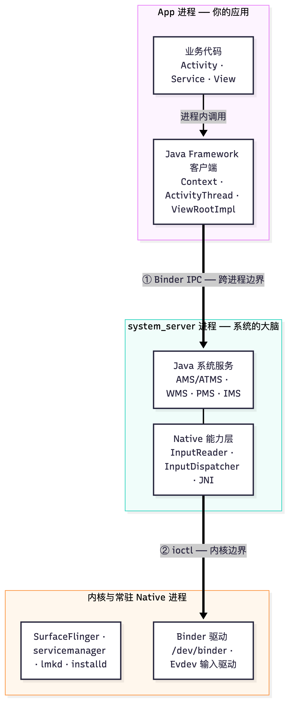
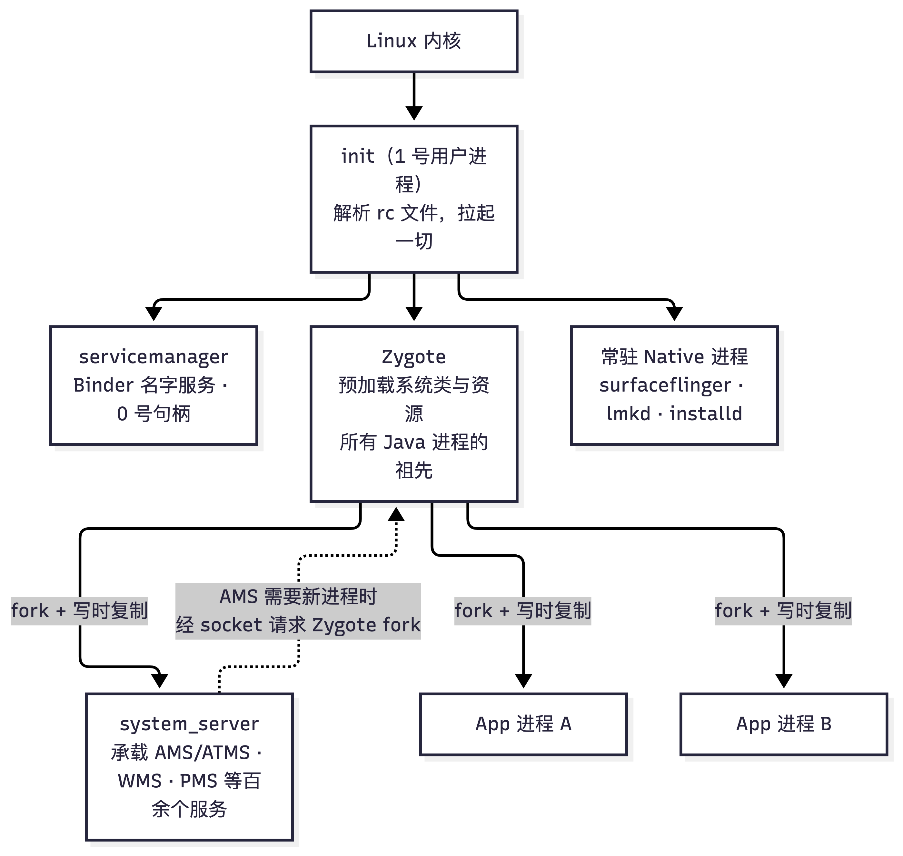
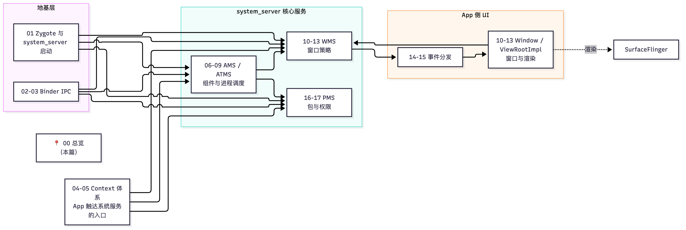
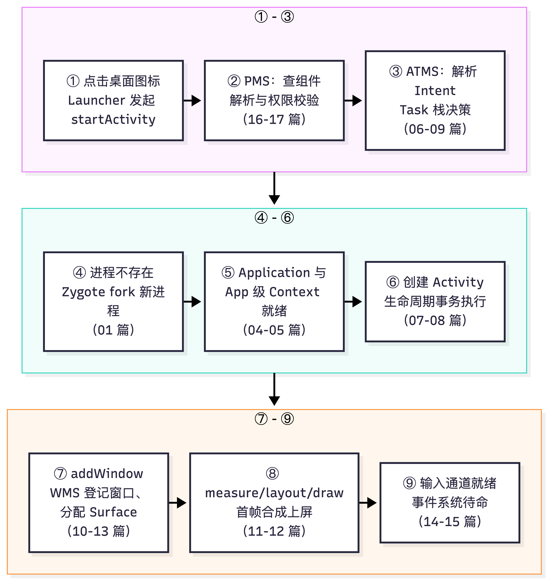
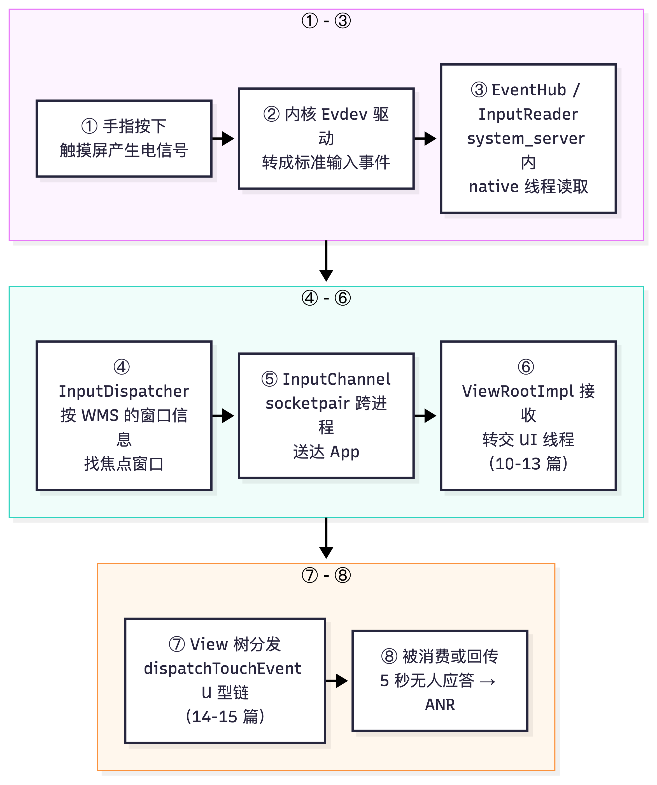

# 00｜总览篇：一张地图，统领 AMS / WMS / PMS / Binder / Context

> 📌 **《Framework 源码深潜》系列 · 第 00 篇 / 共 20 篇**
> 📖 基线版本：**Android 15（API 35）** ｜ 🎯 目标：建立全局观



## 01 引子：为什么你读源码总会迷路

先还原一个真实场景。你打开 `Activity.java` 想搞清楚 `startActivity`：点进去跳到 `Instrumentation.execStartActivity`，再点跳到 `ActivityTaskManager.getService().startActivity()`——这是一个 **Binder 代理对象**，真身在另一个进程里，IDE 的跳转就此"断线"。

切到 cs.android.com 继续追，40 分钟后——Intent 解析、Task 栈、Zygote fork、窗口添加全都看到了，信息量爆炸，**唯独忘了最初想确认什么**。

这不是你记忆力的问题，而是三个结构性的原因：

**① 跨进程断点。** App 侧代码和 system_server 侧实现被 Binder 一刀切开，任何跳转工具都会在 Proxy 处失灵。

**② 模块纠缠。** 一次 startActivity 同时擦过 PMS、ATMS、Zygote、WMS——你以为在读 AMS，其实在读一张网。

**③ 版本漂移。** 网上资料横跨 API 21～34：AMS 在 R 版拆出了 ATMS，生命周期在 P 版改成事务化，PackageParser 在 T 版被弃用。拿旧地图找新大陆，必然迷路。

所以系列第一篇不是任何具体模块，而是**地图**。读完本篇，你要带走三样东西：知道每个核心模块**住在哪个进程**、模块之间**靠什么连接**（Binder 接口名 + 调用方向）、以及接下来 19 篇的**阅读顺序和两条主线**。

## 02 分层架构：先记住两条边界

分层教科书有很多版本，做源码分析只需要记住**两条边界**：

**边界一：App 进程 ⇄ system_server 进程（Binder 边界）。**

你在 Activity 里写的 `startActivity`、`getSystemService` 拿到的绝大多数 Manager——大多不是本地调用，而是一次跨进程通信。**方法一行代码执行完，对面 system_server 已经替你干完了大半活。**

**边界二：Java 层 ⇄ 内核（ioctl 边界）。**

所有 Binder 调用最终落到 `/dev/binder` 的 `ioctl` 上；所有输入事件都从触摸屏驱动经 evdev 上报。所有"魔法"的物理底层在这一层。

一个反直觉的事实：

> **你的 App 进程更像"指挥官"，大量真正的工作——组件调度、窗口布局、Surface 分配——发生在 system_server 里。**

这也是为什么 system_server 一崩，桌面、通知栏、所有 App 窗口全部重启——它才是 Android 的"大脑"。而"指挥官"能安全发号施令，靠的是沙箱模型：每个 App 是独立 uid，调动系统资源只能经 Binder 找 system_server 审批。**安全，是理解这套架构的第一性原理。**

## 03 进程模型：谁住在哪



**init**：内核拉起的 1 号用户进程，解析 rc 文件，用户态世界的一切从这里开始。

**servicemanager**：Binder 世界的"DNS"。服务启动时向它注册"服务名 → 句柄"，跨进程调用先问它要地址。地位特殊：**0 号句柄**，人人可达。

**Zygote**：所有 Java 进程的祖先。启动时预加载系统类与资源，之后每个 App 进程都由它 **fork + 写时复制**而来——启动快、内存省。

**system_server**：Zygote fork 出的第一个、最重要的进程，入口在 `frameworks/base/services/java/com/android/server/SystemServer.java` 的 `main()`，分三步启动：

```java
startBootstrapServices()  // Installer、AMS/ATMS、PMS —— 先立地基
startCoreServices()       // BatteryService 等
startOtherServices()      // IMS、WMS —— 再补人手
```

百余个 Java 服务全住在这一进程。注意顺序细节：**AMS/ATMS、PMS 在第一阶段创建，WMS 与 InputManagerService 在第三阶段一起创建**——后面讲事件系统还会用到。

**常驻 Native 进程**：surfaceflinger（合成上屏）、lmkd（低内存查杀）、installd（安装辅助）……由 init 直接拉起，不走 Zygote。

⚠️ 常见误区：**InputReader / InputDispatcher 是 system_server 里的 native 线程**，不是独立进程——很多人在"哪个进程处理输入事件"上栽跟头。

## 04 三大中枢：AMS、WMS、PMS

一句话职责，先背下来：

- **AMS / ATMS**（ActivityManagerService / ActivityTaskManagerService）——**组件与进程的调度中枢**：生命周期、Task 回退栈、Service/Broadcast 调度、进程优先级与查杀。⚠️ R 版起组件调度拆分给 ATMS，如今说的"AMS"多为二者合称。
- **WMS**（WindowManagerService）——**窗口的"政策局"**：决定层级（Z-order）、位置、大小、可见性与输入焦点归属，再把决策同步给 SurfaceFlinger 和输入系统。注意：**它管策略，不管像素**。
- **PMS**（PackageManagerService）——**包的"户籍办"**：安装/卸载/升级、Manifest 解析、权限授予、组件注册表。

它们都以 Binder 接口对外服务，App 侧拿到的只是"门面"。这张索引表建议收藏，括号里就是 `service list` 中的注册名（除最后一行，其余都住在 system_server）：

| 能力 | Binder 接口（注册名） | App 侧门面 |
|---|---|---|
| 组件调度 | IActivityTaskManager（activity_task） | ActivityTaskManager |
| 进程管理 | IActivityManager（activity） | ActivityManager |
| 窗口管理 | IWindowSession（window） | WindowManager |
| 包与权限 | IPackageManager（package） | PackageManager |
| 图层合成 | ISurfaceComposer（SurfaceFlinger，独立进程） | SurfaceControl |

这些"门面"是怎么递到你手上的？答案是 **Context**：`getSystemService()` 内部有一张静态路由表（`SystemServiceRegistry`）。这是 04-05 篇的主角，先按下不表。

## 05 全景知识地图：20 篇怎么读



这张地图是系列的"锚"，编号即篇目。阅读顺序 = 依赖顺序，三个关键依赖：**Binder 最先**（三大服务的接口都是 Binder 接口，不懂 IPC 链路篇篇卡壳）；**Context 在前**（startActivity 与 getSystemService 都从 Context 出发）；**事件系统在后**（InputChannel 是 addWindow 时随窗口创建的，不懂窗口，输入派发就是空中楼阁）。

## 06 两条主线：把 20 篇串成两个故事

**主线 A：一个 Activity 的诞生。**



**主线 B：一次触摸的旅程。**



系列约定：每篇文末都有"主线进度条"。零散知识点不可怕，可怕的是没有叙事把它们串起来。

## 07 设计追问：系统为什么长成今天这样

**Q1：为什么百余个服务都挤在 system_server 一个进程里？**

三个原因：服务间调用极其频繁（AMS 与 WMS 几乎每个操作都互跳），拆开等于海量跨进程开销；单进程统一生命周期，出问题整体重启；进程数量本身也是资源。
代价是**单点故障**：watchdog 盯着关键线程，一旦失守就杀掉整个 system_server——Zygote 随之自杀，整机"软重启"。这也是系统服务严禁在关键线程做耗时操作的原因。

**Q2：为什么 App 不能直接创建窗口、直接启动别人的组件？**

因为 Android 的安全模型要求**所有特权操作必须经 system_server 审批**：窗口 token 由 WMS 签发，组件启动经 AMS 校验，安装经 PMS 验签。一切"句柄"都是 system_server 发的令牌，校验依据是内核提供的 uid/pid，App 伪造不了。Binder 的内核级身份校验，是这套安全模型的技术底座（02 篇展开）。

**Q3：为什么 IPC 选 Binder，而不是 Socket 或共享内存？**

性能：Binder 基于 mmap，**全程只有 1 次拷贝**（Socket 要 2 次）；安全：内核层记录双方 uid/pid，天然支撑权限校验；易用：C/S 架构 + 死亡通知，服务治理开箱即用。

## 08 动手实验：把地图钉到真机上

```bash
# ① 验证进程模型：zygote 是所有 Java 进程的父亲
adb shell ps -A | grep -E "zygote|system_server"

# ② 找三大中枢的注册名
adb shell service list | grep -iE "activity|window|package"
```

**源码环境，两件事就够：**

1. **在线查**：cs.android.com（选 android-15 release 分支），全量交叉引用，日常首选；
2. **本地看**：不必 repo sync 整个 AOSP，clone GitHub 的 aosp-mirror/platform_frameworks_base 覆盖 90% 场景。

**关键目录速查表**（贴在显示器边上）：

```text
frameworks/base/core/java                  App 侧：Context、View、ActivityThread
frameworks/base/services/core/java         system_server：ams/、wm/、pm/
frameworks/native/libs/binder              Binder C++ 库与 IPCThreadState
内核仓 common/drivers/android              binder.c 驱动
frameworks/native/services/surfaceflinger  合成器
```

**版本变迁速查表**（对照旧资料时先查这张）：

```text
P / 9    生命周期改用 ClientTransaction 事务化；lmkd 用户态化
R / 11   AMS 组件调度拆出 ATMS
S / 12   BLASTBufferQueue 引入，渲染提交路径重构
T / 13   PackageParser 弃用，解析重构为 parsing 包
14 → 15  本系列基线：Android 15
```

## 09 高频面试题 5 连

**Q1：按下电源键到桌面可交互，经历了哪些关键阶段？**

【参考答案】内核引导 → init 解析 rc → 拉起 zygote 与 servicemanager → zygote 预加载后 fork system_server → SystemServer 三步启动 AMS/PMS/WMS → AMS systemReady 后启动 Launcher（Home 也是普通 App）→ 首帧上屏。

**Q2：system_server 崩溃会发生什么？**

【参考答案】watchdog 或异常杀掉 system_server → Zygote 察觉后自杀 → init 重启 zygote 与 system_server → 所有 App 进程被杀。观感：手机没重启，但界面"闪一下"回到桌面，前台页面与通知全没了。

**Q3：App 与 system_server 之间用什么通信？为什么不用共享内存？**

【参考答案】Binder。共享内存只解决"快"不解决"信任"——Binder 在内核层记录双方 uid/pid，天然支持权限校验与死亡通知，mmap 一次拷贝性能足够。

**Q4：ServiceManager 是什么？为什么它是 0 号句柄？**

【参考答案】Binder 世界的服务注册表。它与 Binder 驱动有启动约定：句柄固定为 0，任何进程无需查询就能先找到它，再由它找到其他服务——先有"DNS"，才谈得上"网址"。

**Q5：App 的"主线程"到底是什么？**

【参考答案】就是 ActivityThread.main() 所在、跑着 Looper 的线程。system_server 发来的生命周期消息（ClientTransaction）投递到这个队列执行——"主线程卡了"的本质是消息队列堵了，这是 ANR 的直接温床（19 篇展开）。

## 10 小结 · 思考题 · 下篇预告

**一句话总结：**

> Android = 一群被 Zygote 复制出来的 App + 一个住在 system_server 的"大脑" + 连接两者的 Binder + 从内核管到应用层的安全模型。

**思考题**：

1. Zygote 为什么"先预加载、再 fork"？预加载清单里哪一项收益最大？
2. 把 WMS 拆成独立进程，会得到什么、失去什么？

**下篇预告 · 01《Zygote 与 system_server》**：从 init.rc 的一句话开始，看 Zygote 如何预加载、三步启动各干了什么、三大服务何时"活"过来。

---

🧭 **主线进度**：主线 A「Activity 的诞生」0/9 ｜ 主线 B「触摸的旅程」0/8 ｜ 本篇为总览地图

*配图源码在 diagrams/ 目录，欢迎改用。下一篇：01《Zygote 与 system_server》。*
