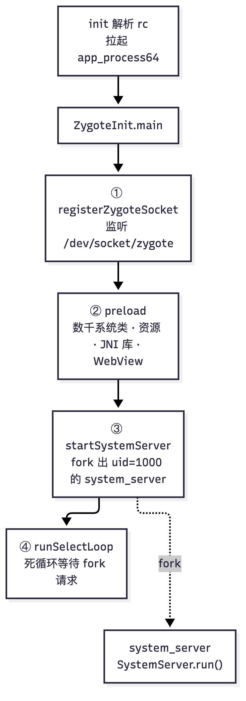
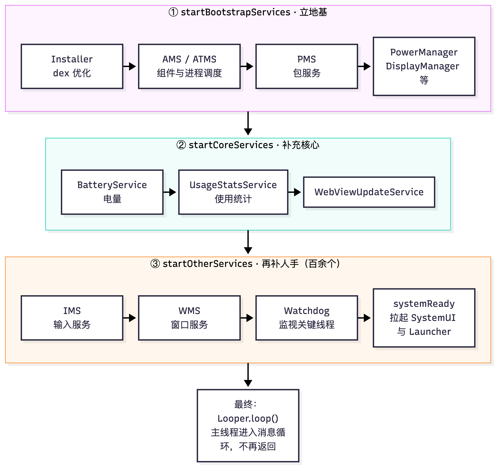
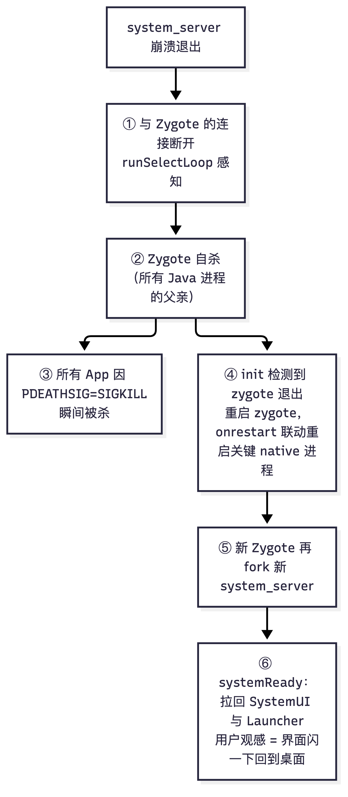
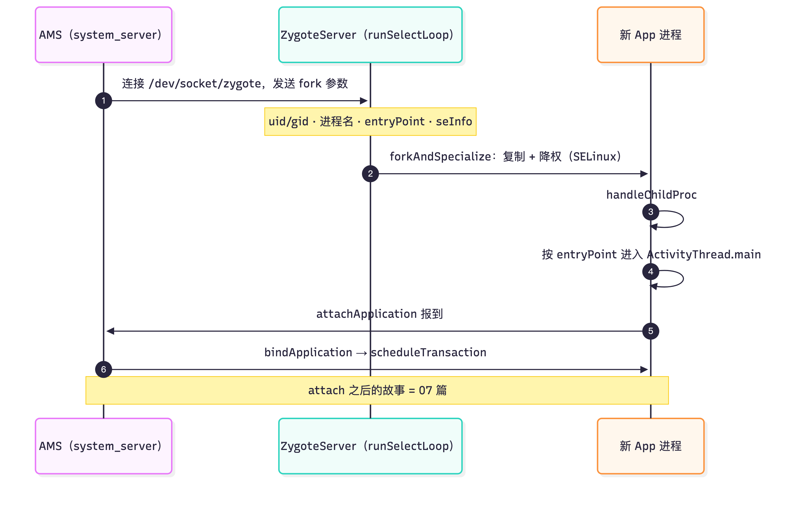

# 01｜Zygote 与 system_server：受精卵，和它最重要的孩子

> 📌 **《Framework 源码深潜》系列 · 第 01 篇 / 共 20 篇** ｜ 📖 基线：Android 15（API 35）
> 上一篇：00《总览与知识地图》

## 01 引子：命名即设计

zygote，中文译作"受精卵"。Android 用它命名第一个 Java 进程，因为整个进程模型就是生物学的：**Zygote 是唯一的受精卵，每个 App 都是它分裂出的细胞，system_server 是第一个、也是最重要的孩子。**

先看一道高频面试题："点击图标后，App 进程是怎么被创建的？"很多人答"系统创建的"——等于没答。本篇把这条链讲透：init → Zygote → system_server → App 进程。读完带走四样东西：**Zygote 的五步启动**、**预加载清单与收益**、**system_server 三步启动**、**"软重启"的自愈机制**。

## 02 init：rc 文件里写着 Zygote 的命运

init 是内核拉起的 1 号用户进程，职责是解析 rc 文件、按声明拉起服务。Zygote 的定义就在其中：

```bash
# /system/etc/init/hw/init.zygote64_32.rc（节选）
service zygote /system/bin/app_process64 -Xzygote /system/bin \
        --zygote --start-system-server --socket-name=zygote
    socket zygote stream 660 root system   # ★ 预创建 /dev/socket/zygote
    onrestart restart audioserver          # ★ 软重启联动的伏笔
    onrestart restart media
```

两个关键点：

**`app_process64`** 是个 native 二进制，但它启动后第一件事是调 `AndroidRuntime.start("com.android.internal.os.ZygoteInit")`——native 把接力棒交给 ART，进入 Java 世界。

**`socket zygote ...`** 这行让 init 预创建了一个 Unix 域 socket（/dev/socket/zygote）。谁连它？以后 AMS 每要一个新进程，都从这里走——06 节的伏笔。

⚠️ 64/32 位 App 如何共存？rc 里还有 `zygote_secondary`（app_process32）。两个 Zygote 各自监听 socket，App 按 abi 路由。

## 03 Zygote 启动五步



对应 `ZygoteInit.main()`（frameworks/base/core/java/com/android/internal/os/ZygoteInit.java）：

**① registerZygoteSocket**：监听 init 预创建的 /dev/socket/zygote；

**② preload()**：预加载——preloaded-classes 清单里的数千个系统类、drawable/color/string 资源、OpenGL 与常用 JNI 库、WebView 工厂准备；

**③ startSystemServer**：fork 出 uid=1000 的 system_server（04 节）；

**④ runSelectLoop**：进入死循环监听 socket，等待"给我 fork 一个进程"的请求——**从这一刻起，Zygote 变成一台"Java 进程复制机"**；

⚠️ **⑤ USAP 池**（Android 10+）：预 fork 一批"空白进程"待命以压缩启动耗时，默认未启用。

预加载是一次性代价：Zygote 加载一份，之后所有 fork 出的进程直接继承——这是 Android 冷启动快、内存省的根源。

## 04 system_server：三步启动

`startSystemServer` fork 时指定 uid/gid=1000（system 用户），进程名 system_server，随后经 `handleSystemServerProcess` 进入 `SystemServer.run()`（frameworks/base/services/java/com/android/server/SystemServer.java）。



**第一步 startBootstrapServices——立地基**：Installer（dex 优化）、AMS/ATMS（组件与进程调度）、PMS、PowerManager、DisplayManager、UserManager……**顺序即依赖**：AMS 一创建就 setInstaller（dex 优化依赖 installd），而 AMS 要等 PMS 就绪才能认识所有包。

**第二步 startCoreServices**：BatteryService、UsageStatsService、WebViewUpdateService。

**第三步 startOtherServices——再补人手**：百余个服务在此创建，重点关注三件事：

**IMS 与 WMS 同时段创建**（先 `InputManagerService`，再 `WindowManagerService.main`）——00 篇埋的顺序细节，是事件系统篇的关键伏笔；

**Watchdog.start()**：开始监视关键服务线程，谁卡死就杀整个 system_server（00 篇设计追问 Q1 在这里落地）；

**AMS.systemReady()**：SystemUI 与 Launcher 在这个回调里被拉起——**桌面 Home 也是一个普通 App 进程，由 AMS 走完整启动流程**。

最后 `Looper.loop()`：主线程进入消息循环，不再返回。system_server 此后的一生，全靠 Handler 消息驱动。

## 05 生命捆绑：system_server 崩了，为什么整机"软重启"



这是 00 篇面试题 Q2 的完整答案，也是 Android 自愈能力的核心：

**① system_server 死亡** → 它与 Zygote 之间的专用连接断开，`runSelectLoop` 感知后，**Zygote 选择自杀**——它不能独活，所有 Java 进程都以它为父；

**② 所有 App 瞬间陪葬**：每个 App fork 时都设置了 **PDEATHSIG=SIGKILL**（父进程死亡信号），内核机制，Zygote 一死全员被杀；

**③ init 重启 zygote 服务**，rc 里的 `onrestart` 联动重启 audioserver、media 等关键 native 进程；

**④ 新 Zygote 再 fork 新 system_server**，重走三步启动，systemReady 拉回 SystemUI 与 Launcher。

用户观感：屏幕闪一下回到桌面，前台页面与通知全没了——但系统几十秒内自愈，无需真重启。

## 06 App 进程的诞生：socket 协议一瞥



以后 AMS 需要新进程（比如目标 Activity 还没进程），流程如上图。AMS 连上 /dev/socket/zygote，发送一串 fork 参数：uid/gid、进程名、**entryPoint**、SELinux seInfo 等。Zygote 的 `runSelectLoop` 收到请求执行 `forkAndSpecialize`：

**fork**：复制自己，类、资源、ART 全部现成；**specialize（个体化）**：给子进程降权——设置真实 uid/gid、挂上 SELinux 上下文、清掉 Zygote 特权。

子进程按参数里的 entryPoint 执行：普通 App 是 `android.app.ActivityThread`，于是走进 `ActivityThread.main()`，再 `attachApplication` 回 AMS 报到。

**entryPoint 是参数化的**——Zygote 本质是"通用 Java 进程工厂"，system_server 也只是它的另一个订单（entryPoint=SystemServer）。attach 之后 Activity 的故事，是 07 篇的主线。

## 07 设计追问

**Q1：为什么用 fork，而不是 exec 一个新进程？**

三个理由。**继承红利**：fork 出的进程自带初始化好的 ART、数万个类、资源表，省掉数百毫秒的重复初始化；**内存共享**：写时复制（COW），未修改的页所有进程共用；**安全不减**：specialize 由 Zygote 这个特权进程完成降权，安全性不弱于 exec。

**Q2：为什么 Zygote fork 前必须"单线程化"？**

fork 有个经典陷阱：**它只复制调用它的那个线程**。如果别的线程正持有锁，子进程里那把锁永远没人释放——死锁。所以 Zygote fork 前（`ZygoteHooks.preFork`）暂停 GC、JIT 等守护线程，fork 后再恢复。

**Q3：为什么 system_server 由 Zygote fork，而不是 init 直接拉起？**

它也是 Java 进程，同样要吃 ART 与预加载的红利；更重要的是保持"同宗同源"——唯其如此，PDEATHSIG 的生命捆绑与统一的 socket 协议才成立。

## 08 动手实验与源码路标

```bash
# ① 亲眼看两个 Zygote（64/32）
adb shell ps -A | grep zygote

# ② 验证 system_server 的父亲就是 Zygote：看 PPID 列
adb shell ps -o PID,PPID,NAME | grep -E "zygote|system_server"
```

源码路标（本篇四站）：

```text
system/core/rootdir/etc/init/hw/init.zygote64_32.rc                    rc 定义
frameworks/base/core/java/com/android/internal/os/ZygoteInit.java      五步启动
frameworks/base/services/java/com/android/server/SystemServer.java     三步启动
frameworks/base/core/jni/com_android_internal_os_Zygote.cpp            native fork 与 specialize
```

## 09 高频面试题 5 连

**Q1：App 进程是怎么被创建的？为什么不用 exec？**

【参考答案】AMS 经 socket 向 Zygote 发请求，Zygote forkAndSpecialize：fork 复制预初始化的运行时与类资源（启动快、COW 省内存），specialize 设置 uid/SELinux 降权，最后按 entryPoint 进入 ActivityThread.main。

**Q2：system_server 崩溃后系统如何自愈？**

【参考答案】system_server 与 Zygote 的连接断开 → Zygote 自杀 → 所有 App 因 PDEATHSIG 被杀 → init 重启 zygote（onrestart 联动重启关键 native 进程）→ 新 Zygote fork 新 system_server → systemReady 拉回 SystemUI 与 Launcher。

**Q3：Zygote 预加载了什么？为什么？**

【参考答案】数千个框架类（preloaded-classes）、系统资源、OpenGL 与常用 JNI 库、WebView 工厂。让 fork 出的每个进程直接继承：省启动时间，靠 COW 省内存。

**Q4：fork 前为什么要单线程化？**

【参考答案】fork 只复制当前线程；其他线程持有的锁在子进程里永远无人释放，必然死锁。preFork 暂停 GC/JIT 等守护线程，fork 后恢复。

**Q5：64 位与 32 位 App 怎么共存？**

【参考答案】两个 Zygote：zygote（app_process64）与 zygote_secondary（app_process32），各自监听 socket，AMS 按 App 的 primaryCpuAbi 路由。

## 10 小结 · 思考题 · 下篇预告

**一句话总结**：

> Zygote = 一个预初始化的 Java 进程模板 + 一台 fork 复制机；system_server 是它最重要的孩子，两者通过 socket 与 PDEATHSIG 绑成"一损俱损"的生命共同体。

**思考题**：

1. USAP 池（预 fork 空白进程）为什么默认关闭？提示：想想内存代价与进程状态新鲜度。
2. 如果 App 没有 PDEATHSIG，Zygote 死后它们会变成什么？Binder 对端全断之后还能干什么？

**下篇预告 · 02《Binder（上）》**：AMS 与 Zygote 隔空对话靠的是 socket，而 AMS 与 App 之间靠的是 Binder。下一篇拆一次 IPC 的完整旅程：从 Java Proxy 到 ioctl，看"一次拷贝"是怎么实现的。

---

🧭 **主线进度**：主线 A「Activity 的诞生」4/9（本篇 = ④ fork）｜ 主线 B「触摸的旅程」0/8
