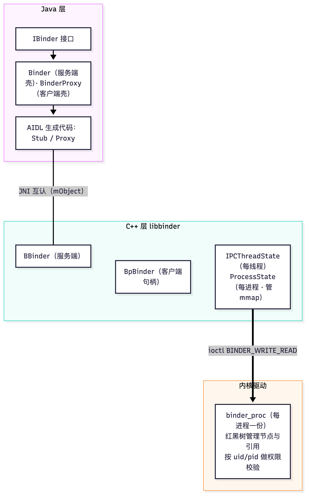
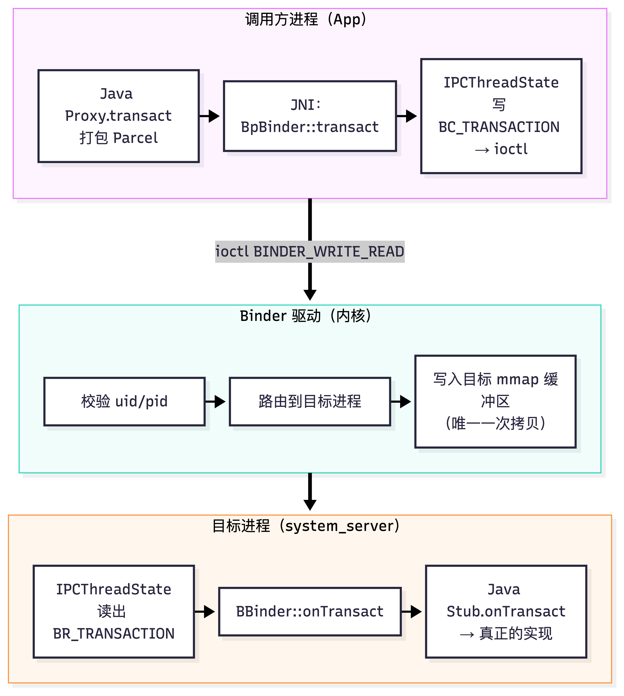
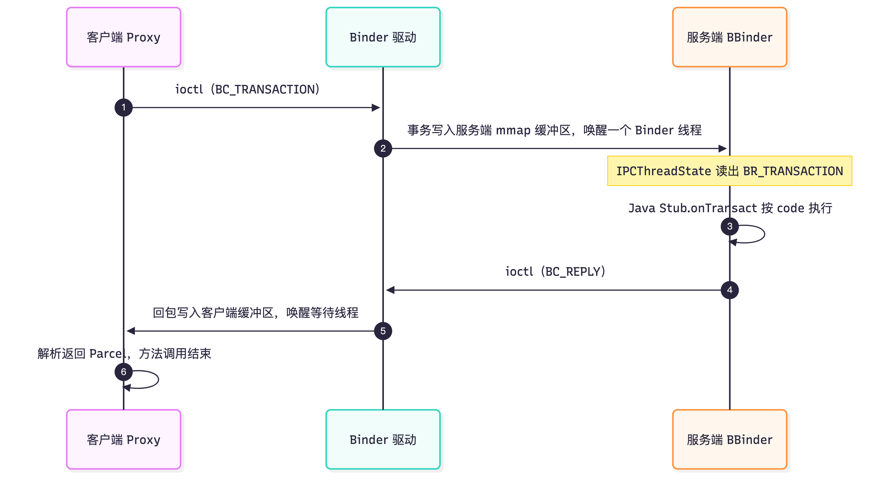
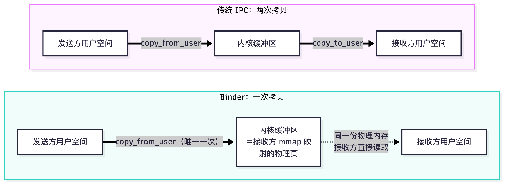

# 02｜Binder（上）：一次 IPC 的完整旅程

> 📌 **《Framework 源码深潜》系列 · 第 02 篇 / 共 20 篇** ｜ 📖 基线：Android 15（API 35）
> 上一篇：01《Zygote 与 system_server》

## 01 引子：你以为的本地调用

上一篇结尾留了个尾巴：AMS 与 Zygote 之间用 socket，而 AMS 与 App 之间用 Binder。为什么后者非它不可？因为 Binder 不只是"更快"，它带着 Android 最核心的设计——**内核级身份校验**。

先建立一个直觉：你在 Activity 里写一行 `startActivity()`，这行代码至少经历**两次跨进程**：一次去 system_server（AMS 审批），一次回来（App 执行）。而承载这一切的 Binder，是整个系列出现频率最高的角色——WMS、PMS、AMS 的每个接口都踩在它身上。本篇拆一次 IPC 的完整旅程，读完带走四样东西：**Binder 的四层模型**、**一次 transact 的全程**、**"一次拷贝"的 mmap 原理**、**为什么传不了超大对象**。

## 02 Binder 到底是什么

很多资料把 Binder 说成"一种 IPC 方式"，太浅。准确说，**Binder 是一套纵跨四层的通信框架**：Java 接口、C++ 库、内核驱动、名字服务，四层缺一不可。



记住几个主角的分工：

- **Java 层**：`IBinder` 接口；`Binder` 是服务端壳，`BinderProxy` 是客户端壳；AIDL 在它们之上生成 `Stub`（服务端）与 `Proxy`（客户端）；
- **C++ 层 libbinder**：`BBinder`/`BpBinder` 是 Java 双胞胎的影子（通过 JNI 的 mObject 互认）；`IPCThreadState` 每线程一个，负责与驱动对话；`ProcessState` 每进程一个，负责打开驱动并 mmap；
- **内核驱动**：`/dev/binder`。每个进程一份 `binder_proc`，红黑树管理所有 Binder 节点与引用，**按 uid/pid 做权限校验**——这是 Binder 安全性的根基；
- **ServiceManager**：0 号句柄的"名字服务"，服务端 `addService` 注册，客户端 `getService` 寻址。

## 03 一次 transact 的全程



以"App 调用 `IActivityTaskManager.startActivity`"为例，走一遍全链路：

**调用方（App 进程）**：Proxy 把参数打包成 `Parcel`，`transact` 走 JNI 进 `BpBinder`，`IPCThreadState` 把事务写入自己的命令缓冲，发起 `ioctl(BINDER_WRITE_READ)`——**系统调用，进入内核**。

**Binder 驱动**：从 Parcel 里解析出目标句柄，查红黑树找到目标节点，**校验调用方 uid/pid**，然后把数据 `copy_from_user` 写进**目标进程预先 mmap 好的缓冲区**，唤醒目标进程的一个 Binder 线程。

**目标进程（system_server）**：被唤醒的线程从缓冲区读出 `BR_TRANSACTION`，经 `BBinder::onTransact` 映射回 Java 层的 `Stub.onTransact`，按 code 分发到真正的实现。执行完，再走一次 `ioctl(BC_REPLY)` 把结果按对称路径送回。



注意两个容易被忽略的点：**客户端线程在 ioctl 期间是挂起等待的**（同步调用），回包到了才醒来继续跑；而服务端是**线程池并发处理**——所以服务端的 onTransact 里天然要考虑线程安全（03 篇展开线程池细节）。

## 04 一次拷贝：mmap 的魔术

Binder 最经典的面试题："为什么 Binder 只有一次拷贝？"

先看传统 IPC（管道/Socket/消息队列）的路径：发送方用户空间 → `copy_from_user` → 内核缓冲区 → `copy_to_user` → 接收方用户空间，**两次拷贝**。



Binder 的做法是：**进程打开 /dev/binder 时，驱动就把一块物理内存 mmap 到该进程的用户空间**。发送时只需 `copy_from_user` 写进这块内存——它既是"内核缓冲区"，又是"接收方的用户空间"，同一份物理页，一次拷贝完成传输。

> **一次拷贝的本质：让"内核缓冲区"和"接收方缓冲区"在物理上重叠。**

代价也在这里：这块缓冲区有限（**默认约 1MB 减去两页**），而且是**整个进程共享**的——并发事务挤在同一块内存里。这直接引出了下一个问题。

## 05 为什么传不了超大对象

给 Intent 塞一张大图（比如 >1MB 的 Bitmap 字节数组），会收到 `TransactionTooLargeException`。原因就是上面那块共享缓冲区：**单次事务大小受限于进程的 Binder 缓冲区总量**，塞满后连其他并发事务都会失败（还可能连带引发远端崩溃）。

那大块数据怎么传？**传 fd，不传数据**：把匿名共享内存（ashmem/memfd）的文件描述符塞进 Parcel，驱动对 fd 做特殊处理——真正的大数据走共享内存，Binder 只负责"递门牌号"。这也是 Bitmap 跨进程、ContentProvider 返回大文件流（openFileDescriptor）的实现思路。

## 06 设计追问：为什么选 Binder

**Q1：性能上共享内存更快，为什么不用它？**

共享内存只解决"快"，不解决"信任"。它没有天然的访问控制——谁能写哪块内存全靠自觉。而 Binder 在**内核层**记录了每次事务的 uid/pid，服务端一行 `getCallingUid()` 就能验明正身，Socket 做不到、共享内存更做不到。Android 的沙箱模型（00 篇）就建立在这个底座上。

**Q2：为什么每个进程的缓冲区不大一点，比如 64MB？**

Binder 缓冲区是**按进程分配的物理内存**，且所有服务调用共享。给每个进程 64MB，几百个进程就是天文数字；而绝大多数事务是几百字节的控制消息。1MB 的默认值是工程权衡——真有大需求，走 fd 共享内存那条路。

**Q3：为什么客户端线程要挂起等待，不像消息队列那样异步？**

同步语义让代码可读（方法返回即结果就绪），也让系统"背锅"：驱动记录了事务的完整链路，超时能定位。异步走 `oneway` 标志（03 篇），但只是不等回包，可靠性语义要自己扛。

## 07 动手实验与源码路标

```bash
# ① 看 system_server 的 Binder 线程池（每个 binder:xxx 是一个线程）
adb shell ps -T $(adb shell pidof system_server) | grep -c binder

# ② 看驱动统计信息（部分机型需要 root）
adb shell cat /sys/kernel/debug/binder/stats 2>/dev/null || echo "需 root"
```

源码路标：

```text
frameworks/base/core/java/android/os/Binder.java          Java 层双胞胎
frameworks/base/core/jni/android_util_Binder.cpp          JNI 互认
frameworks/native/libs/binder/IPCThreadState.cpp          与驱动对话
frameworks/native/libs/binder/ProcessState.cpp            打开驱动 + mmap
内核仓 common/drivers/android/binder.c                    驱动本体
frameworks/native/cmds/servicemanager/                    名字服务
```

## 08 高频面试题 5 连

**Q1：Binder 对比共享内存和 Socket？**

【参考答案】性能：mmap 一次拷贝，优于 Socket 两次；安全：内核层校验 uid/pid，共享内存无访问控制；功能：C/S 模型 + 名字服务 + 死亡通知，服务治理开箱即用。

**Q2：一次拷贝的原理？**

【参考答案】驱动把一块物理内存 mmap 到接收进程用户空间；发送方 copy_from_user 写入这块内存即完成传输，内核缓冲区与接收方缓冲区物理上重叠，省掉 copy_to_user。

**Q3：为什么 Binder 传不了大对象？**

【参考答案】单次事务受限于进程级共享的 mmap 缓冲区（默认约 1MB-8KB）。大对象走 ashmem/memfd，Parcel 里只传 fd。

**Q4：ServiceManager 的作用？**

【参考答案】0 号句柄的名字服务：服务端 addService 注册"名字→节点"，客户端 getService 拿到句柄（内核包装成 BinderProxy）。它先于一切服务存在，是 Binder 世界的 DNS。

**Q5：AIDL 的 Stub 和 Proxy 各在哪个进程？**

【参考答案】Stub 在服务端（继承 Binder，实现 onTransact 分发），Proxy 在客户端（持有 BinderProxy 引用，把方法调用打包 transact）。asInterface 时按是否同进程二选一。

## 09 小结 · 思考题 · 下篇预告

**一句话总结**：

> Binder = Java 门面 + libbinder + 内核驱动 + 名字服务的四层框架；一次拷贝靠 mmap，安全性靠内核身份校验，大对象靠传 fd。

**思考题**：

1. 为什么 Binder 驱动对"每个进程"分配缓冲区，而不是"每次事务"分配？这个设计对并发意味着什么？
2. `getCallingUid()` 拿到的 uid，如果调用方是 system_server 本身，值是多少？这对服务端校验逻辑有什么提醒？

**下篇预告 · 03《Binder（下）》**：AIDL 生成的几百行代码里藏着什么？asInterface 为什么要二选一？linkToDeath 怎么感知对端死亡？——Java 层框架收官。

---

🧭 **主线进度**：主线 A 4/9（横切地基：Binder）｜ 主线 B 0/8
