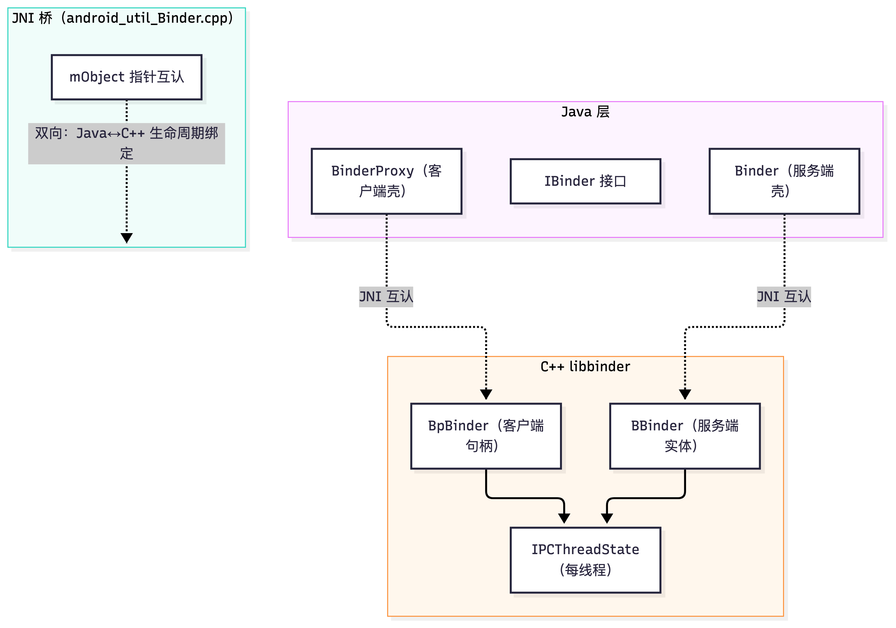
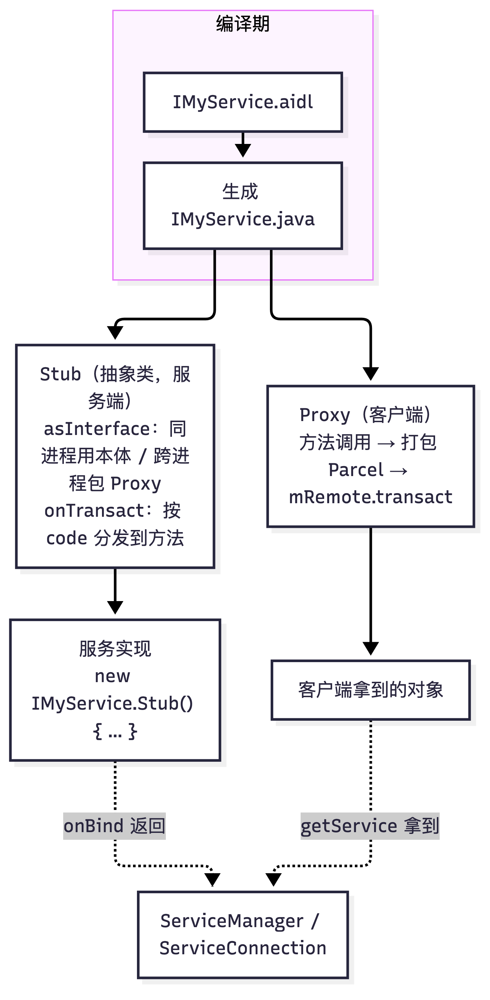
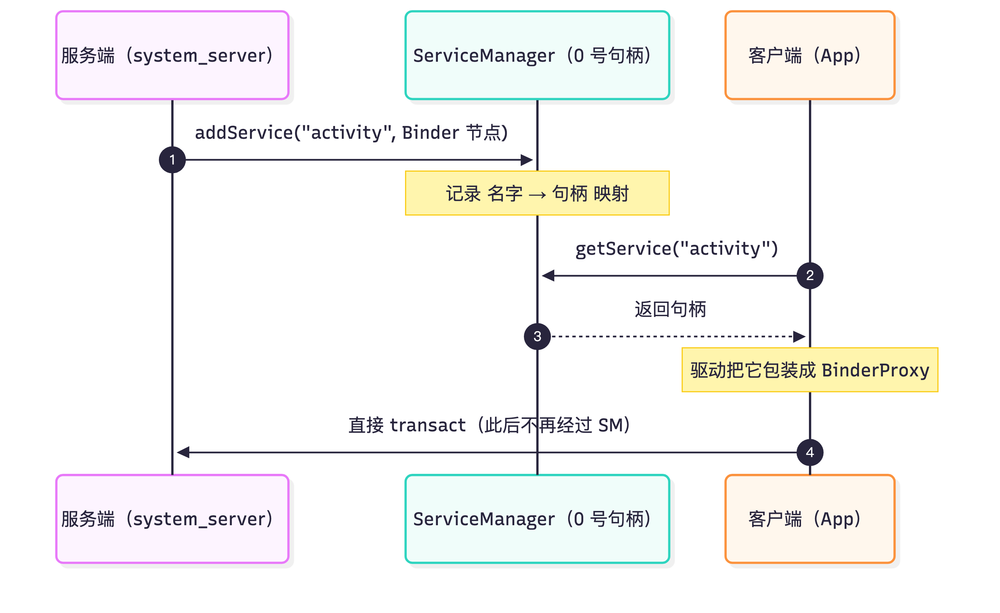
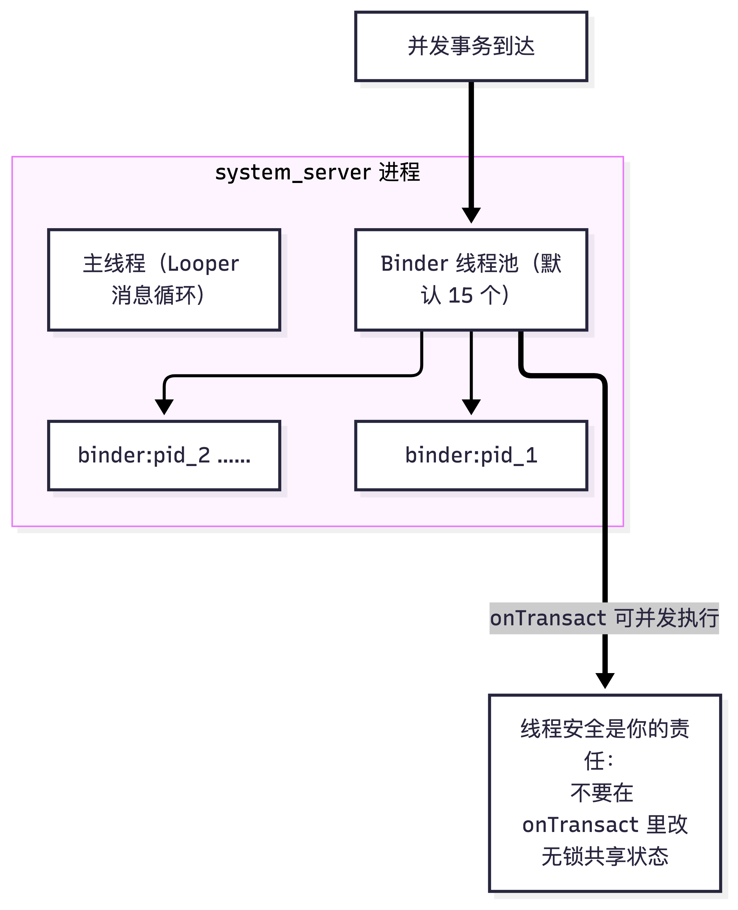

# 03｜Binder（下）：Java 层与 AIDL

> 📌 **《Framework 源码深潜》系列 · 第 03 篇 / 共 20 篇** ｜ 📖 基线：Android 15（API 35）
> 上一篇：02《Binder（上）：一次 IPC 的完整旅程》

## 01 引子：生成代码里的秘密

每个用过 AIDL 的人都写过 `IMyService.Stub.asInterface(binder)`，但很少有人打开过生成的 `IMyService.java`。那几百行"机器代码"里，藏着 Binder Java 层的全部秘密：**双胞胎如何互认、asInterface 为什么二选一、onTransact 怎么分发、线程池怎么坑你**。读懂它，你就读懂了 AMS/WMS/PMS 的每一个接口。本篇收官 Binder，读完带走四样东西：**Java/C++ 双胞胎的映射关系**、**AIDL 生成代码的骨架**、**死亡通知与权限校验**、**线程池的并发陷阱**。

## 02 双胞胎：Java 壳与 C++ 实体



Java 层的两个类只是"壳"：

- **Binder**（服务端壳）：真正干活的是它 JNI 层指向的 `BBinder`；你写的 Stub 继承 Binder，`onTransact` 最终从 BBinder 那里被调上来；
- **BinderProxy**（客户端壳）：持有 `BpBinder` 句柄（内核的节点引用），`transact` 委托给 C++。

两者通过 **JNI 的 mObject 指针互认**，生命周期双向绑定（Java 对象被 GC 时，C++ 实体一起释放）。`IPCThreadState` 是每线程一份的"传令兵"，所有收发都经它——上篇的 ioctl 全由它发起。

Java 层还有个冷知识：`IBinder` 接口的实现类只有两个——`Binder` 和 `BinderProxy`（后者甚至不能直接 new，只能从 Binder 调用里拿）。所以判断"拿到的是本地对象还是远端代理"，就是判断 IBinder 的运行时类型。

## 03 AIDL 生成代码：一个接口的三张脸



一个 `.aidl` 文件编译后生成 `IMyService.java`，内含三个角色：

**Stub（服务端，抽象类）**：继承 Binder、实现接口。你在 Service 里 `new IMyService.Stub() { ... }`，填上真正的业务逻辑；它的 `onTransact(code, data, reply, flags)` 按方法序号分发。

**Proxy（客户端）**：实现同一接口，每个方法的实现都是"把参数打包进 Parcel → `mRemote.transact(code, data, reply)` → 解析 reply"。

**asInterface（粘合剂）**，这是最常考的一行：

```java
public static IMyService asInterface(IBinder obj) {
    if (obj == null) return null;
    IInterface iin = obj.queryLocalInterface(DESCRIPTOR);
    if (iin != null && iin instanceof IMyService)
        return (IMyService) iin;          // 同进程：直接用本体
    return new IMyService.Stub.Proxy(obj); // 跨进程：包一层 Proxy
}
```

**为什么二选一？** 同进程时传来的就是你的 Stub 本体，再走 Proxy 就脱裤子放屁；跨进程时传来的是 BinderProxy，必须包成 Proxy 才能打包参数。`queryLocalInterface` 用 DESCRIPTOR（接口唯一标识）查注册表完成判断。

## 04 ServiceManager：名字服务的使用姿势



系统服务的注册与寻址全走 ServiceManager（`frameworks/base/core/java/android/os/ServiceManager.java`）：服务端在启动时 `addService("activity", ...)`，客户端 `ServiceManager.getService("activity")` 拿句柄——驱动在第一次跨进程引用时把它包装成 `BinderProxy`。**寻址只发生一次，之后的调用直连服务端**。

普通 App 不能随意 addService（SELinux 限制，只有 system_server 等特权进程可注册系统服务）；App 之间共享 Binder 对象走的是另一条路：**bindService**——IApplicationThread、IServiceConnection 这些"回调对象"本身就是客户端进程提供的 Binder 服务端，系统服务反过来调用它们（09 篇展开）。

## 05 三个必须懂的高级机制

**死亡通知 linkToDeath**：服务端进程死了，客户端的 BinderProxy 不会自动失效感知——注册 `DeathRecipient` 后，驱动在对端进程死亡时回调 `binderDied()`，让你及时重建连接。AMS 拿着每个 App 的 IApplicationThread 引用，靠它感知 App 进程死亡（01 篇的"Zygote 察觉子进程死亡"是另一条 SIGCHLD 路径，两条腿缺一不可）。

**权限校验与身份**：服务端 onTransact 里随时可用 `getCallingUid()/getCallingPid()` 验明正身——内核填的，伪造不了。注意一个经典坑：**服务端自己再调别的服务时，身份会变成自己**，需要暂时保留调用方身份就用 `clearCallingIdentity()` / `restoreCallingIdentity()` 包住（AMS 调度 Activity 时大量使用）。

**oneway（异步调用）**：transact 加 `FLAG_ONEWAY` 后客户端不等回包立即返回，服务端把事务排进异步队列。代价：没有返回值、没有失败反馈。系统里所有"通知型"接口几乎都是 oneway——比如 App 收到的生命周期调度、广播派发。

## 06 线程池：最容易踩的坑



进程注册 Binder 服务后，驱动为它维护一个线程池（**默认 15 个**，`ProcessState` 里可通过 `setThreadPoolMaxThreadCount` 调整）。任何事务到达，都由池中某个空闲线程执行 `onTransact`——

**这意味着：onTransact 里的代码跑在 Binder 线程，不是主线程！** 两个推论：

1. 想回 UI 线程操作，必须 Handler 切换（系统服务回调你时同理——ServiceConnection 的 onServiceConnected 在主线程，是因为系统帮你 post 回去了，而底层回调是 Binder 线程）；
2. **并发**：多个事务可能同时在你的 Stub 里跑，无锁共享状态会翻车。AMS 的核心方法全是 `xxxLocked()` 后缀——它用一个全局大锁保护整个服务状态。

## 07 动手实验与源码路标

```bash
# ① 数一数某服务的线程池
adb shell ps -T $(adb shell pidof system_server) | grep binder

# ② 看系统服务都在谁手里（对照 00 篇注册名）
adb shell service check activity
```

源码路标：

```text
frameworks/base/core/java/android/os/Binder.java            双胞胎与本地注册表
frameworks/base/core/jni/android_util_Binder.cpp            JNI 互认核心
frameworks/base/core/java/android/os/ServiceManager.java    名字服务客户端
frameworks/native/libs/binder/ProcessState.cpp              线程池配置（找 15 的来源）
```

## 08 高频面试题 5 连

**Q1：asInterface 为什么要二选一？**

【参考答案】同进程时传入的是 Stub 本体（queryLocalInterface 命中），直接用避免多余的打包；跨进程时传入的是 BinderProxy，必须包成 Proxy 才能参数打包走 transact。

**Q2：oneway 与同步调用的区别？**

【参考答案】oneway 不等回包立即返回，事务进入服务端异步队列，无返回值无失败反馈；同步调用客户端线程挂起在 ioctl 等回包。通知型接口（生命周期/广播派发）都用 oneway。

**Q3：Binder 线程池默认几个线程？onTransact 在哪个线程执行？**

【参考答案】默认 15 个（可调）。onTransact 在池中某个 Binder 线程执行，不是主线程；并发事务会同时进入，服务端需自行保证线程安全。

**Q4：clearCallingIdentity 的作用？**

【参考答案】服务端处理请求期间若自己再发起 Binder 调用，getCallingUid 会变成自己；clear/restore 用于暂时保留并还原调用方身份，AMS 调度场景高频使用。

**Q5：客户端如何感知服务端进程死亡？**

【参考答案】linkToDeath 注册 DeathRecipient，内核在对端进程死亡时回调 binderDied，客户端可及时重建连接。这是 Binder 内核层的死亡通知机制，与 SIGCHLD 进程回收是两套独立机制。

## 09 小结 · 思考题 · 下篇预告

**一句话总结**：

> AIDL 生成代码 = Stub（服务端分发）+ Proxy（客户端打包）+ asInterface（二选一）；Binder Java 层的一切，都是 C++ 实体与内核句柄的影子。

**思考题**：

1. 为什么系统把 ServiceConnection 的回调"post 回主线程"，而不是让开发者直接在 Binder 线程里收？
2. 如果一个 Stub 的 onTransact 里抛异常，调用方会怎样？异常能跨进程传递吗？（提示：试试在 AIDL 里声明异常）

**下篇预告 · 04《Context（上）》**：Binder 讲完了，回到 App 侧：Context 到底是什么？为什么 Activity、Service、Application 各拿一个，数量怎么算？——App 侧地基开篇。

---

🧭 **主线进度**：主线 A 4/9（横切地基：Binder Java 层）｜ 主线 B 0/8
