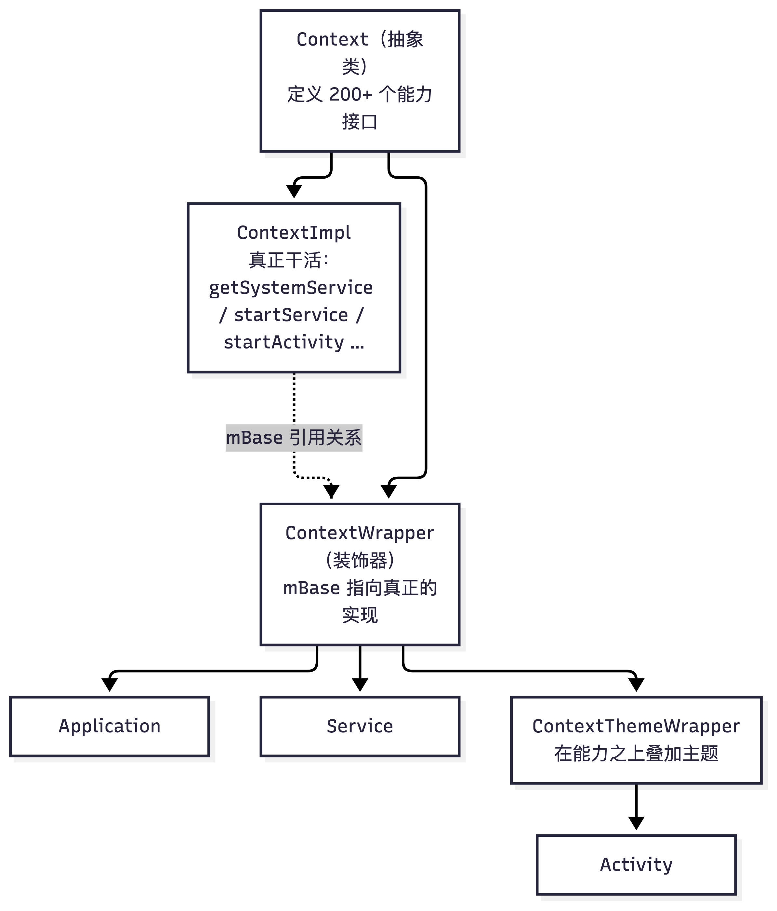
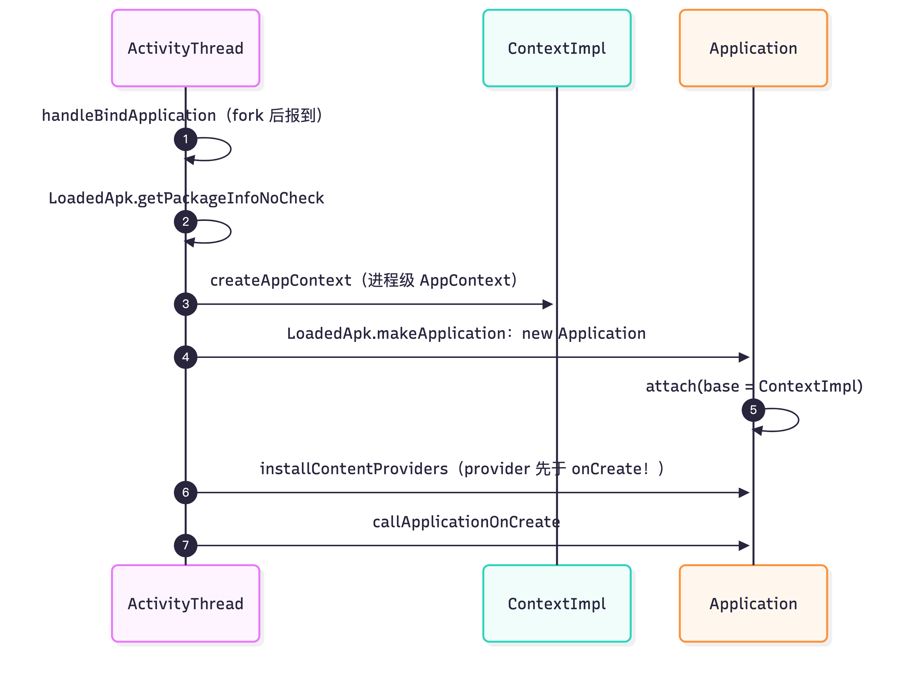
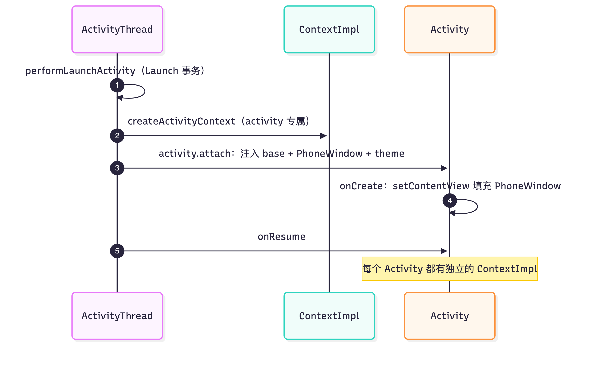

# 04｜Context（上）：继承体系与创建时机

> 📌 **《Framework 源码深潜》系列 · 第 04 篇 / 共 20 篇** ｜ 📖 基线：Android 15（API 35）
> 上一篇：03《Binder（下）》

## 01 引子：最熟悉的陌生人

Context 是 Android 里出场率最高的类，也是被误解最多的类。先来一道经典的面试连环问：

**一个 App 里到底有几个 Context？Activity 和 Application 的 Context 有什么区别？getBaseContext 是什么？为什么说 Application 的 Context 不是万能的？**

回答不了这几问，说明只是"用过"Context，没"认识"它。本篇拆三层继承体系与三类创建时机。读完带走三样东西：**抽象/实现/装饰器三层结构**、**Application 与 Activity Context 的出生证明**、**进程内 Context 数量的清点方法**。

## 02 三层结构：抽象、实现、装饰器



Context 类体系是教科书级的**装饰器模式**实践，一共三层：

**第一层，Context（抽象）**：定义了 200 多个能力接口——启动组件、拿服务、读资源、建视图……它只是"能力清单"，自己一行实现都没有。

**第二层，ContextImpl（实现）**：**真正干活的唯一实现类**。getSystemService、startService、openOrCreateDatabase，全在它内部实现。它同时持有 LoadedApk（包信息）、ActivityThread（进程环境）——这些就是"App 运行环境的快照"。

**第三层，ContextWrapper（装饰器）**：只持有一个 `mBase` 字段指向 ContextImpl，所有方法都转发给 mBase。它的意义在"装饰"——Application、Service 直接继承它，Activity 的父类 ContextThemeWrapper 则**额外叠加主题**（所以 Activity 才有界面主题，Service 没有）。

一句话记住这套设计：**能力定义在抽象层，干活在 ContextImpl，包装在 Wrapper，装饰给具体组件**。

## 03 出生证明一：Application Context



App 进程 fork 出来后（01 篇），`ActivityThread.handleBindApplication` 是它的报到流程，AppContext 就诞生在这里：

1. 为本包创建 **LoadedApk**（包的一切元数据的内存镜像）；
2. `ContextImpl.createAppContext` 创建**进程级唯一的 AppContext**；
3. `LoadedApk.makeApplication` 反射 new 出你的 Application；
4. `attach(base)` 把 AppContext 注入 Application 的 mBase——**这就是你 Application 里那个 this 的真身**；
5. 安装 ContentProvider（注意：**provider 的 onCreate 先于 Application.onCreate**，冷启动优化的重要考点，18 篇复盘）；
6. 最后才回调 `callApplicationOnCreate`。

所以 Application 不是"Context 的一种实现"，而是一个**持有 AppContext 的装饰器**。同一个进程里，Application 实例只有一个，AppContext 也只有一个，`getApplicationContext()` 返回的就是它。

## 04 出生证明二：Activity Context



Activity 的 Context 诞生在 Launch 事务里（08 篇展开事务模型）：`performLaunchActivity` 调 `ContextImpl.createActivityContext`——注意，**每个 Activity 都有自己专属的 ContextImpl**，不是共享 AppContext。

这个专属 ContextImpl 带着 Activity 的身份信息：token（窗口凭据，10 篇）、theme、以及一个专属的 PhoneWindow。随后 `activity.attach` 把它们一并注入。这就是为什么：

- Activity 能 `setTheme`、能弹 Dialog（有 token）；
- Application 没有 PhoneWindow、没有 activity token，弹 Dialog 直接崩。

Service 与 Activity 类似，`handleCreateService` 里创建 service 专属 ContextImpl——只是没有 window、没有主题。

## 05 数量清点：一道送分题的完整答案

回到引子的问题，现在可以精确回答：

```text
Context 总数 = 1（Application） + N（Activity） + M（Service）
             ↑ 进程级唯一          ↑ 各自专属 ContextImpl
```

四大组件之外，`getBaseContext()` 返回的是**组件装饰器里的那个 mBase（ContextImpl）**；`getApplicationContext()` 沿着装饰器链条向上找 Application 的 Context。两者能力几乎一样，但**生命周期归属完全不同**——这正是下一节泄漏问题的根源。

**两者差异速查**（这张表建议背下来）：

```text
能力                 AppContext        ActivityContext
弹 Dialog            ✗ 崩（无 token）   ✓
setTheme             ✗（无主题装饰）     ✓
startActivity        需 NEW_TASK 标记   直接可用（默认在同一 Task）
inflate 带主题的 View ✗（无主题）        ✓
生命周期             进程级             随 Activity 销毁
```

## 06 设计追问

**Q1：为什么 Google 要设计成"装饰器转发"而不是让 Activity 直接继承 ContextImpl？**

解耦与替换。若直接继承，组件的能力实现被焊死；装饰器让 mBase 可以被替换（插桩、热修复、单测 Mock 都靠这个缝），也让"主题"这种附加能力可以按需叠加而非全员承担。

**Q2：为什么每个 Activity 不直接复用 AppContext？**

因为 ContextImpl 不只是"API 集合"，它是**身份**：token、theme、resources 配置（横竖屏/夜间模式差异）都是 per-Activity 的。复用意味着所有 Activity 共享身份，旋转屏幕的资源重建、独立主题、窗口凭据全都没了。

**Q3：getApplicationContext 什么时候会返回 null？**

极端场景：在 Application 创建完成之前（比如 ContentProvider 的 onCreate 里）调用，mApplication 还没注入。这也是"Provider 里别乱用 Application Context"的原因——时机不对。

## 07 动手实验与源码路标

```java
// 在 Activity 里打印，观察对象身份
Log.d("ctx", "this=" + this.getClass().getSimpleName()
        + " base=" + getBaseContext().getClass().getName()
        + " appCtx=" + getApplicationContext().getClass().getName());
// base 是 ContextImpl；appCtx 是你的 Application
```

```bash
# 进程里创建过多少 ContextImpl？数 SystemServiceRegistry 缓存即可侧面观察
adb shell dumpsys activity top | grep -m5 "Activity"
```

源码路标：

```text
frameworks/base/core/java/android/content/Context.java           能力清单
frameworks/base/core/java/android/content/ContextWrapper.java    装饰器
frameworks/base/core/java/android/app/ContextImpl.java           真正实现（本篇主角）
frameworks/base/core/java/android/app/ActivityThread.java        三类创建时机的宿主
```

## 08 高频面试题 5 连

**Q1：一个 App 里有多少个 Context？**

【参考答案】1 个 Application + N 个 Activity + M 个 Service，各持有独立 ContextImpl（App 级一个、组件级各一）。Receiver 与 ContentProvider 不持有独立 Context（provider 持有宿主 AppContext）。

**Q2：Activity 与 Application 的 Context 核心区别？**

【参考答案】身份差异：Activity 的 ContextImpl 带 token、theme、PhoneWindow，可弹窗可设主题；Application 版没有，弹 Dialog 崩、startActivity 需 NEW_TASK。

**Q3：getBaseContext 是什么？**

【参考答案】装饰器 mBase 指向的 ContextImpl 本体。Component 是壳，ContextImpl 是实现——绕过装饰链直接拿实现。

**Q4：为什么 Provider 的 onCreate 先于 Application.onCreate？**

【参考答案】handleBindApplication 的顺序是：先 installContentProviders（外部进程可能在 Application 就绪前就要访问 provider），再 callApplicationOnCreate。冷启动优化的推论：provider 初始化也算启动耗时。

**Q5：ContextThemeWrapper 存在的意义？**

【参考答案】在 Context 能力之上叠加主题维度。Activity 继承它所以有界面主题；Service/Application 不需要，直接继承 ContextWrapper。

## 09 小结 · 思考题 · 下篇预告

**一句话总结**：

> Context 三层：抽象定能力、Impl 来实现、Wrapper 做装饰；每个组件的 ContextImpl 是它的"身份证"，Application 的那份全局唯一，Activity 的份份专属。

**思考题**：

1. ContentProvider 的 onCreate 里能拿到 Application 实例并调用其方法吗？会有什么风险？
2. 为什么推荐"能用 AppContext 就用 AppContext"？哪些能力例外？

**下篇预告 · 05《Context（下）》**：getSystemService 的路由表是怎么搭的？哪些 Manager 是进程级单例、哪些是 Context 级新建？以及最有名的一个坑——用 Application Context 拿 WindowManager 会怎样？

---

🧭 **主线进度**：主线 A 5/9（⑤ Application 与 Context 就绪）｜ 主线 B 0/8
