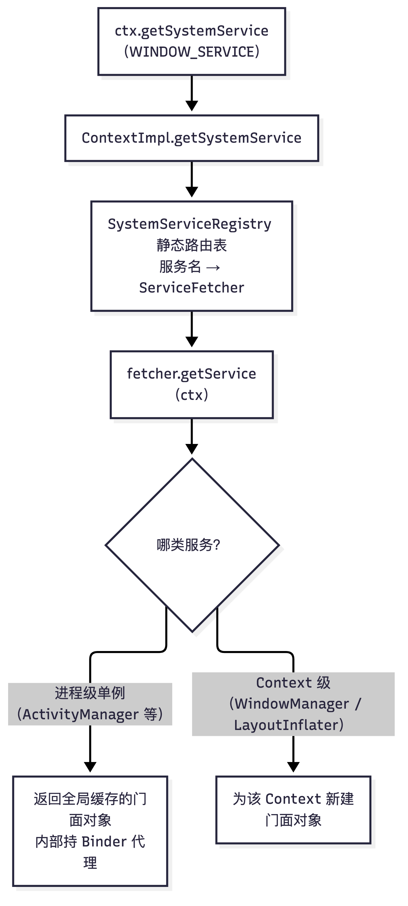
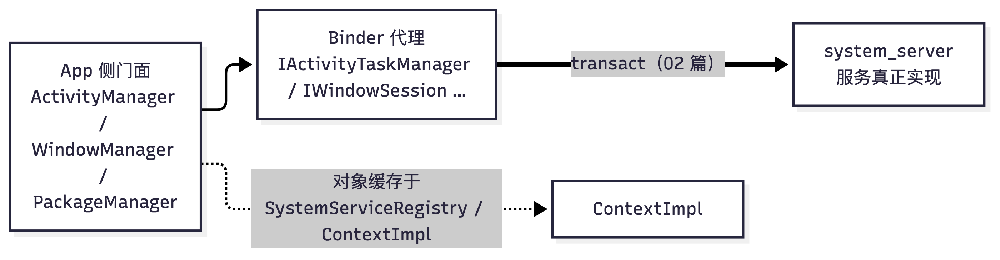
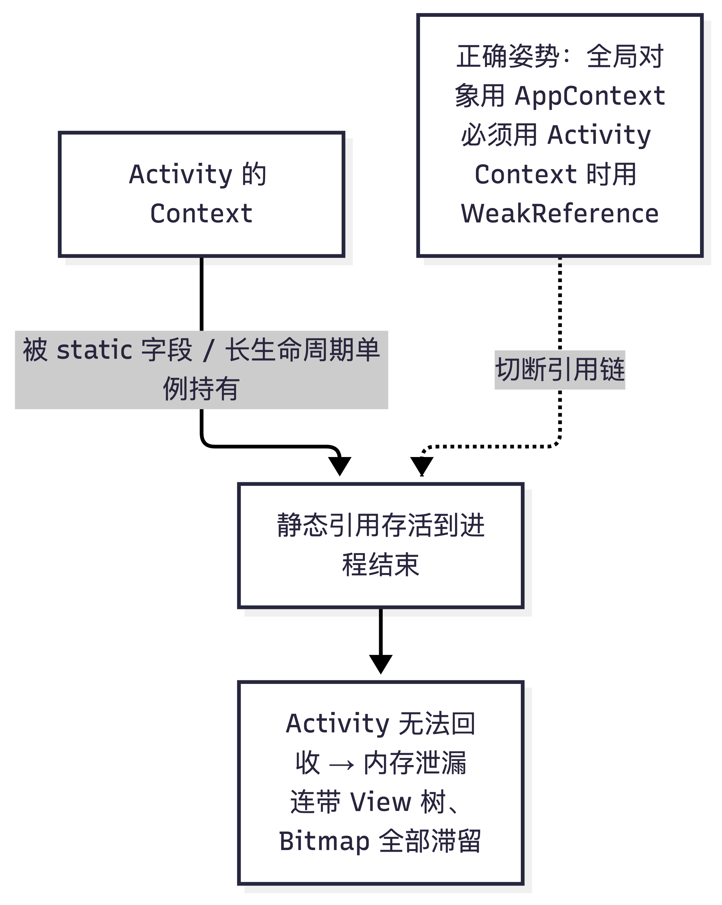

# 05｜Context（下）：服务路由与陷阱

> 📌 **《Framework 源码深潜》系列 · 第 05 篇 / 共 20 篇** ｜ 📖 基线：Android 15（API 35）
> 上一篇：04《Context（上）》

## 01 引子：一行代码的深浅

```java
WindowManager wm = (WindowManager) applicationContext.getSystemService(WINDOW_SERVICE);
Dialog d = new Dialog(this); d.show(); // 用 appContext 拿的 wm 弹窗？——崩
```

`getSystemService` 每个人每天写十次，但路由表怎么工作、对象缓存在哪、哪些坑由此而生，能讲清的不多。本篇是 Context 篇的下篇，读完带走三样东西：**SystemServiceRegistry 的路由机制**、**两类缓存的分野**、**Context 泄漏的经典链路与正确姿势**。

## 02 路由表：SystemServiceRegistry



`ContextImpl.getSystemService(name)` 的实现只有两步：查表、调 fetcher。表是 `SystemServiceRegistry` 的静态注册表（`frameworks/base/core/java/android/app/SystemServiceRegistry.java`）——类加载时，几百行 `registerService(WINDOW_SERVICE, WindowManager.class, ...)` 把"服务名 → ServiceFetcher"塞进 Map。

每个 ServiceFetcher 是一段小工厂逻辑，分两类：

**进程级单例**：第一次调用时创建（往往就是拿一次 Binder 代理），之后全局复用——ActivityManager、PackageManager、NotificationManager 等"通知型/查询型"Manager 都属于这类，因为它们的门面对象里只有 Binder 引用，没有 Context 状态。

**Context 级新建**：每次（或每个 Context）新建——**WindowManager、LayoutInflater、SearchManager** 等带 UI 语义的 Manager。为什么？因为它们必须感知 Context 的身份：WindowManager 要知道自己是哪个窗口的、LayoutInflater 要知道渲染哪套主题。

另外两个语法细节顺带说清：`getSystemService(Class)` 是 API 23 加的泛型封装，内部还是查同一张表，避免强转；注册名就是 00 篇表格里 `service list` 的那些字符串。

## 03 门面到实现：一张关系图



把 00/02/04 三篇串起来看：**门面（Manager）→ Binder 代理 → system_server 实现**。门面是"给人用的 API"，代理是"给人用的通道"。App 侧写代码时碰到的所有 Manager，无一例外长成这个形状。

理解这一点，很多"玄学"就通了：比如为什么 `ActivityManager.getService()` 拿到的对象可以随意转传——它只是个无状态的代理包装；为什么同一进程内多次 getSystemService 拿到的 ActivityManager 是同一个——单例缓存。

## 04 经典陷阱一：WindowManager 与 Application Context

把引子的坑讲透。用 `applicationContext.getSystemService(WINDOW_SERVICE)` 拿到的 WindowManager **本身不崩**，崩的是后续操作——比如 `addView` 弹 Dialog 类窗口：

- Application 的 ContextImpl **没有窗口 token**（04 篇：token 是 Activity 专属身份）；
- `addView` 到 WMS 时 token 校验不过，直接抛 `BadTokenException`（13 篇把所有场景列全）；
- 而同一段代码换成 Activity 的 Context 就能过——Activity 的 token 在 attach 时已随 ContextImpl 就位。

记忆口诀：**"全局的事用全局 Context，界面的事用界面 Context"**。判断标准就一条：这个 Manager/操作需不需要"窗口身份"或"主题"。

## 05 经典陷阱二：Context 泄漏



Context 泄漏的根源只有一个：**长生命周期对象持有短生命周期 Context**。三个重灾区：

**静态字段**：`static Context sCtx = activity;`——静态引用活到进程死，Activity 连同 View 树、Bitmap 全部滞留；

**单例模式**：构造函数传 Activity Context 的"工具类单例"——同上，且更隐蔽；

**系统组件回持**：把 Activity 的 WindowManager/LayoutInflater 存进全局（05 节说了它们是 Context 级对象），或者 Handler 未 remove 的延迟消息持有 Activity——LeakCanary 抓得最多的两类。

**正确姿势三句**：全局单例用 AppContext；必须用 Activity Context 的场景（弹窗/inflate/主题）用完即弃或 WeakReference；Handler 尽量静态化 + 显式 removeCallbacks。泄漏的本质是引用链，看懂 04 篇的装饰器结构（Component → mBase → ContextImpl → 持有服务缓存），LeakCanary 的引用路径就都能读懂了。

## 06 设计追问

**Q1：为什么路由表做成静态的，而不是每个 Context 一份？**

服务清单是全进程一致的（跟 Context 身份无关），静态一份省内存也避免重复初始化；Context 差异只在 fetcher 执行时以参数传入，责任边界清晰。

**Q2：为什么不允许 App 自定义服务注册进这张表？**

这张表是"App 与 system_server 的协议清单"，服务名全局唯一且与 Binder 接口一一对应。开放注册等于开放协议，安全模型（内核身份校验）会被绕出漏洞。App 内部组件共享走 bindService，那条路有权限管控。

**Q3：跨进程的 Manager 单例，为什么线程安全"基本"没问题？**

门面与代理无状态，每次 transact 独立打包。但"基本"很重要：你自己的 Stub（03 篇）是有状态的，线程安全责任在服务端实现者——两边的责任模型不要混淆。

## 07 动手实验与源码路标

```java
// 验证两类缓存
WindowManager w1 = getSystemService(WindowManager.class);
WindowManager w2 = getSystemService(WindowManager.class);
Log.d("ctx", "wm same? " + (w1 == w2));          // 同一 Context 下 true（缓存）

ActivityManager a1 = getApplicationContext()
        .getSystemService(ActivityManager.class);
Log.d("ctx", "am=" + a1.getClass().getName());   // 无状态门面
```

源码路标：

```text
frameworks/base/core/java/android/app/SystemServiceRegistry.java   本篇主角（搜 registerService）
frameworks/base/core/java/android/app/ContextImpl.java            getSystemService 入口
frameworks/base/core/java/android/view/WindowManagerGlobal.java   addView 的下一站（12 篇）
```

## 08 高频面试题 5 连

**Q1：getSystemService 的完整流程？**

【参考答案】ContextImpl 查 SystemServiceRegistry 静态路由表拿到 ServiceFetcher，fetcher.getService(ctx) 返回门面对象；进程级单例有全局缓存，Context 级对象按 Context 新建。

**Q2：哪些 Manager 是 Context 级的？为什么？**

【参考答案】WindowManager、LayoutInflater 等 UI 语义 Manager——需要 Context 的窗口身份与主题；ActivityManager 等纯代理型 Manager 是进程级单例。

**Q3：为什么 Application Context 弹 Dialog 会崩？**

【参考答案】它的 ContextImpl 没有 activity token，addView 时 WMS 的 token 校验失败抛 BadTokenException。窗口类操作必须用有 token 的 Activity Context。

**Q4：Context 泄漏的三大重灾区？**

【参考答案】静态字段持 Context、单例构造传 Activity Context、系统级对象回持 Context 级 Manager 或未清理的 Handler 消息。解法：全局用 AppContext、短生命周期引用用 WeakReference。

**Q5：getSystemService(Class) 和 String 版的区别？**

【参考答案】Class 版是泛型封装（免强转、编译期类型检查），内部仍按服务名查同一张静态路由表，行为完全一致。

## 09 小结 · 思考题 · 下篇预告

**一句话总结**：

> getSystemService = 静态路由表 + 两类缓存；门面无状态、代理管通道、Context 管身份；泄漏的钥匙永远是"谁活得更长、谁被谁持有"。

**思考题**：

1. `LayoutInflater.from(context)` 与 `context.getSystemService(LAYOUT_INFLATER_SERVICE)` 是什么关系？
2. 如果让你给 App 设计一个"Context 池"复用 ContextImpl，最大的阻碍会是什么？（提示：04 篇 Q2）

**下篇预告 · 06《AMS：进程优先级与查杀》**：进入 AMS 三部曲。先回答一个日常困惑：8G 内存手机为什么能开几十个 App 不卡？——oom_adj 分级与 lmkd 查杀的全套机制。

---

🧭 **主线进度**：主线 A 5/9（⑤ 服务路由就绪）｜ 主线 B 0/8
