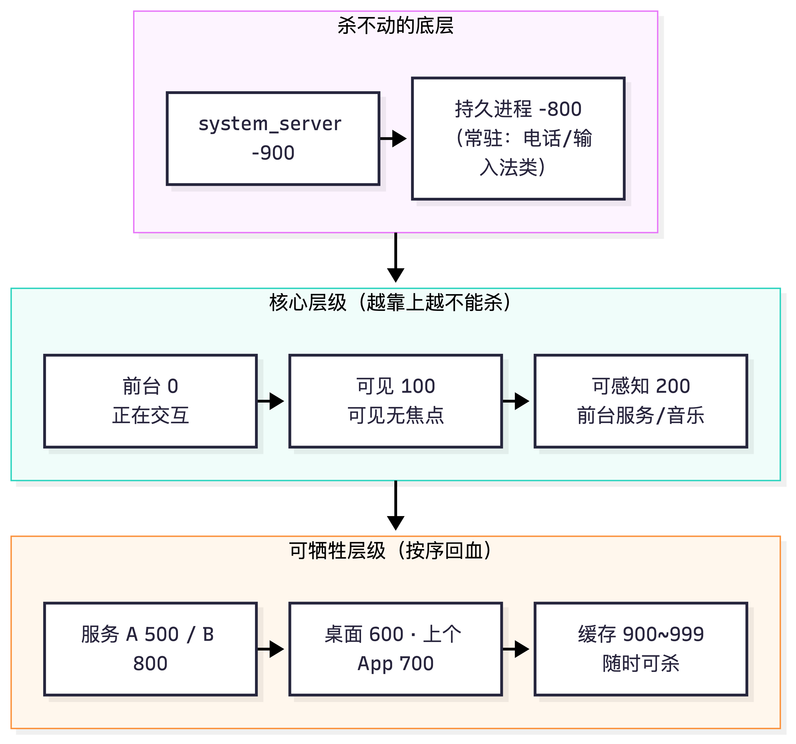
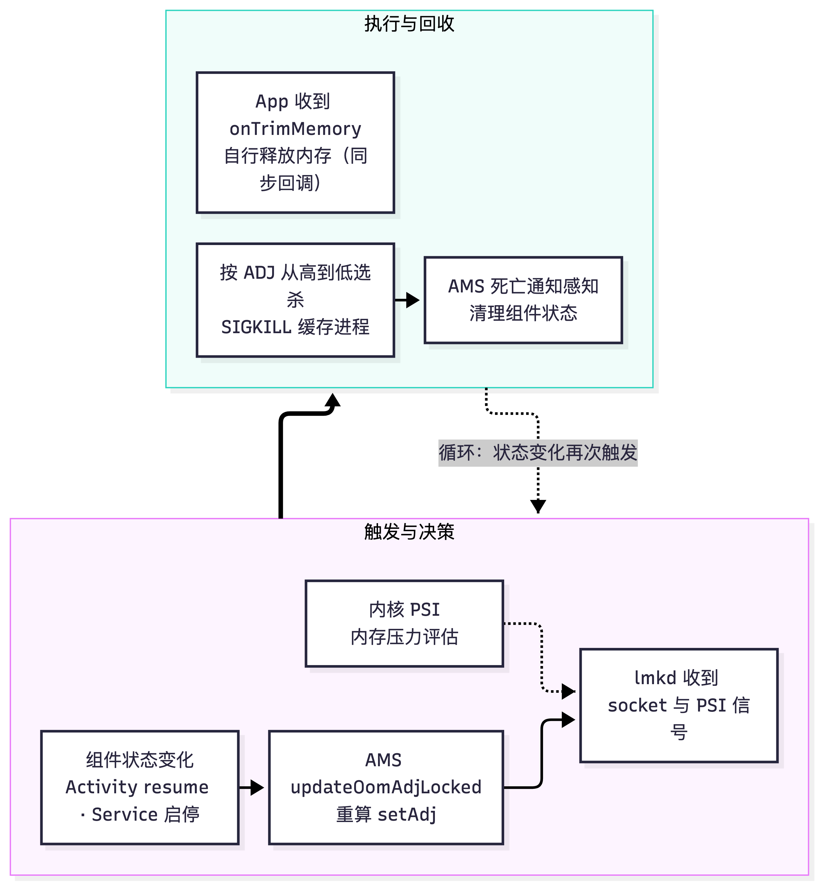
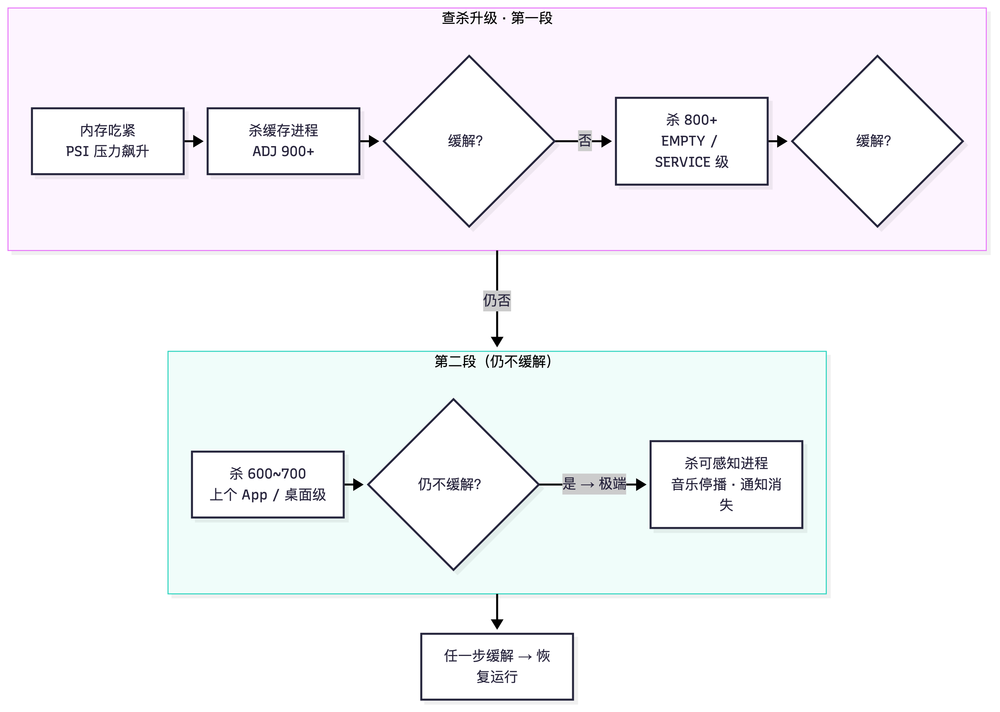

# 06｜AMS：进程优先级与查杀

> 📌 **《Framework 源码深潜》系列 · 第 06 篇 / 共 20 篇** ｜ 📖 基线：Android 15（API 35）
> 上一篇：05《Context（下）》

## 01 引子：矛盾的日常

一个日常悖论：Android 手机 8G 内存，你可能同时开着微信、导航、音乐、十几个"后台"；换 PC 早爆内存了。Android 敢这么玩，靠的是一整套**进程分级与按序查杀**机制——AMS 给每个进程打分，lmkd 负责在内存紧张时按分从后往前杀。这套机制决定了你的推送能不能活着、音乐会不会被切，也是"进程保活"大战的战场。本篇读完带走三样东西：**oom_adj 的分级表**、**adj 更新与 lmkd 查杀的完整链路**、**为什么保活黑科技全线失效**。

## 02 给进程排队：oom_adj 分级

AMS 为每个进程维护一个 ProcessRecord，其核心字段就是 **oom_adj**——一个负到正的数值，越小越重要。层级全景：



背这张表的诀窍不是背数字，而是记住**排序逻辑**：用户当下正在看的 > 刚看过的 > 听得见的 > 看不见的 > 什么都没有的。几个高频成员：

**前台 0**：正在交互的 Activity 所在进程；**可见 100**：分屏/悬浮窗下可见但无焦点的进程；**可感知 200**：前台 Service、正在播放的音乐——用户"知道它活着"；**桌面 600**：Home App 被特殊照顾，切回桌面要快；**上个 App 700**：按返回键上一个界面，用户大概率会回来；**服务 500/800**：后台 Service 分 A/B 两级，B 级更易死；**缓存 900~999**：组件全空的进程，Android 刻意保留它们（下次启动免 fork），内存紧张时第一批祭天。

**进程优先级不是固定的，是组件状态的函数**：你的 App 里 Activity 到前台，整个进程 adj 立刻降到 0；退到后台，又跟着爬回去。

## 03 打分与执法：AMS 与 lmkd 的分工



这套体系是两个角色的接力：

**AMS（打分员）**：任何组件状态变化（Activity resume、Service 启停、Receiver 注册）都会触发 `updateOomAdjLocked`——重算相关进程的 adj，再经 socket 把最新分表同步给 lmkd。同时它会同步回调 App 的 `onTrimMemory`，给应用"主动配合"的机会：到 TRIM_MEMORY_COMPLETE 级别还不清缓存，就别怪杀手上门。

**lmkd（执法者，用户态守护进程）**：⚠️ Android 9 起，内核的 LowMemoryKiller 被用户态 lmkd 取代。lmkd 订阅内核 **PSI（Pressure Stall Information）**——内核统计"因等内存而停摆的时间占比"，这是比"剩余内存大小"科学得多的压力指标。压力到阈值，lmkd 按 AMS 同步的分表，**从 ADJ 最高的进程开始 SIGKILL**，杀到压力缓解为止。



注意查杀的**升级次序**：缓存 → 空/服务级 → 上个 App/桌面级 → 可感知级。每杀一批就观察 PSI 是否回落——极端情况下音乐停播、通知消失，就是这条链杀穿的表现。被杀进程由 AMS 经死亡通知（03 篇的 linkToDeath 机制）感知，清理 ProcessRecord 与组件状态，进程原子的"缓存保留"随之失效。

## 04 保活为什么全线失效

理解了机制，"进程保活黑科技"的徒劳就显而易见：

**1账号双开/双进程互拉**：拉起的进程 adj 仍是缓存级，lmkd 一次杀一对；**前台空 Service**：S 之后空壳前台服务会被检测降级，且可感知级在极端场景照样被杀；**JobScheduler/WorkManager 定时拉活**：调度本身由系统执行，系统不给机会就没有拉活的时机；**反射改 adj**：adj 的权威值在 system_server 内存里，App 进程根本没有写权限——SELinux 拦死一切旁路。

**唯一的正解**：让系统"愿意"留着你的进程——用合规的前台服务（配通知）、接入高优先级推送通道（厂商通道/FCM）、Provider 被系统场景引用。灰色手段都在历史版本里被逐个封死，方向只有与系统合作。

## 05 设计追问

**Q1：为什么查杀决策放在用户态 lmkd，而不是留在内核？**

旧内核 LMK 只看"剩余内存水位"，误杀频繁；PSI 提供了"停摆时间"这种高质量压力信号，且策略需要频繁迭代（不同机型内存差异大）——用户态可 OTA 更新、可按设备调参，内核态做不到。

**Q2：为什么 Android 刻意保留缓存进程，而不是用完即杀？**

启动太贵（01 篇的 fork 与预加载）。保留缓存进程，用户切回一个"已被杀过一次"的 App 要重走冷启动 1 秒+；保留它只占一点被压缩的内存。这是典型的空间换体验——lmkd 杀的就是这份"囤积"。

**Q3：adj 为什么用"负数到 999"这种反直觉刻度？**

负数留给"系统级"成员（system_server -900），数值上比一切 App 小，天然保证查杀顺序永远轮不到系统本体。刻度的两端就是优先级的两端。

## 06 动手实验与源码路标

```bash
# ① 看进程 adj（PROC 名单 + 当前值）
adb shell dumpsys activity processes | grep -iE "oomadj|adj=" | head -10

# ② 直接读内核视角的值（另开一个进程对比）
adb shell cat /proc/$(adb shell pidof com.android.systemui)/oom_adj
```

源码路标：

```text
frameworks/base/services/core/java/com/android/server/am/ProcessList.java      分级常量与 lmkd 通信
frameworks/base/services/core/java/com/android/server/am/OomAdjuster.java      adj 计算核心
system/memory/lmkd/lmkd.cpp                                                    执法者本体
```

## 07 高频面试题 5 连

**Q1：说出主要的 oom_adj 层级？**

【参考答案】前台 0、可见 100、可感知 200、服务 A 500/B 800、桌面 600、上个 App 700、缓存 900~999；系统级 system_server -900、持久进程 -800。

**Q2：lmkd 的工作原理？与旧内核 LMK 的区别？**

【参考答案】订阅内核 PSI 压力信号（停摆时间占比），结合 AMS 同步的 adj 分表，按序 SIGKILL。旧内核 LMK 只看剩余水位，易误杀；lmkd 在用户态，策略可迭代可调参。

**Q3：onTrimMemory 与进程查杀的关系？**

【参考答案】它是查杀前的"配合窗口"：AMS 在更新 adj 时同步通知 App 释放内存。不配合的 App 只会被动等 SIGKILL，且已分配内存全部丢失。

**Q4：为什么进程保活手段在新版本上全线失效？**

【参考答案】adj 权威值在 system_server；PSI 查杀无视双进程互拉；空壳前台服务被降级检测；SELinux 封死一切旁路修改。合规路径只剩前台服务与高优推送通道。

**Q5：为什么桌面 Home 进程 adj 只有 600，仍很难被杀？**

【参考答案】600 虽在"可牺牲段"，但用户按 Home 频率高，AMS 会持续把它保持在最近使用前列；且杀桌面的代价（重拉 Launcher）远大于收益，lmkd 通常到它之前压力已缓解。

## 08 小结 · 思考题 · 下篇预告

**一句话总结**：

> AMS 是打分员（组件状态 → oom_adj），lmkd 是执法者（PSI 压力 → 按分从后往前杀）；保活斗争的胜负，早在系统设计里就注定了。

**思考题**：

1. 音乐类 App 如何在不违法的前提下最大化"不被杀"？请给出完整策略链。
2. 如果 PSI 在某个老机型上不可用，lmkd 的退路是什么？提示：查 lmkd 源码里的模式开关。

**下篇预告 · 07《Activity 启动之旅》**：AMS 三部曲第二篇，全系列最长的调用链——startActivity 从你的代码到 onCreate，中间的 Task 决策、权限校验、进程拉起逐层拆开。

---

🧭 **主线进度**：主线 A 4/9（补 ④ 进程维度）｜ 主线 B 0/8
