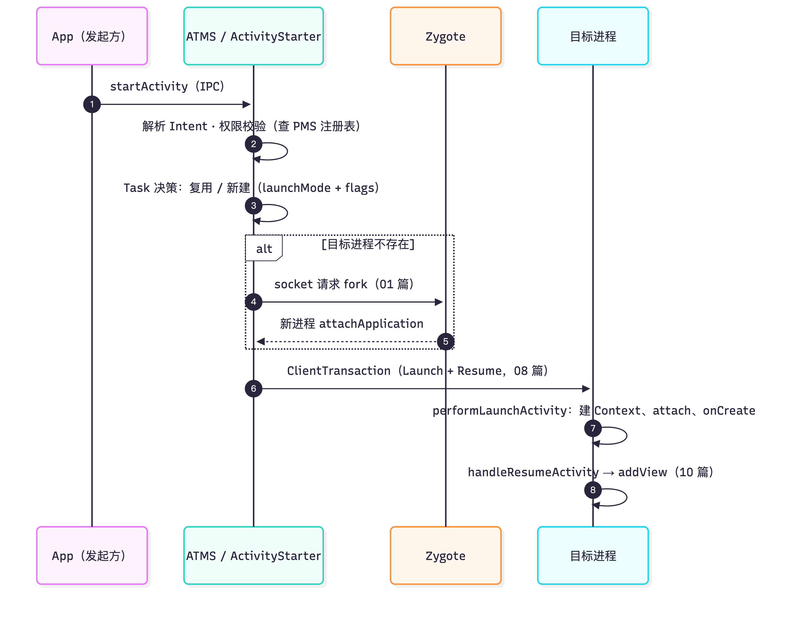
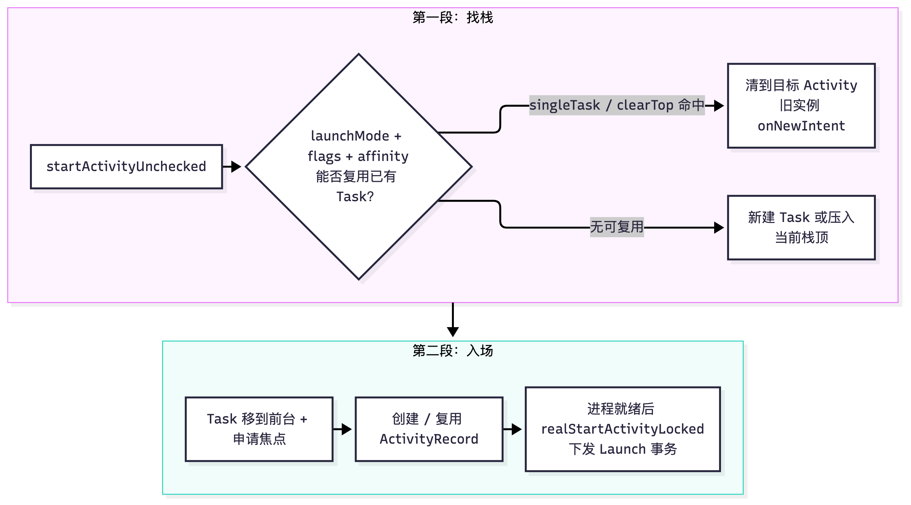
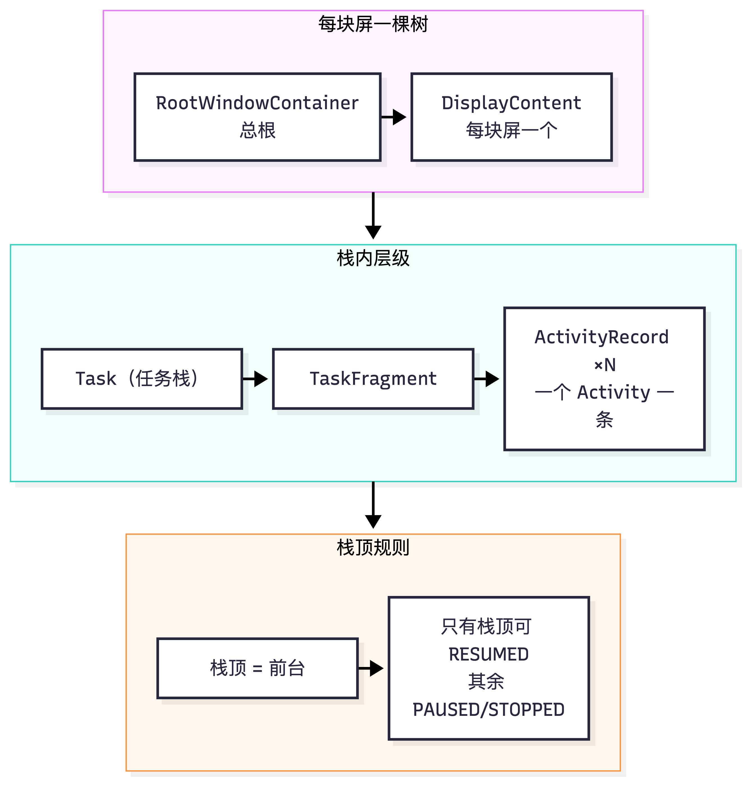

# 07｜AMS：Activity 启动之旅

> 📌 **《Framework 源码深潜》系列 · 第 07 篇 / 共 20 篇** ｜ 📖 基线：Android 15（API 35）
> 上一篇：06《AMS：进程优先级与查杀》

## 01 引子：主线 A 的正片

00 篇主线 A 的第 ③⑥ 环，就是本篇——`startActivity` 到 `onCreate` 之间发生的一切。这条链横跨 4 个角色（App、ATMS、Zygote、目标进程）、3 次跨进程通信，是 Framework 源码的珠穆朗玛。读完带走三样东西：**全链路时序图**、**Task 决策的完整规则**、**ActivityRecord/Task/TaskFragment 的数据结构**。

## 02 全链路：四个角色一台戏



**第 1 步，App 侧**：`Activity.startActivity` → `Instrumentation.execStartActivity` → `ActivityTaskManager.getService().startActivity`——从这里开始就是 IPC（02 篇的链路），对面是 system_server 里的 **ATMS**。⚠️ R 版前这条链的对面是 AMS，如今组件调度全部在 ATMS。

**第 2 步，ATMS 解析**：`ActivityStarter` 登场——它是启动流程的"总指挥"。先解析 Intent：目标组件是谁？显式 Intent 直接查，隐式 Intent 走 PMS 的 IntentResolver 注册表（17 篇）做匹配；再校验调用方权限（exported、permission、跨 uid 校验）。

**第 3 步，Task 决策**：启动的 Activity 要"落"在哪个栈？这是本篇最烧脑的部分，02 节单独展开。

**第 4 步，进程分支**：目标进程不存在？走 01 篇的 socket → Zygote fork → `attachApplication` 回 ATMS 报到。注意：**fork 是异步的**——ATMS 先把 ActivityRecord 记在 Task 里等进程回话，attach 后再续上。

**第 5 步，事务下发**：`realStartActivityLocked` 把 `ClientTransaction`（LaunchActivityItem + ResumeActivityItem）经 IApplicationThread 发往目标进程——App 端 `performLaunchActivity`：创建 Context（04 篇）、attach、走 `onCreate`。onResume 之后 `handleResumeActivity` 里 addView——窗口的戏份交接给 10 篇。

## 03 Task 决策：launchMode 与 flags 的裁判



launchMode 面试必背，但背口诀不如记**判决书**——`ActivityStarter` 依据 launchMode + flags + taskAffinity 三方证据裁决：

**standard**：无脑压栈顶，每次新建；**singleTop**：只在"栈顶是它"时复用（走 onNewIntent），否则照旧新建——典型场景：通知栏点开详情页防重复压栈；**singleTask**：全系统找"affinity 匹配的 Task"，找到则把 Task 上它之上的 Activity 全部清掉、旧实例 onNewIntent，Task 整体搬到前台——主页类 Activity 的标配；**singleInstance**：独占一个 Task，Task 里永远只有它——来电页、扫码页这种"绝对单例"。

flags 是"庭外陈情"：`FLAG_ACTIVITY_NEW_TASK`（无 Task 归属时强制走 singleTask 语义——Application Context startActivity 必须带它的原因就在这，04 篇埋过）；`FLAG_ACTIVITY_CLEAR_TOP`（清到目标再 onNewIntent）；`FLAG_ACTIVITY_NO_HISTORY`（离开即销毁）。

一个反直觉的点：**singleTask 复用时的"清栈"动作发生在 system_server**，App 只感知到 onNewIntent——所以那些"为什么 onNewIntent 之后生命周期顺序怪怪的"问题，答案都在 ActivityStarter 的裁决代码里。

## 04 数据结构：栈不是 Stack



"回退栈"是 API 层的说法，WMS/ATMS 侧的真实结构是一棵**窗口容器树**（10 篇 WMS 会重逢这棵树）：

- **RootWindowContainer**：总根，管理所有屏幕；
- **DisplayContent**：每块物理屏/虚拟屏一棵子树（折叠屏、双屏的悲剧都从这里开始）；
- **Task**：任务栈，动态任务（TaskFragment 是它的分区，桌面模式/分屏用）；
- **ActivityRecord**：一个 Activity 实例一条记录——它同时是窗口容器树的一员（这就是 00 篇说"ActivityRecord 本身是 WindowToken"的原因）。

栈顶规则一句话：**同一时刻，一棵树上只有"最顶层的可聚焦叶子"处于 RESUMED**，其余全部 PAUSED/STOPPED。生命周期事务（08 篇）就是围绕这个规则的纠偏机制。

```bash
# 亲眼看看这棵树
adb shell dumpsys activity activities | grep -A8 "Task"
```

## 05 设计追问

**Q1：为什么启动流程集中在 system_server，而不是 App 自己开？**

窗口、任务、焦点都是全局资源（00 篇安全模型）：谁在前台、谁的 Task 在哪块屏，必须由唯一权威裁决。集中还有一致性的好处——启动流程中每一步失败（权限、进程死亡、窗口异常）都能在服务端回滚状态。

**Q2：为什么 fork 目标进程是异步等回话，而不是同步等？**

fork + bindApplication 可能几百毫秒，同步等待会卡死 ATMS 的调用线程——期间其他 App 的启动请求全堵死。异步 + attach 回报让系统服务保持响应性，代价是状态机变复杂（ActivityRecord 要记录"等进程"这个中间态）。

**Q3：ActivityStarter 为什么是个类而不是一个方法？**

因为启动场景太多：正常启动、快捷方式、PendingIntent、画中画、手势导航……每个场景的参数组合不同。`ActivityStarter` 把"一次启动请求"建模成可配置对象（setRequestXXX 链式），执行时统一裁决——这是典型的"把流程参数化"重构，是读源码学架构的好样本。

## 06 动手实验与源码路标

```bash
# ① 观察一次真实启动的日志（看裁决过程）
adb shell am start -W com.example/.MainActivity   # -W 输出 TotalTime
# ② 强制走 singleTask 复用，对比栈变化
adb shell dumpsys activity activities
```

源码路标：

```text
frameworks/base/services/core/java/com/android/server/wm/ActivityStarter.java       总指挥
.../wm/ActivityTaskManagerService.java                                              ATMS 入口
.../wm/Task.java · TaskFragment.java · ActivityRecord.java                          数据结构
frameworks/base/core/java/android/app/ActivityThread.java                           App 侧执行（08 篇）
```

## 07 高频面试题 5 连

**Q1：startActivity 的完整链路？**

【参考答案】Instrumentation → ATMS（IPC）→ ActivityStarter 解析 Intent/权限 → Task 决策 → 进程不存在则 socket 请求 Zygote fork → realStartActivityLocked 下发 ClientTransaction → App 端 performLaunchActivity 建 Context/attach/onCreate → Resume。

**Q2：singleTask 的完整语义？**

【参考答案】按 affinity 找匹配 Task；有则清掉目标之上的实例、旧实例 onNewIntent、Task 搬前台；没有则新建 Task 并作为根。清除与复用全发生在 system_server。

**Q3：Application Context 的 startActivity 为什么要加 NEW_TASK？**

【参考答案】它没有 activity token、不属于任何 Task，无法"压入当前栈"；NEW_TASK 强制走"找/建 Task"的 singleTask 语义，才有一个合法的落点。

**Q4：singleTop 与 singleTask 的区别？**

【参考答案】singleTop 只看栈顶（范围最小），命中才复用；singleTask 看全系统 Task（affinity 匹配），复用时清栈搬前台。前者防重复压栈，后者做全局单实例。

**Q5：ActivityRecord 是什么？为什么说它也是窗口？**

【参考答案】system_server 里一条 Activity 记录，继承 WindowToken 挂在容器树上——Activity 的窗口凭据由它签发（10 篇）。数据与窗口合一，是 ATMS 与 WMS 深度耦合的体现。

## 08 小结 · 思考题 · 下篇预告

**一句话总结**：

> startActivity = App 提交申请 + ActivityStarter 裁决落点 + 必要时 Zygote 造人 + ClientTransaction 下发执行；一切裁决都在 system_server，App 只是执行者。

**思考题**：

1. 为什么 `FLAG_ACTIVITY_CLEAR_TOP` 不加 `SINGLE_TOP` 时，旧实例会被销毁重建而不是 onNewIntent？查 flags 组合的裁决表。
2. 折叠屏展开时，Activity 可能被"移动"到另一棵 DisplayContent 子树——猜猜这个动作在源码里叫什么？

**下篇预告 · 08《生命周期事务化》**：Launch+Resume 为什么被打包成"事务"？为什么生命周期可能跳跃执行？——Android P 那次大重构的设计动机与实现。

---

🧭 **主线进度**：主线 A 6/9（③⑥ 已解锁）｜ 主线 B 0/8
