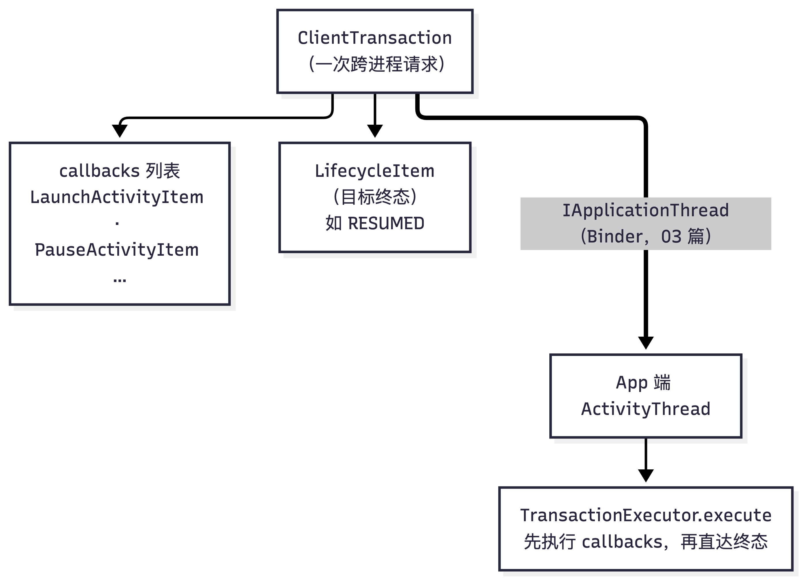
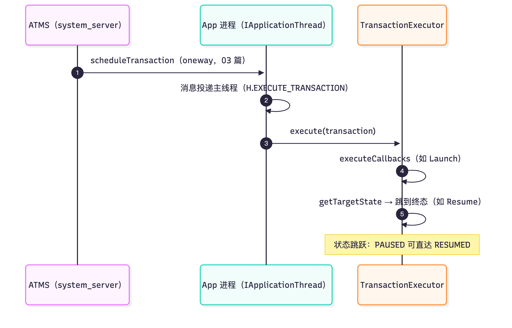
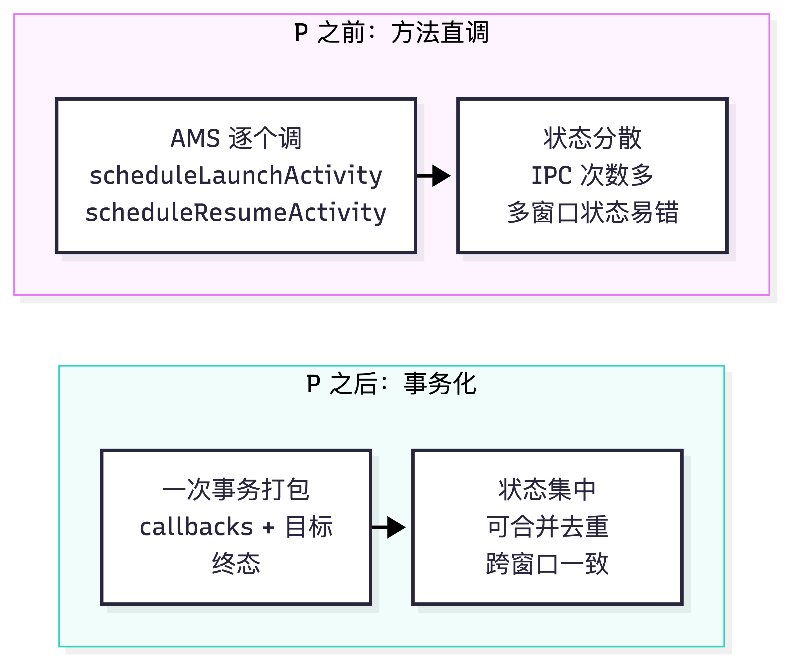

# 08｜AMS：生命周期事务化

> 📌 **《Framework 源码深潜》系列 · 第 08 篇 / 共 20 篇** ｜ 📖 基线：Android 15（API 35）
> 上一篇：07《Activity 启动之旅》

## 01 引子：一次被埋进历史的重构

网上大量资料讲生命周期还是老一套："AMS 调 scheduleLaunchActivity → handleLaunchActivity"。⚠️ 这套说法停在 Android 8。P 版（2018）AOSP 做了一次大手术：生命周期调度全面重构为 **ClientTransaction 事务模型**——旧方法全部废弃。重构不是换皮，而是为多窗口时代铺路。本篇读完带走三样东西：**事务的完整结构**、**状态跳跃的执行机制**、**这次重构的三个动机**。

## 02 事务长什么样



一个 `ClientTransaction`（frameworks/base/core/java/android/app/servertransaction/）打包了两样东西：

**callbacks 列表**：要执行的具体事件——`LaunchActivityItem`（建 Activity 走 onCreate）、`PauseActivityItem`、`ResumeActivityItem`、`DestroyActivityItem`……每个 Item 自带 `execute()` 与 `getTargetState()`；

**LifecycleItem 目标终态**：本次事务要到达的生命周期状态（如 RESUMED）。

发送通道是 **IApplicationThread**——App 进程在 fork 时上报给 AMS 的 Binder 服务端（01 篇的 entryPoint 家族成员），03 篇讲过它是 oneway 调用。**注意方向的翻转**：启动时是 App 请求 ATMS；调度生命周期时是 ATMS 反过来调 App——App 进程同时是 Binder 的客户端和服务端。

## 03 执行：callbacks 先行，然后跳跃到终态



App 端收到事务后并不直接执行，而是投递一条消息给主线程的 H（`H.EXECUTE_TRANSACTION`）——**所以所有生命周期回调都跑在主线程**，这呼应了 00 篇 Q5 的"主线程本质"。

`TransactionExecutor.execute` 的逻辑分两步：

**第一步 executeCallbacks**：按序执行 callbacks 列表——比如先 Launch（建 Activity、attach、onCreate）；

**第二步 跳到终态**：看 LifecycleItem 声明的目标状态，**从当前状态直接计算跳跃路径**。关键机制在这里：生命周期不是"一个回调接一个回调"，而是**状态机**——PAUSED 的 Activity 收到 RESUMED 终态时，`performResume` 被直接调用，中间根本不存在"restart"步骤。

这就是很多"诡异生命周期"现象的答案：从 A 返回 B 时，B 不走 onRestart 而直接 onResume（状态从 PAUSED 直达 RESUMED）；被系统记录为 PAUSED 的 Activity 收到 RESUMED 事务时可能跳过你以为必然的回调。

## 04 为什么重构：三个动机



**动机一，IPC 次数**：旧模型启动一个 Activity 要发多次独立调用（launch、resume、活动状态通知……），事务模型一次打包 Launch+Resume，跨进程次数减半以上——冷启动耗时直接受益（18 篇复盘）。

**动机二，状态一致性**：旧模型里 Activity 状态分散在多个调度方法的时序缝隙里，出问题全靠"补发消息"修复；事务模型以**终态**为权威——不管中间发生过什么，执行器把 Activity 推到目标状态为止。分布式系统里这叫"以终态为准的收敛"，大幅减少状态 bug。

**动机三，多窗口**：分屏/自由窗口下，同一个 Activity 可能被要求"在窗口 A 可见、窗口 B 不可见"，旧的单实例状态机根本表达不了。⚠️ 事务模型配合 T 版引入的 multi-window 状态（TaskFragment），才让"同一 Activity 多状态"成为可能。这也是 07 篇 TaskFragment 存在的另一半原因。

## 05 设计追问

**Q1：为什么 App 端要用消息队列中转，而不是在 Binder 线程直接执行生命周期？**

两个原因。线程模型：生命周期会碰 View、Window，必须回主线程（12 篇的 checkThread）；顺序性：多条事务必须严格排队执行，主线程 Looper 天然就是公平队列——Binder 线程池并发到达的事务，进队列后重新串行化。

**Q2：A 的 onPause 和 B 的 onResume 的顺序是怎么保证的？**

旧窗口切换时 ATMS 先给 A 发 Pause 事务并**等待 App 确认**（onPause 完成）才允许 B Resume——这也是 onPause 不能耗时的原因（它阻塞着整个切换）。P 之后的实现里，Pause 的确认通过 App 回报事务完成事件（`TransactionExecutorExecutor` 侧 finishExtensions）驱动，机制变了，时序契约没变：**先 pause 后 resume**。

**Q3：事务模型对 App 开发者有什么可感知的影响？**

最直接的一个：`onResume` 之后再执行 `finish()`，你不会再看到 `onPause`——状态从 RESUMED 直达 DESTROYED 路径的跳跃。以及所有"生命周期没有按教科书顺序执行"的线上奇案，第一反应应该是"看事务的目标终态"。

## 06 动手实验与源码路标

```bash
# 看事务执行的日志踪迹（需 debuggable 构建或调试模式）
adb shell setprop debug.transaction.log_level 7
adb logcat | grep -iE "ClientTransaction|ActivityLifecycleItem"
```

源码路标：

```text
frameworks/base/core/java/android/app/servertransaction/            事务全家桶
.../servertransaction/TransactionExecutor.java                      两步执行逻辑（本篇主角）
.../app/ActivityThread.java                                         H.EXECUTE_TRANSACTION 消息
frameworks/base/services/core/java/com/android/server/wm/ClientLifecycleManager.java  服务端组事务
```

## 07 高频面试题 5 连

**Q1：ClientTransaction 的结构？**

【参考答案】callbacks 列表（LaunchActivityItem 等具体事件）+ LifecycleItem（目标终态如 RESUMED）。经 IApplicationThread 以 oneway Binder 调用送达 App，主线程 H 消息化后由 TransactionExecutor 执行。

**Q2：生命周期为什么会跳跃执行？**

【参考答案】执行器按"目标终态"驱动状态机：先执行 callbacks，再从当前状态计算到终态的最短路径，PAUSED 可直达 RESUMED。生命周期是状态机收敛，不是固定回调链。

**Q3：生命周期回调在哪个线程执行？为什么？**

【参考答案】主线程。事务经 Binder 到达后在 Binder 线程解包，再投递 H.EXECUTE_TRANSACTION 消息到主线程 Looper——既满足 UI 线程约束，又把并发事务串行化。

**Q4：为什么切屏时 A.onPause 一定先于 B.onResume？**

【参考答案】窗口切换的时序契约由 system_server 保证：A 的 Pause 完成确认后才下发 B 的 Resume。因此 onPause 耗时会阻塞整个切换——不要在 onPause 里做耗时操作。

**Q5：这次重构给 App 开发的可感知变化？**

【参考答案】生命周期可能跳跃（finish 自 onResume 直达 DESTROYED）；跨进程次数减少（冷启动更快）；多窗口下的可见性状态有了独立表达。排查"生命周期顺序异常"应先看事务终态。

## 08 小结 · 思考题 · 下篇预告

**一句话总结**：

> 生命周期调度 = "callbacks 打包 + 终态驱动"的事务状态机；它把 IPC 从"逐个方法"压缩成"一次事务"，把正确性从"时序缝隙"收编成"状态收敛"。

**思考题**：

1. 如果连续快速点按一个按钮打开新 Activity，事务会被"合并去重"吗？去重的依据是什么？
2. 试推断：多窗口下"同一个 Activity 在两个窗口可见性不同"，App 侧对应的是哪个新回调？（提示：T 版的多窗口状态）

**下篇预告 · 09《Service 与广播调度》**：AMS 三部曲收官。start 与 bind 的两条调度路径、Connection 为什么能跨进程、广播两条队列与 10 秒/60 秒超时的由来。

---

🧭 **主线进度**：主线 A 6/9（⑥ 生命周期机制深化）｜ 主线 B 0/8
