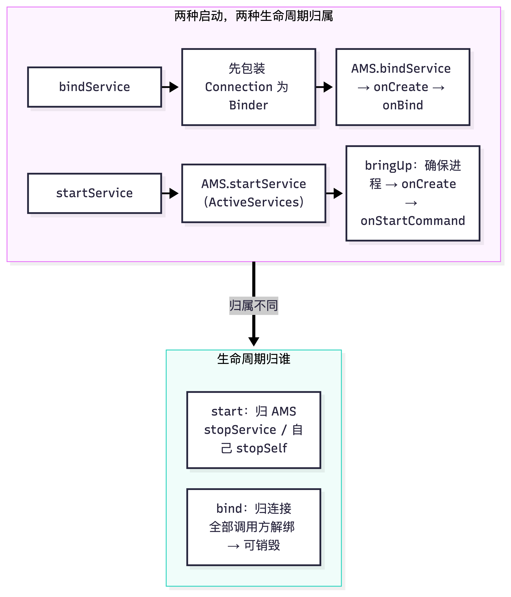
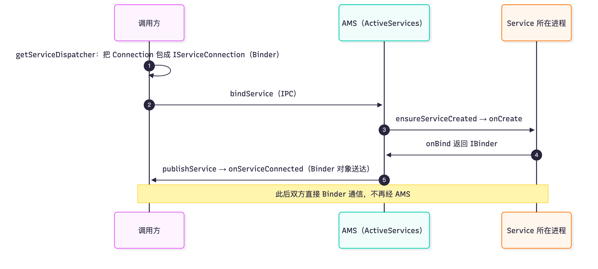
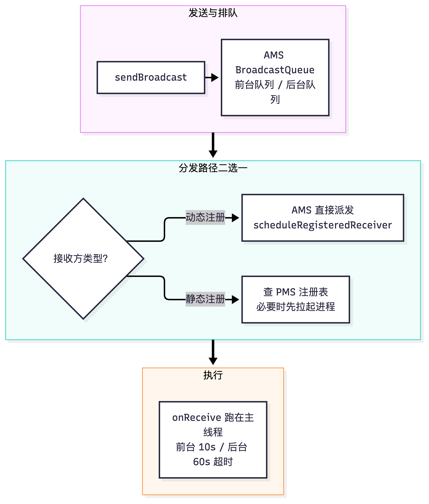

# 09｜AMS：Service 与广播调度

> 📌 **《Framework 源码深潜》系列 · 第 09 篇 / 共 20 篇** ｜ 📖 基线：Android 15（API 35）
> 上一篇：08《生命周期事务化》

## 01 引子：最后两块拼图

四大组件里，Activity 已经讲透，本篇补上 Service 与 BroadcastReceiver 的调度内幕。读完带走三样东西：**start/bind 两条路径的本质区别**、**Connection 跨进程的包装原理**、**广播的双队列与双超时**。

## 02 Service：两条路径，两种归属



**startService 路径**：`ContextImpl.startService` → AMS 的 `ActiveServices.startService` → `bringUpServiceLocked`——目标进程不在就拉起（01 篇的 fork 流程），然后 onCreate → onStartCommand。这条路径的生命周期**归 AMS 管**：不管启动方死没死，Service 都活着，直到 stopService 或自己 stopSelf。

**bindService 路径**：核心在 bind 之前的一个动作——`LoadedApk.getServiceDispatcher` 把你写的 ServiceConnection **包装成 IServiceConnection（一个 Binder 服务端）**。这就是 Connection 能跨进程回调的全部秘密：AMS 拿到的不是你的匿名内部类，而是一个指向它的 Binder 引用。

两条路径的归属差异决定了存活策略：**start 者与被启动者"互不相干"，bind 者与 Service "同生共死"**。同一 Service 被多方 bind 时，全部解绑才允许销毁；同时被 start+bind 的，先解绑再 stop。这张关系表面试常考：

```text
启动方式          谁在管           死亡条件
startService     AMS              stopService / stopSelf
bindService      调用方连接数      全部 unbind
混合             先解绑后 stop     两者条件都满足
```

## 03 bindService：一次"系统牵线"的完整时序



值得逐帧看的关键点：`onBind` 返回的 IBinder 经过 AMS **中转一次**（publishService）送达调用方——之后双方**直接 Binder 通信，不再经过 AMS**。AMS 只做"介绍人"，不做"传话人"。

这也解释了 bindService 的两个经典行为：跨进程 bind 时 onServiceConnected 里拿到的是 **Proxy**（03 篇的 asInterface 又出场了）；同进程 bind 时拿到的是**本体**——所以本地服务调用零 IPC 开销。

顺便纠正一个流行误解：**onBind 每次调用方 bind 都会执行吗？** 不会。Service 只有一个实例，onCreate/onBind 只在首次 bringUp 时走；后续 bind 只是追加连接计数。Intent 也不走 onBind——startService 才有 onStartCommand 逐次传递。

## 04 广播：两条队列与两种接收方



**发送侧**：sendBroadcast 经 IPC 进入 AMS，按发送方优先级进入 **前台队列或后台队列**——前台队列优先消化，避免后台广播洪水阻塞前台交互。有序广播（sendOrderedBroadcast）则按接收者优先级串行传递，还支持 setResult 与 abort——本质是把"并行扇出"改成"链式传递"。

**接收方两条路**：动态注册的 Receiver 对象在 AMS 里直接有引用（registerReceiver 时经 IPC 登记的），直接派发；静态注册的 Receiver 记录在 **PMS 的组件注册表**里（17 篇），派发前可能还要拉起进程——这就是"静态广播慢"以及 Android 8 开始限制大量隐式静态广播的原因。

**超时两条线**：onReceive 跑在主线程，前台广播 10 秒、后台 60 秒不返回就 ANR（19 篇把四类超时放一起）。注意广播 ANR 的计时包含"排队 + 派发 + 执行"全程，所以流水式处理（goAsync + 后台线程）才是正解。

⚠️ 顺带回收一个 03 篇的伏笔：`LocalBroadcastManager` 为什么快？它压根不走 AMS——进程内的 Handler 集合派发，零 IPC。它已废弃，替代思路（依赖注入/EventBus 类）原理相同：**广播的价值在跨进程，进程内广播纯属浪费**。

## 05 设计追问

**Q1：为什么 Service 不做成"直接 Binder 对象"，而要经过 AMS 中转？**

安全和生命周期。谁在连你、连了几个、调用方是谁，必须由系统记账——这决定了 Service 的 adj（06 篇：有连接的 Service 更难死）、权限校验和死亡清理。AMS 中转一次的成本，买来了整个组件生命周期管理。

**Q2：为什么动态广播能即时送达，静态广播要等"页面级"时机？**

动态 Receiver 是活进程内的现成对象；静态 Receiver 只是"声明"，进程可能根本不存在。S 之后系统对静态广播进一步收紧（需要.FLAG_RECEIVER_INCLUDE_BACKGROUNDCHECK？不——是清单广播默认排除后台），设计取向很明确：**减少"广播拉起进程"这种昂贵的隐式行为**。

**Q3：为什么 onStartCommand 返回值有 START_STICKY/NOT_STICKY 之分？**

这是"进程被杀后"的恢复策略协议：STICKY 让 AMS 记住意图、重建 Service（intent 为 null）；NOT_STICKY 直接放弃。返回值本质上是开发者和系统约定"这条业务值不值得重建"——查杀机制（06 篇）的配套补偿。

## 06 动手实验与源码路标

```bash
# ① 看当前所有 Service 与它们的连接数
adb shell dumpsys activity services | grep -E "ServiceRecord|Connection"
# ② 看广播历史
adb shell dumpsys activity broadcasts | head -30
```

源码路标：

```text
frameworks/base/services/core/java/com/android/server/am/ActiveServices.java      start/bind 全部逻辑
.../am/BroadcastQueue.java · BroadcastQueueModernImpl.java                         广播队列（U+ 现代实现）
frameworks/base/core/java/android/app/LoadedApk.java                              getServiceDispatcher 包装点
```

## 07 高频面试题 5 连

**Q1：startService 与 bindService 的本质区别？**

【参考答案】生命周期归属：start 归 AMS（独立存活）；bind 归调用方连接（全部解绑可销毁）。回调链不同：start 走 onStartCommand，bind 走 onBind 返回 Binder 供通信。

**Q2：ServiceConnection 为什么能跨进程回调？**

【参考答案】bindService 前 LoadedApk 把 Connection 包装成 IServiceConnection Binder 服务端；AMS 持引用，publishService 时经它把 onBind 的 IBinder 送达调用方 onServiceConnected。

**Q3：onBind 会被多次调用吗？**

【参考答案】不会。Service 单实例，onCreate/onBind 只在首次创建时执行；后续 bind 仅追加连接计数，onStartCommand 才逐次回调。

**Q4：广播前台/后台超时分别是多少？计时包含什么？**

【参考答案】前台 10 秒、后台 60 秒（19 篇汇总四类 ANR）。计时覆盖排队 + 派发 + onReceive 全程；goAsync 允许把工作交给后台线程但总时限不变。

**Q5：静态与动态注册广播的区别？**

【参考答案】动态：运行时经 IPC 登记，进程内现成对象，派发快，随 Context 生命周期；静态：声明在 PMS 注册表，接收前可能需拉起进程，Android 8+ 对隐式静态广播大幅限制。

## 08 小结 · 思考题 · 下篇预告

**一句话总结**：

> Service 的两条路径本质是"生命周期归谁管"；bind 的 Connection 是"把回调包装成 Binder"；广播的队列与超时，是公平性与响应性的平衡器。

**思考题**：

1. 前台服务被杀后，系统会自动重启它吗？和 START_STICKY 的行为差异是什么？
2. 如果让你们设计"进程内事件总线"，从广播的实现里能偷哪三个机制？

**下篇预告 · 10《WMS：窗口的本质》**：离开 AMS，进入窗口世界。一个 Activity、一个 Dialog、一个悬浮窗，在 WMS 眼里分别是什么？addWindow 的校验流水线全程拆解。

---

🧭 **主线进度**：主线 A 6/9（Service/广播横切）｜ 主线 B 0/8
