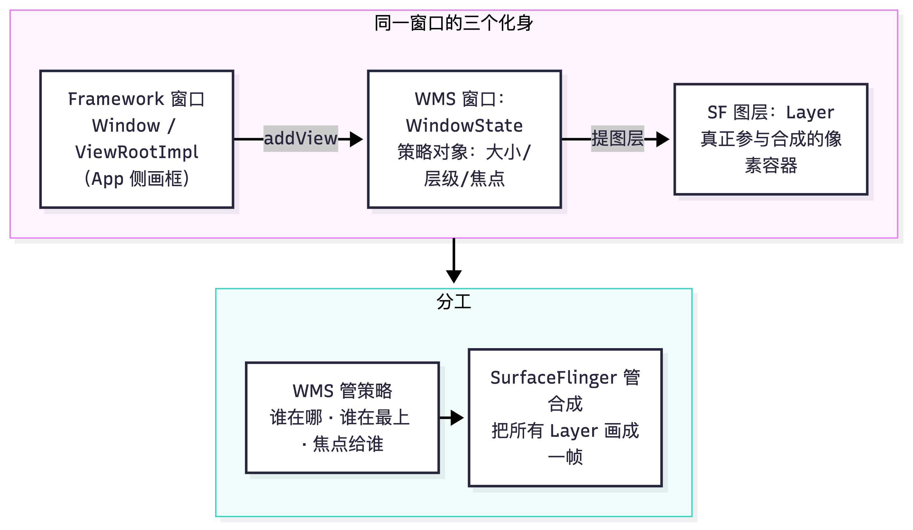
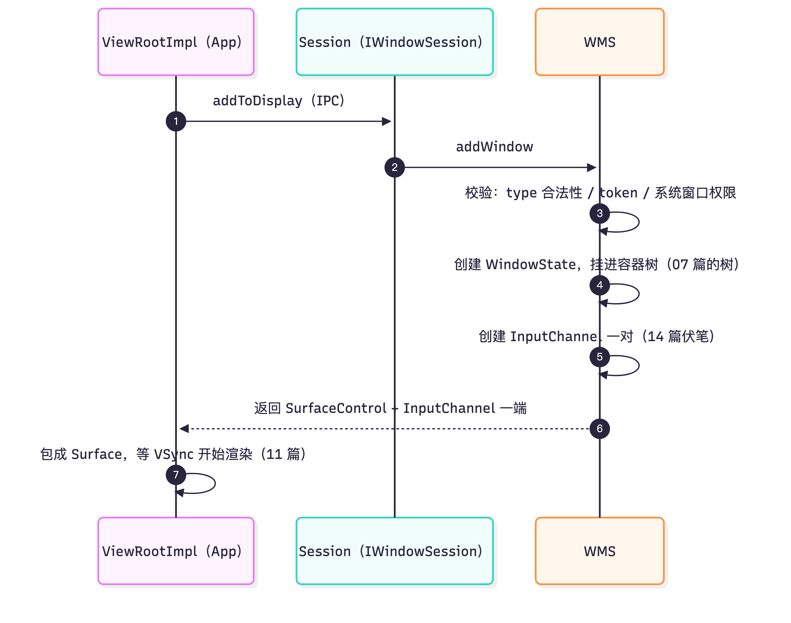
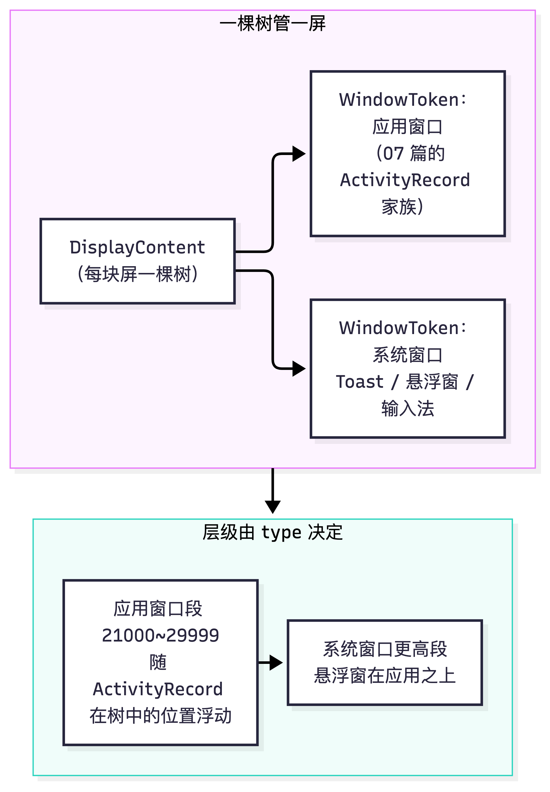

# 10｜WMS：窗口的本质与 addWindow

> 📌 **《Framework 源码深潜》系列 · 第 10 篇 / 共 20 篇** ｜ 📖 基线：Android 15（API 35）
> 上一篇：09《Service 与广播调度》

## 01 引子：你说的"窗口"是哪个窗口

"窗口"这个词在 Android 里至少有三个指代：Activity/Dialog 感知的 **Framework 窗口**、WMS 管理的 **WindowState**、SurfaceFlinger 合成的 **Layer**。90% 的窗口类疑难（层级不对、焦点丢失、token 无效）都源于把这三者混为一谈。本篇读完带走三样东西：**三层窗口模型**、**addWindow 校验流水线**、**token 与 InputChannel 两条伏笔的回收**。

## 02 三层模型：一个窗口的三次变身



**第一层，Framework 窗口（App 侧）**：PhoneWindow 是"画框"，ViewRootImpl 是"管家"（12 篇展开）。你 `setContentView` 的一切都画在它里面。

**第二层，WindowState（system_server）**：WMS 里的策略对象——它没有像素，只有"规则"：这个窗口多大、在哪、层级多少、焦点给谁、能不能被输入法遮挡。**App 的一切窗口诉求，本质都是在改 WindowState 的属性。**

**第三层，Layer（surfaceflinger 进程）**：真正参与合成的像素容器。WMS 每次改完策略，把位置/层级/可见性打包成 SurfaceTransaction 提给 SurfaceFlinger——**WMS 管策略，SF 管合成**，两层职责永不相交。

07 篇的容器树在这里重逢：DisplayContent → Task → ActivityRecord → WindowState。Activity 的 WindowState 挂在 ActivityRecord 下——**Activity 既是组件记录也是窗口凭据**，这是 ATMS 与 WMS 深度耦合的结构性原因。

## 03 addWindow：一道五关校验流水线



App 侧 `ViewRootImpl.setView` → `WindowManagerGlobal` → `IWindowSession.addToDisplay`（IPC）→ WMS 的 `addWindow`。这个方法百行代码，本质是五关校验：

**① type 合法性**：应用窗口（1~99）App 随便用；系统窗口（2000+）需要权限——用普通 App 的 uid 申请 TYPE_SYSTEM_ALERT，第一关就死。**② token 校验**：本篇主角，04 节展开。**③ 权限校验**：需要特殊权限的窗口类型逐个过（悬浮窗、输入法……）。**④ 创建 WindowState** 挂进容器树，按 type 计算初始层级（应用窗口段 21000~29999，系统窗口更高段）。**⑤ 创建 InputChannel 一对**——一端留在 WMS/输入系统，一端随返回值给 App，14 篇的事件之旅从这里开始。

返回值同样重要：**SurfaceControl**（窗口图层在 SF 侧的句柄，11 篇）+ InputChannel + 一堆窗口属性。App 侧包成 Surface，等下一个 VSync 开始渲染。

## 04 token：窗口的"身份证"



04 篇埋的伏笔在这里落地：**token 就是"谁有权在这个系统里开窗口"的凭证**。

- Activity 的 token 由 ActivityRecord 签发（07 篇：它就是 WindowToken）——所以 Activity 能开窗口；
- Application 的 Context 没有这个凭证——所以弹窗必崩（05 篇埋过）；
- 子窗口（如 PopupWindow）必须声明父窗口 token——依附关系一目了然；
- Toast/悬浮窗用**系统级 token**（由系统进程签发）——所以它们不依赖任何 Activity（13 篇对比四类弹层）。

校验逻辑一句话：**addWindow 时，WMS 查这个 token 是否存在、type 是否匹配、调用方 uid 是否是签发对象**。三查全过，WindowState 才诞生。所以 token 问题的本质是"身份与凭证的绑定"——它是 00 篇安全模型在窗口系统的直接投影。

## 05 设计追问

**Q1：为什么 WMS 与 SurfaceFlinger 分成两个进程？**

策略与机制分离。WMS 的决策（焦点、层级、大小）依赖全局状态、需要与 AMS 紧密协作（ActivityRecord 即 WindowToken），放 system_server；SF 是高频帧合成器，任何阻塞都掉帧，必须独立进程 + 高优先级线程。两者之间只有轻量的 Transaction 通道。

**Q2：为什么窗口层级不用"连续数字"，而用 type 分段？**

分段让"谁能盖住谁"由类型决定而非由调用方自由指定——普通 App 的窗口永远盖不住系统栏，因为它的 type 区间就在那里。权限模型自然地映射到层级模型（13 篇的窗口实战就是这段表的应用题）。

**Q3：Session 为什么每进程一个，IWindow 却每窗口一个？**

Session 是"会话"（进程与 WMS 的通信信道，复用省资源），IWindow 是"每窗口的回调地址"（焦点变化、窗口被系统关闭时 WMS 找得到具体的那个窗口）。一对一通信 + 一对多地址簿，职责天然分开。

## 06 动手实验与源码路标

```bash
# ① 看全屏窗口树（对照 04 节的结构）
adb shell dumpsys window | grep -E "Window #|mToken|DisplayContent" | head -20
# ② 看当前焦点窗口（焦点决策的结果）
adb shell dumpsys window | grep -i "mCurrentFocus"
```

源码路标：

```text
frameworks/base/services/core/java/com/android/server/wm/WindowManagerService.java   addWindow 本体
.../wm/WindowState.java · WindowToken.java                                           策略对象
frameworks/base/core/java/android/view/WindowManagerGlobal.java                      App 侧 addView
.../view/ViewRootImpl.java                                                           setView 入口（12 篇）
```

## 07 高频面试题 5 连

**Q1：一个 View 是窗口吗？**

【参考答案】不是。根 View（DecorView）所在的 ViewRootImpl 才对应一个 WMS 窗口；普通子 View 只是窗口内 View 树的成员。一个 App 同时可能有多个窗口（Activity、Dialog、PopupWindow 各一）。

**Q2：IWindowSession 与 IWindow 的区别？**

【参考答案】Session 是进程级会话信道（每进程一个，addWindow/relayout 走它）；IWindow 是每窗口的回调地址（WMS 通知焦点变化/窗口关闭）。一对多关系。

**Q3：addWindow 的校验有哪些？**

【参考答案】type 合法性与权限、token 存在性与身份匹配、子窗口父窗口检查，通过后创建 WindowState 挂树、分配层级、创建 InputChannel，返回 SurfaceControl。

**Q4：token 为什么必须存在？**

【参考答案】它是"开窗口权限"的凭证，把窗口创建从"谁都能调"变成"持证上岗"；Activity 的 token 来自 ActivityRecord，系统窗口由系统签发——安全模型的窗口投影。

**Q5：WMS 与 SurfaceFlinger 的分工？**

【参考答案】WMS 管"策略"：窗口在哪、多大、层级、焦点；SF 管"合成"：把所有 Layer 按策略合成一帧上屏。策略与机制分离，两进程协作。

## 08 小结 · 思考题 · 下篇预告

**一句话总结**：

> 窗口三次变身：App 的画框 → WMS 的策略（WindowState）→ SF 的图层（Layer）；addWindow 五关校验，token 是身份证，InputChannel 是伏笔。

**思考题**：

1. 输入法窗口的 type 属于哪一段？为什么它永远盖在应用窗口之上、却又不会抢走焦点？
2. 多屏/折叠屏下，同一个 Activity 移屏 = 移动什么？（提示：07 篇思考题的答案）

**下篇预告 · 11《Surface 与渲染管线》**：addWindow 返回的 SurfaceControl 是什么？一个 View 的像素如何变成屏幕上的光？——渲染管线全程拆解。

---

🧭 **主线进度**：主线 A 7/9（⑦ addWindow）｜ 主线 B 5/8（⑤ InputChannel 就位）
