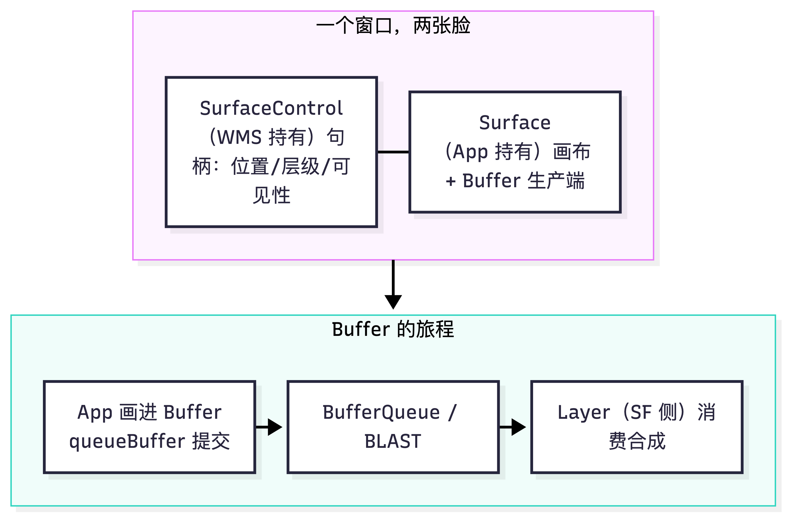
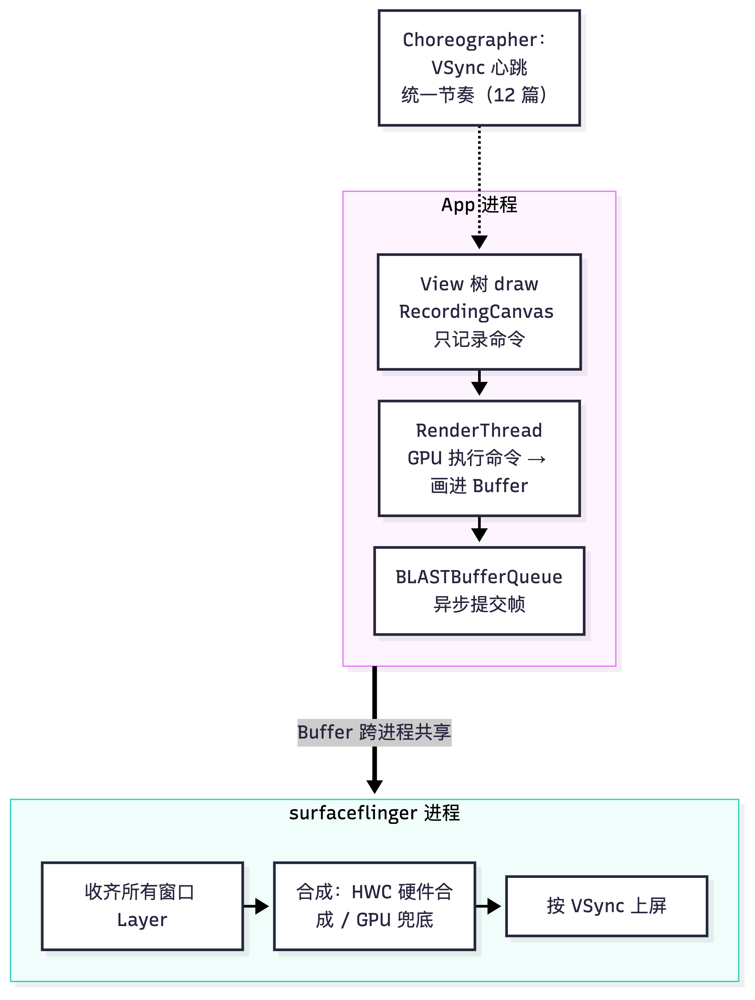
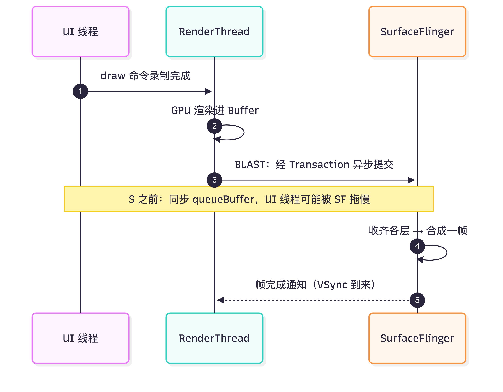

# 11｜WMS：Surface 渲染管线

> 📌 **《Framework 源码深潜》系列 · 第 11 篇 / 共 20 篇** ｜ 📖 基线：Android 15（API 35）
> 上一篇：10《WMS：窗口的本质》

## 01 引子：一个像素的旅程

你在 `onDraw` 里画的一个圆，最终变成屏幕上的一圈光，中间隔着一整条流水线：UI 线程录制 → RenderThread 渲染 → Buffer 提交 → SurfaceFlinger 合成 → 显示。这条链上有三个高频面试题：**SurfaceControl 和 Surface 什么关系？双缓冲是什么？BLAST 为什么被引入？** 本篇读完带走三样东西：**渲染管线全景**、**Surface 家族的分工**、**S 版渲染路径重构的意义**。

## 02 Surface 家族：一个窗口的两张脸



10 篇的 addWindow 返回了 SurfaceControl，现在讲清它与 Surface 的分工：

**SurfaceControl（WMS 持有）**：窗口在 SF 侧图层的**句柄**——位置、层级、透明度、可见性，全是它身上的属性。注意所有权：WMS 创建并持有它，App 只拿到副本。这就是"App 永远改不了自己窗口层级"的结构原因——句柄在人家手里。

**Surface（App 持有）**：真正拿来画图的"画布"，背后是 BufferQueue 的生产端。你 onDraw 的所有像素都进它的 Buffer。

两者是**同一窗口的两个切面**：SurfaceControl 管"窗口在哪里多大"（策略），Surface 管"窗口里画什么"（内容）。改策略要过 WMS（安全），画内容走 Buffer（性能）——各走各的通道，互不干扰。

## 03 渲染全程：从录制到上屏



**第 1 站，UI 线程（录制）**：performDraw 里 View 树把 draw 调用**记录**成图形命令（RecordingCanvas）——注意 UI 线程不画像素，只"写剧本"，这一步快得惊人。

**第 2 站，RenderThread（渲染）**：App 进程里常驻的渲染线程拿到命令清单，调 GPU 执行，画进一个空闲 Buffer。**UI 线程与渲染线程分离**是流畅度的第一功臣：哪怕 GPU 忙，UI 线程也不被卡死。

**第 3 站，提交（BLAST）**：画好的 Buffer 要交给 SurfaceFlinger。⚠️ Android S 的 BLASTBufferQueue 重构了这一步，03 节展开。

**第 4 站，合成（surfaceflinger 进程）**：SF 收齐所有窗口的 Layer（10 篇），按层级合成一帧——能走硬件合成器（HWC）的层直接叠（省电省带宽），复杂的用 GPU 兜底。最后在 VSync 到来时上屏。

**Choreographer** 是贯穿全程的心跳：它接收 VSync 信号，把"输入动画绘制"统一调到每一拍的节奏上（12 篇拆它的回调模型）。掉帧的本质就是某一拍没跑完——pipeline 排队。

## 04 BLAST：为什么要异步提交



⚠️ S 之前的提交路径是**同步**的：RenderThread 把 Buffer `queueBuffer` 给 SF，可能阻塞等待 SF 确认——如果 SF 正在合成上一帧，你的 UI 线程链路就被它拖慢了，跨进程同步点成了掉帧放大器。

**BLAST（S+ 默认）改成异步**：App 侧持有提交逻辑（BLASTBufferQueue），把 Buffer 打包成 SF Transaction 直接送出，不等确认；帧完成时 SF 再通知回来。收益三点：**UI 链路不再被 SF 卡住**（掉帧只取决于自己画得多快）；**提交时机由 App 掌控**（动画可以攒一帧多个属性原子提交）；**架构解耦**（App 与合成器彻底异步化）。

代价是引入了一帧的延迟可能（异步的固有 trade-off），Google 用 frame deadline 与回压机制把它控制在可感知范围外。这个"同步换异步 + 结果通知"的思路，在你自己的跨进程设计里完全可复用。

## 05 设计追问

**Q1：为什么双缓冲（甚至三缓冲）？**

Buffer 正在被 GPU 写时不能同时被 SF 读——必须两份交替。双缓冲解决"读写冲突"，三缓冲进一步解决"GPU 慢一拍时 UI 线程无事可做"的排队问题：拿不到 Buffer 时 UI 线程只能睡等，多一个 Buffer 就多一拍余量。内存换流畅，与 06 篇"缓存换体验"同构。

**Q2：VSync 为什么必须存在？**

没有统一节拍，各窗口各画各的，合成器拿到的帧新旧不一，画面撕裂（tearing）。VSync 是全局时钟：App 按 VSync 画，SF 按 VSync 合成，输入按 VSync 采样——整个显示系统的"节拍器"。

**Q3：为什么 UI 线程只录制不渲染？**

录制是纳秒级的命令追加，渲染是毫秒级的 GPU 执行——两者差三个数量级。合并在一起等于让最宝贵的线程（主线程）去干最慢的活，掉帧不可避免。这也是"主线程做重活是原罪"这条系列原则在渲染侧的体现。

## 06 动手实验与源码路标

```bash
# ① 抓一帧渲染轨迹（systrace/perfetto 的 Frame 类目）
adb shell perfetto -o /data/misc/perfetto-traces/frame.pftrace -t 3s \
  sched freq gfx view wm am input binder
# ② 看当前 SurfaceFlinger 图层栈
adb shell dumpsys SurfaceFlinger | grep -A5 "Layer Hierarchy" | head -10
```

源码路标：

```text
frameworks/base/core/java/android/view/ThreadedRenderer.java      UI 线程与 RenderThread 桥
frameworks/base/libs/hwui/                                        渲染核心（RecordingCanvas/RenderProxy）
frameworks/native/libs/gui/BLASTBufferQueue.cpp                   异步提交
frameworks/native/services/surfaceflinger/                        合成器
```

## 07 高频面试题 5 连

**Q1：SurfaceControl 与 Surface 的区别？**

【参考答案】SurfaceControl 是图层句柄（WMS 持有，管位置/层级/可见性等策略属性）；Surface 是画布（App 持有，BufferQueue 生产端，管内容）。同一窗口的两张脸：策略与内容分离。

**Q2：双缓冲的作用？**

【参考答案】读写分离：GPU 写一个 Buffer、SF 读另一个，交替使用避免冲突；三缓冲进一步在 GPU 慢一拍时给 UI 线程留余量。以内存换流畅。

**Q3：VSync 是什么，为什么需要？**

【参考答案】屏幕刷新的同步时钟。App 按 VSync 画、SF 按 VSync 合成、输入按 VSync 采样，保证合成器拿到的帧完整一致，避免撕裂。掉帧本质是某个 VSync 周期内流水线没跑完。

**Q4：BLAST 是什么，解决什么问题？**

【参考答案】S+ 的异步 Buffer 提交：App 把帧打包成 Transaction 直接送 SF，不再同步等待确认。解决同步 queueBuffer 让 UI 链路被合成器拖慢的问题；代价是可能引入一帧延迟，由回压机制兜底。

**Q5：UI 线程在渲染中做什么？为什么不直接画？**

【参考答案】只录制图形命令（RecordingCanvas）+ 提交渲染线程；绘制交给 RenderThread + GPU。录制与执行差三个数量级，分离才保得住主线程响应。

## 08 小结 · 思考题 · 下篇预告

**一句话总结**：

> 渲染 = UI 线程录剧本 + RenderThread 演戏 + BLAST 异步交片 + SF 合成上屏；SurfaceControl 管窗口策略，Surface 管像素内容，VSync 是全场节拍器。

**思考题**：

1. 为什么 `SurfaceView` 的绘制不走 View 树的渲染管线？它的 Surface 从哪来？（提示：独立 SurfaceControl + 独立 Buffer）
2. 如果 App 一秒只画 10 帧，屏幕仍 120Hz——SF 在中间拍次做什么？

**下篇预告 · 12《ViewRootImpl》**：把渲染与窗口缝合起来的枢纽。performTraversals 的三大步骤、requestLayout 与 invalidate 的分野、子线程更新 UI 为什么崩。

---

🧭 **主线进度**：主线 A 8/9（⑧ 首帧渲染）｜ 主线 B 5/8
