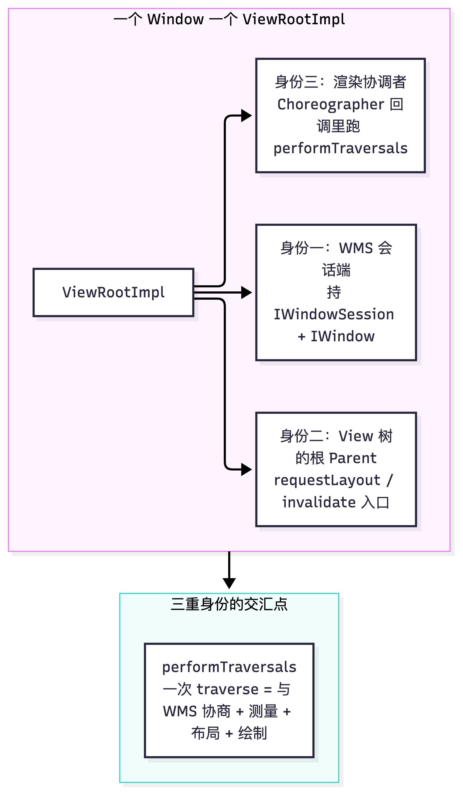
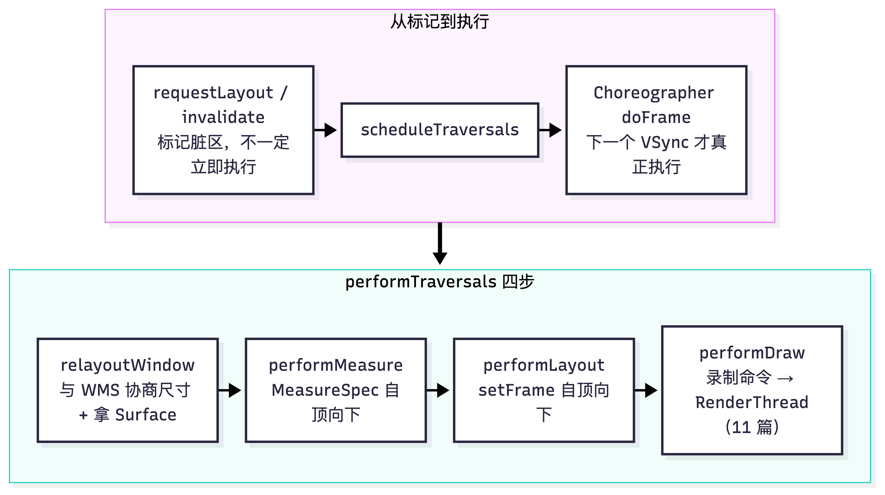

# 12｜ViewRootImpl：UI 系统的枢纽

> 📌 **《Framework 源码深潜》系列 · 第 12 篇 / 共 20 篇** ｜ 📖 基线：Android 15（API 35）
> 上一篇：11《Surface 渲染管线》

## 01 引子：三个经典问题，一个答案

**为什么 onCreate 里 getWidth() 返回 0？requestLayout 和 invalidate 有什么区别？子线程更新 UI 为什么报 CalledFromWrongThreadException？** 三个问题看似无关，答案都指向同一个平时被忽略的类：**ViewRootImpl**。它不在你的代码里出现，却管着 View 树与 WMS、渲染、输入的全部往来。本篇读完带走三样东西：**ViewRootImpl 的三重身份**、**performTraversals 的完整流程**、**三大经典问题的源码级答案**。

## 02 三重身份：一个类，三副担子



**身份一，WMS 会话端**：每个窗口的 ViewRootImpl 都持有 IWindowSession（进程级信道）与自己的 IWindow 回调（10 篇）。窗口与系统的全部往来——addWindow、relayout、收输入、被系统关闭——都以它为端点。**15 篇的输入事件，也是它先收到的。**

**身份二，View 树的根 Parent**：View 的 getParent() 沿链上溯，终点就是 ViewRootImpl。它实现了 ViewParent 接口，requestLayout/invalidate 从叶子一路冒泡到这里才"出界"进入系统流程。

**身份三，渲染协调者**：它持有 Choreographer 回调，每个 VSync 拍子执行一次 performTraversals（11 篇的心跳在这里落地）。

三副担子在同一个方法里交汇——**performTraversals**。理解它，就理解了整个 UI 系统的运转方式。

## 03 performTraversals：一帧的四步



**标记 ≠ 执行**。你调 requestLayout 时，它只沿 Parent 链标记"需要布局"，最终走到 ViewRootImpl 的 scheduleTraversals——向 Choreographer 注册回调，**下一个 VSync 才真正执行**。这个"攒一批、齐步走"的设计让一帧内的 N 次布局请求合并成一次 traverse（对比 08 篇事务合并，同构思想）。

traverse 本体四步：

**① relayoutWindow**：与 WMS **协商**窗口尺寸——注意是协商：窗口想要的大小、屏幕约束、状态栏/输入法避让，来回博弈后得出最终 frame。Surface 也在这一步拿到（首次 traverse 时 addWindow 已完成，之后每次尺寸变化重新协商）。**这就回答了 onCreate 宽高为 0**：onCreate 只是 Activity 生命周期的一环，ViewRootImpl 此刻可能还没 addView，更没跑过任何 traverse——宽高要等第一次 traverse 的 relayout 之后。

**② performMeasure**：MeasureSpec 从 WindowSize 出发自顶向下传递——父容器把约束编码成"模式+数值"传给子 View。这解释了自定义 View 的经典坑：onMeasure 里忘了 setMeasuredDimension 直接异常。

**③ performLayout**：setFrame 自顶向下确定每个 View 的四角坐标——measure 定大小，layout 定位置，两者信息互补不可混谈。

**④ performDraw**：脏区驱动（只有 invalidate 标记的区域重画），进入 11 篇的录制→渲染→提交管线。

## 04 requestLayout vs invalidate：分野在哪

**requestLayout**：尺寸/位置可能变了——measure+layout+draw 全链重跑（贵）；**invalidate**：内容变了但大小没变——只 draw，且只画脏区（便宜）。源码级的分野在 ViewRootImpl 的标记位：`mLayoutRequested` 决定 relayout/measure/layout 三步是否执行，`mDirty` 决定 draw 的范围。

实践推论：动画场景用 invalidate（或属性动画直接改 Render 属性，连 invalidate 都省）；让 requestLayout 尽量少出现——一次多余的 requestLayout 就是全树重测重排，列表卡顿的经典元凶。

**子线程更新 UI** 的答案也在这里：ViewRootImpl 在哪个线程创建，checkThread 就校验哪个线程——**UI 线程 = 创建 ViewRootImpl 的线程**（默认主线程）。子线程操作 View 树会触发到 checkThread 直接抛异常。但注意例外：SurfaceView 的 SurfaceHolder 回调、以及不经过 ViewRootImpl 的 Render 属性动画，都能在子线程操作——机制清楚了，例外就不再是玄学。

## 05 设计追问

**Q1：为什么 measure 和 layout 分开两次遍历？**

职责分离：measure 只决定"我多大"（可独立缓存），layout 决定"我在哪"。分开后 RelativeLayout 这种"依赖兄弟位置"的容器可以量两次而不破坏协议；且 measure 结果可复用（RecyclerView 缓存的就是 measure 结果）。代价是两趟遍历，收益是协议的正交性。

**Q2：为什么标记后不在当前调用栈里立即执行 traverse？**

合并与节拍。立即执行意味着一次事件处理里改十个属性触发十次全树遍历；挂到 VSync 批处理，一帧一次。这也是为什么 post 一个 runnable 拿宽高比"直接拿"可靠——runnable 排在 traverse 同帧之后（更稳的是 onWindowFocusChanged / OneShotPreDrawListener）。

**Q3：ViewRootImpl 为什么不叫 WindowRoot？**

它实际是 View 层的"Impl"：对上实现 ViewParent（View 世界的根），对下对接 WindowManager（窗口世界）。名字里藏着一句话：**View 树与窗口系统之间的翻译官**。

## 06 动手实验与源码路标

```kotlin
// 验证"onCreate 拿不到宽高"与解法
view.post { Log.d("size", "${view.width}") }              // 通常可行
view.viewTreeObserver.addOnGlobalLayoutListener { }        // 每次 traverse 后回调
OneShotPreDrawListener.add(view) { Log.d("size", "predraw") } // 官方推荐单次
```

源码路标：

```text
frameworks/base/core/java/android/view/ViewRootImpl.java         本篇主角（performTraversals）
.../view/WindowManagerGlobal.java                                三集合单例池
.../view/Choreographer.java                                      VSync 回调模型
```

## 07 高频面试题 5 连

**Q1：onCreate 为什么拿不到 View 宽高？**

【参考答案】ViewRootImpl 在 onResume 后的 addView 才创建，宽高来自 traverse 的 relayout+measure，要等下一个 VSync。解法：post、OnGlobalLayoutListener、OneShotPreDrawListener。

**Q2：requestLayout 与 invalidate 的区别？**

【参考答案】requestLayout 标记全链重跑（measure/layout/draw）；invalidate 只重绘脏区。前者贵后者便宜，动画场景应避免 requestLayout。

**Q3：子线程更新 UI 为什么崩？有例外吗？**

【参考答案】ViewRootImpl.checkThread 校验操作线程 = 创建线程（默认主线程）。例外：SurfaceHolder 回调、Render 属性动画等不经过 ViewRootImpl 的路径可在子线程。

**Q4：performTraversals 的流程？**

【参考答案】relayoutWindow（与 WMS 协商尺寸拿 Surface）→ performMeasure（MeasureSpec 自顶向下）→ performLayout（setFrame）→ performDraw（脏区录制→RenderThread）。由 Choreographer 在 VSync 驱动。

**Q5：ViewRootImpl 何时创建？一个进程有几个？**

【参考答案】WindowManagerGlobal.addView 时创建；每个窗口（Activity/Dialog/PopupWindow 的根）一个，进程内可有多个，数量 = 当前存活窗口数。

## 08 小结 · 思考题 · 下篇预告

**一句话总结**：

> ViewRootImpl = WMS 会话端 + View 树根 Parent + 渲染协调者；performTraversals 是 UI 世界的"一帧主循环"，三大经典问题全由此出。

**思考题**：

1. 连续调用 100 次 invalidate 只会触发几次 traverse？连续 100 次 requestLayout 呢？差异说明什么？
2. RecyclerView 缓存了什么才敢跳过 measure？这与 Q1 的 measure/layout 分离有什么关系？

**下篇预告 · 13《窗口实战》**：Dialog、PopupWindow、Toast、悬浮窗——四类弹层的 token 溯源、BadTokenException 全场景汇总、子线程 Toast 能活而 Dialog 会崩的真相。

---

🧭 **主线进度**：主线 A 8/9（⑧ 渲染协调）｜ 主线 B 6/8（⑥ ViewRootImpl 接手）
