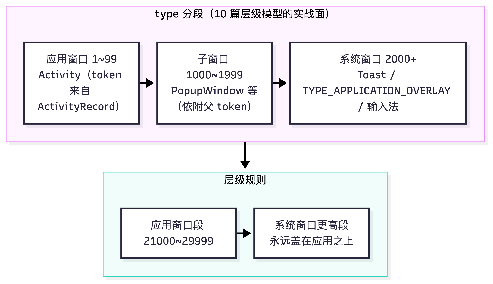
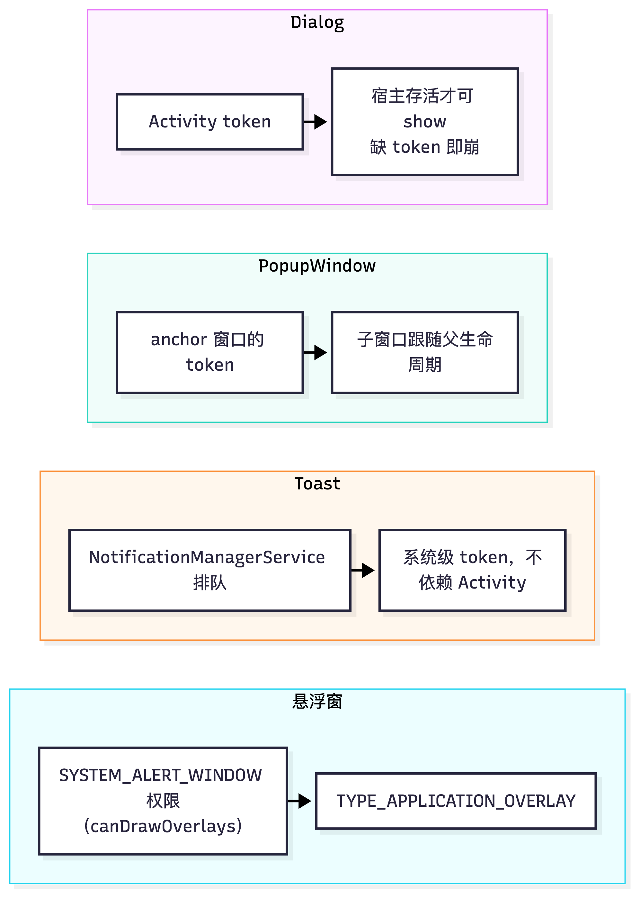
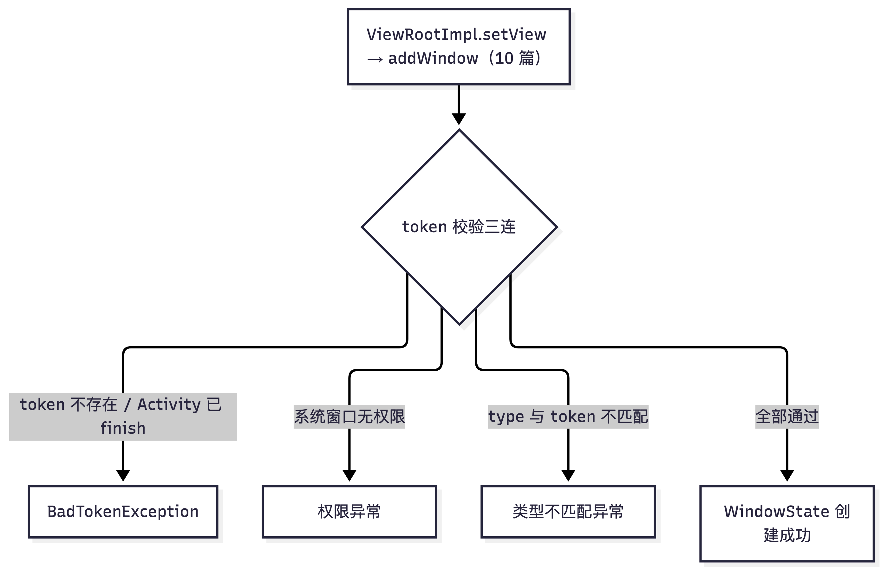

# 13｜窗口实战：Dialog / PopupWindow / Toast / 悬浮窗

> 📌 **《Framework 源码深潜》系列 · 第 13 篇 / 共 20 篇** ｜ 📖 基线：Android 15（API 35）
> 上一篇：12《ViewRootImpl》

## 01 引子：一类报错，四种弹层

`BadTokenException: Unable to add window — token is not valid` 是线上最常见的窗口崩溃。而 Dialog、PopupWindow、Toast、悬浮窗这四样东西，行为差异（能不能在子线程弹、会不会随 Activity 死、要不要权限）全都能用**一张 token 表**解释。本篇是 10 篇理论的应用题课，读完带走三样东西：**窗口三要素模型**、**四类弹层的 token 溯源表**、**BadTokenException 的全部场景清单**。

## 02 窗口三要素：type / token / flag



每个窗口的三张"户口页"：**type** 决定层级段（10 篇：应用窗口段永远盖不过系统窗口段）；**token** 决定身份合法性（addWindow 的第二关）；**flag** 决定行为细节（NOT_FOCUSABLE 不抢焦点、LAYOUT_NO_LIMITS 出屏……）。

```text
type 分段速查（高频成员）
应用窗口  1~99      Activity / Dialog
子窗口    1000~1999 PopupWindow（依附父窗口）
系统窗口  2000+     Toast(2005) / 输入法 / TYPE_APPLICATION_OVERLAY(2038)
```

## 03 四类弹层的 token 溯源



**Dialog**：构造时必须传 Activity Context，token 来自 Activity 的 WindowToken（10 篇：ActivityRecord 签发）。show 时把自己的 ViewRootImpl 挂到 Activity token 上——**宿主活着才合法**。所以"Dialog 泄漏"（宿主销毁后仍持有）和"show 后崩溃"（token 已失效）是同一枚硬币的两面。

**PopupWindow**：type 是**子窗口**（1000 段），子窗口的 addWindow 要求必须有父窗口 token——popup 从 anchor View 所在窗口借 token。行为特征全部由此推出：父窗口关闭它跟着消失、不能脱离 anchor 独立显示、遮不住比父窗口更高级的窗口。

**Toast**：走的根本不是普通 addWindow——它先把请求发到 **NotificationManagerService 排队**（系统控制"同一时间只有一个 Toast"、时长 2s/3.5s 也由系统控制），轮到它时用**系统级 token** 创建窗口。所以 Toast 不依赖任何 Activity、App 全死它也能飘着。⚠️ T 版起 Toast 行为进一步收紧（自定义 Toast 被系统替代渲染），定制提示建议用应用内 View。

**悬浮窗**：TYPE_APPLICATION_OVERLAY 属系统窗口段，需要 **SYSTEM_ALERT_WINDOW** 权限（26+ 必须用户在设置里手动授予 canDrawOverlays，普通 requestPermissions 申请不来）。窗口由 WMS 直接用系统 token 放行——**权限换 token**，这是"特权窗口"的合法通道。

## 04 BadTokenException 全场景清单



结合 10 篇的校验流水线，线上会遇到的全部场景：

```text
场景                                    根因
1. Activity finish 后 show Dialog       token 已随 Activity 注销
2. 异步回调里 show Dialog               回调到达时 Activity 可能已死
3. Application Context 弹 Dialog        无 token（05 篇）
4. 子窗口 PopupWindow 无有效 anchor     父窗口已不在
5. 非法 type / 缺系统权限                type 校验或权限关不过
6. AI 生成代码里 windowManager.addView  同 3
```

工程防御两板斧：**show 前检查 isFinishing/isDestroyed**；**用 WeakReference + try-catch 包 show**（治标），根本上还是把弹窗生命周期绑定到宿主（治本）。第 2 种最阴险——网络回调线程与 Activity 生命周期的竞态，只能靠"回主线程 + 活性检查"双保险。

**子线程 Toast 能活的谜题**也顺带解开：Toast.show 只是 IPC 到 NMS 排队，不碰 ViewRootImpl 的 checkThread——但 TN（Toast 的内部回调）要创建窗口，仍需要 Looper，所以子线程弹 Toast 必须先 Looper.prepare；而 Dialog 的 show 直接走 ViewRootImpl（主线程校验），子线程必崩。**同为弹层，一个排队走系统、一个直连 ViewRootImpl，命运就此分岔。**

## 05 设计追问

**Q1：为什么 Toast 要绕道 NMS 排队，而不是 App 自己 new 窗口？**

全局一致性：同一时刻全屏只能有一个 Toast、时长统一、连续 show 要串行——这些"全局约束"必须有一个全局裁判。窗口系统给了"能不能显示"的裁判（WMS），NMS 管的是"什么时候显示"（队列）。

**Q2：为什么悬浮窗权限不给 requestPermissions，而要跳设置页？**

危险等级不同。运行时权限（17 篇）是"单次弹窗可授予"的危险权限；悬浮窗是"长期全局覆盖"能力，影响面是整个系统所有应用之上，必须用户显式跳转设置且可随时撤销（AppOps 体系，17 篇再讲）。

**Q3：为什么 PopupWindow 设计成"子窗口"而不是独立窗口？**

依附语义：popup 的存在意义是"悬浮在某个 View 附近"，跟随父窗口显隐、跟随父窗口层级，天然是子窗口模型。设计成独立窗口反而要手动维护同步。

## 06 动手实验与源码路标

```bash
# 看当前屏幕所有窗口的 type 与归属（对照 02 节分段）
adb shell dumpsys window windows | grep -E "Window #|type=|package="
# 查某 App 的悬浮窗权限状态（AppOps）
adb shell appops get <package> SYSTEM_ALERT_WINDOW
```

源码路标：

```text
frameworks/base/core/java/android/app/Dialog.java              show 与 token 获取
.../widget/PopupWindow.java                                    子窗口锚定
frameworks/base/services/core/java/com/android/server/notification/NotificationManagerService.java   Toast 队列
frameworks/base/core/java/android/view/WindowManager.LayoutParams.java   type/flag 全集
```

## 07 高频面试题 5 连

**Q1：四类弹层的 token 来源？**

【参考答案】Dialog：Activity token；PopupWindow：anchor 窗口 token（子窗口）；Toast：系统级 token（NMS 排队后签发）；悬浮窗：权限换系统 token（TYPE_APPLICATION_OVERLAY）。

**Q2：子线程为什么能弹 Toast 不能弹 Dialog？**

【参考答案】Toast.show 是 IPC 到 NMS 排队（但 TN 创建窗口需该线程有 Looper）；Dialog.show 直连 ViewRootImpl，checkThread 校验主线程，子线程必抛异常。

**Q3：BadTokenException 的常见场景与防御？**

【参考答案】宿主已 finish/destroy 时 show、无 token 的 Context 弹窗、子窗口锚失效。防御：show 前查 isFinishing，异步回调先回主线程再活性检查。

**Q4：PopupWindow 与 Dialog 的选择标准？**

【参考答案】看语义：依附某个 View 的轻浮层用 PopupWindow（子窗口跟随父）；模态交互/生命周期绑定 Activity 用 Dialog。PopupWindow 默认不抢焦点可点击外部消失，Dialog 默认模态。

**Q5：悬浮窗权限为什么特殊？**

【参考答案】它覆盖在一切应用之上，影响全局；属于 AppOps 类长期权限，须用户跳设置显式授予、可随时撤销，与运行时权限（单次弹窗）的管控模型不同。

## 08 小结 · 思考题 · 下篇预告

**一句话总结**：

> 弹层的全部行为差异 = token 来源差异；窗口三要素（type/token/flag）是 WMS 校验的三个关，BadToken 只是"没过 token 关"的名字。

**思考题**：

1. 为什么 Dialog 可以 `setCancelable(false)` 实现模态，PopupWindow 实现模态要额外处理什么？
2. 输入法窗口的 token 是谁签发的？它凭什么能盖在所有应用之上？

**下篇预告 · 14《输入事件之旅》**：离开窗口策略，进入事件世界。触摸屏的一次电信号，如何穿过内核、InputFinger、InputChannel，落到你的 onTouchEvent 上？主线 B 正片开演。

---

🧭 **主线进度**：主线 A 7/9（实战应用篇）｜ 主线 B 5/8（token 全景补强）
