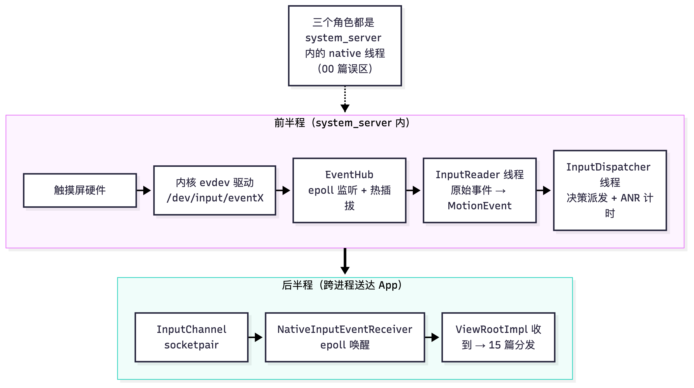
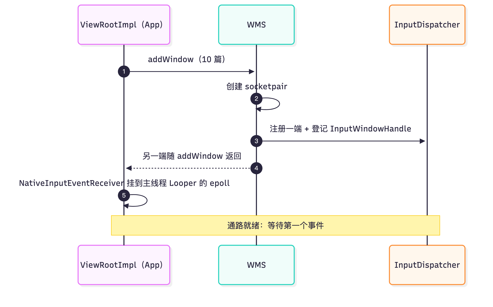
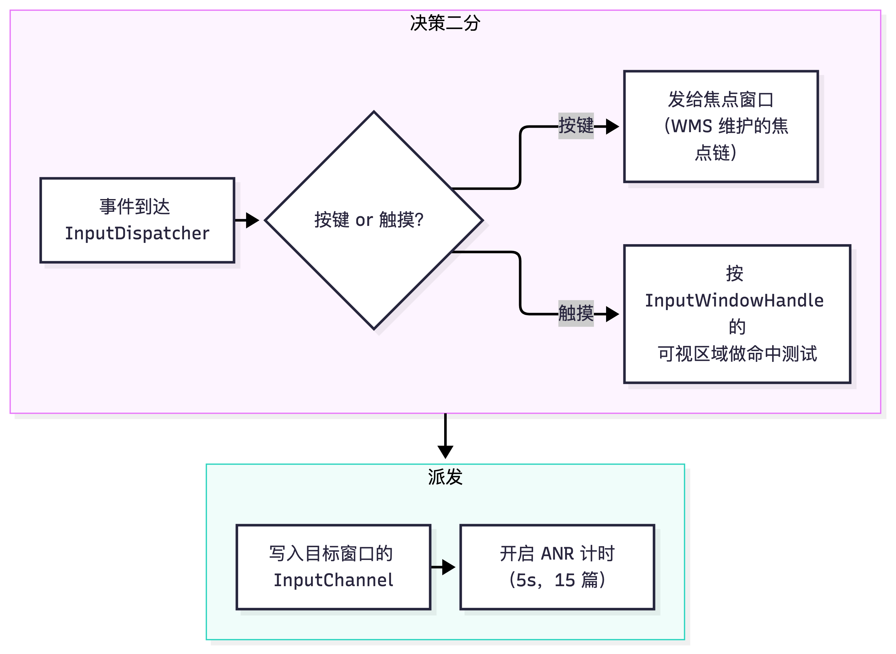

# 14｜事件系统（上）：输入事件之旅

> 📌 **《Framework 源码深潜》系列 · 第 14 篇 / 共 20 篇** ｜ 📖 基线：Android 15（API 35）
> 上一篇：13《窗口实战》

## 01 引子：主线 B 开演

00 篇的两条主线里，主线 B「一次触摸的旅程」藏得最深：从手指接触玻璃到 `onTouchEvent` 被调用，事件穿过**内核驱动、两个 native 线程、一次跨进程**——每一步都可能成为卡顿或 ANR 的现场。本篇拆前半程（到事件送达 App），分发细节留给 15 篇。读完带走三样东西：**输入流水线全景**、**InputChannel 的建立与设计理由**、**"谁决定事件给哪个窗口"**。

## 02 流水线：前半程的五个角色



**触摸屏硬件 → evdev 驱动**：触摸控制器把电信号写成标准输入事件，挂在 `/dev/input/eventX`——这是 Linux 通用机制，Android 直接继承。

**EventHub**：system_server 里的"事件总开关"，用 epoll 监听所有 /dev/input 设备（inotify 处理热插拔）。它不管语义，只管"哪个设备有新数据"。

**InputReader 线程**：读取原始事件并**语义化**——把触点坐标序列加工成 MotionEvent（多点触控、手势状态机在这里，你熟悉的 ACTION_DOWN/MOVE/UP 就诞生于此）。原始坐标还要经过校准与变换（旋转、分辨率映射）。

**InputDispatcher 线程**：流水线的决策中枢。拿到的每个事件都要回答"给谁"（03 节），然后写入目标窗口的 InputChannel，**同时开始 ANR 计时**。

**注意三个角色全是 system_server 进程内的 native 线程**（00 篇埋的误区回收）——没有独立进程，它们的性能问题会直接拖累系统。

## 03 InputChannel：为什么是 socketpair



10 篇 addWindow 时埋的伏笔在此回收：WMS 在窗口创建时建一对 **socketpair**，一端注册给 InputDispatcher，另一端随返回值给 App。App 侧把 fd 交给 NativeInputEventReceiver，**挂进主线程 Looper 的 epoll**——主线程从此多了一个"输入事件"唤醒源。

为什么不用 Binder 传事件？三个硬理由：**①流式 vs 事务式**：一次滑动产生几十上百个 MOVE，Binder 每次事务都有打包/校验/线程调度的固定开销，socketpair 是纯流式写读；**②异步 epoll**：InputChannel 直接对接 Looper 的事件循环，事件到达即唤醒，天然适配"主线程消息驱动"模型；**③低延迟**：省掉 Binder 的线程池调度，链路更短。这个选型值得记住——**高频连续小消息用流式 fd，低频结构化调用用 Binder**。

另一个关键点：**InputWindowHandle**。Dispatcher 怎么知道每个窗口的位置/可点区域/可聚焦性？WMS 在 addWindow 和每次布局变化时把窗口信息同步给它（focusable、touchable、visibleFrame 等快照）。**输入决策的"地图"由 WMS 绘制**——这就是 00 篇说"事件系统在 WMS 之后"的原因。

## 04 决策：事件给谁



**按键（KeyEvent）**：查 WMS 维护的焦点链——焦点窗口是谁就给谁（10 篇思考题的答案：输入法窗口可聚焦层级却永远不抢应用焦点，靠的就是焦点链的规则）。

**触摸（MotionEvent）**：按 InputWindowHandle 的可视区域做**命中测试**——从屏幕顶层窗口往下找第一个命中的（所以悬浮窗能"挡住"下面的点击；FLAG_NOT_TOUCHABLE 能穿透）。DOWN 事件锁定目标后，**后续 MOVE/UP 全部跟随这个目标**——手指滑出按钮范围仍能收到 MOVE/CANCEL，这就是"锁定"语义。

派发时 Dispatcher 记录**事件的 deadline（5 秒）**——这是输入 ANR 的计时起点，15 篇展开。手速极快时多个 MOVE 会被**合并（batch）**：App 消费不过来时，Dispatcher 把未取走的 MOVE 合并成一个，保证"最新位置"优先送达——这也是"快速滑动偶尔丢中间点"的原因。

## 05 设计追问

**Q1：为什么输入决策放在 system_server，而不是内核或 App？**

安全与全局视野。哪个窗口该收事件，取决于全局窗口层级与焦点状态（WMS 独占）；App 不可信——不能让 App 自己声明"把所有点击给我"。

**Q2：为什么 Reader 和 Dispatcher 分成两个线程？**

读写解耦：Reader 的语义加工（多点触控状态机）耗时且与设备相关，Dispatcher 的窗口决策必须低延迟。分开后 Dispatcher 的队列可以独立做"预派发/重试/合并"，互不阻塞。

**Q3：事件为什么在"主线程"消费，而不是渲染线程？**

事件语义属于"应用逻辑"（改状态、触发回调），与 View/Handler 生态强绑定在主线程；渲染线程只管画（11 篇）。分离再次成立：**逻辑在主线程，像素在渲染线程**。

## 06 动手实验与源码路标

```bash
# ① 亲眼看到原始输入事件（最好玩的一步）
adb shell getevent -lt        # 按下屏幕：BTN_TOUCH DOWN + 坐标 ABS_MT_*
# ② 看输入系统的全景状态
adb shell dumpsys input | grep -E "InputReader|Dispatcher|Focus" | head
```

源码路标：

```text
frameworks/native/services/inputflinger/reader/EventHub.cpp         事件总开关
frameworks/native/services/inputflinger/dispatcher/InputDispatcher.cpp  决策中枢
frameworks/base/core/java/android/view/InputChannel.java            socketpair 封装
frameworks/base/core/jni/android_view_InputEventReceiver.cpp        App 侧接收
```

## 07 高频面试题 5 连

**Q1：从触摸屏到 onTouchEvent 分几步？**

【参考答案】硬件 → evdev → EventHub（epoll）→ InputReader（语义化 MotionEvent）→ InputDispatcher（决策派发）→ InputChannel（socketpair）→ NativeInputEventReceiver → ViewRootImpl → View 分发（15 篇）。

**Q2：为什么输入用 socketpair 而不是 Binder？**

【参考答案】高频连续小消息场景：流式无事务开销、epoll 对接主线程 Looper、延迟更低。Binder 适合低频结构化调用——选型标准是消息模式而非性能教条。

**Q3：谁决定事件派发给哪个窗口？**

【参考答案】InputDispatcher。按键走 WMS 的焦点链；触摸按 WMS 同步的 InputWindowHandle 快照做命中测试，从顶层往下找第一个命中窗口。

**Q4：手指滑出按钮还会收到事件吗？**

【参考答案】会。DOWN 锁定目标后 MOVE/UP/CANCEL 跟随该目标（窗口维度锁定）；这是手势可靠性的基础，也是 CANCEL 机制的由来（父容器拦截时给子 View 发 CANCEL）。

**Q5：快速滑动为什么会"丢点"？**

【参考答案】App 消费不及时时 Dispatcher 对未取走的 MOVE 做合并（batch），保证最新位置优先送达。高频事件的正确消费姿势是"每次循环取净队列"，而不是逐个处理。

## 08 小结 · 思考题 · 下篇预告

**一句话总结**：

> 输入链路 = 内核 evdev → EventHub → Reader（语义化）→ Dispatcher（决策 + ANR 计时）→ InputChannel → 主线程 Looper；地图由 WMS 绘制，通道靠 socketpair。

**思考题**：

1. 为什么输入事件要挂主线程 Looper 的 epoll，而不是单独开线程收完再 post？（提示：顺序性与唤醒成本）
2. FLAG_NOT_TOUCHABLE / FLAG_NOT_FOCUSABLE 分别影响 03 节的哪条决策分支？

**下篇预告 · 15《分发链与 ANR》**：事件到达 ViewRootImpl 之后：Activity→ViewGroup→View 的 U 型分发、滑动冲突两板斧、以及输入 ANR 那 5 秒的完整计时逻辑。

---

🧭 **主线进度**：主线 A 9/9（⑨ 输入就绪）｜ 主线 B 4/8（①-④ 已解锁）
