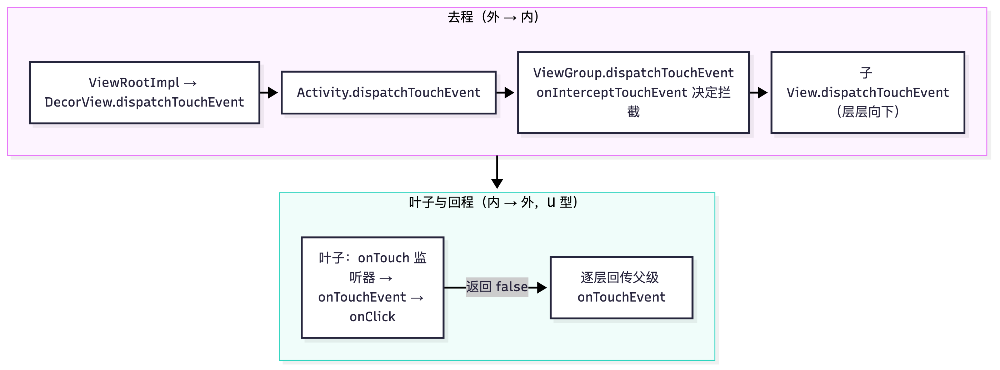
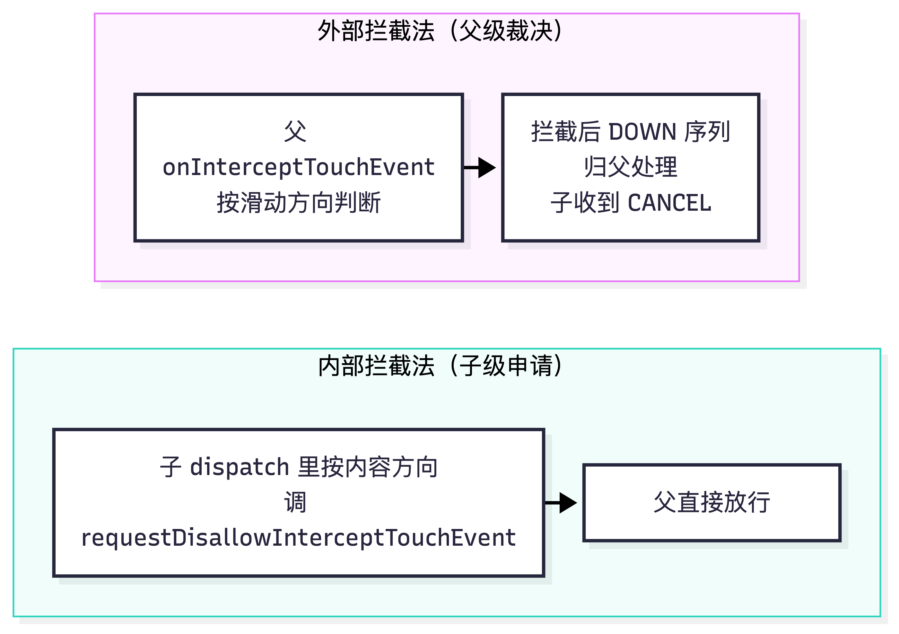
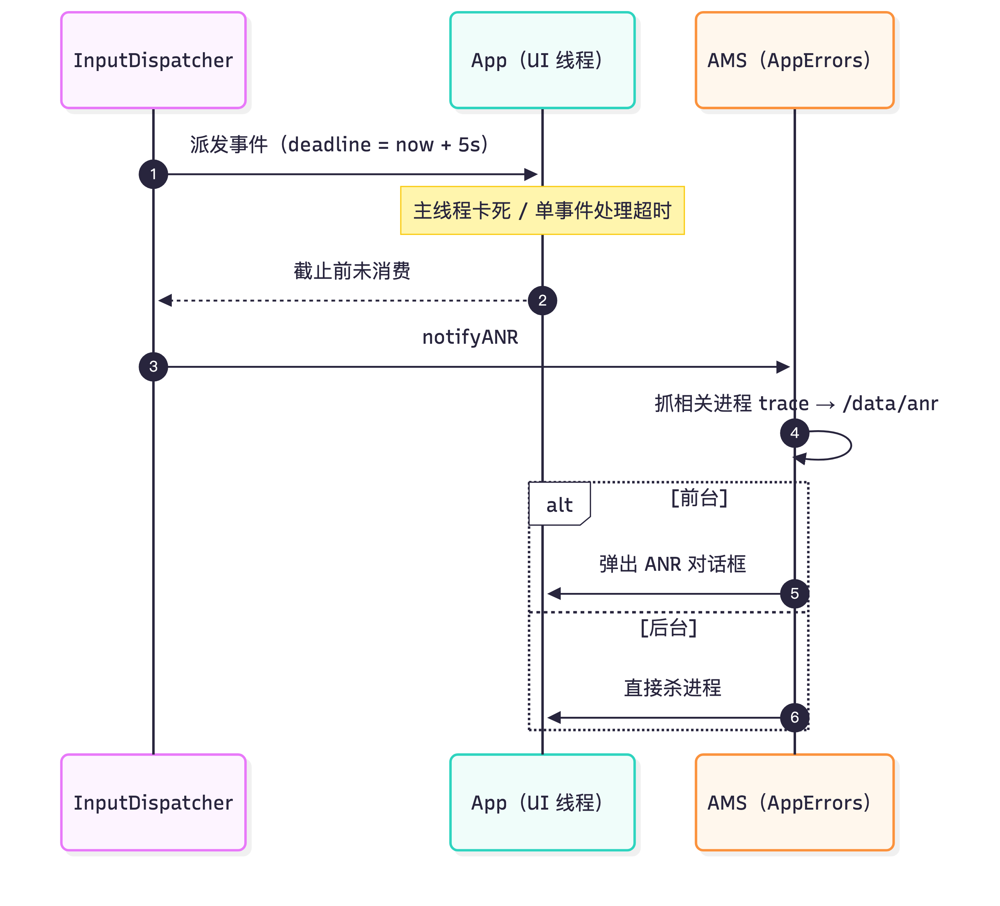

# 15｜事件系统（下）：分发链与 ANR

> 📌 **《Framework 源码深潜》系列 · 第 15 篇 / 共 20 篇** ｜ 📖 基线：Android 15（API 35）
> 上一篇：14《输入事件之旅》

## 01 引子：事件系统的最后一公里

14 篇把事件送到了 ViewRootImpl，本篇走完最后一公里：View 树内的分发规则、滑动冲突的解法、以及输入 ANR 的计时真相。这三件事覆盖了事件系统 90% 的面试题与线上问题。读完带走三样东西：**U 型分发的完整地图**、**拦截两板斧的适用场景**、**ANR 计时的源码级答案**。

## 02 U 型分发：一张地图背完规则



事件进入 View 树后的完整路径，形状像一个"U"：

**去程（外→内）**：ViewRootImpl → DecorView → `Activity.dispatchTouchEvent`（Activity 有第一处置权，能全局监听/吞掉事件）→ PhoneWindow → `ViewGroup.dispatchTouchEvent`。在 ViewGroup 这里先问 `onInterceptTouchEvent`：父容器要不要自己处理？不拦截则遍历子 View，用 dispatchTransformedTouchEvent 把事件交给命中的子 View 继续下发。

**叶子消费**：View 的 dispatchTouchEvent 顺序是 **onTouch 监听器 → onTouchEvent**（监听器返回 true 就短路）→ onTouchEvent 里 UP 时触发 onClick。

**回程（内→外）**：叶子返回 false 表示"我不处理"，事件原路回传给父级的 onTouchEvent——谁都不处理就冒泡到 Activity 收尾。

三个高频细节：**DOWN 决定归属**——DOWN 消费者锁定为整个手势序列的 target，MOVE/UP 只发给它；**拦截产生 CANCEL**——父容器中途拦截时，子 View 收到 ACTION_CANCEL 而不是"事件突然消失"（不做 CANCEL 清理是按钮状态错乱的头号原因）；**顺序即契约**——去程问 dispatch/intercept，回程问 onTouchEvent，两个方法名对应 U 型的两条边。

## 03 滑动冲突：两板斧的适用场景



**外部拦截法（父级裁决）**：父容器在 onInterceptTouchEvent 里按滑动方向（或业务规则）决定是否拦截。DOWN 返回 false 给子机会，MOVE 时按方向判断，一旦拦截就接管整个序列、子 View 收 CANCEL。**优点：逻辑集中在父级、子 View 无感知，适合"轮播图+内嵌列表"这类方向冲突**。

**内部拦截法（子级申请）**：子 View 在 dispatch 里按自己的内容方向调用 `requestDisallowInterceptTouchEvent(true)` 要求父级放行。**适合"子 View 逻辑更复杂、父级难以判断"的场景（如 ViewPager 嵌套列表）**；注意 DOWN 时默认 disallow 会被重置，通常要配合父级 DOWN 不拦截 + 子级在 MOVE 早期抢规则。

选型口诀：**谁了解业务谁裁决**——方向冲突（横向轮播 vs 纵向列表）用外部拦截；区域冲突（列表头吸顶 vs 列表滚动）用内部拦截。

## 04 输入 ANR：5 秒的真相



14 篇留的问题：5 秒从哪开始？答案是 **Dispatcher 派发时记录的 deadline（now + 5s）**——注意计时对象是"事件被 App 消费"，不是"onTouchEvent 返回"：

- 事件写入 InputChannel 后，Dispatcher 挂起等待 App 的"已消费"回执；
- App 侧回执发生在事件被主线程取走时（NativeInputEventReceiver → finishInputEvent）；
- **5 秒内主线程没把这个事件取走**（消息队列堵死、onTouchEvent 耗时、锁等待）→ Dispatcher 上报 AMS 的 AppErrors → 抓全链 trace 存 /data/anr → 前台弹 ANR 对话框，后台直接杀。

由此得出两个重要推论：**①"主线程不卡，就不会输入 ANR"**——所有输入 ANR 本质是主线程消息循环堵了（00 篇 Q5 的回收）；**②单个 onTouchEvent 耗时超过 5 秒同样触发**——不是"整体不响应"才算，单事件超时即算。

19 篇会把输入 ANR 与 Service/Broadcast/生命周期四类超时放一张表里收尾。

## 05 设计追问

**Q1：为什么 Activity 也有 dispatchTouchEvent？**

全局钩子。它让应用在"View 树还没表态"前拥有一票裁决权（全局手势、埋点、防误触）。设计上它也是"责任链的入口"——DecorView 是 View 树成员，Activity 是它的宿主，两层各司其职。

**Q2：为什么拦截后要发 CANCEL，而不是"直接不发了"？**

状态完整性。子 View 收到 DOWN 后可能已经按下变色/启动动画/启动长按计时——如果不通知，这些状态永远悬挂。CANCEL 是"合同作废通知书"，保证子 View 能把状态回滚到初始。

**Q3：为什么多指触摸不拆成多个独立序列？**

多点触控在 InputReader 层统一建模：一个 MotionEvent 携带全部触点（pointer id 区分），App 按指针分别处理。单发合并保证了"同一手势的所有触点状态同步"，拆开会产生状态撕裂（双指缩放最敏感）。

## 06 动手实验与源码路标

```kotlin
// 用日志观察 U 型分发（在关键节点打点）
override fun dispatchTouchEvent(ev: MotionEvent): Boolean { Log.d("act", "dispatch ${ev.actionMasked}"); return super.dispatchTouchEvent(ev) }
override fun onInterceptTouchEvent(ev: MotionEvent) = false.also { Log.d("vg", "intercept ${ev.actionMasked}") }
// 快速滑动时观察 MOVE 的 batch：事件间隔不均匀 = 被合并过
```

源码路标：

```text
frameworks/base/core/java/android/view/ViewGroup.java          dispatch/intercept 与 CANCEL
.../view/View.java                                             onTouch → onClick 链
frameworks/native/services/inputflinger/dispatcher/InputDispatcher.cpp   notifyANR 与 deadline
frameworks/base/services/core/java/com/android/server/am/AppErrors.java  ANR 入口（19 篇主角）
```

## 07 高频面试题 5 连

**Q1：完整的事件分发顺序？**

【参考答案】ViewRootImpl → DecorView → Activity.dispatchTouchEvent → ViewGroup.dispatchTouchEvent（onInterceptTouchEvent 决定拦截）→ 子 View 逐层下发 → 叶子 onTouch/onTouchEvent → 未消费则回传父级 onTouchEvent（U 型）。

**Q2：onTouch、onTouchEvent、onClick 的优先级？**

【参考答案】dispatchTouchEvent 里先 onTouch 监听器（返回 true 短路），否则 onTouchEvent，其 UP 分支触发 onClick。给可点击 View 设置消费事件的 onTouch 会吃掉 click。

**Q3：滑动冲突的两板斧与选型？**

【参考答案】外部拦截：父级 onInterceptTouchEvent 按方向裁决，适合方向冲突；内部拦截：子级 requestDisallowInterceptTouchEvent 申请放行，适合子级逻辑复杂的区域冲突。口诀：谁懂业务谁裁决。

**Q4：输入 ANR 的 5 秒从哪开始计时？**

【参考答案】Dispatcher 派发事件时记 deadline（now+5s），计到 App"消费事件"（finishInputEvent）为止——主线程取走事件即算消费。主线程堵塞、单事件处理超时都会触发。

**Q5：ACTION_CANCEL 什么时候产生？为什么重要？**

【参考答案】父容器拦截、窗口失去焦点、目标被移除等"序列被夺走"的场景。它让子 View 回滚按压状态/动画/长按计时，漏处理是交互状态错乱的常见根因。

## 08 小结 · 思考题 · 下篇预告

**一句话总结**：

> 分发是 U 型责任链：去程问"要不要拦"，回程问"谁来处理"；输入 ANR 的 5 秒盯着的是"事件是否被消费"——主线程畅通是一切的底线。

**思考题**：

1. NestedScrolling 机制（如 CoordinatorLayout）本质上替代了拦截法的哪个环节？它为什么能解决"既要拦截又要共享"的矛盾？
2. 双指缩放时，两个手指分别滑出屏幕边界，事件序列如何收场？（提示：pointer count 变化与 CANCEL）

**下篇预告 · 16《APK 安装全流程》**：进入 PMS 双篇。adb install 的一次输入，在 system_server 里要过几道关？Session 机制为什么把安装改成了"事务"？

---

🧭 **主线进度**：主线 A 9/9｜ 主线 B 7/8（⑦ 分发完成）
