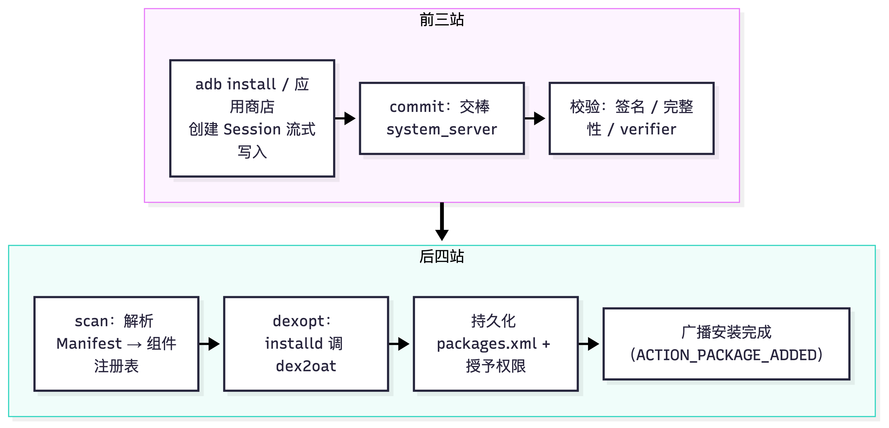
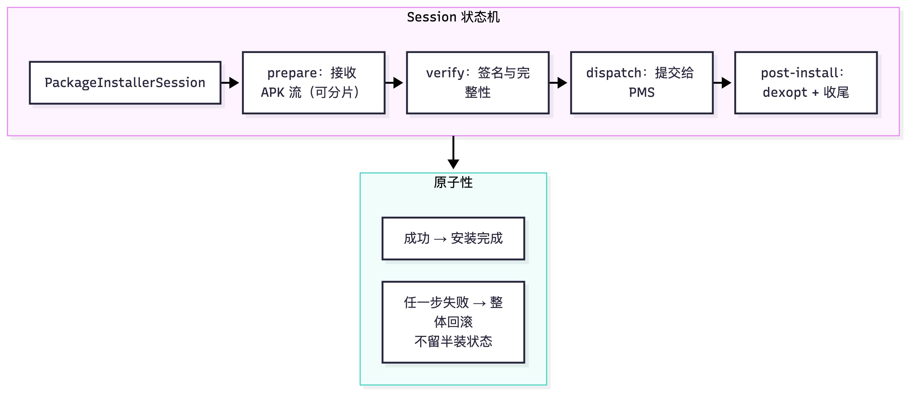
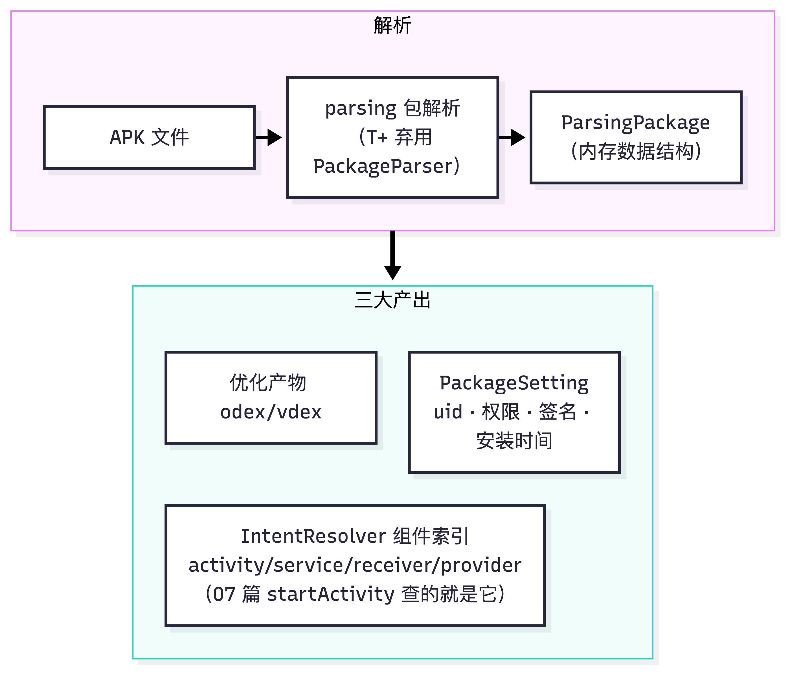

# 16｜PMS：APK 安装全流程

> 📌 **《Framework 源码深潜》系列 · 第 16 篇 / 共 20 篇** ｜ 📖 基线：Android 15（API 35）
> 上一篇：15《分发链与 ANR》

## 01 引子：主线 A 的第②环

主线 A 里 PMS 出现在两处：安装（本篇）与启动时的组件查询（07 篇 startActivity 查的 IntentResolver 就来自它）。本篇走完整条安装链，读完带走三样东西：**安装的七道关**、**Session 事务机制的动机**、**scan 产出的三大数据结构**。

## 02 七道关：从 adb install 到图标出现



**① 创建 Session**：调用方（adb/应用商店）通过 `PackageInstaller` API 创建安装会话，APK 以**流式写入**临时区——大文件不占内存，可分片断点续传（商店的"分发热更"基于此）。

**② commit**：数据齐了，交棒 system_server。从此进入 PMS 的世界。

**③ 校验**：签名（v2/v3 的 APK 签名块校验，一改一个字节都过不去）+ 完整性 + 第三方 verifier（企业 MDM/杀毒可介入）。

**④ scan**：解析 APK → 生成组件注册表（03 节展开）。

**⑤ dexopt**：installd 拉起 dex2oat，把 dex 编译成机器码产物（odex/vdex）——冷启动免解释执行。

**⑥ 持久化**：`packages.xml` 记录包元数据（uid、权限、签名），重启后 PMS 快速恢复"户籍数据库"。

**⑦ 收尾广播**：`ACTION_PACKAGE_ADDED`——**静态广播接收方从这里感知新装应用**（09 篇的静态广播派发链在此闭环）。

## 03 Session：把安装变成"事务"



N 之前安装是一条大流程走到黑，中断就是半装状态。⚠️ N 引入 **PackageInstallerSession** 后，安装成了**状态机 + 原子提交**：

prepare → verify → dispatch → post-install 四阶段清晰可查（`adb shell pm get-serial-number`？不——用 `pm install-create/install-write/install-commit` 可分步观察）；**任何一步失败，整体回滚**，设备上永远不存在"装了一半"的包。多 APK（App Bundle 按需下发 split）也靠 Session 天然聚合——多个分片收齐才算一次安装。

这个设计与 08 篇的 ClientTransaction、12 篇的 traverse 合并，是同一个思想的三次出现：**把长流程建模成原子事务**。系统级操作的可靠性，靠的都是这个模式。

## 04 scan：解析的三大产出



⚠️ 版本变迁重点：PackageParser 在 T 版被弃用，替换为 **parsing 包**（`android.content.pm.parsing`，内存结构更轻、解析更快、API 更清晰）。无论哪代实现，产出都是三份：

**IntentResolver 组件索引**：activity/service/receiver/provider 各一张 IntentFilter 匹配表——**startActivity 隐式匹配、广播静态接收方查询，查的都是它**（07/09 篇的伏笔在此回收）。

**PackageSetting**：uid 映射、权限授予状态、签名证书、安装时间——17 篇权限体系的底座。

**优化产物**：odex/vdex/art 三件套。odex 是 AOT 机器码，vdex 是原 dex 的快速校验容器，art 是启动 profile——配合 cloud profile（商店侧编译好下发）冷启动直接跳过解释。

## 05 设计追问

**Q1：为什么安装要在 system_server 里做校验，而不是装完后抽查？**

安全时序。签名校验必须在"包获得 uid、被授予目录权限"**之前**——装完再验等于先给身份再查户口。校验失败直接终止，恶意包从未获得过任何系统资源。

**Q2：为什么 dexopt 在安装时做，而不是首启时？**

启动体验与磁盘的权衡。AOT 编译耗时数秒到数十秒，首启现场编译会让用户干等；安装时后台做（甚至云端做，cloud profile）把成本转移到"等待安装"这种容忍度高的时刻。运行时 JIT 作为补充兜底。

**Q3：packages.xml 为什么用 XML 而不是数据库？**

量级与读写模式：几百个包、启动时一次性全量加载、低频写。XML 简单可靠、人类可读（debug 利器）。现代 PMS 已拆分成多文件（如 package-info 缓存），但 XML 骨架没变——**选型跟着读写模式走，不追时髦**。

## 06 动手实验与源码路标

```bash
# ① 分步安装，亲眼看 Session 状态机
adb shell pm install-create
adb shell pm install-write -S <size> <session> apk.apk < apk.apk
adb shell pm install-commit <session>
# ② 看某包的户籍信息（scan 产出的运行时形态）
adb shell dumpsys package <pkg> | head -40
```

源码路标：

```text
frameworks/base/services/core/java/com/android/server/pm/PackageManagerService.java   总入口
.../pm/PackageInstallerSession.java                                                   状态机
.../pm/parsing/ApkLiteParser.java 等                                                  T+ 新解析
frameworks/base/cmds/pm/src/com/android/commands/pm/Pm.java                           实验命令的实现
```

## 07 高频面试题 5 连

**Q1：APK 安装分几步？**

【参考答案】创建 Session 流式写入 → commit → 签名/完整性校验 → scan 解析建注册表 → dexopt（installd/dex2oat）→ 持久化 packages.xml 并授予权限 → 广播 ACTION_PACKAGE_ADDED。

**Q2：Session 机制解决什么问题？**

【参考答案】原子性：四阶段状态机 + 失败整体回滚，杜绝半装状态；支持分片断点与多 split APK 聚合。长流程事务化的典型实现。

**Q3：签名校验发生在哪一步？为什么必须前置？**

【参考答案】verify 阶段（获得 uid 与目录权限之前）。安全时序要求：身份未验证前不分配任何系统资源。

**Q4：odex/vdex/art 是什么？**

【参考答案】odex：AOT 编译的机器码；vdex：原 dex 快速校验容器；art：启动热点 profile。安装时 AOT + 运行时 JIT + 云端 profile 组合优化冷启动。

**Q5：隐式 Intent 的组件匹配查的是什么数据？**

【参考答案】PMS 的 IntentResolver 注册表——安装 scan 时从 Manifest 建立的 IntentFilter 索引，startActivity/广播静态查询共用。

## 08 小结 · 思考题 · 下篇预告

**一句话总结**：

> 安装 = Session 事务（原子性）+ 校验前置（安全）+ scan 三产出（注册表/户籍/优化码）；PMS 的价值在"把一个文件变成系统承认的公民"。

**思考题**：

1. App Bundle 的 split APK 按需下载，如果 split 中途断网，已下载部分去哪了？（提示：Session 的 staging 目录）
2. 为什么系统应用的"安装"不走 Session 流程？（提示：OTA 与只读分区）

**下篇预告 · 17《解析与权限体系》**：Manifest 如何被解析成内存结构、运行时权限的弹窗属于谁、一次性授权与自动撤销怎么实现。

---

🧭 **主线进度**：主线 A 2/9（② PMS 组件查询）｜ 主线 B 7/8
