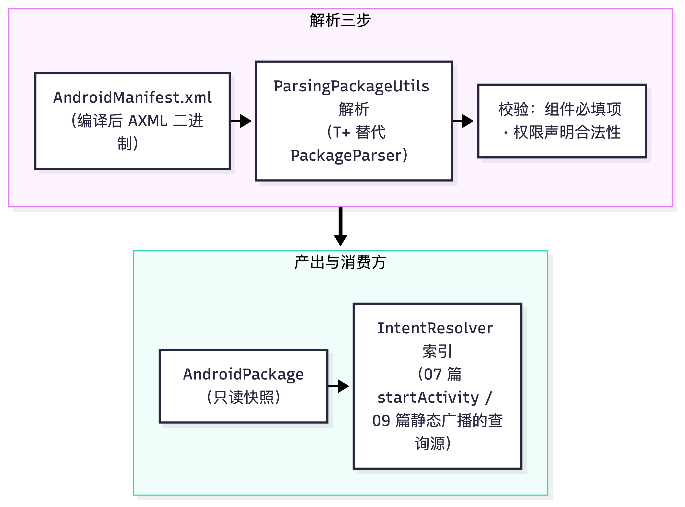
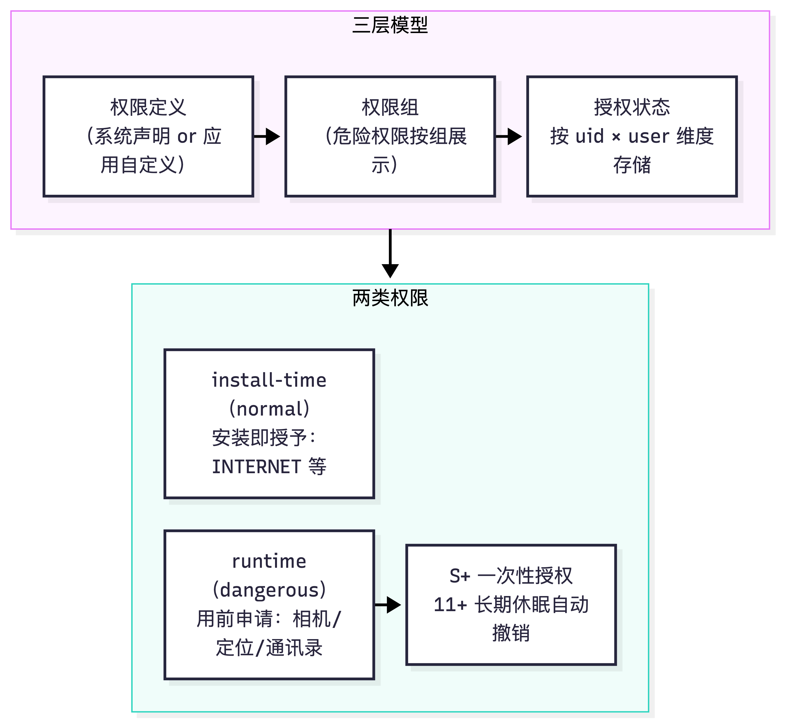
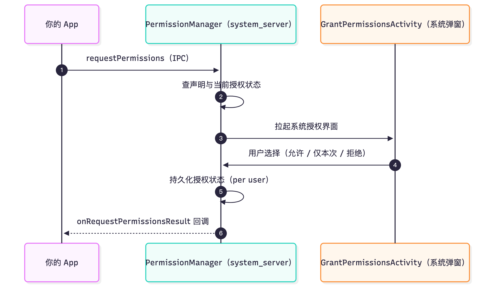

# 17｜PMS：解析与权限体系

> 📌 **《Framework 源码深潜》系列 · 第 17 篇 / 共 20 篇** ｜ 📖 基线：Android 15（API 35）
> 上一篇：16《APK 安装全流程》

## 01 引子：声明与授予的两条线

Manifest 里写一行 `uses-permission`，运行时 `checkSelfPermission` 才有答案——"声明"与"授予"是两条独立的线：声明在解析期入库，授予在运行期决策。PMS 双篇的收官篇讲清这两条线。读完带走三样东西：**Manifest 解析链**、**权限三层模型**、**运行时权限的完整时序**。

## 02 Manifest 解析：从 AXML 到内存快照



APK 里的 AndroidManifest.xml 不是文本，是编译期压过的 **AXML 二进制**（省空间、解析快）。解析链三步：**ParsingPackageUtils** 读 AXML（⚠️ T+ 替代了服役十年的 PackageParser）→ 校验（组件必填项、权限声明合法性、targetSdk 兼容规则）→ 产出只读快照 **AndroidPackage**。

解析的时机有两个：安装时（16 篇 scan 阶段）与 **system_server 启动时全量扫描**（Settings 里的 packages.xml + APK 实体比对重建）——这就是为什么开机时 PMS 阶段较重。

产出里最重要的成员是 **IntentResolver 索引**：每类组件一张 IntentFilter 匹配表。07 篇 startActivity 的隐式匹配、09 篇静态广播的接收方查询、14 篇"拉起进程再派发"的判断，查的全是它。**Manifest 是静态声明，IntentResolver 是查询用的动态索引**——这对关系是组件系统的心脏。

## 03 权限三层模型



**第一层，权限定义**：谁声明权限——系统预置（INTERNET）或应用自定义（自定义权限要签名级保护才有意义，普通声明等于没声明，这也是权限模型里最常被误解的一点）。

**第二层，权限组**：危险权限按组展示（定位组/相机组）——授权以组为单位弹窗，用户授予组内一个，同组其他自动获得（⚠️ 行为细节各版本有差异，以官方文档为准）。

**第三层，授权状态**：按 **uid × user** 维度存储——多用户（工作资料/多开）下同一个包在不同 user 的授权相互独立，PackageSetting 里的 per-user state。

两类权限的授予时机完全不同：**install-time（normal）** 安装即授予、用户无感（INTERNET、VIBRATE）；**runtime（dangerous）** 用前必须申请——相机、定位、通讯录。⚠️ 两个新机制要记：S 的一次性授权（"仅本次"，进程死即回收）；11+ 的自动撤销（长期未使用的 App 权限被系统自动回收）。

## 04 运行时权限：弹窗属于谁



那个熟悉的授权对话框，**不是你的 App 弹的，也不是 PMS 弹的**——是系统包 `com.android.permissioncontroller` 里的 **GrantPermissionsActivity**。完整时序：

App 发 requestPermissions（IPC）→ PermissionManager 查"是否声明过 + 当前状态"（未声明的直接拒绝，不会弹窗）→ 拉起系统授权界面 → 用户选择 → **授权状态持久化（per user）** → 回调 onRequestPermissionsResult。

三个工程要点：**① 弹窗不可定制**——它是独立进程的系统界面，任何覆盖/伪装它的尝试都会被系统拦截（这是权限体系的安全红线）；**② checkSelfPermission 每次都查**——授权状态可能被用户随时撤销或被自动撤销回收，缓存授权状态是 bug 之源；**③ 拒绝后要引导**——shouldShowRequestPermissionRationale 的 true 表示"用户拒绝过但未永久拒绝"，是引导去设置的信号（悬浮窗的 AppOps 体系是另一条平行线，13 篇的 canDrawOverlays 走的就是它）。

## 05 设计追问

**Q1：为什么权限弹窗做成独立进程的系统 Activity？**

可信边界。弹窗内容（权限名、图标、说明）必须不可被申请方篡改——如果弹窗在申请方进程渲染，钓鱼式伪装毫无门槛。独立进程 + 系统签名是唯一可信渲染方。

**Q2：为什么运行时权限按"组"授予？**

用户认知成本。定位类有 5 个细粒度权限，逐个弹窗会逼疯用户；按组授予把"技术权限"映射成"用户心智里的能力"（位置/相机/麦克风）。工程上组只是展示粒度，存储仍按单权限——展示层与存储层解耦。

**Q3：为什么 11+ 要做自动撤销？**

权限的"沉没膨胀"：用户授权一次后，App 可能长期占用而不被审查。自动撤销把授权从"永久契约"改成"定期续约"——代价是 App 要正确处理权限突然失效（这也是上线前必须测"撤销权限后的冷启动"的原因）。

## 06 动手实验与源码路标

```bash
# ① 看 App 的权限全景（声明 vs 授予 vs AppOps）
adb shell dumpsys package <pkg> | grep -A20 "runtime permissions"
adb shell appops get <pkg>
# ② 手动授权/撤销（模拟用户操作）
adb shell pm grant <pkg> android.permission.CAMERA
adb shell pm revoke <pkg> android.permission.CAMERA
```

源码路标：

```text
frameworks/base/core/java/android/content/pm/parsing/           T+ 解析包
frameworks/base/services/core/java/com/android/server/pm/permission/PermissionManagerService.java   授权决策
packages/modules/Permission/（mainline 模块）                    GrantPermissionsActivity 所在
frameworks/base/services/core/java/com/android/server/pm/IntentResolver 基类   组件索引
```

## 07 高频面试题 5 连

**Q1：Manifest 何时被解析？**

【参考答案】安装时（scan 阶段）与 system_server 启动时全量重建；T+ 起用 parsing 包替代 PackageParser，产出 IntentResolver 组件索引供组件查询。

**Q2：install-time 与 runtime 权限的区别？**

【参考答案】normal 类安装即授予（INTERNET）；dangerous 类用前申请（相机/定位），按组弹窗、per-user 存储、可撤销可自动回收（11+）。

**Q3：权限弹窗的 Activity 属于哪个进程？为什么？**

【参考答案】系统 permissioncontroller 模块的 GrantPermissionsActivity。独立进程保证弹窗内容不可被申请方篡改，是可信渲染边界。

**Q4：声明了权限却仍被拒绝，可能原因？**

【参考答案】targetSdk 行为差异（23+ 需运行时申请）、用户撤销或自动撤销回收、"仅本次"授权已过期、AppOps 限制（悬浮窗类）。排查用 dumpsys package + appops。

**Q5：自定义权限有什么坑？**

【参考答案】普通应用自定义权限无保护级意义（签名校验不通过任何申请方）；同签名加 signature protectionLevel 才有效；命名冲突会被系统合并/拒绝——自定义权限应限定在系统级或同签名家族内使用。

## 08 小结 · 思考题 · 下篇预告

**一句话总结**：

> 解析把声明入库（IntentResolver），权限把授予决策化（三层模型 × per-user 状态）；弹窗是系统进程的可信渲染，撤销是用户的随时权利。

**思考题**：

1. 为什么"仅本次"授权在进程死亡后就失效，而普通授权永久？两者的存储位置有什么区别？
2. 工作资料（Work Profile）里装同一个 App，相机授权要单独申请吗？为什么？

**下篇预告 · 18《冷启动全链路》**：PMS 双篇收官，进入贯通复盘。把 01–17 的知识钉回主线 A：从点击图标到首帧，完整走一遍，标出每段耗时与优化抓手。

---

🧭 **主线进度**：主线 A 2/9（② 组件查询与权限）｜ 主线 B 7/8
