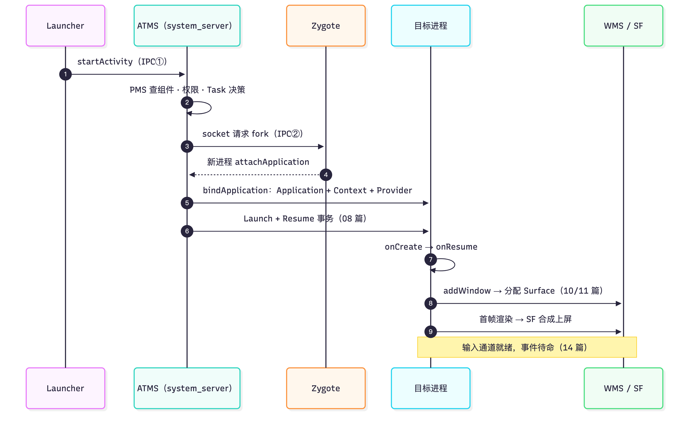
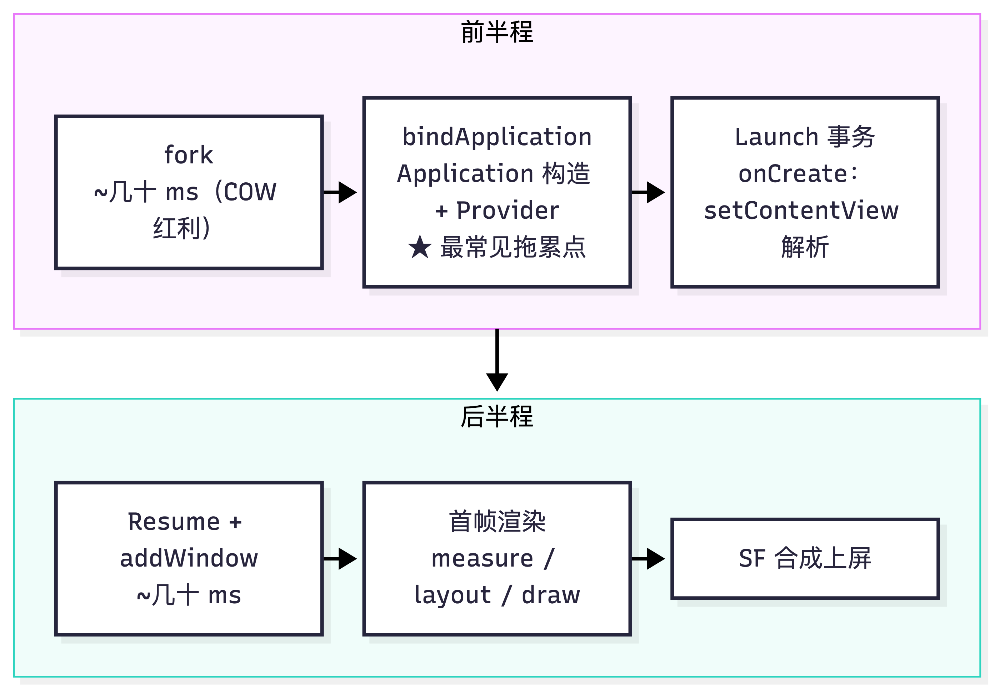

# 18｜贯通复盘：冷启动全链路

> 📌 **《Framework 源码深潜》系列 · 第 18 篇 / 共 20 篇** ｜ 📖 基线：Android 15（API 35）
> 上一篇：17《解析与权限体系》

## 01 引子：把零件装成机器

前 17 篇是零件，本篇装成机器。一次冷启动（点击图标 → 首帧）横跨 8 个模块、4 次跨进程、2 个进程诞生——每个环节都能对应到前面某一篇。本篇的价值在"钉图"：**把知识钉回主线 A 的地图，并给出每段的耗时数量级与优化抓手**。读完带走三样东西：**全链路大时序图**、**六段耗时地图**、**一份可落地的启动优化清单**。

## 02 全链路：一台戏的完整剧本



**第一幕（IPC①：请求）**：Launcher 的 startActivity → ATMS。PMS 查组件（17 篇 IntentResolver）、校验权限、Task 决策（07 篇）——全部在 system_server 内完成，App 侧无感。

**第二幕（IPC②：造人）**：目标进程不存在，socket → Zygote fork（01 篇）。COW 红利让这一步只要**几十毫秒**——预加载的类与资源直接继承。

**第三幕（报到与授命）**：新进程 attachApplication → bindApplication——Application 构造 + **Context 体系就位**（04/05 篇）+ **ContentProvider 安装**（注意顺序：provider 先于 Application.onCreate，04 篇）。然后 Launch+Resume 事务（08 篇）下发。

**第四幕（界面登场）**：onCreate → onResume → handleResumeActivity 里 addView → addWindow（10 篇：校验/token/InputChannel）→ Surface 分配（11 篇）。

**第五幕（像素上屏）**：measure/layout/draw → RenderThread → BLAST 提交 → SF 合成（11/12 篇）。首帧亮起。

**尾声（待命）**：输入通道已随 addWindow 建立（14 篇）——从这一刻起，用户的所有触摸都会被正确路由到这个新窗口。

## 03 耗时地图：钱花在哪



各段典型数量级（中端机、正常包体，仅作量级参考）：

```text
fork                几十 ms     系统侧，不可优化（COW 已尽力）
bindApplication     50~200ms    ★ 最大可优化段：Application 构造 + Provider onCreate
Launch 事务         50~150ms    onCreate：setContentView 的 XML 解析与实例化
Resume+addWindow    几十 ms     系统侧为主
首帧渲染            50~150ms    布局深度 × View 数量 × 过度绘制
SF 合成上屏         1~2 帧      系统侧
```

**关键洞察：bindApplication 是第一大优化区**——Provider 与 Application 构造串行发生在首帧之前，任何主线程初始化（SDK init、日志框架、网络库、加密库）都直接计入启动耗时。第二大优化区是首帧渲染——布局深度与 overdraw 是常见病灶。

## 04 优化清单：可落地的七条

```text
1. Application.onCreate 只留"活着必须"的初始化，其余异步/按需（注意异步的坑：回主线程的时序）
2. Provider.onCreate 瘦身：Lazy 初始化（android:initOrder/enable 切分）
3. 首屏用 ViewStub / 延迟 inflate：减少首帧 View 数量
4. ConstraintLayout 压平层级；避免过度绘制（开发者选项可视化验证）
5. 使用 cloud profile / baseline profile：让 dexopt 聚焦启动路径
6. 启动期禁止主线程 IO 与锁等待（StrictMode 打开）
7. 指标对齐 reportFullyDrawn()：比 blindly 优化更重要的是知道"真正可用"的时刻
```

**测量三件套**：`adb shell am start -W`（TotalTime）、perfetto（逐段火焰图）、线上 APM（启动分段打点）。优化的第一步永远是测量——没有数据支撑的"启动优化"大多是在给偶然性还愿。

## 05 设计追问

**Q1：为什么系统不进一步压缩冷启动耗时？**

系统侧已接近物理极限：fork 吃满 COW、事务合并吃满 IPC 预算（08 篇）、预加载吃满启动内存。剩余的大头（bindApplication、首帧渲染）全在**应用自己的代码**里——系统把刀递到你手上，剩下的看你自己。

**Q2：为什么 Provider 必须在 Application.onCreate 之前？**

依赖语义。Provider 的存在意义是"进程未起也能被外部进程访问"——如果先走 Application.onCreate，外部进程的 ContentResolver 查询就要等 Application 初始化完，违背 Provider 的"提前服务"承诺。代价是：Provider 变成了启动路径的一部分（04 篇思考题的完整答案）。

**Q3：为什么"首帧"被定义为优化终点，而不是"页面完全可用"？**

首帧是系统可测量的锚点（SF 上屏即触发）。完全可用是应用语义（数据加载完成），系统无从判断——所以 Google 提供 reportFullyDrawn 让你**自己声明**可用时刻，基准 profile 与 Vitals 都认这个锚点。

## 06 动手实验与源码路标

```bash
# 冷启动计时（试三次取均值）
adb shell am start -W -S com.example/.MainActivity
# perfetto 抓启动全链（逐段看 fork/bind/launch/首帧）
adb shell perfetto -o /data/misc/perfetto-traces/startup.pftrace -t 5s sched gfx view am binder
```

源码路标（全程回顾，无新代码——这是复盘篇）：

```text
本篇涉及的每个环节 = 01/04/05/07/08/10/11/12/14/16/17 各篇的知识点
推荐练习：对照大时序图，从每篇源码路标里找出对应函数，串成自己的完整笔记
```

## 07 高频面试题 5 连

**Q1：冷启动完整流程？**

【参考答案】IPC① startActivity → ATMS 查组件/决策 Task → IPC② socket 请求 Zygote fork → attachApplication → bindApplication（Application+Context+Provider）→ Launch/Resume 事务 → onCreate/onResume → addWindow/Surface → 首帧渲染 → SF 上屏 → 输入待命。

**Q2：冷启动优化怎么落地？**

【参考答案】先测量（am start -W / perfetto / reportFullyDrawn 锚点）；Application.onCreate 只留必需项、Provider 瘦身、首屏 ViewStub 压平布局、baseline profile、禁主线程 IO。

**Q3：am start -W 的 TotalTime 包含什么？**

【参考答案】从 ATMS 收到请求到"首帧窗口被绘制完成"（包含 fork、bindApplication、生命周期、首次 traverse）。不含 reportFullyDrawn 之后的"完全可用"部分。

**Q4：Provider 的 onCreate 为什么在 Application.onCreate 前？**

【参考答案】Provider 承诺"进程未起即可被外部访问"，须先就位；代价是它计入启动耗时。优化手段：Lazy provider、切分 enable/initOrder。

**Q5：启动慢如何定位是哪一段拖的？**

【参考答案】先 am start -W 区分冷/温启动；perfetto 看 fork→bind→launch→首帧的分段泳道；bindApplication 段慢查 Application/Provider；首帧段慢查布局深度与过度绘制。

## 08 小结 · 思考题 · 下篇预告

**一句话总结**：

> 冷启动 = 两次 IPC + 一次造人 + 一场事务 + 一帧像素；系统的部分已近极限，你的部分（bindApplication + 首帧）才是战场。

**思考题**：

1. 温启动（进程存活、Activity 重建）省掉了哪些段？耗时地图里哪几格会消失？
2. 为什么官方推荐把"完全可用"锚定在 reportFullyDrawn 而不是 onResume？两个锚点分别测的是什么？

**下篇预告 · 19《ANR 全景与排查》**：全系列终章。四类 ANR 的超时全家福、trace 文件的阅读方法、线上监控的原理——把 00 篇埋的最后一颗种子种完。

---

🧭 **主线进度**：主线 A 9/9（全线贯通）｜ 主线 B 7/8
