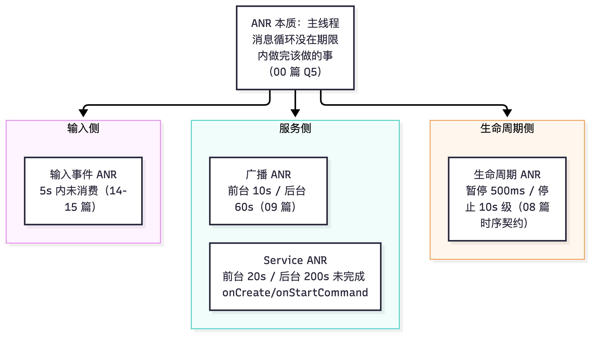
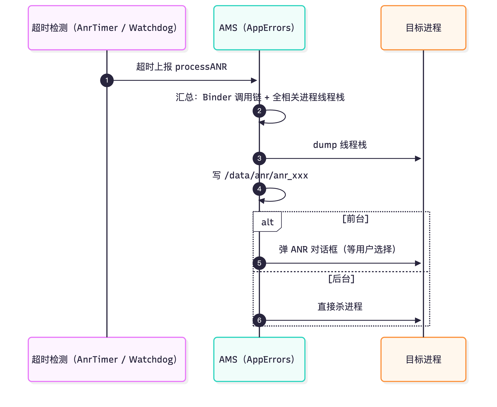
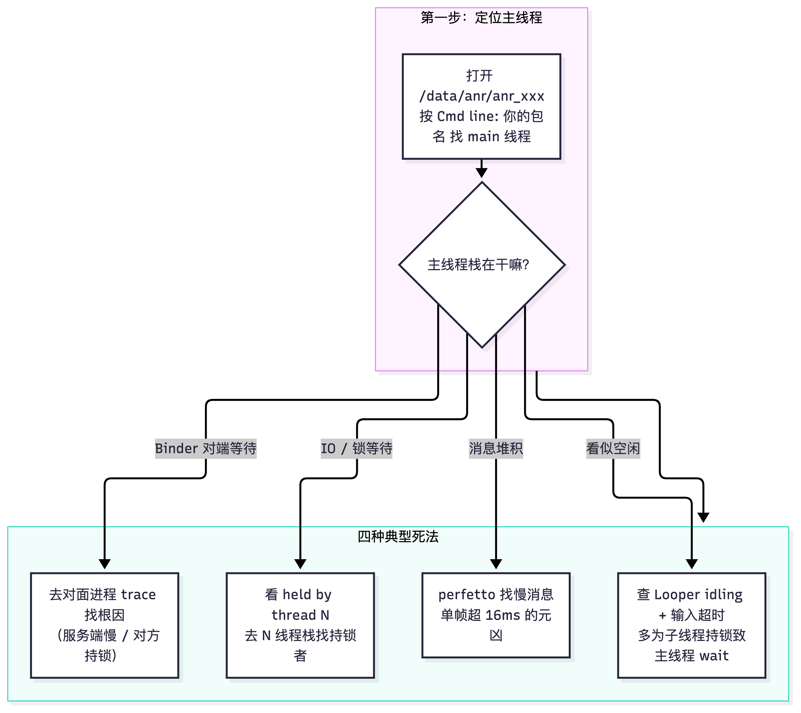

# 19｜贯通复盘：ANR 全景与排查（终章）

> 📌 **《Framework 源码深潜》系列 · 第 19 篇 / 共 20 篇** ｜ 📖 基线：Android 15（API 35）
> 上一篇：18《冷启动全链路》

## 01 引子：终章的任务

ANR 是 Framework 知识的"总考试"——输入（14/15 篇）、生命周期（08 篇）、广播（09 篇）、主线程模型（00 篇）、Binder（02/03 篇）全部入卷。本篇把它们收编成一套排查体系。读完带走三样东西：**四类 ANR 超时全家福**、**trace 文件的阅读决策树**、**线上监控的原理**。

## 02 四类 ANR：超时全家福



所有 ANR 共享同一个本质：**主线程的消息循环没在期限内做完"系统认为该做完的事"**。四类事件各自的期限：

```text
类型            超时                 计时起点
输入事件        5s                   Dispatcher 派发 → App 消费（15 篇）
Service         前台 20s / 后台 200s  onCreate/onStartCommand 收到 → 执行完
广播            前台 10s / 后台 60s   入队 + 派发 + onReceive 全程（09 篇）
生命周期        暂停 500ms / 停止 10s 级  事务下发 → 执行完（08 篇时序契约）
```

两个容易记错的点：**广播超时含排队时间**——队列里堵了 9 秒、onReceive 只花 1 秒也算 ANR，所以"减少无脑注册静态广播"比"优化 onReceive"更治本；**生命周期超时最苛刻**——onPause 只有 500ms，因为它阻塞整个窗口切换（08 篇），在 onPause 里写网络请求是全宇宙公认的反模式。

另有一类容易被忽略：**ContentProvider publish 超时（10 秒）**——冷启动时 provider 未能在时限内发布，直接 ANR（18 篇启动优化的又一个必查项）。

## 03 ANR 的触发与 trace 生成



超时检测（⚠️ U 起从 Handler 定时器迁移为独立 AnrTimer 服务）触发 `processANR` 后，AMS 做三件事：

**① 汇总现场**：抓目标进程全部线程栈，加上**Binder 调用链**（谁把目标进程卡住了——这一步是"跨进程 ANR"定位的关键）、CPU 使用、进程状态；**② 持久化**：写 `/data/anr/anr_xxx`（一个 ANR = 一堆文件：java 栈 + binder info + CPU + 事件日志）；**③ 处置**：前台弹 ANR 对话框（用户可选择等待），后台直接杀。

`adb bugreport` 会打包 /data/anr 全部内容——线上用户报"卡死"，bugreport 就是黑匣子。

## 04 trace 阅读决策树



拿到 trace 文件，四步定位：

**第一步，找主线程**：按 `Cmd line: 你的包名` 定位进程段，找 `main` 线程的栈。

**第二步，四种典型死法**：

**死法一，Binder 对端等待**：栈顶是 `nativePollOnce`？不——是停在某个 binder 调用（如 `BinderProxy.transactNative`）。**去对面进程的 trace 看它在干嘛**：服务端慢、服务端持锁，甚至服务端也在等别人（跨进程锁链，trace 里会连环出现）。这也是 trace 要抓"全部相关进程"的原因。

**死法二，锁/IO 等待**：栈显示 `waiting to lock <0x...> held by thread N`——去 N 线程的栈看它在干嘛：大概率在做 IO 或等另一个锁。**锁链可视化是读 trace 的基本功**：从主线程出发，顺"held by"指针走到尽头。

**死法三，消息堆积**：主线程栈看起来正常（空闲/在 poll），但事件还是超时——看 `Looper idling=false` 与消息队列：大量待处理消息说明前面有个慢消息堵着，去 perfetto 找那个超长帧（12 篇）。

**死法四，看似空闲但仍 ANR**：输入 ANR 却主线程空闲？多半是**子线程持锁、主线程偶尔要用**的间歇性死锁，或 receiver 未按契约 finishInputEvent。这类最难查，perfetto 的输入泳道是唯一线索。

**第三步，定位到代码**：栈顶的几行就是答案——结合业务代码反查。

**第四步，修复 + 回归**：fix 之后用压测复现场景验证，而不是"改了应该就好了"。

## 05 线上监控：不是玄学

**原理（主线程探针）**：起一个 watchdog 子线程，循环向主线程 post 任务并记录"任务执行完的时间差"——差值长期超过阈值即判定卡顿/疑似 ANR；结合主线程栈抓取（需另开信号机制）即可离线还原现场。这是所有 APM 框架（Matrix、BTrace 类）的通用骨架。

**与系统 ANR 的关系**：线上监控只能"疑似"——真正的 ANR 判定权在 system_server。所以线上方案定位"卡顿热点"，配合系统 trace（用户授权后拉 bugreport）才能坐实。**两层结合才是完整闭环**。

**预防性指标**：主线程 IO 检测（StrictMode）、锁等待上报、慢消息 top N——把 ANR 消灭在它成为 ANR 之前。

## 06 动手实验与源码路标

```bash
# ① 亲手制造一个 ANR：主线程 sleep 10s，然后点屏幕
# ② 拉出现场
adb bugreport bug.zip     # 解压后看 FS/data/anr/
# ③ 看 trace 里的主线程（第一行的优先级与 tid=main）
grep -A30 '"main"' <anr文件>
```

源码路标：

```text
frameworks/base/services/core/java/com/android/server/am/AppErrors.java       processANR 入口
.../am/AnrTimer.java? （U+ 迁移至独立服务）                                    超时检测
frameworks/base/core/java/android/os/Looper.java                              主线程消息循环
```

## 07 高频面试题 5 连

**Q1：四类 ANR 的超时值？**

【参考答案】输入 5s（派发到消费）；Service 前台 20s/后台 200s；广播前台 10s/后台 60s（含排队）；生命周期 onPause 500ms/onStop 10s 级；附加：Provider publish 10s。

**Q2：为什么输入 ANR 是 5 秒？**

【参考答案】人对"按下没反应"的容忍度上限。系统据此定 deadline——它不是技术约束而是交互预期。所以比 5 秒更早解决卡顿是产品目标，5 秒只是底线。

**Q3：拿到 ANR trace 怎么读？**

【参考答案】定位目标进程 main 线程栈 → 判断死法（Binder 对端等待/锁等待/消息堆积/假空闲）→ Binder 等待查对面进程栈、锁等待顺 held by 指针、消息堆积查 perfetto 慢帧 → 定位代码修复回归。

**Q4：线上如何监控 ANR？**

【参考答案】主线程探针（子线程 post 差值）检测卡顿 + 信号机制抓主线程栈离线还原；真 ANR 判定权在 system_server，线上方案与系统 trace 两层结合才完整。

**Q5：为什么 onPause 超时只有 500ms？**

【参考答案】onPause 完成是窗口切换的前置契约（08 篇），它阻塞新旧 Activity 的整个过渡。500ms 逼迫开发者绝不在 onPause 做耗时事，保证切换手感。

## 08 小结 · 思考题 · 全系列收官

**一句话总结**：

> ANR = "系统在期限内等不到主线程的回应"；四类超时、一份 trace、一棵决策树——排查体系的全部，都是前面 18 篇机制的自然推论。

**思考题（全系列最后一组）**：

1. 跨进程 ANR 链（A 等 B、B 等 C、C 死锁）在多份 trace 里如何"连线"定位？你会设计什么样的工具辅助？
2. 全系列 19 篇里，你觉得哪个设计决策最值得学习？为什么？（欢迎在评论区写下你的答案——这也是这个系列的结业作业。）

**系列收官**：00–19 共 20 篇至此完结。后续将按读者点单推出番外（源码阅读环境进阶 / AOSP 贡献流程 / 特定模块深挖均可）。感谢一路同行。

---

🧭 **主线进度**：主线 A 9/9 ✅｜ 主线 B 8/8 ✅｜ 两条主线全部贯通，系列完结 🎉
