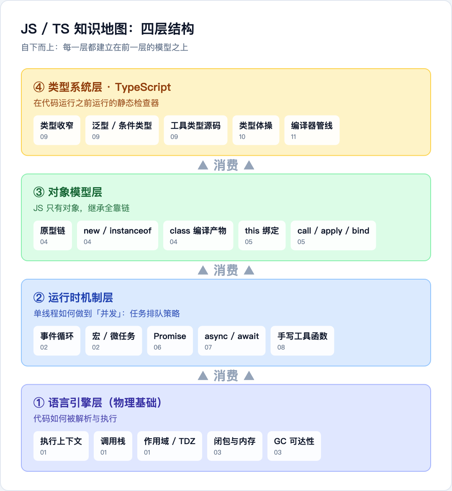

> 这个系列写给已经「会用」JavaScript / TypeScript，但想搞懂「为什么」的同学。每篇文章的配方是固定的：**原理 → 源码 → 手写 → 面试**。欢迎收藏追更。

## 一、为什么要下功夫学「底层」？

同样是写了三年前端，差异往往出现在这些时刻：

- 一段 10 行的异步代码输出顺序不对，你只能靠加日志猜，而有人能一眼看出微任务、宏任务的交错点；
- 一个 `WeakMap` 导致的内存泄漏，有人能从 GC 与闭包的引用关系直接定位根因；
- 面试官问「手写一个 `Promise`」「`async/await` 编译后长什么样」，有人能把规范、状态机、微任务调度一条线讲完。

**「会用」靠 API，「懂」靠模型。** 这个系列的目标，就是帮你把 JS/TS 的每一块核心知识，装进一个可以推演的 mental model（心智模型）里，而不是一堆背不下来的结论。

## 二、系列目录（持续更新）

| 篇 | 主题 | 你将搞懂的问题 |
|---|---|---|
| 00 | 导读与知识地图 | 系列全貌、学习方法 |
| 01 | 执行上下文与调用栈 | 变量提升、TDZ 到底发生在哪一步 |
| 02 | 事件循环与宏微任务 | 输出顺序题为什么永远难不倒你 |
| 03 | 闭包的底层实现与内存 | 闭包在 V8 里是什么，为什么闭包不「泄漏」 |
| 04 | 原型链与继承 | `new`、`instanceof`、class 编译产物 |
| 05 | this 绑定与 call/apply/bind | 四大绑定规则、三件套手写 |
| 06 | 手写 Promise 源码 | Promises/A+ 规范、then 链、微任务调度 |
| 07 | async/await 与生成器 | 协程、Babel 编译产物、co 库源码 |
| 08 | 手写高频工具函数 | 防抖节流、深拷贝、柯里化、EventEmitter |
| 09 | TS 类型系统与工具类型源码 | 收窄、泛型、条件类型、内置工具类型 |
| 10 | 类型体操方法论 | 递归类型、infer 技巧、体操实战 |
| 11 | TS 编译器架构 | tsc 五阶段管线、AST、tsconfig 精要 |
| 12 | 面试题精编与收束 | 30+ 高频题、复习路线 |

每篇都是独立可读的，但按顺序读体验最好——后面的主题会反复引用前面建立的模型。

## 三、知识地图：JS/TS 的四层结构

先给全系列一张总图。这张图把零散的知识点组织成四层，建议保存下来，学完一篇勾掉一块。



四层从下往上：

1. **语言引擎层**：代码如何被解析、执行。执行上下文、调用栈、作用域、GC 都在这一层，它是其他一切的「物理基础」。
2. **运行时机制层**：单线程如何做到「并发」。事件循环、宏微任务、Promise、async/await，本质都在回答一个问题——**任务排队策略**。
3. **对象模型层**：JS 只有对象没有类的真相。原型链、this、继承、class 语法糖，都绕不开 `[[Prototype]]`。
4. **类型系统层**：TypeScript 在运行之前运行。类型收窄、泛型、条件类型、编译器管线，本质是「给 JS 加一套编译期可推演的逻辑系统」。

## 四、学习方法：源码三遍法

每一篇我都会按这个顺序推进，你也可以用它自学任何源码：

**第一遍：用法与现象。** 先用 20 行以内的例子，把「现象」固化下来。例如事件循环篇的开头，是一段输出顺序会让人翻车的代码。

**第二遍：规范与模型。** 找到这个现象的「裁判文件」——要么是 ECMAScript 规范，要么是 V8/libuv/TypeScript 的源码。这一遍要回答「为什么」，并且把源码简化成 30 行以内可以画出来的模型。

**第三遍：手写与迁移。** 自己手写一个最小实现（手写 `Promise`、手写 `debounce`、手写 `Partial`），写不出来就回去重看第二遍。**手写不出来 = 没有真懂**，这不是羞辱，是最诚实的检验标准。

## 五、版本与环境基线

为了内容可复现，系列统一使用以下基线（概念性的引擎源码会标注「简化示意」）：

- **JavaScript 语法**：ECMAScript 2023 为准，标注 2024+ 的新特性；
- **Node.js**：20 LTS（V8 引擎 + libuv 事件循环）；
- **TypeScript**：5.x（内置工具类型定义在 `lib.es5.d.ts`，编译器源码位于 `src/` 目录）；
- **面试题**：全部来自高频真题，按主题分组给出「一句话要点 + 详细展开」。

## 六、下一篇预告

下一篇《执行上下文与调用栈》，我们从这段代码开始：

```js
console.log(a)
var a = 1
function a() {}
console.log(a)
```

为什么两行 `console.log` 之间，`a` 的类型会从函数变成数字？答案藏在「执行上下文的创建阶段」。我们下篇见。
