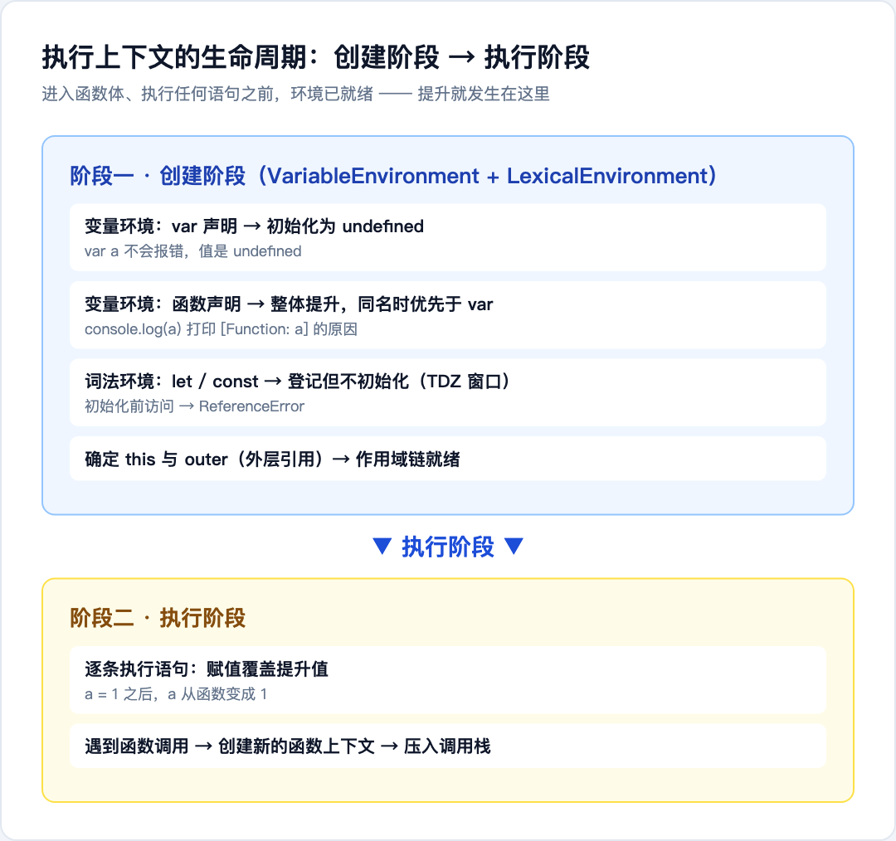
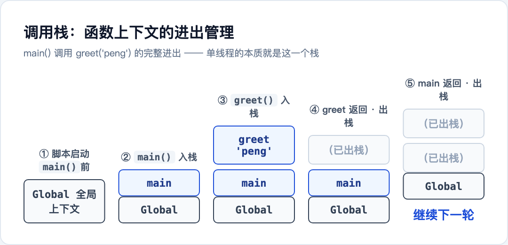

## 开场：一段让人怀疑人生的代码

```js
console.log(a)   // 输出什么？
var a = 1
function a() {}
console.log(a)   // 又输出什么？
```

实际输出：先打印 `[Function: a]`，再打印 `1`。

- `var a = 1` 在前、`function a(){}` 在后，为什么第一行打印的却是函数？
- 同一个变量 `a`，类型怎么会在两行之间从函数变成数字？

要回答这两个问题，必须进入 JS 引擎的世界：**代码不是逐行「扫描」执行的，而是先创建环境，再执行语句**。这一篇我们把这个环境——执行上下文——彻底讲透。

## 一、先看大图：V8 如何执行一段 JS

V8 是 Chrome 和 Node.js 使用的 JS 引擎。执行一段脚本的大致流程：

```text
源代码
  → 解析器 Parser（生成 AST、做预解析/懒惰解析）
  → 解释器 Ignition（把 AST 编译成字节码并执行）
  → 优化编译器 TurboFan（热点代码优化成机器码）
```

本篇关心的是第二步到第三步之间：**Ignition 执行字节码时，靠什么记录「变量存在哪、this 是谁、出错后往哪里回退」**？答案是三个术语：

- **执行上下文（Execution Context）**：执行某段代码所需的全部环境数据；
- **调用栈（Call Stack）**：管理执行上下文的进出顺序；
- **作用域链（Scope Chain）**：变量沿上下文链向外查找的路径。

> 注：JIT 优化（Ignition/TurboFan 细节）属于性能专题，本系列不展开。本文引用的 V8 源码均为概念级简化，标注「简化示意」，用于建立模型而非逐行精读。

## 二、执行上下文：创建阶段 + 执行阶段

JS 里有三种执行上下文：**全局上下文**（脚本启动时创建，整个生命周期只有一个）、**函数上下文**（每次函数调用创建一个）、**eval 上下文**（基本不用，忽略）。

关键认知：**每一个执行上下文的生命周期分两个阶段**。



**阶段一：创建阶段（进入函数体、执行任何语句之前）**

1. 创建**词法环境**（LexicalEnvironment）：登记 `let / const / class` 声明，以及临时性死区（TDZ）；
2. 创建**变量环境**（VariableEnvironment）：登记 `var` 声明（初始化为 `undefined`）和函数声明（**整体提升**，函数体直接可用）；
3. 确定 **this** 与外层引用（outer），搭好作用域链。

**阶段二：执行阶段**

逐条执行语句：赋值、调用函数、创建新的函数上下文压栈……

用这个模型解释开场的代码：

```js
// 创建阶段（尚未执行任何一行）
// 变量环境：{ a: <函数 a 的引用> }      ← 函数声明整体提升
// 变量环境：{ a: undefined → 被函数覆盖 } ← var a 声明时不覆盖已有函数引用

console.log(a)   // [Function: a] —— 提升阶段函数声明「赢了」
a = 1            // 执行阶段，赋值把函数引用覆盖为 1
console.log(a)   // 1
```

**为什么函数声明能赢？** 提升阶段处理 `var` 与函数声明时，遇到同名声明：函数声明的绑定是不可覆盖的（规范层面用 `HasRestrictedGlobalProperty` 等步骤约束，简化记法：**函数声明优先于 var 声明**）。而赋值是执行阶段的行为，自然发生在最后。

## 三、TDZ：let/const 的「死区」到底是什么

```js
let x = 'outer'
{
  console.log(x)     // ReferenceError: Cannot access 'x' before initialization
  let x = 'inner'
}
```

很多人背过「let 有暂时性死区」，但说不清死区在哪。用两阶段模型看：

- 创建阶段：词法环境登记 `x`，但状态是 **uninitialized**（未初始化），并没有像 `var` 那样填 `undefined`；
- 执行阶段：执行到 `let x = 'inner'` 这一行才初始化。

在「登记了、但还没初始化」的窗口期访问，引擎抛出 `ReferenceError`。**这个窗口期就是 TDZ**，它是创建阶段与执行阶段之间的空档，不是某个魔法标记。

V8 侧的简化模型（简化示意，源自 `src/objects/contexts.h` 与 `ScopeInfo` 的设计思路）：

```text
// 简化示意
Context {
  scope_info:  ScopeInfo   // 记录本作用域有哪些变量名、各自槽位
  previous:    Context     // 指向外层上下文 —— 作用域链的实体
  slots: [ ... ]           // 变量按槽位索引存放；TDZ 变量槽标记为未初始化
}
```

变量查找过程：当前 `Context` 的 `scope_info` 里找不到 → 沿 `previous` 向外层找 → 一路到全局。**这就是「作用域链」在引擎里的真实形态：一条 Context 链**，而不是抽象的「链表结构」。

## 四、调用栈：函数上下文的进出管理

调用栈（Call Stack）是 JS 引擎里唯一的管理器——**JS 是单线程的，一切函数调用都在这一个栈上进行**。



```js
function greet(name) {
  return `hi, ${name}`        // ④ 返回，上下文出栈
}
function main() {
  greet('peng')               // ③ greet 上下文入栈
}
main()                        // ① 全局上下文常驻栈底 → ② main 入栈
```

栈的特点决定了三个常见现象：

**1. 同步阻塞**：`greet` 没执行完，`main` 就停在原地。JS「单线程」的本质就是这一个栈。

**2. 栈溢出**：栈深度有限（V8 默认约 1 万层，具体数值因版本/设备而异），无限递归会爆栈：

```js
function loop() { loop() }
loop()  // RangeError: Maximum call stack size exceeded
```

**3. 报错堆栈**：`error.stack` 打印的就是「当错误发生时调用栈上每一层的信息」，所以它天然是倒序的——最上面是出错的函数。

## 五、一道综合题：把本篇知识串起来

```js
console.log(foo)          // ①
var foo = 1
console.log(foo)          // ②
function foo() {}
console.log(typeof foo)   // ③

bar()                     // ④
var bar = function () {}
```

逐行推演（创建阶段先完成）：

- ① 函数声明 `function foo(){}` 已整体提升 → 打印 `[Function: foo]`；
- ② 执行阶段 `foo = 1` 已完成 → 打印 `1`；
- ③ `typeof` 不再是函数 → `"number"`；
- ④ **`bar` 保存的是函数表达式**，表达式赋值遵循 `var` 规则：只提升声明（`undefined`），函数体不提升 → 调用 `undefined` → `TypeError: bar is not a function`。

**核心口诀：函数声明整体提升，函数表达式只提升声明。** 面试里 90% 的提升题考的就是这句话。

## 六、面试高频

**Q1：什么是执行上下文？它的两个阶段分别做什么？**
一句话：代码执行所需环境的抽象，分创建阶段（登记变量/绑定 this/搭作用域链）与执行阶段（逐语句运行）。详细展开参考本文第二节。

**Q2：var、let、const 在提升上的区别？**
`var`：创建阶段登记并初始化为 `undefined`；`let/const`：登记但**不初始化**，访问即 TDZ 错误；函数声明：整体提升，同名时优先于 `var`。

**Q3：调用栈和事件队列是什么关系？**
调用栈只放**同步**执行的上下文；异步回调由事件队列（宏/微任务）暂存，等调用栈清空后再由事件循环送入——详见第 02 篇。

**Q4：为什么 `typeof` 对未声明变量返回 "undefined" 而不报错？**
`typeof` 是特例：它对「查不到的绑定」返回 `"undefined"` 而不抛 `ReferenceError`（规范专门为它设计了 `IsUnresolvableReference` 分支）。这也是生产代码里判断「变量是否存在」的唯一安全方式。

## 小结

- 执行上下文 = 词法环境 + 变量环境 + this + outer，生命周期分创建/执行两阶段；
- 变量提升发生在**创建阶段**，TDZ 是「登记未初始化」的窗口期；
- 作用域链在引擎里是 Context 的 `previous` 指针链；
- 调用栈是 JS 单线程的本质，`error.stack` 就是它的快照。

下一篇我们进入「单线程却能并发」的核心谜题：**事件循环与宏微任务**——那道经典的 `setTimeout` + `Promise` 输出题，我们用 libuv 源码级别的流程图彻底拆解。
