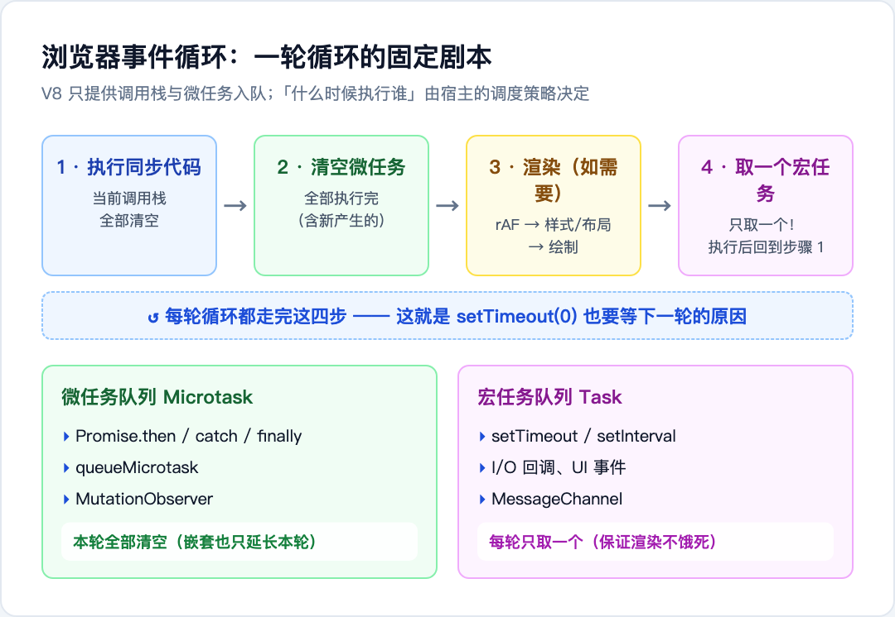
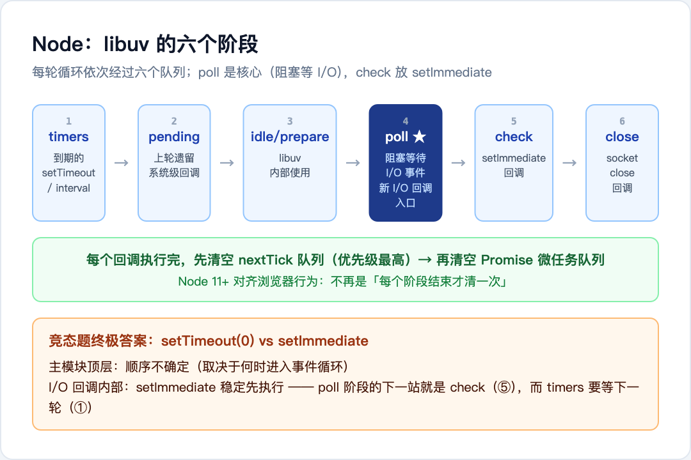

## 开场：一道输出顺序题

```js
console.log(1)

setTimeout(() => {
  console.log(2)
}, 0)

Promise.resolve().then(() => {
  console.log(3)
})

console.log(4)

// 输出：1 4 3 2
```

绝大多数人背过「1 4 3 2」，但追问两个问题就露馅了：

1. 为什么 `setTimeout(fn, 0)` 的 `0` 毫秒「延迟」比 `Promise.then` 还慢？
2. 如果微任务里有微任务，嵌套一百层会怎样？浏览器会不会卡死渲染？

这一篇我们把事件循环从「规则背诵」升级到「机制理解」。

## 一、先纠正一个常见误区：V8 不负责事件循环

很多人以为「JS 引擎」包含了事件循环。实际上：

- **V8 只提供两样东西**：调用栈（上一篇讲的）和**微任务队列的入队 API**（源码里是 `EnqueueMicrotask`，位于 `src/execution/` 一层）；
- **事件循环是「宿主环境」的**：浏览器实现于 Chromium 的消息循环，Node 实现于 **libuv**。

这意味着：微任务「优先于宏任务」不是 V8 的规矩，而是**宿主在每轮循环里的调度策略**。理解了这一点，浏览器与 Node 的行为差异就都有了解释。

## 二、浏览器：一轮循环的完整剧本



浏览器侧每一轮 event loop 的固定剧本：

1. **执行完当前调用栈上所有同步代码**；
2. **清空整个微任务队列**（注意：是全部清空，包括执行过程中新产生的微任务——所以微任务嵌套一百层也只是拉长这一步，不会跳过渲染去执行宏任务）；
3. （如需要）执行渲染：`requestAnimationFrame` → 样式计算/布局 → 绘制；
4. **取一个宏任务**执行，回到第 1 步。

两个队列各自的成员：

| 队列 | 成员 | 何时执行 |
|---|---|---|
| 微任务队列 | `Promise.then/catch/finally`、`queueMicrotask`、`MutationObserver` | 每轮循环**清空** |
| 宏任务队列 | `setTimeout / setInterval`、I/O、UI 事件回调、`MessageChannel` | 每轮循环**取一个** |

用剧本重放开场题：同步输出 `1`、`4`（第 1 步）→ 清微任务输出 `3`（第 2 步）→ 取宏任务输出 `2`（第 4 步）。

**为什么 `setTimeout(fn, 0)` 不准？** `0` 毫秒在浏览器里会被钳制为最小延迟（嵌套超过 5 层时 Chrome 至少 4ms）；更重要的是它要**排队等下一轮循环**，而微任务在**本轮**就清空了——这是队列优先级差异，不是定时器精度问题。

## 三、Node：libuv 的六个阶段

Node 的事件循环跑在 libuv 上，每轮循环依次经过六个阶段，每个阶段是一个「回调队列」：



```text
┌ timers          → 执行到期的 setTimeout / setInterval 回调
├ pending callbacks → 执行上一轮遗留的系统级回调（如 TCP 错误）
├ idle / prepare    → libuv 内部使用
├ poll             → 核心：阻塞等待 I/O 事件（也是新 I/O 回调的入口）
├ check            → 执行 setImmediate 回调
└ close callbacks  → 执行 socket 的 close 回调（如 server.close）
```

**关键规则：每进入下一阶段之前、每个回调执行完之后，都会先清空微任务队列**（libuv 的 C 代码里对应每个阶段循环后回到 JS 层的处理）。所以 Node 里微任务的优先级依然高于后续阶段。

**`process.nextTick` 是个特例**：它不在六个阶段里，Node 11+ 把它放进独立的 nextTick 队列，**优先级高于 Promise 的微任务队列**：

```js
Promise.resolve().then(() => console.log('promise'))
process.nextTick(() => console.log('nextTick'))
// nextTick 先输出
```

## 四、setTimeout(0) vs setImmediate：经典竞态

```js
setTimeout(() => console.log('timeout'), 0)
setImmediate(() => console.log('immediate'))
```

在**主模块顶层**执行：顺序**不确定**（取决于进入事件循环的时机与机器性能）。

但在 **I/O 回调内部**：顺序**确定**为 `immediate` 先——因为 I/O 回调跑在 poll 阶段，下一站就是 check 阶段（setImmediate），而 timers 要等下一轮循环：

```js
const fs = require('fs')
fs.readFile(__filename, () => {
  setTimeout(() => console.log('timeout'), 0)
  setImmediate(() => console.log('immediate'))
  // 稳定输出：immediate → timeout
})
```

**这张「阶段地图」请记牢**：poll 之后是 check，check 之后是 close，然后回到 timers——所有竞态题都能在图上推出来。

## 五、嵌套微任务会饿死渲染吗？

```js
function chain() {
  Promise.resolve().then(chain)  // 无限微任务
}
chain()
```

不会触发宏任务，但会**卡死页面交互**：每轮循环的「清空微任务」步骤永远不清空，渲染步骤（第 3 步）永远轮不到。结论：微任务适合「本任务收尾」（如状态同步），不要用微任务实现轮询——轮询请用宏任务（`setTimeout` / `MessageChannel`）。

Vue、React 内部的批量更新调度正是利用了这一点：把更新放进微任务，保证在渲染前一次性完成（这也是「DOM 更新是异步的」的原理）。

## 六、面试高频

**Q1：宏任务和微任务的区别？为什么要有两个队列？**
微任务是「当前任务的一部分」（规范叫 job），保证的是**顺序确定性**（同一轮内全部执行完）；宏任务是「下一个独立任务」，保证的是**不阻塞渲染与 I/O**。

**Q2：Node 11 前后的事件循环有什么变化？**
Node 11 之前微任务在每个**阶段**结束后才清空一次；11+ 对齐浏览器，**每个回调执行完**就清空微任务与 nextTick 队列。

**Q3：`Promise.resolve().then` 与 `setTimeout(fn,0)` 谁快？**
微任务本轮清空，宏任务下一轮取用，微任务先执行；`setTimeout` 还有最小延迟钳制（约 4ms）。

**Q4：浏览器一帧里发生什么？**
宏任务收尾 → 清微任务 → `requestAnimationFrame` → 样式/布局/绘制 → 下一轮。想保证动画流畅，重活放宏任务或 worker。

## 小结

- V8 提供调用栈与微任务机制，**调度策略属于宿主**（浏览器消息循环 / libuv）；
- 浏览器一轮 = 同步代码 → 清空微任务 →（渲染）→ 取一个宏任务；
- Node 六阶段：timers → pending → idle/prepare → poll → check → close；`nextTick` 队列优先级最高；
- `setImmediate` 在 I/O 回调内稳定先于 `setTimeout(0)`；
- 微任务嵌套只延长「清空」步骤，不会插入宏任务，但会饿死渲染。

下一篇：**闭包**。我们将进入 V8 的内存世界，看「函数为什么能记住变量」，以及闭包到底是引擎里的哪个数据结构。
