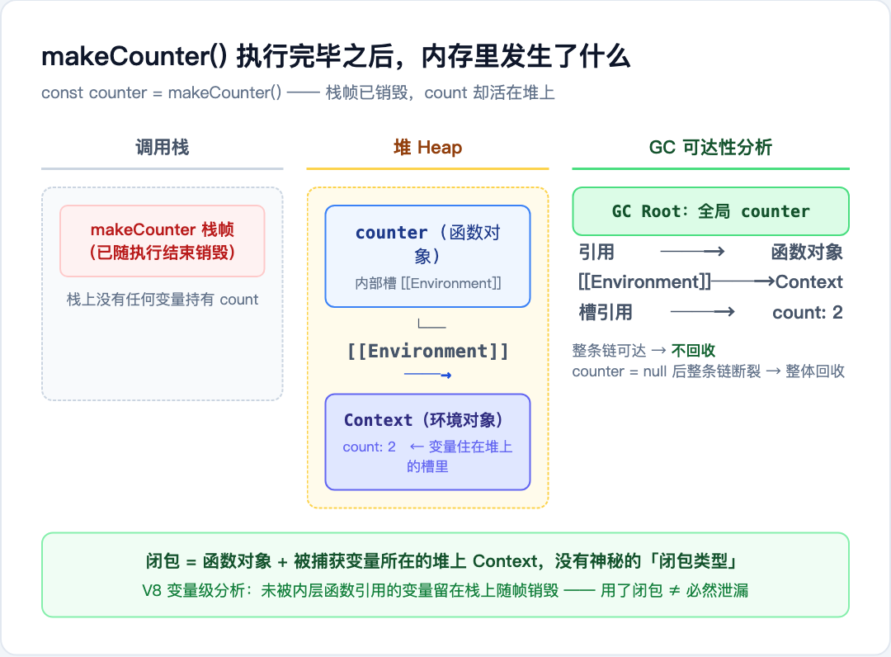

## 开场：一个计时器的「记忆」

```js
function makeCounter() {
  let count = 0
  return function () {
    return ++count
  }
}
const counter = makeCounter()
counter() // 1
counter() // 2
```

`makeCounter` 早就执行完了，局部变量 `count` 按理说应该随栈帧销毁——为什么 `counter` 还能继续读写它？

教科书答案是「函数与其词法作用域的组合」。这句话没错，但本篇的目标是把它落到 V8 的**真实数据结构**上：闭包到底「住」在哪里？谁在给它续命？

## 一、定义：闭包 = 函数 + 它捕获的环境

ECMAScript 规范中，每个函数对象都有一个内部槽 `[[Environment]]`，指向**定义它时的词法环境**。调用函数时，新建执行上下文的 outer 就取自这个槽（上一篇的 Context 链由此而来）。

**闭包没有专门的「闭包对象」类型**——它是：函数对象（携带 `[[Environment]]`）+ 被捕获变量所在的堆上环境对象。两者合起来的引用关系，才叫闭包。



把 `makeCounter` 的例子画进内存：

```text
counter (函数对象)                  堆
  └ [[Environment]] ────────→  Context { count: 2 }
                                    ↑
栈上没有任何东西再引用它，
但 GC 可达性分析沿函数对象可达 → 不回收
```

这就是全部答案：**`count` 没有住在栈上，而是住在堆上的 Context 里；只要函数对象可达，Context 就可达**。

## 二、V8 的取舍：变量为什么会被「搬」到堆上

V8 执行函数时变量本来分配在栈帧上，速度快、随栈销毁。但预解析阶段（PreParser）会做**作用域分析**，发现这些情况时改走堆分配：

1. 变量被**嵌套函数引用**（即将被捕获）→ 分配到堆上 Context；
2. 变量被 `eval` 或 `with` 触及 → 保守处理，同样堆分配。

V8 源码里这个信息记录在 `ScopeInfo`（每个作用域的「清单」：变量名、槽位、是否 context-allocated）。简化示意：

```text
// 简化示意（源自 V8 src/ast/scopes.h 的 Scope/ScopeInfo 设计）
Scope {
  variables: [ { name: 'count', mode: LET, location: CONTEXT_SLOT } ]
  // location 决定变量住栈（LOCAL）还是住堆上的 Context（CONTEXT_SLOT）
}
```

**没有被捕获的变量永远留在栈上**。所以「函数里用了局部变量」≠「闭包泄漏」——V8 做了精确到**变量级**的分析，只有真正被内层函数引用的变量才进堆。

## 三、经典争议题：for 循环里的 var 与 let

```js
for (var i = 0; i < 3; i++) {
  setTimeout(() => console.log(i))   // 3 3 3
}
for (let i = 0; i < 3; i++) {
  setTimeout(() => console.log(i))   // 0 1 2
}
```

用本篇模型解释，而不是背「块级作用域」：

- **var 版本**：`i` 提升到函数（全局）变量环境，**只有一个绑定**。三个闭包的 `[[Environment]]` 指向**同一个环境**，循环跑完后 `i === 3`，所以都输出 3。
- **let 版本**：规范为每次迭代创建一个**新的词法环境**（规范算法 `CreatePerIterationEnvironment`：复制上一轮的绑定再更新），三个闭包捕获的是**三个不同的环境**，各自记住当轮的 `i`。

一句话总结：**var 的循环体共享一个环境，let 的每轮迭代复制出一个新环境**——这是规范层面的行为，引擎照规范实现而已。

## 四、闭包与 GC：什么时候真的会泄漏？

GC 用**可达性分析**：从根（全局对象、当前调用栈、`WeakRef` 注册表等）出发，沿引用图遍历，不可达的对象回收。

由此得出闭包不泄漏的判定法：**只要捕获的 Context 不再被任何可达对象引用，整体一起回收**。`counter = null` 之后，函数对象与 Context 都变成垃圾。

真正常见的泄漏，反而是「闭包活得太久」的间接形态：

```js
// 1. 意外全局：漏写声明
function handler() { leaked = bigData }   // leaked 挂到全局，永不回收

// 2. 定时器持有闭包
const timer = setInterval(() => console.log(hugeArray), 1000)
// clearTimer 之前，hugeArray 一直可达

// 3. 事件监听不清理
el.addEventListener('click', () => console.log(state))
// 组件销毁但 el 常驻（如挂在 document 上）→ state 不可回收
```

共同模式：**长生命周期对象（全局 / 定时器 / 常驻 DOM）捕获了短生命周期的大对象**。排查工具：Chrome DevTools 的 Memory 面板做 Heap Snapshot，搜索 `Detached` 与 Retainers 链。

ES2021+ 的兜底工具：`WeakRef`（弱引用，不阻止回收）与 `FinalizationRegistry`（回收后回调）：

```js
let cache = new WeakRef(buildBigThing())
cache.deref()   // 活着就返回对象，被回收则返回 undefined
```

## 五、面试高频

**Q1：闭包的本质是什么？**
函数对象携带的 `[[Environment]]` 槽 + 被捕获变量所在的堆上 Context。本质是「跨栈帧的变量生命周期延长」。

**Q2：闭包为什么不被回收？什么时候回收？**
GC 可达性：函数对象可达 → 其 `[[Environment]]` 可达 → Context 不回收。断开对函数对象的引用（置 null / 移除监听 / 清定时器）后整体回收。

**Q3：var 和 let 在循环闭包中为什么表现不同？**
var 共享一个绑定；let 每轮迭代由规范创建新词法环境（`CreatePerIterationEnvironment`），闭包各自捕获当轮绑定。

**Q4：闭包一定导致内存泄漏吗？**
不是。V8 做变量级分析，未捕获的变量留在栈上随帧销毁；被捕获的变量只要整体不可达就正常回收。泄漏来自长生命周期对象对短生命周期大对象的持有。

## 小结

- 闭包 = 函数对象的 `[[Environment]]` + 堆上 Context，没有神秘的「闭包类型」；
- V8 在预解析的作用域分析中决定变量住栈还是住堆（`ScopeInfo` 的 `CONTEXT_SLOT`）；
- for 循环差异的根源是规范为 let 每轮创建新环境；
- 判泄漏看可达性，防泄漏断引用；`WeakRef` 是手动的兜底手段。

下一篇：**原型链与继承**。`new` 关键字背后发生了什么？`instanceof` 是怎么「顺着链找」的？class 编译成 ES5 之后长什么样？我们逐一拆解。
