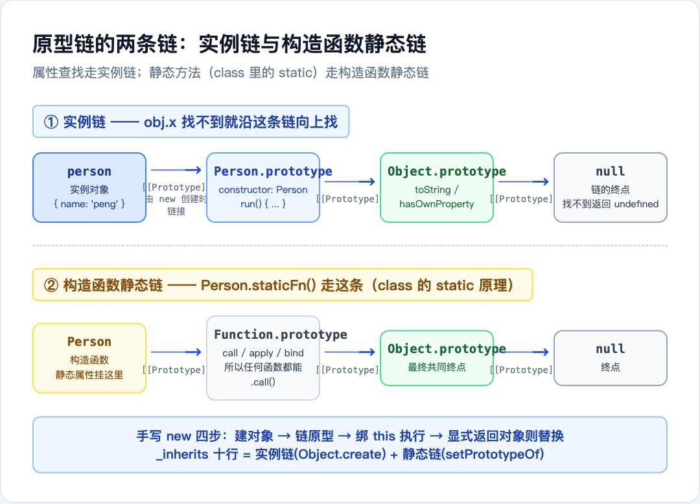

## 开场：`obj.name` 里没有 name，值从哪来？

```js
const person = { name: 'peng' }
person.toString()   // "[object Object]" —— person 上根本没有 toString
```

`person` 上没有 `toString`，但没报错，还能拿到结果。值来自 `Object.prototype`——沿着一条**原型链**找到的。本篇目标：把这条链、以及围绕它的一切（new、instanceof、继承、class）全部打通。

## 一、两个容易混淆的「prototype」



先划清两个概念：

- **`prototype` 属性**：只有函数有。「这个函数 `new` 出来的实例，`[[Prototype]]` 指向它」。
- **`[[Prototype]]` 内部槽**：每个对象都有，是实例到原型的真实链接；规范 API 是 `Object.getPrototypeOf` / `setPrototypeOf`（`__proto__` 是遗留写法，不推荐）。

**查找规则**：`obj.x` 先查自身，没有就沿 `[[Prototype]]` 逐级向上，到 `null` 结束——这就是原型链。

两条链要分清（重点，面试常考）：

```text
实例链（属性查找用）：   person ──[[Prototype]]──→ Person.prototype ──→ Object.prototype ──→ null
构造函数静态链（静态方法用）： Person ──[[Prototype]]──→ Function.prototype ──→ Object.prototype ──→ null
```

`Person.staticFn()` 走第二条链——class 的 `static` 方法原理就在这里。

## 二、手写 new：四步拆解

`new Person(...)` 在规范层面（`[[Construct]]`）等价于四步：

1. 创建一个全新对象；
2. 把它的 `[[Prototype]]` 链到构造函数的 `prototype`；
3. 以该对象为 `this` 执行构造函数体；
4. 若构造函数**显式返回了对象**，用它替换默认结果，否则返回第一步的对象。

```js
function myNew(Ctor, ...args) {
  if (typeof Ctor !== 'function') {
    throw new TypeError('myNew: constructor must be a function')
  }
  const obj = Object.create(Ctor.prototype)          // 第 1、2 步
  const result = Ctor.apply(obj, args)               // 第 3 步
  const isObj = result !== null &&
    (typeof result === 'object' || typeof result === 'function')
  return isObj ? result : obj                        // 第 4 步
}

function Person(name) { this.name = name }
myNew(Person, 'peng').name            // 'peng'
myNew(Person, 'peng') instanceof Person  // true
```

第 4 步是冷知识：构造函数里 `return { id: 1 }` 会让 `new` 的结果变成那个对象（`return 1` 则被忽略，原始值不能替换）。

## 三、手写 instanceof

`instanceof` 的本质：**沿左边对象的 `[[Prototype]]` 链，逐级查找是否等于右边函数的 `prototype`**。

```js
function myInstanceof(left, right) {
  // ES6 钩子：Symbol.hasInstance 优先（如 Promise.all 内部就用到自定义行为）
  if (typeof right === 'function' && right[Symbol.hasInstance]) {
    return !!right[Symbol.hasInstance](left)
  }
  let proto = Object.getPrototypeOf(left)
  while (proto !== null) {
    if (proto === right.prototype) return true
    proto = Object.getPrototypeOf(proto)
  }
  return false
}

myInstanceof([], Object)      // true —— 沿链找到 Object.prototype
myInstanceof('a', String)     // false —— 原始值没有原型链
```

原始值没有 `[[Prototype]]` 链，所以 `'a' instanceof String` 是 `false`——它与 `typeof` 的经典分界。

## 四、class 的真面目：编译产物分析

「class 只是语法糖」这句话**半对半错**。看 TypeScript 以 ES5 为 target 编译下面的类：

```ts
class Animal {
  static kind = 'animal'
  name: string
  constructor(name: string) { this.name = name }
  run() { console.log(this.name + ' runs') }
}
```

编译产物（节选并简化，关键函数仅保留主干）：

```js
var Animal = (function () {
  function Animal(name) {
    _classCallCheck(this, Animal)   // ① 禁止不写 new 直接调用
    this.name = name
  }
  Animal.kind = 'animal'            // ② 静态属性挂在构造函数本身
  Animal.prototype.run = function () { console.log(this.name + ' runs') }
  return Animal
})()
```

只有继承时代码才真正复杂起来。`class Dog extends Animal` 会编译出：

```js
// 简化自 Babel/TS 产物
function _inherits(subClass, superClass) {
  // ① 实例链：sub.prototype 的 [[Prototype]] → super.prototype
  subClass.prototype = Object.create(superClass.prototype, {
    constructor: { value: subClass, writable: true, configurable: true },
  })
  // ② 静态链：subClass 自身的 [[Prototype]] → superClass（static 成员靠它）
  Object.setPrototypeOf(subClass, superClass)
}
```

所以 **class 比手写继承多了四件事**，这是「不是完全的语法糖」的依据：

1. **`_classCallCheck`**：保护性检查，`Animal()` 不带 new 直接抛错（手写构造函数做不到）；
2. **静态链继承**：`Object.setPrototypeOf(sub, sup)`，手写继承常常漏掉这条；
3. **方法不可枚举**：class 方法是 `{ enumerable: false }`，手写赋值是可枚举的（`for...in` 行为不同）；
4. **严格模式强制**：class 体内自动严格模式，`this` 未初始化前访问（TDZ）有保护。

## 五、继承方式演进史（ES5 时代为什么难写）

| 方式 | 要点 | 问题 |
|---|---|---|
| 原型链继承 | `Child.prototype = new Parent()` | 实例属性变原型属性被所有实例**共享**；无法向 Parent 传参 |
| 构造函数继承 | `Parent.call(this)` | 属性隔离可传参；原型方法不可用（实例链没接上） |
| 组合继承 | 两者结合 | Parent **执行两次**，原型上多出冗余属性 |
| 寄生组合（最终形态） | `Object.create(Parent.prototype)` 补 constructor；`Parent.call(this)` | 只执行一次、属性方法全对——**就是 `_inherits` 的手写版** |

ES6 的 `extends` 把寄生组合继承规范化，还加上了静态链与调用保护。理解演进史，面试聊继承就有完整叙事：**问题 → 补丁 → 终态 → class**。

## 六、面试高频

**Q1：new 一个对象发生了什么？**
四步：建对象、链原型、绑 this 执行、按返回值决定结果。构造函数显式 return 对象时替换默认实例。

**Q2：instanceof 的原理？为什么 'a' instanceof String 是 false？**
沿左值原型链逐级比对右函数的 prototype；原始值没有原型链。可被 `Symbol.hasInstance` 自定义。

**Q3：class 是纯语法糖吗？**
实例链与静态链的手写等价物存在，但 class 额外提供调用保护、方法不可枚举、强制严格模式与 TDZ 保护，语义更严。

**Q4：Object.create(null) 的特点？**
`[[Prototype]]` 为 null，无任何继承能力——纯净字典，安全存储用（`in` 判断不受原型链污染影响）。

## 小结

- 属性查找沿实例链，静态成员沿构造函数静态链，`new` 与 `instanceof` 都是在这两条链上做文章；
- 手写 `new` 四步、手写 `instanceof` 一个 while 循环，建议都能默写；
- class = 寄生组合继承 + 静态链 + 语义保护，`_inherits` 十行代码就是它的 ES5 翻译；
- 继承演进史是一条「补丁变规范」的路线，理解问题比背写法重要。

下一篇：**this 与 call/apply/bind**。为什么同一个函数四种调法 this 就四种值？手写 bind 的「new 陷阱」怎么破？一篇讲透。
