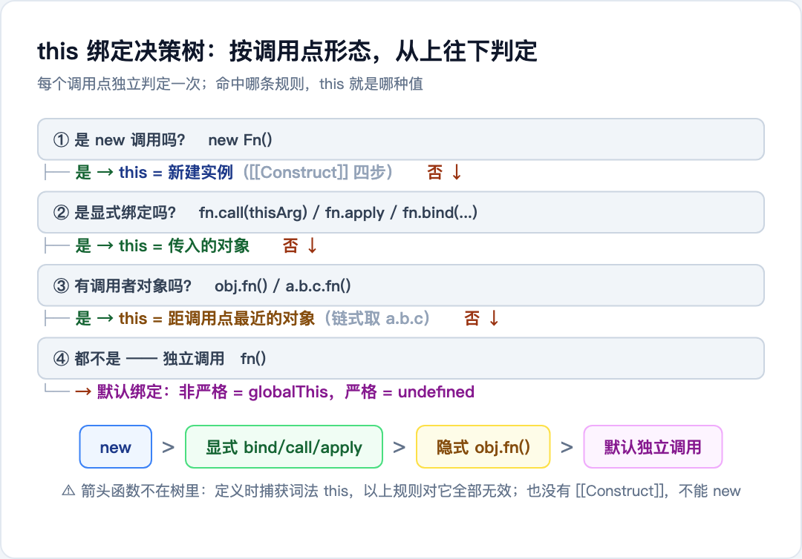

## 开场：同一个函数，四种 this

```js
function who() { console.log(this) }

const obj = { name: 'obj', who }

who()                  // window（严格模式 undefined）—— 默认绑定
obj.who()              // { name: 'obj', who } —— 隐式绑定
who.call({ tag: 'call' })   // { tag: 'call' } —— 显式绑定
new (obj.who.bind(obj))()   // who {} —— new 绑定赢了 bind！
```

四行代码同一个函数，`this` 四种结果，最后一行甚至「违反直觉」。要彻底掌握 `this`，只需要建立两个模型：**绑定规则优先级** + **箭头函数例外**。

## 一、核心模型：this 由「调用点」决定

`this` 在函数**定义时完全未知**，在**每次调用时**根据调用点的形态确定。四大规则：



**规则 1：new 绑定**——`new Fn()` 时 `this` 指向新建实例（上一篇已拆解 `[[Construct]]` 四步）。

**规则 2：显式绑定**——`fn.call(thisArg, ...)` / `fn.apply(thisArg, args)`，`this` 就是传入的对象；`fn.bind(thisArg)` 返回永久锁定 `this` 的新函数。

**规则 3：隐式绑定**——`obj.fn()` 时 `this` 指向调用点**最近的对象**（链式调用取最里层）：

```js
const a = { b: { c: { fn: who } } }
a.b.c.fn()   // this 是 a.b.c，不是 a
```

**规则 4：默认绑定**——不属于以上任何情况的独立调用：非严格模式 `this` 为 `globalThis`，严格模式为 `undefined`。

**优先级：new > 显式（bind/call/apply）> 隐式 > 默认。** 验证：

```js
function Foo() { console.log(this.id) }
const bound = Foo.bind({ id: 'bound' })
new bound()     // 打印 {} —— 新实例没有 id，说明 this 是 new 出来的对象
                // new 覆盖了 bind 的锁定（ES6 起 bind 内部用 new.target 判断）
```

## 二、箭头函数：唯一的「规则外」函数

箭头函数没有自己的 `this` 绑定——它**捕获定义时所在词法作用域的 this**（本质就是上一篇讲的 `[[Environment]]`：this 被当作普通变量捕获进环境）。

由此三条推论，全部可以推出来：

```js
const arrow = () => console.log(this)
arrow.call({ tag: 'call' })    // 打印定义处的 this —— call/apply/bind 对它无效
new arrow()                    // TypeError: arrow is not a constructor
                               // 没有 [[Construct]]，不能当构造器
```

1. **call/apply/bind 第一个参数对箭头函数无效**（this 已在定义处锁定）；
2. **箭头函数不能用 `new`**（引擎层面没有 `[[Construct]]` 内部方法）；
3. **事件回调与定时器是箭头函数的主场**——因为回调的调用点在宿主代码里，普通函数会掉进默认绑定：

```js
class Counter {
  count = 0
  constructor() {
    // 普通函数：this 是 undefined（严格模式）→ 报错
    // 箭头函数：捕获 constructor 的 this，即实例
    setTimeout(() => console.log(++this.count), 100)
  }
}
```

> 工程约定：React class 组件时代「为什么 render 里的回调要 bind」就是同一个问题——绑定发生在 JSX 渲染时机，调用点已经丢失。这也是函数组件 + Hooks 方案诞生的原因之一。

## 三、手写 call：借尸还魂

`call` 的思路：把函数临时挂到目标对象上调用，用完删除。

```js
Function.prototype.myCall = function (thisArg, ...args) {
  if (typeof this !== 'function') {
    throw new TypeError('myCall 必须由函数调用')
  }
  // ① 规范处理：thisArg 为 null/undefined 时 → 全局对象；原始值 → 包装对象
  const context = Object(thisArg ?? globalThis)
  // ② 用 Symbol 避免覆盖对象已有属性
  const key = Symbol('fn')
  context[key] = this
  // ③ 借用对象身份调用 → 隐式绑定生效，this 指向 context
  const result = context[key](...args)
  delete context[key]     // ④ 清理痕迹
  return result
}

who.myCall({ tag: 'mine' })   // { tag: 'mine' }
```

`apply` 只差参数形态：`myCall` 用剩余参数，`apply` 直接传数组（面试常顺手考察 `args` 的合法性校验）。

## 四、手写 bind：真正的难点是 new 陷阱

bind 返回的函数要满足两个语义：**普通调用锁死 this**，但 **`new` 调用时让 new 优先**（上一篇验证过的行为）。

```js
Function.prototype.myBind = function (thisArg, ...boundArgs) {
  if (typeof this !== 'function') {
    throw new TypeError('myBind 必须由函数调用')
  }
  const original = this

  function bound(...args) {
    // 关键判断：new bound() 时，this 是新实例且沿原型链可达 bound.prototype
    if (this instanceof bound) {
      return original.apply(this, [...boundArgs, ...args])  // new 优先
    }
    return original.apply(thisArg, [...boundArgs, ...args])  // 普通调用锁定
  }

  // 维持原型链：让 new bound() 时 instanceof 检查成立，
  // 且不执行原构造函数（Object.create 不触发 constructor）
  if (original.prototype) {
    bound.prototype = Object.create(original.prototype)
  }
  return bound
}

function Point(x, y) { this.x = x; this.y = y }
const P = Point.myBind(null, 1)
new P(2).x           // 1 —— 绑定参数生效
new P(2) instanceof Point   // true —— 原型链维持
```

三个考点全部覆盖：**预置参数（偏函数）**、**new 优先级**、**原型链不破坏**。手写 bind 是面试中出现频率最高的手写题之一。

## 五、面试高频

**Q1：this 的确定时机与规则优先级？**
调用时确定；new > 显式 > 隐式 > 默认。箭头函数除外——定义时捕获词法 this，永远不参与四规则。

**Q2：为什么 call 对箭头函数无效？**
箭头函数没有自己的 this 绑定，this 作为词法变量被捕获进 `[[Environment]]`，显式绑定改不了它。

**Q3：手写 bind 有哪些坑？**
① new 调用要放行（`instanceof` 判断）；② 原型链用 `Object.create` 维持；③ 预置参数与调用参数合并顺序。

**Q4：非严格模式下 call(null) 的 this 是什么？**
`globalThis`；传原始值则被包装成对象（Number/String/Boolean 实例）。严格模式不转换，this 就是传入值本身。

## 小结

- this 的全部复杂性 = 四条规则 + 一个优先级 + 一个箭头函数例外；
- 隐式绑定看「调用点最近的对象」，显式绑定看传入值，默认绑定看严格模式；
- 手写 bind 的灵魂是 `instanceof` 判断 + `Object.create` 维持原型链；
- 箭头函数是词法 this，事件回调/定时器的第一选择。

下一篇进入异步主战场：**手写 Promise 源码**。以 Promises/A+ 规范为骨架，从状态机到 then 链，逐行实现一个通过全部测试用例的 Promise。
