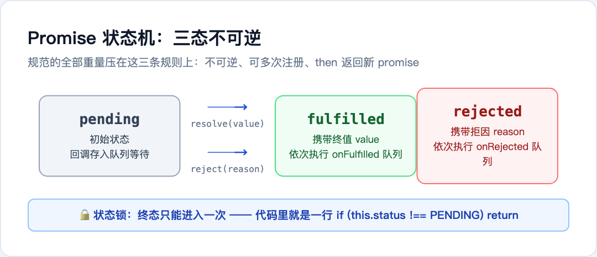
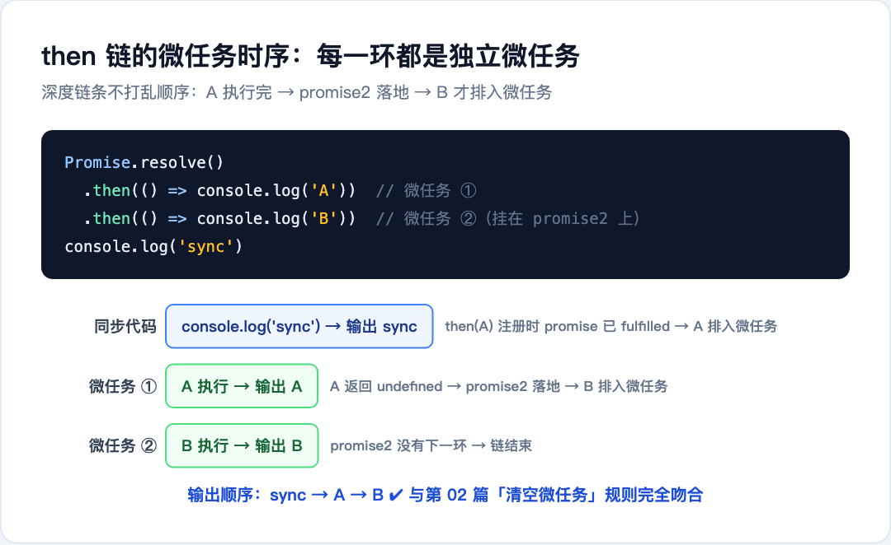

## 开场：从回调地狱到状态机

```js
// 2015 年之前的样子
getUser(id, (err, user) => {
  if (err) return handle(err)
  getOrders(user, (err, orders) => {
    if (err) return handle(err)
    getDetail(orders[0], (err, detail) => { /* ... */ })
  })
})
```

回调地狱的三个病根：**嵌套表达控制流**、**错误处理分散**、**无法复用与组合**。Promise 用「状态机 + 队列」一次性解决：异步结果被封装成**值**，控制流被压平成**链**。

本篇按 Promises/A+ 规范（测试套件 promises-aplus-tests 有 872 个用例，手写版可以跑通）从零实现。这是整个系列含金量最高的一篇手写，建议跟读并动手敲一遍。

## 一、规范骨架：只有三条硬规则



Promises/A+ 的核心极其克制，三条规则撑起全部：

1. **三态不可逆**：`pending → fulfilled` 或 `pending → rejected`，且只能变一次；
2. **then 注册回调**：同一 promise 可多次 `then`，回调按注册顺序执行；
3. **then 返回新 promise**：链式调用的基础，且回调「异步执行」（规范指明微任务）。

用 `queueMicrotask`（浏览器与 Node 通用）满足第 3 条。

## 二、第一层：构造函数与状态锁

```js
const PENDING = 'pending'
const FULFILLED = 'fulfilled'
const REJECTED = 'rejected'

class MyPromise {
  constructor(executor) {
    this.status = PENDING
    this.value = undefined      // 终值
    this.reason = undefined     // 拒因
    this.onFulfilledCallbacks = []   // pending 期间注册的回调队列
    this.onRejectedCallbacks = []

    const resolve = (value) => {
      // resolve 里再收到 promise：等待它定型后再延续（简化版 thenable 处理）
      if (value instanceof MyPromise) return value.then(resolve, reject)
      if (this.status !== PENDING) return            // 状态锁：三态不可逆
      this.status = FULFILLED
      this.value = value
      // 关键：只有此时注册过的回调才排微任务；状态未定的回调进队列等待
      this.onFulfilledCallbacks.forEach(fn => queueMicrotask(() => fn(this.value)))
    }
    const reject = (reason) => {
      if (this.status !== PENDING) return
      this.status = REJECTED
      this.reason = reason
      this.onRejectedCallbacks.forEach(fn => queueMicrotask(() => fn(this.reason)))
    }

    try {
      executor(resolve, reject)
    } catch (e) {
      reject(e)       // executor 同步抛错 → 直接拒绝
    }
  }
}
```

两个易漏点：

- **pending 阶段的回调必须存队列**（同一 promise 多次 then 都要在状态落地后按序执行）；
- **executor 抛错要转成 reject**，否则 promise 永远 pending。

## 三、第二层：then 的链式与值穿透

`then` 做四件事：收集两个回调、创建**下一个** promise、在合适的时机调度回调、把回调结果「解析」进下一个 promise。

```js
then(onFulfilled, onRejected) {
  // 值穿透：非函数参数，值/拒因原样传给下一环
  onFulfilled = typeof onFulfilled === 'function' ? onFulfilled : v => v
  onRejected = typeof onRejected === 'function' ? onRejected : e => { throw e }

  const promise2 = new MyPromise((resolve, reject) => {
    const runFulfilled = () => {
      queueMicrotask(() => {
        try {
          const x = onFulfilled(this.value)         // 回调返回值 x 是关键
          resolvePromise(promise2, x, resolve, reject)
        } catch (e) { reject(e) }                   // 回调抛错 → promise2 拒绝
      })
    }
    const runRejected = () => {
      queueMicrotask(() => {
        try {
          const x = onRejected(this.reason)
          resolvePromise(promise2, x, resolve, reject)
        } catch (e) { reject(e) }
      })
    }

    if (this.status === FULFILLED) runFulfilled()
    else if (this.status === REJECTED) runRejected()
    else {   // pending：先入队，状态落地后由构造函数里的 forEach 触发
      this.onFulfilledCallbacks.push(runFulfilled)
      this.onRejectedCallbacks.push(runRejected)
    }
  })
  return promise2
}
```

链式时序验证：

```js
Promise.resolve(1)
  .then(v => { console.log(v); return v + 1 })
  .then(console.log)
console.log('sync')
// sync → 1 → 2    每一环都是独立微任务，按注册顺序执行
```

## 四、第三层：resolvePromise——规范的精华

回调返回值 `x` 可能是：普通值、promise、**thenable（有 then 方法的对象）**，甚至递归引用自身。规范 2.3 条款专门定义「解析过程」：

```js
function resolvePromise(promise2, x, resolve, reject) {
  // 2.3.1 x 就是 promise2 自己 → 循环引用，必须拒绝
  if (x === promise2) {
    return reject(new TypeError('Chaining cycle detected for promise'))
  }
  if (x !== null && (typeof x === 'object' || typeof x === 'function')) {
    let called = false                        // 2.3.3.3.3：只允许成功/失败其一
    try {
      const then = x.then                     // 2.3.3.1：then 可能是 getter，只取一次
      if (typeof then === 'function') {
        then.call(x, y => {
          if (called) return; called = true
          resolvePromise(promise2, y, resolve, reject)   // 递归解析，直到普通值
        }, r => {
          if (called) return; called = true
          reject(r)
        })
      } else {
        resolve(x)                            // 伪 thenable：当普通值处理
      }
    } catch (e) {
      if (called) return
      reject(e)                               // 取 then 抛错 → 拒绝
    }
  } else {
    resolve(x)                                // 普通值
  }
}
```

这段代码是「读源码学设计」的范本：**called 标志**防双调用，**then 只取一次**防 getter 副作用，**递归解析**统一了 promise/thenable/普通值三种世界。

## 五、第四层：派生方法

```js
catch(onRejected) { return this.then(null, onRejected) }

finally(onFinally) {
  return this.then(
    v => MyPromise.resolve(onFinally()).then(() => v),
    e => MyPromise.resolve(onFinally()).then(() => { throw e })
  )   // finally 不改变链的值与状态，只做收尾
}

static all(promises) {
  return new MyPromise((resolve, reject) => {
    const results = []
    let count = 0
    const arr = [...promises]
    if (arr.length === 0) return resolve([])
    arr.forEach((p, i) => {
      MyPromise.resolve(p).then(v => {       // 非 promise 值也要包装
        results[i] = v                        // 按位置存放，不按完成顺序
        if (++count === arr.length) resolve(results)
      }, reject)                              // 任一失败 → 整体失败
    })
  })
}

static race(promises) {
  return new MyPromise((resolve, reject) => {
    for (const p of promises) MyPromise.resolve(p).then(resolve, reject)  // 第一个定型者胜
  })
}

static any(promises) {
  return new MyPromise((resolve, reject) => {
    const errors = []
    const arr = [...promises]
    if (arr.length === 0) return reject(new AggregateError([], 'All promises were rejected'))
    let count = 0
    arr.forEach((p, i) => {
      MyPromise.resolve(p).then(resolve, e => {     // 第一个成功者胜
        errors[i] = e
        if (++count === arr.length) reject(new AggregateError(errors, 'All promises were rejected'))
      })
    })
  })
}

static allSettled(promises) { /* 全部定型后 resolve 每一项的 {status, value/reason}，实现略 */ }
```

记忆口诀：`all` 全成功才成功、`race` 谁快听谁的、`any` 有一个成功就成功、`allSettled` 全部都要交卷。

## 六、then 链的微任务时序



```js
Promise.resolve()
  .then(() => console.log('A'))
  .then(() => console.log('B'))
console.log('sync')
// sync → A → B
```

推演：`then(A)` 注册时 promise 已 fulfilled → A 排入微任务；`then(B)` 挂在 promise2 上（pending）→ A 执行完、promise2 落地，B 才排入微任务。**每一环是一个独立的微任务，深度链条不会打乱顺序**——这也是第 02 篇「清空微任务会不断产生新微任务」的实例。

## 七、面试高频

**Q1：手写 Promise 最容易漏的三个点？**
① pending 期回调入队（多次 then 按序执行）；② thenable 递归解析 + called 标志；③ executor 同步抛错转 reject。

**Q2：then 的值穿透是怎么实现的？**
非函数参数替换为 `v => v` / `e => { throw e }`，让值原样流过，实现 `promise.then().then().then(v => ...)` 直达。

**Q3：resolvePromise 为什么要防循环引用？**
`const p = promise.then(v => p)` 时 x === promise2，不检测则无限递归爆栈。规范 2.3.1 规定必须拒绝并抛 TypeError。

**Q4：Promise.all 的 results 顺序由什么保证？**
按输入位置写入 `results[i]`，与完成顺序无关——并行请求按序聚合的标准手法。

## 小结

- Promise = 三态状态机 + 回调队列 + then 链解析，规范 872 个用例全部源于这三块；
- resolvePromise 是规范精华：递归解析 + called 标志 + 循环检测；
- 派生方法只是状态机的组合应用，`finally` 特殊在「不改链」；
- 手写不是目的，能从任何一行 then 代码推演出微任务时序才是。

下一篇：**async/await 与生成器**。await 背后是 generator 协程 + 自动执行器，Babel 编译产物 `_asyncToGenerator` 三十行就能还原 async 的全部语义。
