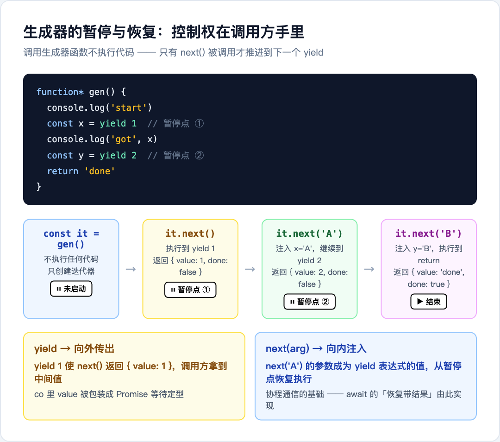

## 开场：await 到底「等」了什么

```js
async function load() {
  const user = await getUser()      // 看起来像同步代码
  const orders = await getOrders(user)
  return orders[0]
}
```

`async/await` 让异步代码「看起来同步」，但引擎里它是一台**可控暂停的机器**：函数执行到 `await` 处交出控制权，等 promise 定型后再从暂停点**带着结果恢复执行**。这个能力不是 async 发明的，而是 **generator（生成器）** 提供的——async 函数 = generator + 自动执行器 + Promise 语义。

本篇按三层递进：生成器原理 → 手写 co → 编译产物还原。

## 一、生成器：可以暂停的函数

```js
function* gen() {
  console.log('start')
  const x = yield 1            // 暂停点 ①，向内传 1
  console.log('got', x)
  const y = yield 2            // 暂停点 ②
  console.log('got', y)
  return 'done'
}

const it = gen()        // 不执行任何代码！只创建迭代器
it.next()               // 打印 start，返回 { value: 1, done: false }
it.next('A')            // 打印 got A，返回 { value: 2, done: false }
it.next('B')            // 打印 got B，返回 { value: 'done', done: true }
```

三个关键认知：

1. **调用生成器函数不执行代码**，只返回迭代器（实现迭代器协议：`next` 返回 `{ value, done }`）；
2. **`yield` 是双向通道**：向外抛出值（`value`），`next(arg)` 的参数从暂停点**向内注入**（成为 `yield` 表达式的值）——这就是协程通信的基础；
3. **控制权在调用方手里**：`next` 不被调用，函数体就停在 `yield` 处——这叫**协作式调度**。



## 二、手写 co：三十行的自动执行器

生成器解决了「暂停/恢复」，但没有解决「await 一个异步结果后自动继续」。2013 年 tj/co 给出答案——递归调用 `next`：

```js
function co(genFn) {
  return new Promise((resolve, reject) => {
    const gen = genFn()                       // 生成器函数 → 迭代器

    function next(lastValue) {
      let step
      try {
        step = gen.next(lastValue)            // 唤醒生成器，注入上一步的结果
      } catch (e) { return reject(e) }
      if (step.done) return resolve(step.value)    // 生成器结束 → 整体成功

      // 把 yield 的值标准化为 promise，定型后自动继续
      Promise.resolve(step.value)
        .then(v => next(v), e => gen.throw(e))     // 失败 → throw 注入生成器
    }
    next()
  })
}

// 用法（2015 年流行的写法，await 出现前最后的优雅）
co(function* () {
  const user = yield getUser()          // 等价于今天的 await getUser()
  const orders = yield getOrders(user)
  return orders[0]
})
```

两个设计点值得品味：

- `gen.throw(e)`：promise 失败时**向生成器内部抛异常**，生成器里的 `try/catch` 捕获——async 函数里 `try { await ... } catch` 能工作的根源；
- 失败时没有调用 `reject` 而是 `gen.throw`，把错误处理权**交还给用户代码**，co 层只兜底。

> 原版 co 还支持 thunk、数组、对象的 yield（源码约 200 行，核心就是上面这 20 行的调度循环）。

## 三、还原编译产物：_asyncToGenerator

今天的 Babel / TypeScript 把 async 降级为 ES5 时，用的就是「co 思想」。看这段：

```js
async function load() {
  const user = await getUser()
  return user.name
}
```

编译产物（Babel 的 helper `_asyncToGenerator`，节选主干并简化）：

```js
function asyncToGenerator(genFn) {
  return function () {
    const gen = genFn.apply(this, arguments)
    return new Promise((resolve, reject) => {
      function step(key, arg) {
        let info
        try {
          info = gen[key](arg)              // key 为 'next' 或 'throw'
        } catch (e) { return reject(e) }
        if (info.done) return resolve(info.value)
        Promise.resolve(info.value)
          .then(v => step('next', v), e => step('throw', e))
      }
      step('next')                          // 启动
    })
  }
}
```

与 co 一字不差的核心：**async 函数在低版本下就是一个被自动执行器包裹的生成器**。`await` 编译为 `yield`，错误注入用 `throw`，返回值被装进一个外层 Promise。所以两条结论自然成立：

- **async 函数总是返回 Promise**（哪怕 `return 1`）；
- **`await` 非 promise 值时**（如 `await 42`），该值被 `Promise.resolve` 包装，依然走一次微任务。

## 四、错误处理与并发的正确姿势

**错误处理三条路**：

```js
// ① try/catch —— co 的 gen.throw 让它成立
try { await risky() } catch (e) { handle(e) }

// ② Go 风格 —— await 正常返回，错误以值形式处理
const [err, data] = await to(risky())

// ③ 全局兜底 —— 无人处理的拒绝
window.addEventListener('unhandledrejection', e => report(e.reason))
```

**并发陷阱（面试重灾区）**：连续 `await` 是**串行**的，无依赖时浪费一倍时间：

```js
// 串行：总耗时 ≈ t1 + t2
const a = await fetchA()
const b = await fetchB()

// 并行：总耗时 ≈ max(t1, t2)
const [a, b] = await Promise.all([fetchA(), fetchB()])
```

区分两种场景：**逻辑上必须先后**（b 依赖 a）用串行；**仅顺序书写但无依赖**改 `Promise.all`。for 循环里 `await` 同理——批量任务改 `all` 或 `allSettled`，需要限流时用队列分批。

## 五、面试高频

**Q1：async/await 的本质是什么？**
生成器（暂停/恢复/双向通信）+ 自动执行器（递归 next）+ Promise 标准化。`_asyncToGenerator` 编译产物三十行可完整还原。

**Q2：await 之后的代码在哪个任务里执行？**
`await promise` 的延续（continuation）在微任务中执行；即使 await 的是普通值，也经过 Promise.resolve 包装走微任务。所以 async 函数体内的同步段先行执行，首个 await 之前的部分是同步的。

**Q3：co 里 gen.throw 起什么作用？**
把异步失败注入生成器内部，让用户代码的 try/catch 能捕获——这就是 async 函数里 try/catch 能接住 await 错误的原理。

**Q4：多个 await 一定是并发吗？**
不是，逐行 await 是串行链；并行用 Promise.all 聚合。输出顺序题中「await 前的代码同步执行、await 后的代码在微任务」是高频考点。

## 小结

- 生成器提供「暂停 + 恢复 + 双向通信」，是协程的 JS 实现；
- co 与 `_asyncToGenerator` 是同一个思想的两次亮相：递归 next + Promise 标准化 + throw 注入；
- async 函数总返回 Promise；await 前同步、await 后微任务；
- 并发优化是工程上的高频失分点：无依赖不串行。

下一篇：**手写高频工具函数**。防抖节流、深拷贝、柯里化、compose、EventEmitter——面试手写题的「五虎将」一次打包。
