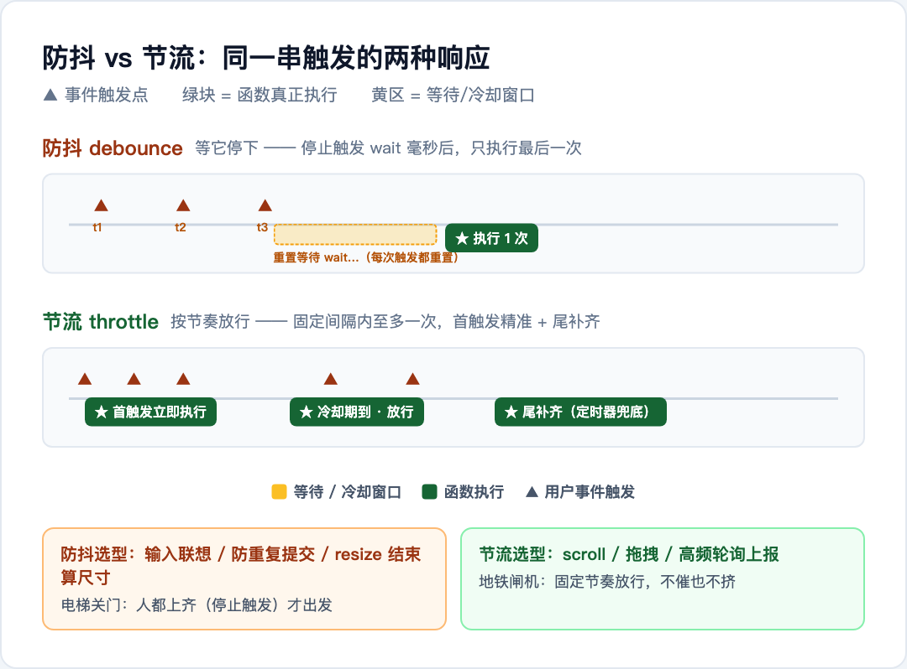

## 开场：手写题在考什么

手写工具函数考的不是记忆力，而是四个工程素养：**this 保留、参数透传、边界情况、状态管理**。本篇五道高频题全部给出生产级写法，每道都标注「考点」。

## 一、防抖：停车场理论

搜索框连续输入，只在**最后一次输入后等 500ms** 才发请求——事件停止触发后延迟执行，期间重新触发则重置计时。



```js
// 考点 ①：保留调用方的 this 与参数（用普通 function，不是箭头函数）
function debounce(fn, wait) {
  let timer = null
  return function (...args) {
    if (timer) clearTimeout(timer)
    timer = setTimeout(() => {
      timer = null
      fn.apply(this, args)
    }, wait)
  }
}
```

进阶：lodash 还支持 `leading`（首次立即执行）、`trailing`（末次补执行）、`maxWait`（最长等待上限）。实现方式是给闭包加状态位：

```js
function debounceLeading(fn, wait) {
  let timer = null
  return function (...args) {
    const callNow = !timer          // 没有进行中的计时器 → 这次是「第一次」
    if (timer) clearTimeout(timer)
    timer = setTimeout(() => { timer = null }, wait)
    if (callNow) fn.apply(this, args)
  }
}
```

**考点 ②：`timer` 是防抖的全部状态**——清定时器 = 重置状态，理解这一点任何变体都能现场推。

## 二、节流：地铁闸机

滚动监听每秒最多处理一次——固定间隔内至多执行一次。时间戳版首触发精准，但停手后「最后一次」会丢；定时器版反过来。生产写法是**两者混合**：

```js
// 考点 ③：首触发 + 尾补齐，一个函数同时满足两种需求
function throttle(fn, interval) {
  let last = 0
  let timer = null
  return function (...args) {
    const remaining = interval - (Date.now() - last)
    if (remaining <= 0) {
      if (timer) { clearTimeout(timer); timer = null }
      last = Date.now()
      fn.apply(this, args)
    } else if (!timer) {
      // 已过冷却期但还没到：安排一个「补一次」，保证停手后最后动作不丢
      timer = setTimeout(() => {
        last = Date.now()
        timer = null
        fn.apply(this, args)
      }, remaining)
    }
  }
}
```

**记忆锚点**：防抖是「等它停下」（电梯关门），节流是「按节奏放行」（闸机）。选型：输入联想用防抖，scroll/resize 用节流，按钮防重复提交用防抖（leading 版）。

## 三、深拷贝：手写题的天花板

原生 `structuredClone`（Chrome 98+）已能覆盖大部分场景，但**函数、DOM 节点、Symbol 键**它都不支持；面试考的还是手写思路。

```js
// 考点 ④：循环引用用 WeakMap 缓存（既能去重又能被 GC 回收）
function deepClone(target, map = new WeakMap()) {
  if (target === null || typeof target !== 'object') return target   // 原始值直接返回
  if (map.has(target)) return map.get(target)                        // 循环引用出口

  if (target instanceof Date)   return new Date(target)
  if (target instanceof RegExp) return new RegExp(target)
  if (target instanceof Map) {
    const clone = new Map()
    map.set(target, clone)
    target.forEach((v, k) => clone.set(k, deepClone(v, map)))
    return clone
  }
  if (target instanceof Set) {
    const clone = new Set()
    map.set(target, clone)
    target.forEach(v => clone.add(deepClone(v, map)))
    return clone
  }

  // 考点 ⑤：保留原型（class 实例拷贝后 instanceof 不失效）
  const clone = Object.create(Object.getPrototypeOf(target))
  map.set(target, clone)               // 必须在递归前注册，循环引用才查得到
  Reflect.ownKeys(target).forEach(key => {   // 含 Symbol 键
    clone[key] = deepClone(target[key], map)
  })
  return clone
}
```

四个必踩的坑，逐一对应：

1. **循环引用**：先 `map.set` 再递归，顺序反了自引用对象直接爆栈；
2. **原型丢失**：用 `{}` 拷贝 class 实例会变成普通对象，`Object.create(getPrototypeOf(target))` 保住原型链；
3. **Symbol 键**：`Object.keys` 拿不到，用 `Reflect.ownKeys`；
4. **可序列化边界**：JSON.parse(JSON.stringify) 的老方案丢函数、丢 undefined、Date 变字符串、循环引用直接抛错——提这个方案等于自动扣分。

## 四、柯里化：参数的积木

```js
function curry(fn) {
  return function curried(...args) {
    if (args.length >= fn.length) return fn.apply(this, args)   // 参数集齐才执行
    return (...rest) => curried.apply(this, [...args, ...rest])
  }
}

const log = curry((level, tag, msg) => console.log(`[${level}][${tag}] ${msg}`))
const errLog = log('error')
errLog('net')(404)      // [error][net] 404 —— 分步传参
```

考点是 `fn.length` 判断「收集够了没有」。延伸题：lodash 的 `curry` 支持**占位符**（`_`），实现上需要按位置拼接参数数组，思路是给 `args` 做带洞合并——面试聊到这个层次就赢了。

## 五、compose 与 pipe：函数式流水线

```js
// compose：从右往左执行（数学记号 f(g(x))）
const compose = (...fns) => x => fns.reduceRight((acc, f) => f(acc), x)
// pipe：从左往右（数据流向更直观）
const pipe = (...fns) => x => fns.reduce((acc, f) => f(acc), x)

pipe(addOne, double, stringify)(3)   // "8" —— addOne→double→stringify
```

**考点 ⑥：reduce 语义**——把「上一环的输出作为下一环的输入」。redux 的 `combineReducers`、koa 的洋葱模型中间件（递归版 compose），本质都是它。异步版的 `compose` 每环返回 promise，用 `reduce` 链接即可：

```js
const composeAsync = (...fns) => x =>
  fns.reduceRight((acc, f) => acc.then(f), Promise.resolve(x))
```

## 六、EventEmitter：发布订阅的完整实现

Node.js `events` 模块的简化版（保留 on/once/off/emit 四件套）：

```js
class EventEmitter {
  #events = new Map()

  on(type, listener) {
    const list = this.#events.get(type) || []
    list.push(listener)
    this.#events.set(type, list)
    return this                                    // 链式注册
  }

  once(type, listener) {
    const wrapped = (...args) => {
      this.off(type, wrapped)                      // 先摘除自己
      listener.apply(this, args)
    }
    wrapped._origin = listener                     // 记住原函数，off 才能匹配
    return this.on(type, wrapped)
  }

  off(type, listener) {
    const list = this.#events.get(type)
    if (!list) return this
    this.#events.set(type, list.filter(
      l => l !== listener && l._origin !== listener   // ① 能摘 once 的包装函数
    ))
    return this
  }

  emit(type, ...args) {
    const list = this.#events.get(type)
    if (!list) return false
    list.slice().forEach(l => l.apply(this, args)) // ② slice：遍历中 off 也不炸
    return true
  }
}
```

两个隐藏坑（真实源码都处理了）：**① once 的移除**——off 传原函数时要能匹配到包装函数，所以打 `_origin` 标记；**② 遍历中修改**——`emit` 里监听器又触发了 off，`slice()` 拷贝一份再遍历才安全。Node 源码还有 `maxListeners` 默认 10 的防泄漏警告与 `prependListener`，聊到即是加分。

## 七、面试高频

**Q1：防抖和节流的区别与选型？**
防抖合并「停手后一次」，节流保证「固定频率放行」。输入联想/防重复提交用防抖，scroll/resize/拖拽用节流。

**Q2：手写深拷贝要处理哪些情况？**
循环引用（WeakMap）、特殊对象（Date/RegExp/Map/Set）、原型保留、Symbol 键、函数与 DOM 直接引用即可。生产场景首选 `structuredClone`，注意它不支持函数与 DOM。

**Q3：柯里化的用途？**
参数复用与延迟执行（偏函数），配合 compose 形成函数式管线。核心是 `fn.length` 收集判断。

**Q4：EventEmitter 的 once 实现？**
包装函数里先 off 再执行原函数，包装上标记 `_origin` 保证 off 能匹配。发布订阅是解耦模块通信的基础（Node events、组件事件总线都是它）。

## 小结

- 手写五虎将的共同考点：this 保留、参数透传、边界、闭包状态；
- 防抖=重置定时器，节流=时间戳+定时器混合保证首尾；
- 深拷贝的核心是 WeakMap 循环引用出口 + 原型保留；
- compose 是 reduce 的思想升华，EventEmitter 的坑在 once 与遍历修改。

下一篇进入 TypeScript 专场：**类型系统核心与内置工具类型源码**。从结构化类型到条件类型，把 `Partial`、`Record`、`ReturnType` 这些天天在用的类型拆开看。
