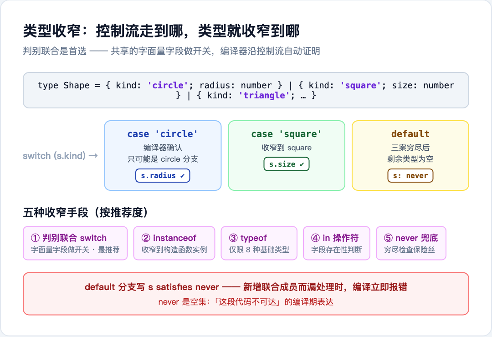

## 开场：TS 在运行什么、什么时候运行

一句话定义：**TypeScript 是一个「在 JS 运行之前运行」的静态类型检查器**。它编译产物里没有任何类型信息（类型擦除），但编译期它帮你证明了大多数运行时错误不可能发生。

要真正用好 TS，需要理解它的类型系统三个核心设计：**结构化类型、类型收窄、可编程的类型运算**。本篇前半讲设计与收窄，后半把内置工具类型的源码逐行拆开。

## 一、结构化类型：鸭子判定的边界

TS 判断类型兼容只看**形状（shape）**，不看名字或继承关系：

```ts
interface Point2D { x: number; y: number }
interface Named { x: number; y: number; name: string }

const named: Named = { x: 1, y: 2, name: 'p' }
const p: Point2D = named            // 兼容：Named 的形状覆盖 Point2D
```

这带来两个常考的边界行为：

**1. 「多余属性」只在字面量直接赋值时报错**——对象字面量会被「过严检查」（freshness 检查），但通过变量中转就放行：

```ts
const extra = { x: 1, y: 2, z: 3 }
const p: Point2D = extra     // OK：z 不影响结构兼容
const q: Point2D = { x: 1, y: 2, z: 3 }   // Error：字面量直接检查
```

**2. 想要「名义类型」用品牌（brand）技巧**——用字段让两个同形类型不再兼容：

```ts
type UserId = string & { readonly __brand: 'UserId' }
function validate(id: string): UserId { return id as UserId }
function loadUser(id: UserId) { /* 只接受带品牌的 id */ }
loadUser('abc')            // Error —— 防「两个 string 参数传反」的经典手法
```

## 二、类型收窄：从宽到窄的证明链

TS 的类型是**流分析**出来的：控制流走到某个点时，变量类型被自动「收窄」。



五种收窄手段，按常用度排列：

```ts
type Shape =
  | { kind: 'circle'; radius: number }
  | { kind: 'square'; size: number }
  | { kind: 'triangle'; a: number; b: number; c: number }

// ① 判别联合（最推荐）：共享的字面量字段做开关
function area(s: Shape) {
  switch (s.kind) {
    case 'circle':  return Math.PI * s.radius ** 2
    case 'square':  return s.size ** 2
    default:        s satisfies never   // ② exhaustiveness：加新分支编译即报错
  }
}

// ③ typeof —— 只能收窄 JS 的八种基础类型（typeof null === 'object' 的坑 TS 也如实反映）
// ④ instanceof —— 收窄到构造函数实例（原型链的编译期版）
// ⑤ in 操作符 —— 判断字段存在性
if ('radius' in s) { /* s 是 circle */ }
```

**`never` 是空集**：没有任何值能赋给 never。收窄穷尽后剩下的类型就是 never——「unreachable code」的编译期表达，`satisfies never` 断言是新分支漏网的保险丝。

## 三、条件类型与 infer：类型的 if 和模式匹配

```ts
type IsString<T> = T extends string ? true : false
type A = IsString<'hi'>     // true
type B = IsString<42>       // false
```

**分发（distributive）**：条件类型的类型参数若是**裸写**的联合类型，会逐成员分发：

```ts
type ToArray<T> = T extends any ? T[] : never
type R = ToArray<string | number>   // string[] | number[]（而不是 (string|number)[]）

// 阻止分发：套一层元组
type ToArrayNonDist<T> = [T] extends [any] ? T[] : never
type R2 = ToArrayNonDist<string | number>   // (string | number)[]
```

**infer 在推断位置解构**——像正则的捕获组：

```ts
type ElementType<T> = T extends (infer E)[] ? E : never
type E = ElementType<string[]>            // string

type ReturnType<T extends (...args: any) => any> =
  T extends (...args: any) => infer R ? R : any

type Reverse<T extends (...args: any) => any> =
  T extends (...args: infer P) => any
    ? (...args: Reverse2<P>) => any : never   // 参数反转的体操基础
```

## 四、映射修饰符：`?` 与 `readonly` 的加减号

映射类型上可以**加或减**修饰符，这是理解所有内置工具类型的钥匙：

```ts
type Mutable<T> = { -readonly [P in keyof T]: T[P] }     // 减 readonly
type Concrete<T> = { [P in keyof T]-?: T[P] }            // 减可选
```

## 五、内置工具类型源码逐行（lib.es5.d.ts）

这些定义每天都编译进你的项目，但很多人从没读过源码。逐个拆：

```ts
// 把所有属性变成可选 —— 映射 + 加 ?
type Partial<T> = { [P in keyof T]?: T[P] }

// 与 Partial 相反 —— 映射 + 减 ?（-?：去掉可选标记）
type Required<T> = { [P in keyof T]-?: T[P] }

// 全部只读 —— 映射 + 加 readonly
type Readonly<T> = { readonly [P in keyof T]: T[P] }

// 挑选 K 个键 —— K 是 keyof T 的子集（约束保证只能挑已有的键）
type Pick<T, K extends keyof T> = { [P in K]: T[P] }

// 排除后挑选 —— Omit 的实现：先 Exclude 再 Pick
type Omit<T, K extends keyof any> = Pick<T, Exclude<keyof T, K>>

// 键值映射：K 作键集，T 作统一值类型
type Record<K extends keyof any, T> = { [P in K]: T }
// keyof any === string | number | symbol，所以 Record<'a'|'b', string> 能成立
```

`Exclude/Extract` 用的是**分发条件类型**——这就是为什么它们对联合类型有效：

```ts
// 逐成员分发：T 的每个成员问一次「你 extends U 吗」
type Exclude<T, U> = T extends U ? never : T
type Extract<T, U> = T extends U ? T : never

type T1 = Exclude<'a' | 'b' | 'c', 'a'>        // 'b' | 'c'
type T2 = Extract<string | number | (() => void), Function>   // () => void
```

`ReturnType/Parameters` 是 **infer + 条件类型**的组合：

```ts
type Parameters<T extends (...args: any) => any> =
  T extends (...args: infer P) => any ? P : never
type ReturnType<T extends (...args: any) => any> =
  T extends (...args: any) => infer R ? R : any

// 4.5+ 的 Awaited：递归解包 Promise
type Awaited<T> = T extends PromiseLike<infer V> ? Awaited<V> : T
```

**Omit 的历史教训**（面试偶尔考）：早期版本是 `Pick<T, Exclude<keyof T, K>>`，K 不受约束导致可以「Omit 出不存在的键」；3.5 收紧为 `keyof any`，同时修正了与 index signature 的兼容问题——工具类型的设计也在随版本演进。

## 六、面试高频

**Q1：TS 如何判断两个类型兼容？**
结构化兼容（看形状不看名字）；想名义化用 brand 技巧。多余属性只在字面量直接赋值时报错。

**Q2：分发条件类型是什么？怎么阻止？**
裸类型参数收到联合类型时逐成员分发；套元组 `[T] extends [U]` 阻止。Partial 里的映射不是条件类型，天然不分发。

**Q3：手写一个 MyPick？**
`type MyPick<T, K extends keyof T> = { [P in K]: T[P] }`——映射类型 + 约束，两行讲完映射与 keyof。

**Q4：never 有什么用？**
空集类型：穷尽检查的保险丝（default 分支 `satisfies never`）、Exclude 的「删除成员」载体、函数永不返回的返回类型。

## 小结

- TS = 编译期逻辑系统：结构化判定 + 流分析收窄 + 可编程类型运算；
- 收窄五件套：判别联合、typeof、instanceof、in、穷尽性检查（never）；
- 条件类型是 if，infer 是解构，映射是 for 循环——三者组合出全部工具类型；
- 内置工具类型源码都在 `lib.es5.d.ts`，读懂它们等于读懂一半的 TS 类型体操。

下一篇：**类型体操方法论**。递归类型、元组运算、模板字面量解析——把类型系统当一门函数式语言来写。
