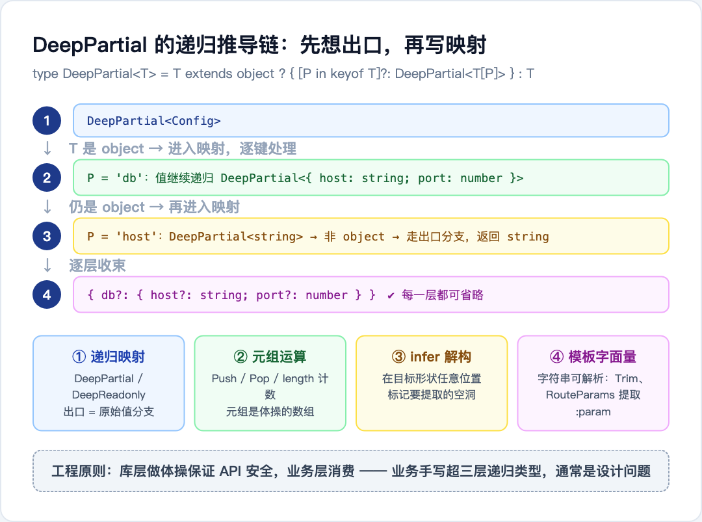

## 开场：把类型系统当一门语言

类型体操的本质是**编译期的函数式编程**：映射类型是 for 循环，条件类型是 if，infer 是解构，递归是循环——这门「语言」甚至有自己的深度限制（默认约 1000 层递归）。

学好体操不需要天赋，需要的是**四大基本功 + 一套套路**。本篇全部给出可复制的实战代码。

## 一、基本功一：递归类型



嵌套结构收不了尾时，让映射类型自己调用自己：

```ts
type DeepPartial<T> = T extends object
  ? { [P in keyof T]?: DeepPartial<T[P]> }    // 每层都变成可选，且继续下钻
  : T

interface Config {
  db: { host: string; port: number }
  auth: { jwt: { secret: string } }
}
type PartialConfig = DeepPartial<Config>
// { db?: { host?: string; port?: number }; auth?: { jwt?: { secret?: string } } }
```

推演 `DeepPartial<{ db: { host: string } }>` 的完整链路（面试画这张图就赢了）：

```text
DeepPartial<Config>
  → 条件命中 object → 进入映射
  → P = 'db'，值为 DeepPartial<{ host: string; port: number }>
      → 又命中 object → 映射
      → P = 'host'，值为 DeepPartial<string> → 非 object → 返回 string
  → 收束：{ db?: { host?: string; port?: number } }
```

同款变体：`DeepReadonly`（把 `?` 换成 `readonly`）、`DeepRequired`。递归的出口永远是「非 object 的原始值分支」——**先想出口，再写映射**。

## 二、基本功二：元组运算

元组是类型体操的「数组与计数器」：

```ts
// length 是天然的数字（字面量类型）
type Two = [any, any]['length']           // 2

// Push / Pop / Concat —— 全是展开运算符的形态
type Push<T extends any[], V> = [...T, V]
type Pop<T extends any[]> = T extends [...infer Rest, any] ? Rest : []
type Concat<A extends any[], B extends any[]> = [...A, ...B]

type T1 = Push<[1, 2], 3>                 // [1, 2, 3]
type T2 = Pop<[1, 2, 3]>                  // [1, 2]
```

元组的杀手级应用：**用递归模拟循环**。比如「求两个字符串拼接的长度」——先把字符串转元组：

```ts
type StringToTuple<S extends string> =
  S extends `${infer Head}${infer Rest}` ? [Head, ...StringToTuple<Rest>] : []

type Length<S extends string> = StringToTuple<S>['length']
type L = Length<'hello'>   // 5
```

`[Head, ...Rest]` 的解构就是字符串的「头尾分离」——模板字面量类型（见基本功四）与元组的联手。

## 三、基本功三：infer 的进阶用法

infer 不只在返回值位置，还能出现在**任意推断位置**，形成「模式匹配」：

```ts
// ① 函数参数解构
type Params<T> = T extends (...args: infer P) => any ? P : never

// ② Promise 链解包（递归 infer）
type Unpacked<T> = T extends Promise<infer U>
  ? Unpacked<U>                          // Promise<Promise<T>> → T
  : T extends (infer U)[] ? U
  : T

// ③ 构造器签名匹配实例类型
type InstanceOf<T> = T extends new (...args: any[]) => infer I ? I : never
```

**套路总结**：遇到「提取类型中某一部分」的需求，先写出目标形状的完整「模板」（比如 `Promise<infer U>`），再用 infer 标记要提取的空洞——和正则捕获组一个思路。

## 四、基本功四：模板字面量类型

字符串在类型层可被模式匹配与重组，这让「配置驱动的类型」成为可能：

```ts
// 实战 1：Trim —— 递归削掉空格
type TrimLeft<S extends string> =
  S extends ` ${infer Rest}` ? TrimLeft<Rest> : S
type TrimRight<S extends string> =
  S extends `${infer Rest} ` ? TrimRight<Rest> : S
type Trim<S extends string> = TrimLeft<TrimRight<S>>

type A = Trim<'  hello  '>   // 'hello'

// 实战 2：路由参数提取（Next.js / vue-router 场景的思想原型）
type RouteParams<T extends string> =
  T extends `${string}:${infer Param}/${infer Rest}`
    ? Param | RouteParams<Rest>              // 中段参数，继续递归
    : T extends `${string}:${infer Param}`
      ? Param                                // 末段参数，出口
      : never

type P = RouteParams<'/user/:id/posts/:pid'>   // 'id' | 'pid'

// 实战 3：事件名 → 处理器名（onXxx 系列 API 的类型联动）
type HandlerOf<E extends string> = `on${Capitalize<E>}`
type H = HandlerOf<'click'>   // 'onClick'   （Capitalize 是 4.1+ 内置的字符工具类型）
```

## 五、递归深度的现实约束

类型递归默认约 1000 层爆「Type instantiation is excessively deep」。三个对策：

1. **尾部递归化**：TS 4.4+ 对「尾位置的递归条件类型」做了优化，把 `DeepPartial` 的映射里递归改成条件在最后，可显著提升深度上限；
2. **元组计数上限**：需要大数字时用位计数法（`[[0,0],[0,1],[1,0],[1,1]]` 组合）拼出 2^n 数量级，面试知道即可；
3. **工程上避免体操失控**：库作者用体操保证 API 类型安全，业务代码消费它们——**业务里手写超三层递归类型通常意味着设计问题**。

## 六、面试高频体操题清单

| 题目 | 一句话解法 |
|---|---|
| `DeepPartial<T>` | 条件收 object + 映射递归，出口是原始值 |
| `GetRequiredKeys<T>` | `-? {} extends Pick<T, P> ? P : never` 判断可选性 |
| `TupleToUnion<T>` | `T[number]`（索引访问自动展开成联合） |
| `Pop<T>` | `T extends [...infer Rest, any] ? Rest : []` |
| `Trim<S>` | 模板字面量 + 递归削首尾 |
| `RouteParams<S>` | 模板字面量匹配 `:param`，中段递归、末段出口 |
| `DeepPromise<T>` | `T extends Promise<infer V> ? DeepPromise<V> : T` |
| `UnionToIntersection<U>` | `((arg: U) => any) extends (arg: infer I) => any ? I : never`（逆变位收集） |

最后一条 `UnionToIntersection` 值得多看一眼：联合类型放在函数**参数的逆变位置**会被 TS 收集成交叉类型——「逆变」是 TS 类型系统里最深刻的一条规则，讲出来就是加分项。

## 小结

- 体操四基本功：递归映射、元组运算、infer 模式匹配、模板字面量解析；
- 递归先想出口（原始值分支），映射先想键集（keyof 还是显式列表）；
- 字符串也是数据：`StringToTuple` + 递归能解析任意 DSL 字面量；
- 工程原则：库层做体操，业务层消费；业务手写深递归类型通常是设计坏了。

下一篇：**TS 编译器架构**。tsc 的五阶段管线、AST 长什么样、babel/esbuild 为什么不做类型检查——理解工具链，才能理解「类型检查离线、转译在线」的工程现实。
