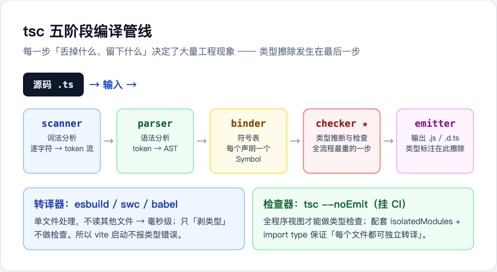

## 开场：一个 tsconfig 里藏着多少取舍

```json
{
  "compilerOptions": {
    "target": "ES2020",
    "module": "ESNext",
    "moduleResolution": "bundler",
    "strict": true,
    "skipLibCheck": true
  }
}
```

抄一份默认配置人人都会，但「为什么 `skipLibCheck: true` 几乎成了标配」「为什么 vite 项目里类型检查还要单独跑」——这些问题的答案在 tsc 的架构里。本篇讲清两件事：**编译器如何工作**、**哪些选项在改变它的行为**。

## 一、五阶段管线



tsc 的编译流程是一条清晰的流水线（源码都在 TypeScript 仓库的 `src/` 下）：

```text
源码 .ts
 → scanner.ts      逐字符扫描，产出 token 流（词法分析）
 → parser.ts       token 组装成 AST（语法分析）
 → binder.ts       建立 Symbol 表：每个声明一个符号，绑定作用域
 → checker.ts      类型推断与检查（全流程的重头）
 → emitter.ts      产出 .js / .d.ts / sourcemap
```

理解每一步「丢掉什么、留下什么」，就能推演大量工程现象。

## 二、AST：类型信息的载体

```ts
const x: number = 1
```

在 AST 里长这样（简化示意，可用 `ts.createSourceFile` 在 Node 里打印验证）：

```text
SourceFile
  └ VariableStatement
      └ VariableDeclarationList
          └ VariableDeclaration
              ├ Identifier      → 绑定 Symbol{x}   ← binder 阶段挂上
              ├ Keyword "number"（类型标注节点）
              └ NumericLiteral  1
```

三个关键认知：

1. **类型标注只是 AST 上的普通节点**，emitter 输出时直接丢弃——这就是「类型擦除」的字面含义；
2. **checker 的输入是「AST + Symbol 表」**：符号表把名字（`Identifier`）连到声明（`VariableDeclaration`），跨文件的类型解析就是符号查找；
3. **编辑器的智能提示与 tsc 检查是同一套代码**——VS Code 的 TS 语言服务跑的就是这棵 AST 与 checker，这就是「编辑器飘红」与「构建报错」一致性的来源。

## 三、checker：类型是怎么「算」出来的

`checker.ts` 是 tsc 仓库里最庞大的模块（万行级单文件），它的工作分三类：

**1. 推断（inference）**：没有标注时从赋值/返回值反推类型；

**2. 收窄（narrowing）**：上一篇讲的流分析，在 checker 里是一张「控制流图」上做类型变换；

**3. 兼容检查（assignability）**：问「类型 A 能否赋值给 B」——结构化判定就在这一步：

```text
S 可赋值给 T 当且仅当：
  对 T 的每个属性 p，S 上都存在同名属性，
  且 S.p 可赋值给 T.p（递归判定）；
  函数还要求参数逆变、返回值协变（strictFunctionTypes 开启时）
```

最后一句值得记住：**函数参数是逆变检查**（`strictFunctionTypes` 才严格；历史上 TS 对方法参数是「双向协变」宽松处理，这是类型体操篇 `UnionToIntersection` 诡异性与大量参数兼容问题的根源）。

## 四、为什么 esbuild/babel 只转译、不检查

Vite、swc、babel 走的是**单文件转译**：为了速度，每个文件独立处理，不读别的文件。而类型检查天然需要**全程序视图**（一个 `interface` 变化影响所有引用文件）。

于是现代构建的现实分工是：

```text
dev/构建：esbuild / swc / babel —— 只做「剥类型」，毫秒级
CI/编辑器：tsc --noEmit —— 全程序类型检查，慢但完整
```

两个配套选项因此而生：

- **`isolatedModules: true`**：强制你的代码「每个文件都能独立转译」，提前暴露跨文件类型操作（如 `const enum` 导出、re-export 类型）在转译器下的坑；
- **`import type` / `import()` 类型语法**：显式告诉转译器「这个导入只是类型，编译期删除」——不写的话，值导入可能被 esbuild 保留成真实的运行时 import，产物里多出幽灵依赖。

**结论：现代工程里「转译」与「检查」是两条流水线，tsc 的检查职责通常以 `tsc --noEmit` 形式挂在 CI 上。**

## 五、tsconfig 精要：按意图分组

| 选项 | 控制什么 | 常见取舍 |
|---|---|---|
| `target` | 产物 JS 语法级别 | 库项目调高，让下游决定降级 |
| `module` / `moduleResolution` | 产物模块格式 / 导入解析规则 | TS 5 的 `bundler` 策略专配 vite/webpack 项目（支持无后缀、exports 字段） |
| `strict` 全家桶 | 检查强度 | `noImplicitAny`（隐式 any 报错）、`strictNullChecks`（null 归入类型流）是收益最大的两项 |
| `paths` | 模块路径别名 | 只影响类型解析，运行时映射要靠 bundler 配置，两边必须同步 |
| `types` / `typeRoots` | 全局 @types 装载范围 | 只写用到的包，避免全局声明污染 |
| `skipLibCheck` | 跳过所有 .d.ts 内部检查 | 性能标配；代价是失去对依赖声明文件错误的感知 |
| `declaration` | 产出 .d.ts | 发布 npm 库必开；配合 `declarationMap` 支持跳转进源码 |
| `incremental` / `composite` | 增量缓存 | 大仓库多包构建（project references）的基础 |

**声明文件一句话体系**：`declare` 声明「这个标识符在运行时存在」（环境声明）；`.d.ts` 是只含声明、无实现的文件；`@types/xxx` 是社区的集中声明仓库；`/// <reference types="..." />` 三斜线指令在模块系统时代已少用，改用 `types` 字段。

## 六、面试高频

**Q1：tsc 编译分哪几步？哪一步最重？**
scanner → parser → binder → checker → emitter；checker 最重（全程序类型推断与兼容检查）。

**Q2：为什么 vite 启动不报类型错误？**
esbuild 单文件转译只剥类型不检查；类型检查需要全程序视图，由编辑器/CI 的 `tsc --noEmit` 承担。配套 `isolatedModules` 保证单文件可转译。

**Q3：skipLibCheck: true 会带来什么风险？**
跳过依赖 .d.ts 的内部错误检查，换取编译速度；自己代码的类型安全不受影响，但可能漏掉声明文件本身的问题。

**Q4：import type 有什么用？**
显式标记纯类型导入，转译器可直接删除，避免产物中残留无效 import；这也是 `verbatimModuleSyntax`（TS 5 强化的转译忠实性选项）推荐搭配的写法。

## 小结

- tsc = 转译器（快速、单文件）+ 检查器（完整、全程序），两者在现代工具链中已分工；
- 类型擦除发生在 emitter，符号表是 checker 的检索结构；
- 结构兼容 + 参数逆变是 assignability 的全部核心；
- tsconfig 每一项都在改变上述某一步的行为，按意图分组记忆。

下一篇是系列收官：**面试题精编与知识地图收束**——把前十一篇的全部要点浓缩成一份可反复刷的高频题清单。
