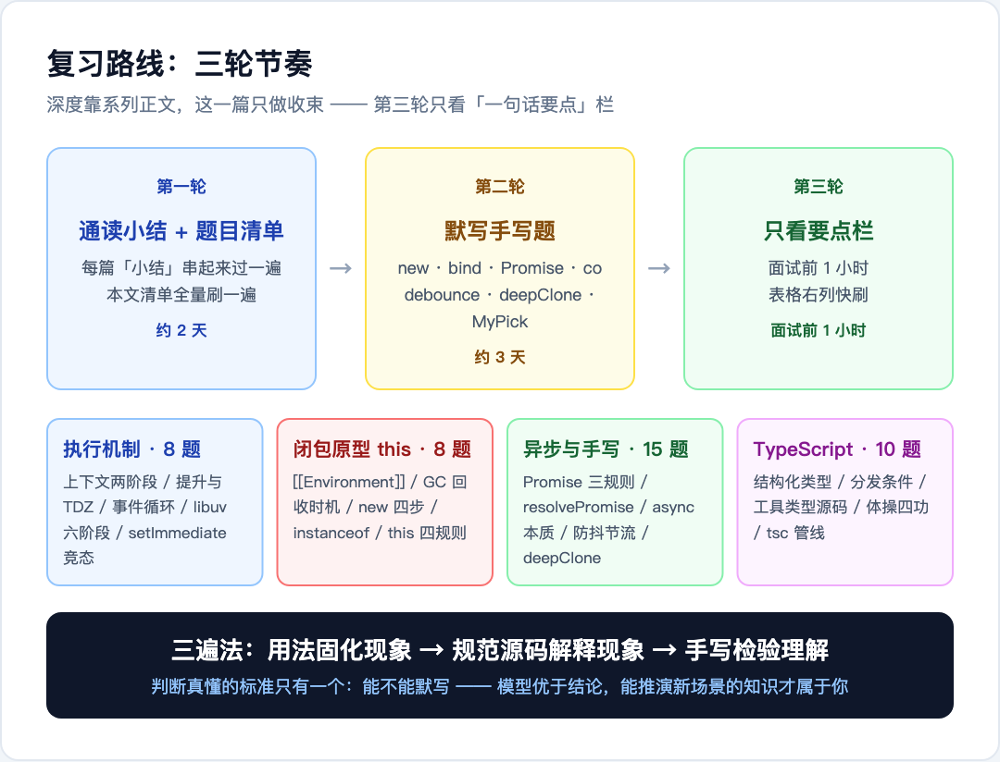

## 复习路线：最后一遍怎么过

建议的三轮节奏：**第一轮**（2 天）通读每篇「小结」+ 本文清单；**第二轮**（3 天）每篇挑 1 道手写题默写（new、bind、Promise、co、debounce、MyPick）；**第三轮**（面试前 1 小时）只看本文的「一句话要点」栏。前两轮的深度靠系列正文，这一篇只做收束。

## 一、执行机制（对应 01 / 02 篇）

| 题目 | 一句话要点 |
|---|---|
| 执行上下文两阶段 | 创建：登记变量/绑 this/搭作用域链；执行：逐语句运行 |
| var/let/const 提升差异 | var 初始化 undefined；let/const 登记不初始化（TDZ）；函数声明整体提升且优先于 var |
| 调用栈是什么 | 同步执行的唯一管理器；error.stack 是它的快照；递归爆栈 RangeError |
| 事件循环一轮做什么 | 同步清栈 → 清空全部微任务 →（rAF/渲染）→ 取一个宏任务 |
| 宏 vs 微任务举例 | 宏：setTimeout/setInterval/I/O/事件；微：Promise.then/queueMicrotask/MutationObserver |
| Node 事件循环阶段 | timers → pending → idle/prepare → poll → check → close；nextTick 队列最优先 |
| setImmediate vs setTimeout(0) | 主模块竞态不确定；I/O 回调内 immediate 稳定先（poll 后就是 check） |
| 微任务嵌套会怎样 | 只延长「清空」步骤，不会插入宏任务，但会饿死渲染 |

## 二、闭包 / 原型 / this（对应 03 / 04 / 05 篇）

| 题目 | 一句话要点 |
|---|---|
| 闭包的本质 | 函数对象的 `[[Environment]]` + 被捕获变量所在的堆上 Context |
| 闭包何时回收 | 引用断开（置 null/清定时器/移除监听）后整体不可达，GC 可达性分析回收 |
| for 循环 var/let 差异 | var 共享一个绑定；let 每轮 CreatePerIterationEnvironment 新建环境 |
| new 的四步 | 建对象 → 链原型 → 绑 this 执行 → 显式返回对象则替换 |
| instanceof 原理 | 沿左值 `[[Prototype]]` 链逐级比对右函数 prototype；原始值无链 |
| class 是语法糖吗 | 手写等价物存在，但多出调用保护/方法不可枚举/强制严格模式/静态链继承 |
| this 四规则与优先级 | new > 显式 > 隐式 > 默认；箭头函数例外（词法捕获，三规则全部无效） |
| 手写 bind 的坑 | new 放行（instanceof 判断）、Object.create 维持原型链、预置参数合并 |

## 三、异步（对应 06 / 07 篇）

| 题目 | 一句话要点 |
|---|---|
| Promise 三条硬规则 | 三态不可逆；then 可多次注册按序执行；then 返回新 promise 且回调异步执行 |
| 手写 Promise 易漏点 | pending 回调入队、thenable 递归解析（called 标志）、executor 抛错转 reject |
| resolvePromise 防什么 | 循环引用（x === promise2 抛 TypeError）、then 的 getter 副作用（只取一次）、双调用 |
| all/race/any/allSettled | 全成功才成功 / 谁快听谁的 / 首个成功 / 全部交卷 |
| async/await 本质 | generator + 自动执行器（递归 next + throw 注入）；编译产物 _asyncToGenerator |
| await 前后执行时机 | await 之前同步执行；之后进微任务；await 非值也经 Promise.resolve 包装 |
| try/catch 为什么能接 await 错误 | 失败时执行器 gen.throw 把错误注入生成器内部 |
| 串行并发陷阱 | 连续 await 是串行；无依赖改 Promise.all，耗时 max 替代 sum |

## 四、手写题（对应 06 / 08 篇）

| 题目 | 一句话要点 |
|---|---|
| debounce | 重置定时器；leading 版判断「无进行中 timer 即首次」 |
| throttle | 时间戳+定时器混合：冷却期直接执行，未到安排尾补齐 |
| deepClone | WeakMap 循环引用出口、Date/RegExp/Map/Set、Object.create 保原型、Reflect.ownKeys 含 Symbol |
| curry | fn.length 判断收集完成；进阶支持占位符按位拼接 |
| compose | reduceRight 串函数；异步版每环返回 Promise 链接 |
| EventEmitter | once 包装函数先 off 再执行（_origin 标记）；emit 用 slice 防遍历中修改 |
| call 手写 | 借对象挂载（Symbol 键）触发隐式绑定；thisArg 规范转换（null→globalThis，原始值包装） |

## 五、TypeScript（对应 09 / 10 / 11 篇）

| 题目 | 一句话要点 |
|---|---|
| 结构化类型 | 看形状不看名字；字面量直接赋值才有多余属性检查；名义化用 brand |
| never 的用途 | 空集：穷尽检查保险丝、Exclude 删除成员、永不返回的返回类型 |
| 分发条件类型 | 裸类型参数遇联合逐成员分发；`[T] extends [U]` 阻止 |
| Partial/Required 源码 | 映射 + 修饰符加减：`?` 加可选，`-?` 去可选，`readonly` 同理 |
| Omit 实现 | `Pick<T, Exclude<keyof T, K>>`；K 的约束从 keyof T 放宽到 keyof any 的历史修正 |
| infer 模式匹配 | 在目标形状的任意位置标记空洞：参数、元素、Promise 内层 |
| 元组体操 | `T[number]` 转联合；`[...T, V]` Push；length 做计数器 |
| 模板字面量 | 字符串可解析：Trim 递归削首尾、RouteParams 提取 `:param` |
| tsc 五阶段 | scanner → parser → binder → checker → emitter；checker 最重 |
| 转译 vs 检查 | esbuild/babel 单文件转译只剥类型；tsc --noEmit 全程序检查挂 CI；isolatedModules + import type 配套 |

## 六、源码学习的方法论收束

系列用了十二篇反复实践同一个方法，最后把它交给你：

**三遍法**：用法固化现象 → 规范/源码解释现象 → 手写检验理解。判断真懂的标准永远只有一个——**能不能默写**。

**裁判意识**：每个「为什么」都要找到裁判文件——语言行为找 ECMAScript 规范，调度找宿主（浏览器/libuv），类型行为找 checker，工具类型找 `lib.es5.d.ts`。背结论靠不住，裁判文件不会改口。

**模型优于结论**：事件循环不是「宏慢微快」的口诀，而是一轮循环的剧本；闭包不是「函数记住变量」，而是一条引用链。**当模型能推演出新场景的答案时，知识才算归你。**

系列完结，感谢追更。建议收藏本文清单，面试前最后一轮只刷它。
