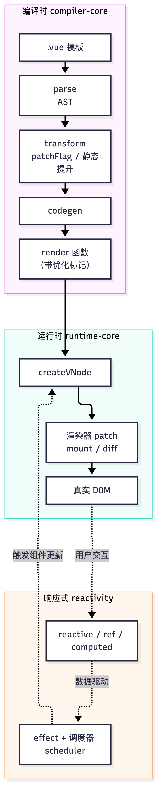

你每天都在写 Vue，可面试官问起「nextTick 到底做了什么」「Vue 3 的 diff 为什么用最长递增子序列」，心里还是没底。

背八股文解决不了这种心虚。**读源码才是唯一的解药**——而且 Vue 3 的源码比你想的友好得多：TypeScript、模块边界清晰、注释完整。

这个系列的目标只有一个：**带你把 Vue 3 的核心源码真正走一遍**，每一篇都有三个固定配置：

1. **真实源码摘录**——直接引用官方仓库代码，标注文件路径（本系列锁定版本 `v3.5.46`，Vue 官方 2026-11-20 发布的最新稳定版）；
2. **手写 mini 实现**——用不到 100 行代码复现核心机制，`node` 直接可跑；
3. **图示**——一图看懂流程，先看图再读代码。

# 一、源码地图：三大模块各管什么

Vue 3 采用 monorepo 结构，核心逻辑集中在三个包里，这就是我们全部的学习地图：

| 包 | 职责 | 关键词 |
|---|---|---|
| `@vue/reactivity` | 响应式系统 | Proxy、track、trigger、effect |
| `@vue/compiler-core` | 模板编译器 | parse、AST、transform、codegen |
| `@vue/runtime-core` | 运行时 | vnode、patch、diff、组件生命周期 |



三者协作关系一句话说清：

> **编译器**把模板变成带优化标记的 render 函数；**运行时**把 render 函数产出的 vnode 渲染成真实 DOM；**响应式**在数据变化时，精准找出受影响的 render 函数重新执行。

# 二、一个 counter 的一生

用最小的例子，把三大模块串起来。模板：

```html
<div>
  <p>你点了 {{ count }} 次</p>
  <button @click="count++">+1</button>
</div>
```

**第 1 幕 · 编译时**：`@vue/compiler-core` 把这段模板解析成 AST，transform 阶段打上优化标记（比如「只有 count 是动态的」，patchFlag = TEXT），最终 codegen 生成一个普通 JS 函数：

```js
// 编译产物（示意）
function render(ctx) {
  return h('div', [
    h('p', '你点了 ' + ctx.count + ' 次', 1 /* patchFlag: TEXT */),
    h('button', { onClick: () => ctx.count++ }, '+1')
  ])
}
```

**第 2 幕 · 运行时**：`runtime-core` 的渲染器执行 render 得到 vnode 树，patch 递归挂载，变成真实 DOM。挂载时 `render()` 内部读过 `ctx.count`——这一读，触发了响应式系统的 **依赖收集**。

**第 3 幕 · 响应式**：用户点按钮 → `count++` 走 Proxy 的 set 拦截 → trigger → 精准通知「那个读过 count 的 render 函数」重新执行 → 新旧 vnode 一对比，patchFlag 告诉渲染器「只需改文字」→ DOM 更新完成。

整个闭环里没有一个全局的脏检查。**Vue 3 的「快」，快在每一环都只做必要的事。**

# 三、学习顺序（重要）

读源码最忌讳从 `vue` 包入口开始平推。推荐的顺序是**从响应式开始，因为它是另外两个模块的地基**：

```
01 reactive 与 Proxy      —— 拦截点在哪
02 effect 与依赖收集      —— 心脏（含 3.5 新架构 Dep/Link）
03 ref 与 computed        —— 一等公民
04 watch 与调度器         —— nextTick 的真相
05 编译器三步走           —— 模板怎么变成函数
06 patchFlag 与 Block     —— 编译优化的精髓
07 渲染器 patch 全流程    —— vnode 怎么变成 DOM
08 diff 与最长递增子序列  —— 算法含量最高的一章
09 组件系统与生命周期     —— setup 的真相
10 KeepAlive/Teleport/Suspense
11 性能优化清单 + 面试考点汇总
```

每篇的 mini demo 都放在同一套目录里，可以直接 `node demos/xx.mjs` 运行，不需要装任何依赖。

# 四、本篇的「开胃菜」

先不解释，直接跑一段 60 行的手写响应式（完整代码见 `demos/01-mini-reactive.mjs`）：

```js
const state = reactive({ count: 0 })
effect(() => {
  console.log(`count = ${state.count}`)
})
state.count = 1   // effect 自动重跑：count = 1
```

数据变了，函数自己动了——**没有任何轮询、没有脏检查**。它凭什么？下一篇，我们从 `new Proxy` 的第一个拦截点讲起。

> **上一篇**：无（这是第 1 篇）｜**下一篇**：01《Proxy 响应式的地基》
