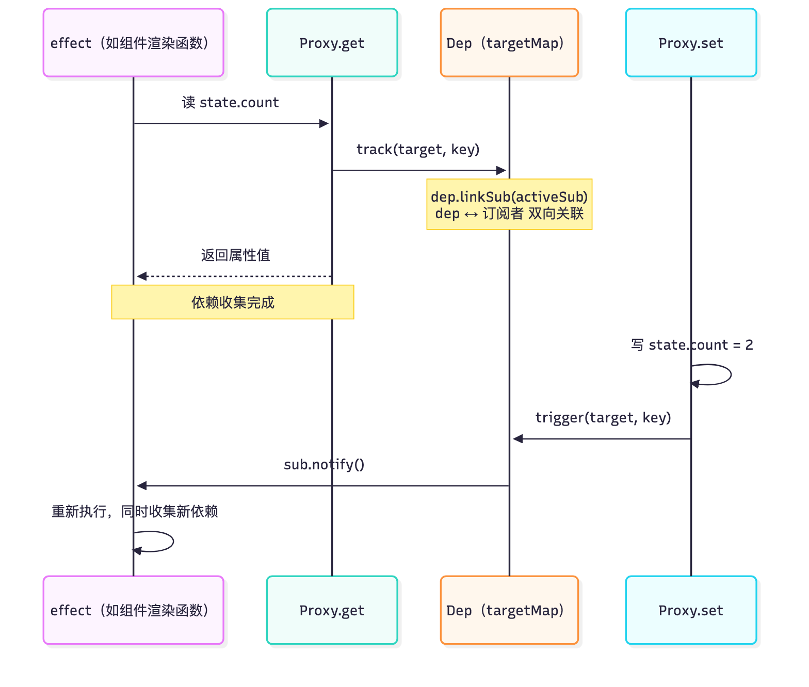

先看一段 Vue 2 时代的经典痛代码：

```js
this.obj.newKey = 1        // ❌ 不响应：defineProperty 无法感知新增属性
this.arr[0] = 1            // ❌ 不响应：索引赋值拦不住
this.arr.length = 0        // ❌ 不响应：length 变更拦不住
```

`Object.defineProperty` 的三个先天缺陷：**新增属性拦不住、索引赋值拦不住、删除属性拦不住**。Vue 2 只能用 `$set`、重写数组七个方法这些「补丁」绕过去。

Vue 3 直接换武器：**Proxy**。它拦截的是整个对象的操作，上面的三个坑全部天然解决。

# 一、reactive 的本质：一个 Proxy

源码位置：`packages/reactivity/src/reactive.ts`（v3.5.46，下同）。

```ts
// reactive.ts L300 附近（节选）
const proxy = new Proxy(
  target,
  targetType === TargetType.COLLECTION ? collectionHandlers : baseHandlers,
)
proxyMap.set(target, proxy)
return proxy
```

三个细节值得注意：

1. **按类型分流**：普通对象走 `baseHandlers`，Map/Set/WeakMap/WeakSet 走 `collectionHandlers`（集合的拦截点完全不同，比如是 `get` 方法而不是属性读取）；
2. **proxyMap 缓存**：同一个原始对象只会被代理一次，重复 `reactive(obj)` 返回同一个代理；
3. **代理是不可逃逸的**：对代理再取属性，拿到的内嵌对象也已经是代理（下面讲为什么）。

# 二、get 拦截：读的时候发生了什么

源码位置：`packages/reactivity/src/baseHandlers.ts` 的 `createGetter`。

```ts
// baseHandlers.ts L112 附近（节选，删繁就简）
if (!isReadonly) {
  track(target, TrackOpTypes.GET, key)   // ★ 依赖收集入口
}

if (isShallow) {
  return res                             // shallow：到此为止，不再深代理
}

if (isRef(res)) {
  // 对象里嵌了 ref？读的时候自动 .value 解包
  return targetIsArray && isIntegerKey(key) ? res : res.value
}

if (isObject(res)) {
  // ★ 懒代理：返回的嵌套对象在「被读到」的那一刻才变成响应式
  return isReadonly ? readonly(res) : reactive(res)
}
return res
```

这就是 get 拦截的全部灵魂：

- **track**：把「谁读了我」记录下来（下一章展开）；
- **懒代理**：嵌套对象不是在 `reactive()` 时递归代理的，而是**读到哪个属性，哪个才被代理**。这就是为什么初始化一个几百个字段的大对象也不卡——没读到的字段一个 Proxy 都没创建；
- **ref 解包**：`state.user = ref(1)`，读 `state.user` 直接得 `1`，不用写 `.value`。

# 三、set 拦截：写的时候发生了什么

```ts
// baseHandlers.ts createSetter（节选）
const result = Reflect.set(target, key, value, receiver)

if (target === toRaw(receiver)) {
  if (!hadKey) {
    trigger(target, TriggerOpTypes.ADD, key, value)   // 新增属性
  } else if (hasChanged(value, oldValue)) {
    trigger(target, TriggerOpTypes.SET, key, value, oldValue)  // ★ 值变了才触发
  }
}
return result
```

注意 `hasChanged(value, oldValue)`：**给 count 连续赋两次同样的值，第二次不会触发任何更新**。你写组件时的「无谓更新」，很多在这一步就被挡掉了。

# 四、手写一个 mini reactive

60 行，把上面两个拦截点复现（完整代码 `demos/01-mini-reactive.mjs`）：

```js
const targetMap = new WeakMap()   // target -> key -> 依赖该 key 的 effect
let activeSub = undefined         // 当前正在运行的 effect

function track(target, key) {
  if (!activeSub) return
  let depsMap = targetMap.get(target)
  if (!depsMap) targetMap.set(target, (depsMap = new Map()))
  let dep = depsMap.get(key)
  if (!dep) depsMap.set(key, (dep = new Set()))
  dep.add(activeSub)
}

function trigger(target, key) {
  const dep = targetMap.get(target)?.get(key)
  if (dep) for (const sub of [...dep]) sub.run()
}

function reactive(obj) {
  return new Proxy(obj, {
    get(target, key) {
      track(target, key)
      const val = Reflect.get(target, key)
      // 懒代理：嵌套对象读到才代理 —— 与源码 baseHandlers.ts 一致
      return typeof val === 'object' && val !== null ? reactive(val) : val
    },
    set(target, key, value) {
      const old = target[key]
      const ok = Reflect.set(target, key, value)
      if (ok && old !== value) trigger(target, key)  // hasChanged 检查
      return ok
    },
  })
}
```

跑起来（真实输出）：

```
▶ 演示 1：数据变化，依赖它的 effect 自动重跑
    [track]   count <- effect#0
  effect#0 看到 count = 0
  执行 state.count = 1：
    [trigger] count: 0 -> 1
  effect#0 看到 count = 1

▶ 演示 3：没被 effect 读过的属性，改了也不会触发任何人
  执行 state.msg = "hi"（没有 effect 依赖 msg）：
  —— 上面没有任何 effect 重跑，因为 track 时没记录它
```



# 五、面试考点小结

1. **Vue 3 为什么用 Proxy？** 拦截整个对象操作：新增/删除/索引赋值全响应，还省掉了 Vue 2 的初始化递归遍历；
2. **嵌套对象什么时候被代理？** 惰性的——读到才代理（`baseHandlers.ts` 里 `isObject(res)` 分支），deep watch 的全量 traverse 除外；
3. **给同一个属性赋同一个值会更新吗？** 不会，`hasChanged` 拦截；`NaN !== NaN` 也被这个函数特殊处理掉了。

> **上一篇**：00《一张地图看懂全貌》｜**下一篇**：02《effect 与依赖收集的心脏》——track 记录下来的「人」到底是什么？
