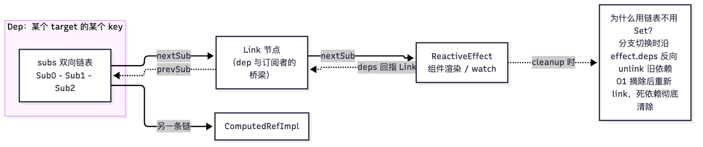

上一章留下一个悬念：track 把「谁读了我」记了下来。这个「谁」，就是 **effect（副作用函数）**——整个响应式系统的心脏。

你平时写的每一块 Vue 代码，底层几乎都是 effect：

- 组件的 render 函数 → 一个 ReactiveEffect；
- `watch(source, cb)` → 一个 ReactiveEffect + 调度；
- `computed` → 一个惰性求值的订阅者（3.5 后不再是普通 effect）。

# 一、activeSub：全世界的「现在谁在跑」

`packages/reactivity/src/effect.ts` 里有一个全局变量：

```ts
// effect.ts L39
export let activeSub: Subscriber | undefined
```

约定只有一条：**任何函数执行前，把自己赋给 `activeSub`；执行完，恢复原值**。Proxy 的 get 拦截里 track 只认它——没有 activeSub（比如事件回调里随手读了个属性），就不做任何记录。

```js
// 伪代码还原
effect(() => state.count)     // 读取发生在 run() 内部
//     ↑ 执行前置位 activeSub = 这个effect，读取时 track 记账，执行后还原
```

# 二、ReactiveEffect.run：逐行看真实源码

```ts
// effect.ts class ReactiveEffect 的 run()（v3.5.46，节选）
run(): T {
  if (!(this.flags & EffectFlags.ACTIVE)) {
    return this.fn()          // 已 stop：裸跑，不再收集依赖
  }
  this.flags |= EffectFlags.RUNNING
  cleanupEffect(this)         // ★ ① 清理上一次的旧依赖
  prepareDeps(this)           // ★ ② 准备本轮 track 的复用
  const prevEffect = activeSub
  const prevShouldTrack = shouldTrack
  activeSub = this            // ★ ③ 我就是当前的记账对象
  shouldTrack = true
  try {
    return this.fn()          // ★ ④ 执行：内部所有响应式读取都会 track 到我头上
  } finally {
    cleanupDeps(this)         // ★ ⑤ 没被用到的旧依赖，真正解除
    activeSub = prevEffect    // ★ ⑥ 还原现场（支持嵌套 effect）
    shouldTrack = prevShouldTrack
    this.flags &= ~EffectFlags.RUNNING
  }
}
```

六个 ★ 就是 run 的全部逻辑，没有魔法。重点拆两个：

**① cleanupEffect + ⑤ cleanupDeps：解决「死依赖」**。设想：

```js
watchEffect(() => {
  state.ok ? renderA(state.a) : renderB(state.b)
})
```

第一次执行只读了 `ok` 和 `a`。之后 `ok` 变成 false，第二次执行只读了 `ok` 和 `b`——此时 effect 还记着上一轮的 `a` 依赖。如果不清理，**改 `a` 也会触发这个 effect 白跑一次**。所以 Vue 每次重跑前先清理旧依赖，跑完后再解除没再用到的。

**③ + ⑥ prevEffect 压栈恢复：支持嵌套**。effect 里再创建 effect（组件里嵌子组件很常见），内层跑完必须把 `activeSub` 还给外层，否则外层后续的读取全部记错账。

# 三、3.5 重构：为什么 Dep 不用 Set 了

老版本（3.4 及以前）每个 key 挂一个 `Set<Effect>`，effect 身上存 `Set<Dep>`。3.5 换成了**双向链表**——这是 Vue 3.5 响应式性能提升约 40% 的关键。

```ts
// dep.ts —— Link 类（v3.5.46）
export class Link {
  version: number
  nextDep?: Link    // 同一个 effect 的下一条依赖
  prevDep?: Link
  nextSub?: Link    // 同一个 dep 的下一个订阅者
  prevSub?: Link
  prevActiveLink?: Link
  constructor(
    public sub: Subscriber,   // 订阅者：ReactiveEffect 或 ComputedRefImpl
    public dep: Dep,          // 依赖：某个 target 的某个 key
  ) { /* ... */ }
}
```

看懂这张图，3.5 的响应式就通了：



- **Dep**（一个属性一份）：`subs` 是订阅者链表；
- **Subscriber**（effect / computed）：`deps` 是自己依赖哪些 Dep；
- **Link** 是中间的边，双向指——所以**从任何一端摘除这条边都是 O(1)**：trigger 顺着 subs 通知，cleanup 顺着 deps 反向解除，互不遍历全量。
- 链表还让 **版本号（version）优化** 成为可能： computed 依赖没变时（version 相同），下游 effect 可以直接跳过重跑。

# 四、手写 mini effect + 双向清理

完整代码 `demos/02-mini-effect.mjs`，这里看运行实录（简化版用数组模拟双向记录）：

```js
function track(target, key) {
  if (!activeSub) return
  const dep = getDep(target, key)
  dep.add(activeSub)           // dep -> effect（trigger 用）
  activeSub.deps.push(dep)     // effect -> dep（cleanup 用）
}
```

```
▶ 演示 1：分支切换 —— 如果不做 cleanup，死依赖会导致幽灵更新
  [第1次运行] ok=true,  渲染 = A 值
  执行 p.ok = false（分支切换，从依赖 a 切到依赖 b）：
  [第2次运行] ok=false, 渲染 = B 值
  执行 p.a = "A 新值"（此刻没人依赖 a，不应重跑）：
  [第3次运行] ok=false, 渲染 = B 值      ← 没有重跑！
  ✅ cleanup 把旧的 a 依赖清掉了

▶ 演示 2：嵌套 effect —— 内层跑完，activeSub 恢复为外层
  内层创建完后，执行 innerP.count = 1：
  [内层] 读 inner.count = 1              ← 只有内层重跑
  ✅ 外层的 activeSub 上下文已正确恢复
```

「改 a 不再触发幽灵更新」这一行输出，就是 cleanupEffect 存在的意义。

# 五、面试考点小结

1. **组件渲染函数和 effect 什么关系？** 每个组件实例有一个 ReactiveEffect 包着 render，数据变化 → trigger → 通知这个 effect 重新渲染；
2. **为什么要清理依赖？** 分支切换后旧依赖是死的，不清理会造成「改无关属性也触发更新」的幽灵刷新；
3. **Vue 3.5 响应式为什么快了 40%？** Dep/Link/Subscriber 双向链表：O(1) 增删依赖边 + version 跳过无变化路径 + 内存更友好。

> **上一篇**：01《Proxy 响应式的地基》｜**下一篇**：03《ref 与 computed》——原始值怎么拦截？computed 凭什么能缓存？
