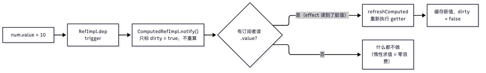

# 一、为什么 ref 必须有 .value

上一篇我们讲清了：响应式的本质是「读写时有人拦得住」。Proxy 能拦对象的属性读写，可**原始值（number、string、boolean）根本没有属性可拦**：

```js
let count = 0
count = 1   // 谁也拦不住，这是纯粹的内存赋值
```

唯一的办法是把原始值**包成对象**，给这个对象一个 `value` 属性——读写 `.value` 就是读写对象属性，天然存在拦截点。这就是 `RefImpl` 的全部动机。

```ts
// reactivity/src/ref.ts（v3.5.46，节选）
class RefImpl<T = any> {
  _value: T
  private _rawValue: T
  dep: Dep = new Dep()          // 和 Proxy 的 get/set 拦截一样：每个 ref 一份依赖

  constructor(value: T, isShallow: boolean) {
    this._rawValue = isShallow ? value : toRaw(value)
    this._value = isShallow ? value : toReactive(value)   // ★ 对象值自动变 reactive
  }

  get value() {
    this.dep.track()            // ★ 读 .value = track
    return this._value
  }

  set value(newValue) {
    newValue = /* shallow 或 readonly 时直存 */ toRaw(newValue)
    if (hasChanged(newValue, oldValue)) {                 // ★ 值变了才触发
      this._rawValue = newValue
      this._value = useDirectValue ? newValue : toReactive(newValue)
      this.dep.trigger()        // ★ 写 .value = trigger
    }
  }
}
```

三个高频误区一次说清：

1. **`.value` 不是语法糖，是拦截点本身**——丢了 `.value` 就丢回了「拦不住的原始赋值」；
2. **给 ref 一个对象，对象自动被 reactive 包一层**（`toReactive`），所以 `ref({a:1}).value.a` 也是响应式的；
3. **同一逻辑在模板里不用 `.value`**：模板编译产物的 `ctx.count` 实际经过 proxyRefs 解包，模板是另一层拦截。

# 二、computed：不是缓存了 getter，而是「标记脏」

很多人把 computed 理解成「计算完存起来」，源码里的机制更精妙：**依赖变化时只打一个脏标记（DIRTY），有人来读才真正重算**。

```ts
// reactivity/src/computed.ts（v3.5.46，节选）
export class ComputedRefImpl<T = any> implements Subscriber {
  flags: EffectFlags = EffectFlags.DIRTY

  // 依赖它的 dep 发生变化时，通知入口不是重跑，而是——
  notify(): true | void {
    this.flags |= EffectFlags.DIRTY    // ★ 只标记脏，不计算
    batch(this, true)                  // 把「标脏」向上游传播
  }

  get value(): T {
    this.dep.track()                   // 谁在读 computed？也记下来
    refreshComputed(this)              // ★ 脏了才重算，不脏直接给缓存
    return this._value
  }
}
```

`refreshComputed`（effect.ts）会检查 flags：只有 `DIRTY` 时才执行 getter；计算完后 3.5 还会对比 **version 版本号**——如果这次重算的结果没引起依赖版本变化，连下游的 effect 都不用通知。这就是 computed 链条（computed 依赖 computed）也能精准传播的原因。



# 三、手写 mini ref + computed

完整代码 `demos/03-mini-ref-computed.mjs`（60 行版，用简化 Set 模拟 dep）。运行实录：

```
▶ 演示 1：ref —— 原始值只有 .value 能当「属性」读写，才拦得住
  effect#0 看到 count.value = 0
  执行 count.value = 1：
  effect#0 看到 count.value = 1
  执行 count.value = 1（值没变，不应触发）：
  ✅ 值未变化，无重跑

▶ 演示 2：computed —— 惰性 + 缓存
  创建 computed 但还没读 —— 注意：上面没有「重新计算中」
  第一次读 double.value：
    [computed] 重新计算中…
  double.value = 2
  第二次读 double.value（缓存生效）：
  double.value = 2

▶ 演示 3：computed 的「标记脏」—— 改依赖，只标记不立刻算
  执行 num.value = 10（double 标记为脏，但还没重算）：
  再读 double.value 才真正重算：
    [computed] 重新计算中…
  double.value = 20
```

「创建时不算、改了只标脏、读了才重算」——这三行输出就是 computed 的设计哲学。

# 四、面试考点小结

1. **ref 和 reactive 怎么选？** reactive 适合对象聚合；原始值、跨模块传递、需要整体替换的场景必须 ref（reactive 的对象无法整体替换——Proxy 没法换 target）；
2. **computed 为什么不能写异步/副作用？** 它是惰性求值的：没人读就不算，写副作用会永远不知道何时执行；
3. **computed 缓存失效的条件？** 依赖变化 → DIRTY；下次有人读才重算；重算结果没变（3.5 version 对比）则不惊动下游。

> **上一篇**：02《effect 与依赖收集的心脏》｜**下一篇**：04《watch、nextTick 与调度器》——同一个 tick 改三次数据，回调为什么只跑一次？
