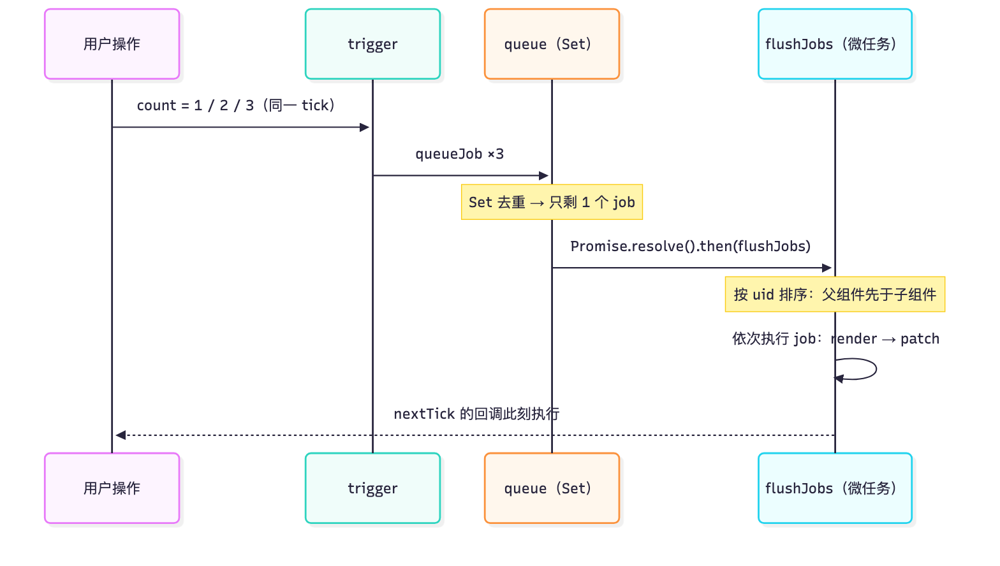

先出一道面试题：**同一个 tick 里把 `count` 连续改三次，watch 回调执行几次？DOM 更新几次？**

答案是各一次。数据层面：Set 队列去重；DOM 层面：三次修改合并成一次 patch。所有秘密都藏在 `packages/runtime-core/src/scheduler.ts` 里。

# 一、doWatch：flush 选项的三条岔路

`packages/runtime-core/src/apiWatch.ts`（v3.5.46）的 `doWatch` 里，watch 的核心配置只有一段——根据 flush 把「变化时的任务」扔到不同地方：

```ts
// apiWatch.ts doWatch（节选）
if (flush === 'post') {
  baseWatchOptions.scheduler = (job) => {
    queuePostRenderEffect(job, instance && instance.suspense)
  }                        // ③ post：组件更新完再跑（可以拿到更新后的 DOM）
} else if (flush !== 'sync') {
  isPre = true
  baseWatchOptions.scheduler = (job, isFirstRun) => {
    if (isFirstRun) job()
    else queueJob(job)     // ① pre（默认）：进统一队列，组件更新前执行
  }
}
// ② sync 什么都不配：trigger 直接同步执行回调
```

记住这张对照表：

| flush | 执行时机 | 典型用途 |
|---|---|---|
| `pre`（默认） | 组件更新**前**、同一队列去重 | 一般侦听 |
| `post` | 组件更新**后**（post 队列） | 要读更新后的 DOM |
| `sync` | 不排队，变化即执行 | 需要严格同步场景（少用，改几次跑几次） |

另外两个常见选项在源码里也一目了然：`immediate` 对应 `runsImmediately`（创建时先跑一遍回调）；`deep` 对应 watcher 内部的 `traverse`——**本质就是把对象整棵树递归读一遍，让每个属性都被 track 上**，没什么黑魔法。

# 二、queueJob：Set 去重 + 微任务刷新

```ts
// scheduler.ts（v3.5.46，节选）
export function queueJob(job: SchedulerJob): void {
  if (
    !queue.length ||
    !queue.includes(job, ...)   // ★ 去重：同一个 job 在这一轮里只会存在一次
  ) {
    if (job.flags & SchedulerJobFlags.QUEUED) {
      queue.splice(...)         // 允许去重后重新入队的位置调整
    }
    queue.push(job)
    flushJobs()                 // 注意：只是「安排」刷新
  }
}

function flushJobs() {
  // currentFlushPromise 就是 nextTick 的本体
  currentFlushPromise = resolvedPromise.then(flushJobs)
}
```

而真正的 `flushJobs` 执行阶段：

```ts
// scheduler.ts flushJobs（节选）
for (flushIndex = 0; flushIndex < queue.length; flushIndex++) {
  const job = queue[flushIndex]
  // job 排序发生在入队阶段：按 id（组件 uid）升序 → 父组件先于子组件
  callWithErrorHandling(job, ...)
}
// ...
flushPostFlushCbs(seen)          // post 队列：mounted/updated/watch post
if (queue.length || pendingPostFlushCbs.length) {
  flushJobs(seen)                // 执行过程中又产生的任务？继续刷
}
```



# 三、nextTick 的真相

源码里 `nextTick` 就一句话（`runtime-core/src/scheduler.ts`）：

```ts
export function nextTick(fn?: () => void) {
  return fn ? currentFlushPromise!.then(fn) : currentFlushPromise
}
```

**nextTick 不是 Vue 自己的定时器，它只是把你的回调排到「本轮 DOM 刷新」这个微任务后面**。同一微任务循环里先执行所有组件更新，再执行你的回调——所以你在 nextTick 里拿到的永远是最新 DOM。

完整链条：数据变化 → queueJob（Set 去重）→ `Promise.resolve().then(flushJobs)` → 按 uid 顺序执行更新 → flushPostFlushCbs → 你的 nextTick 回调。

# 四、手写 mini watch + 调度器

完整代码 `demos/04-mini-watch.mjs`。运行实录：

```
▶ 演示 1：同步世界里的异步回调 —— 同一 tick 改 3 次，只回调 1 次
  执行 state.count = 1 / 2 / 3：
  同步代码结束 —— watch 还没跑！（它被排进了微任务队列）
  [watch 回调] count 变了（此刻最新值 = 3）
  [nextTick] 队列刷新完毕，上面只出现了一次 watch 回调 ✅

▶ 演示 3：deep —— 改深层属性也能被侦听到
  [deep watch] obj.a.b.c 变化被侦听到（traverse 全量遍历收集依赖）
```

注意输出顺序：`state.count = 1/2/3` 三次赋值后，同步代码跑完了 watch 还没执行——它已经和组件更新 job 一起，被合并进了同一个微任务。

# 五、面试考点小结

1. **watch 默认什么时候执行？** flush=pre：组件更新前，且同一 tick 内多次触发只执行一次（队列去重）；
2. **nextTick 的实现原理？** `Promise.resolve().then` 排到本轮刷新微任务后，拿到的一定是最新 DOM；
3. **deep watch 的原理？** traverse：递归读取所有属性强制收集依赖，深层大对象慎用，可用 `watch(() => obj.a.b.c)` 精确订阅替代。

> **上一篇**：03《ref 与 computed 的缓存真相》｜**下一篇**：05《编译器三步走》——模板字符串是怎么变成可执行函数的？
