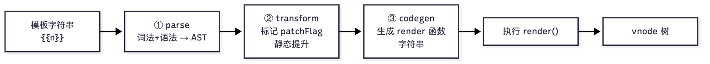

很多人写过 Vue 却没见过编译产物。先看一段真模板：

```html
<div id="app">
  <p>静态文字，永远不变</p>
  <p>你好，{{ name }}</p>
</div>
```

它最终会变成一段**纯 JavaScript**（真实的 Vue 编译产物，可在 Vue 官网 SFC Playground 里验证）：

```js
const _hoisted_1 = /*#__PURE__*/ createElementVNode("p", null, "静态文字，永远不变")

function render(_ctx) {
  return createElementVNode("div", { id: "app" }, [
    _hoisted_1,                                            // 静态：直接复用常量
    createElementVNode("p", null, "你好，" + _toDisplayString(_ctx.name), 1 /* TEXT */)
  ])
}
```

注意第二处和第一处的差别：**静态节点被提到了函数外面（只创建一次），动态节点被打上了 `1`（TEXT 标记）**。整个编译器的本职工作，就是尽一切可能把「运行时要判断的事」提前到「编译时」。本文拆解这条流水线。

# 一、三步走总览

编译器入口在 `packages/compiler-core/src/compile.ts`，核心就三行：

```ts
// compile.ts（v3.5.46，节选）
const ast = parse(source, options)                     // ① 字符串 → AST
transform(ast, options)                                // ② AST → 优化 AST
return generate(ast, options)                          // ③ AST → 代码字符串
```



# 二、parse：从字符串到 AST

`packages/compiler-core/src/parser.ts` 的 `baseParse`（L1035）基于状态机 + 词法扫描：逐字符消费模板，遇到 `<` 进入标签模式，识别开始标签/结束标签/属性/文本/插值，用栈维护嵌套层级，最终产出：

```ts
// AST 上的关键节点类型（ast.ts）
interface ElementNode { type: NodeTypes.ELEMENT, tag, props, children, ... }
interface InterpolationNode { type: NodeTypes.INTERPOLATION, content }  // {{ name }}
interface TextNode { type: NodeTypes.TEXT, content }
```

AST 只是「结构化描述」——此时它还不知道谁是静态的、谁是动态的，更没有任何优化信息。

# 三、transform：加工 AST 的流水线工厂

`packages/compiler-core/src/transform.ts` 的 `transform` 是一个**插件体系**：它递归遍历 AST，对每个节点依次调用一串 transformer：

```ts
// transform.ts L334（节选）
export function transform(root, options) {
  const context = createTransformContext(root, options)
  traverseNode(root, context)          // 深度优先遍历，每个节点进出时调用插件
}
```

Vue 内置的核心插件（都在 `transforms/` 目录）：

| 插件 | 干什么 |
|---|---|
| `transformElement` | 给动态节点计算 patchFlag、收集 dynamicPropNames |
| `transformHoist` | 静态提升：整个无动态内容的子树移出 render |
| `transformExpression` | 把模板里的 `{{ name }}` 转成 `_ctx.name` |
| `vIf` / `vFor` | 指令转译成条件表达式 / 循环函数 |
| `cacheHandlers` | 事件缓存（下一篇详讲） |

patchFlag 的赋值逻辑就在 `transformElement.ts`（L101 起）：先初始化 `patchFlag = 0`，再根据 props 和 children 里出现的动态内容做**位或叠加**：

```ts
// transformElement.ts（节选）
let patchFlag: VNodeCall['patchFlag'] | 0 = 0
// ...分析 props 与 children
if (dynamicPropNames) patchFlag |= PatchFlags.PROPS       // 8
if (动态文字)           patchFlag |= PatchFlags.TEXT       // 1
```

# 四、codegen：AST 变回字符串

`packages/compiler-core/src/codegen.ts` 的 `generate` 深度优先递归 AST，拼接代码字符串：

- 静态节点 → 输出为 `_hoisted_N` 常量引用；
- 动态节点 → `createElementVNode(tag, props, children, patchFlag)`；
- 插值 → `_toDisplayString(_ctx.xxx)`；
- v-if/v-for → 三元表达式 / 循环函数。

最后统一输出成一段合法 JS 源码。**编译器的全部输出就是这个字符串**——运行时那头拿着它 eval 或直接当函数用。

# 五、mini 编译器：100 行跑通全链路

手写版（`demos/05-mini-compiler.mjs`）完整复现了三步走，运行实录：

```
▶ 第 2 步 transform
  静态提升节点数：1（运行时只创建一次，反复复用）
  <p> → patchFlag=0, isStatic=true   ← 静态文字
  <p> → patchFlag=1, isStatic=false  ← 只有文字动态
  <span> → patchFlag=0, v-if=true

▶ 第 3 步 codegen：AST → render 函数源码
const _hoisted_0 = /* 静态提升 */ h("p", null, [t("静态文字，永远不变")])
function render(ctx) {
  return h("div", { "id": "app" }, [
    _hoisted_0,
    h("p", null, [t("你好，"), t(ctx.name)], 1),
    ...(ctx.ok ? [h("span", null, [t("动态开关")])] : [])   ← v-if 编译成三元
  ])
}

▶ 第 4 步：eval 生成代码，跑起来
  ctx = { ok: true }  → 渲染出 span
  ctx = { ok: false } → span 消失（编译产物层面就没了这个分支）
```

**100 行实现里，和真实源码结构完全对应**：parse 用栈维护层级、transform 遍历打标、codegen 递归生成。

# 六、面试考点小结

1. **Vue 3 编译器输出什么？** 一个带优化标记的 render 函数（patchFlag、静态提升、dynamicProps 数组）；
2. **AST 是什么？** 用 JS 对象描述模板结构，parse 产出、transform 加工、codegen 消费；
3. **v-if 在编译产物里是什么？** 三元表达式；v-for 是循环函数——它们在编译时就消失了。

> **上一篇**：04《watch、nextTick 与调度器》｜**下一篇**：06《patchFlag 与 Block：Vue 3 快的真相》
