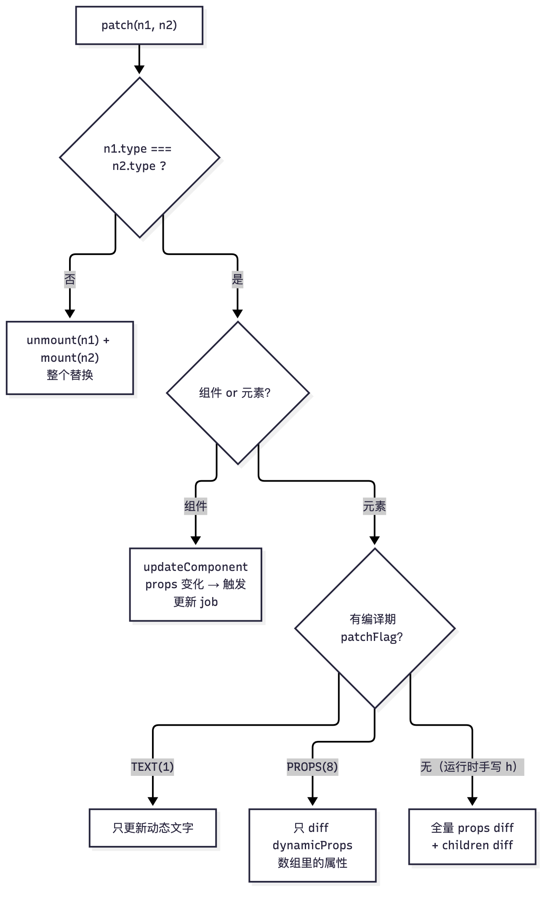
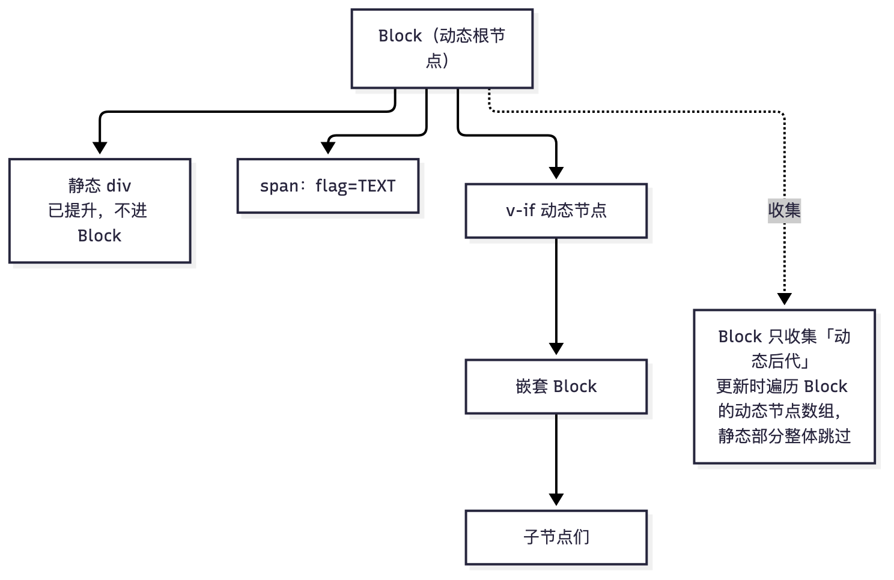

一个页面有 1000 个节点，只有 1 个变量在变。Vue 2 的做法：新旧 vnode 树从根到叶全量对比，看谁变了。

Vue 3 的做法：**编译时就知道「只有那个 span 的文字会变」，更新时直奔它**。这不是猜的——是编译器在 transform 阶段埋下的三件武器。今天逐一拆解。

# 一、武器一：patchFlag——位运算精确制导

`packages/shared/src/patchFlags.ts` 开头有一段官方注释，直接说明了它的用途：

> Patch flags are optimization hints generated by the compiler... the algorithm **only needs to handle updates explicitly marked by these patch flags**.

```ts
// shared/src/patchFlags.ts（v3.5.46）
export enum PatchFlags {
  TEXT = 1,                    // 只有文字会变
  CLASS = 1 << 1,              // class 动态      → 2
  STYLE = 1 << 2,              // style 动态      → 4
  PROPS = 1 << 3,              // 非 class/style 的 props 动态 → 8
  FULL_PROPS = 1 << 4,         // props 的 key 是动态的 → 16
  STABLE_FRAGMENT = 1 << 6,    // 子列表顺序稳定 → 64
  KEYED_FRAGMENT = 1 << 7,     // 带key子列表    → 128
  ...
}
```

为什么用**位标记**？一个节点可以同时有 class 和文字动态：`flag = 1 | 2 = 3`，运行时用 `flag & TEXT` 一条位运算就能判断某一种变化是否存在——不占额外空间，还方便合并。

更狠的是 PROPS 场景：带 flag=8 的 vnode 还会附带一个 `dynamicProps` 数组，里面是**编译器算好的、可能变化的属性名**。运行时 diff 只遍历这个数组，静态属性一个都不碰。



# 二、武器二：Block——动态节点的「点名册」

patchFlag 解决「单个节点比什么」，Block 解决「哪些节点值得比」。

编译器把「结构会动态变化」的节点（v-if、v-for 的作用对象）标记为 Block，**每个 Block 维护一个 dynamicChildren 数组**，把所有动态后代收集进来——注意是**打平收集，无论嵌套多深**。



于是运行时 patch 有了两个模式：

```
全量模式（手写 h）：  遍历新旧 vnode 树的每一个节点           O(n)
优化模式（编译产物）：只遍历 Block.dynamicChildren 数组        O(动态节点数)
```

静态节点根本不在名单里，diff 的时间复杂度从「节点总数」变成「动态节点数」——这就是「1000 个节点 1 个变量」秒级响应的原因。

一个重要细节：v-if/v-for 会打开新的 Block。因为列表的**结构**会变，动态集合不能跨层级收集，否则旧数组里的下标会失效。

# 三、武器三：cacheHandlers——事件不更新

```html
<div @click="onClick">...</div>
```

绑定事件本该每次渲染创建新函数、触发 props diff。但编译器产物是：

```js
// 编译产物（真实结构）
_hoisted_2 = { onClick: _cache[1] || (_cache[1] = (...args) => ($setup.onClick?.(...args))) }
```

事件被缓存在组件实例的 `_cache` 里：**第一次创建，之后每次渲染都复用同一个函数引用**。props 对比发现 onClick 没变，子组件也因此不会因 props 变化而无谓更新。

# 四、mini 演示：快通道有多快

`demos/06-mini-renderer.mjs` 复现了 renderer.ts 里 patch 的三分支（TEXT 快通道 / PROPS+dynamicProps 快通道 / 全量 diff），运行实录：

```
▶ 场景 A：编译器产出的 vnode —— <p> 节点已带 TEXT(1) 标记
  执行 patch(v1.children[0], v2.children[0])：
    [patch] 命中 TEXT(1) 快速通道：只更新文字，跳过 props diff！
  ✅ 只换了文字，props 一次都没有比对

▶ 场景 B：已知只有 2 个属性可能变化（PROPS=8 + dynamicProps）
    [patch] 命中 PROPS(8) 快速通道：只 diff 编译器标记的 2 个属性
      [setProp] placeholder="请输入姓名"
      [setProp] disabled="true"
  ✅ type 属性（静态）根本没被比对

▶ 场景 C：运行时手写 h() —— 没有 patchFlag，只能全量 diff
    [patch] 无标记 → 全量 props diff
      [全量 diff] 共比对 6 次属性
  ⚠️ 6 次属性比对才找到变化 —— 这就是为什么模板能比手写 h 更快
```

# 五、面试考点小结

1. **Vue 3 快在哪？** 编译时信息（patchFlag/dynamicProps/静态提升）让运行时 diff 从 O(全树) 降到 O(动态节点数)；
2. **为什么手写 render 函数享受不到优化？** 没有 patchFlag 的 vnode 只能走全量 diff 快通道判断失败后逐层遍历；
3. **v-if/v-for 为什么会阻断 Block 收集？** 结构动态变化会让打平数组的下标失效，必须开新 Block 重新收集；
4. **事件为什么不会导致子组件更新？** cacheHandlers 把函数缓存在 `_cache`，引用永远稳定。

> **上一篇**：05《编译器三步走》｜**下一篇**：07《渲染器：createVNode 与 patch 全流程》
