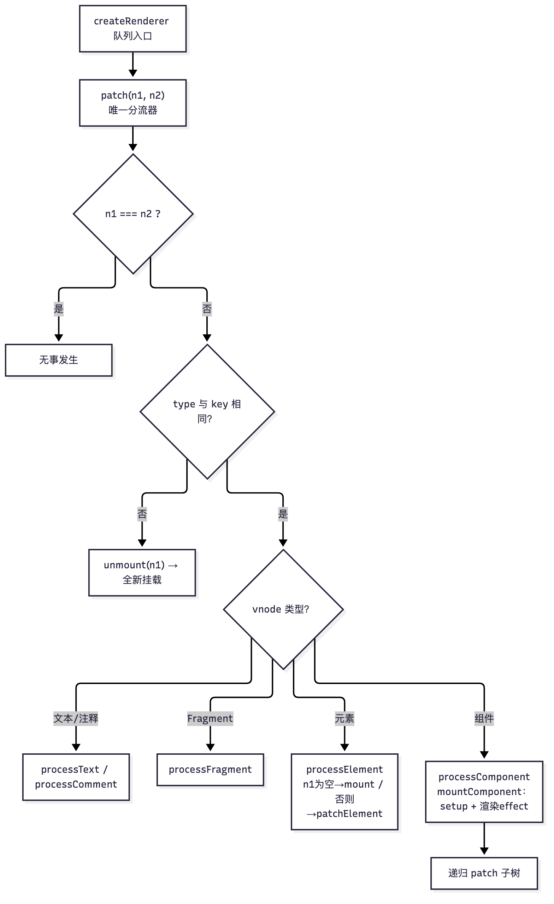

`packages/runtime-core/src/renderer.ts` 全文 2700 行，是 Vue 3 最大的单个文件。但它其实是一个「工厂」：`createRenderer` 返回一套闭包函数，核心只有一个入口——**patch**。

# 一、patch：唯一的分流器

```ts
// renderer.ts L385（v3.5.46，节选）
const patch: PatchFn = (n1, n2, container, anchor = null, ..., optimized) => {
  if (n1 === n2) return                     // 同一个 vnode：无事发生

  // 类型不同 → 卸载旧树，n1 置空后走全新挂载
  if (n1 && !isSameVNodeType(n1, n2)) {
    anchor = getNextHostNode(n1)
    unmount(n1, parentComponent, parentSuspense, true)
    n1 = null
  }

  const { type, ref, shapeFlag } = n2
  switch (type) {
    case Text:       processText(...)       // 文本节点
    case Comment:    processCommentNode(...)  // 注释节点
    case Static:     processStaticNode(...)  // v-pre 静态子树
    case Fragment:   processFragment(...)
    default:
      if (shapeFlag & ShapeFlags.ELEMENT)      processElement(...)
      else if (shapeFlag & ShapeFlags.COMPONENT) processComponent(...)
  }
}
```

读懂这个 switch，渲染器的骨架就有了：**n1 为 null 走挂载，n1 存在走更新；类型不同直接换，类型相同细对比**。`isSameVNodeType` 的判断只有一行 `n1.type === n2.type && n1.key === n2.key`——这就是为什么列表必须加 key：key 变了 = 类型不同 = 整个重建。



# 二、processElement：元素的挂载与更新

```ts
// renderer.ts L619（节选）
const processElement = (n1, n2, ...) => {
  if (n1 === null) {
    mountElement(n2, container, ...)        // ① 挂载
  } else {
    patchElement(n1, n2, ...)               // ② 更新
  }
}
```

**mountElement**（L673）四步：`hostCreateElement` 建 DOM → `hostPatchProp` 逐个设置 props → 挂子节点（文本 `hostSetElementText`，数组递归 `mountChildren`）→ `hostInsert` 插入容器。

**patchElement**（L849）里藏着上一篇讲的快通道：

```ts
// patchElement（节选）
const patchFlag = n2.patchFlag
// ...
if (patchFlag & PatchFlags.TEXT) {
  hostSetElementText(el, n2.children)      // 只改文字
} else if (patchFlag & PatchFlags.PROPS) {
  // 只遍历 dynamicProps 数组里登记的属性
  for (const key of n2.dynamicProps!) {
    ...patchProps(prevValue, nextValue)...
  }
} else {
  // 全量：diff props + diff children
  patchProps(...) ; patchChildren(...)
}
```

# 三、processComponent：组件更新的特殊性

组件分支做了两件元素分支没有的事：

1. **首次挂载**：`mountComponent` 创建组件实例 → 执行 setup → 包一层 ReactiveEffect 渲染 → 递归 patch 子树（这就是 09 篇生命周期的挂载时序）；
2. **更新**：props 变化只是「登记」——真正的更新 job 由响应式系统触发（数据变化 → 组件的渲染 effect → 重新执行 render → 递归 patch）。**元素的更新是同步递归，组件的更新要经过调度队列**（这就是 04 篇的 scheduler）。

# 四、手写 mini 渲染器

`demos/06-mini-renderer.mjs` 里的 mount/patch 是本篇的实践版（核心 40 行）：

```js
function mount(vnode, container) {
  const el = (vnode.el = { tag: vnode.type, props: {}, children: [] }) // 模拟 DOM
  if (vnode.props) for (const [k, v] of Object.entries(vnode.props)) el.props[k] = v
  if (typeof vnode.children === 'string') el.children = vnode.children
  else if (Array.isArray(vnode.children)) {
    for (const child of vnode.children) {
      if (typeof child === 'string') el.children.push({ text: child })
      else mount(child, el)               // 递归挂载 —— 和真实源码一致
    }
  }
  container.children.push(el)
}

function patch(n1, n2) {
  if (n1.type !== n2.type) return mount(n2, { children: [] })  // 类型不同 → 替换
  const el = (n2.el = n1.el)             // ★ 复用真实 DOM，避免重建
  if (n2.patchFlag & PatchFlags.TEXT) { /* 快通道：只更新文字 */ }
  else if (n2.patchFlag & PatchFlags.PROPS) { /* 快通道：只 diff dynamicProps */ }
  else { /* 全量 diff */ }
}
```

注意 `n2.el = n1.el` 这一行——**更新 vnode 接管旧 vnode 的真实 DOM 引用**，之后所有修改都作用在这一个节点上。真实源码里的 patchElement 也是这个写法。

# 五、面试考点小结

1. **patch 的分流依据是什么？** vnode type（Text/Comment/Fragment/Element/Component）+ n1 是否为 null（挂载/更新）；
2. **为什么组件更新走异步调度、元素更新是同步的？** 组件更新经过 scheduler 去重排序（父先子后），元素 patch 在组件渲染函数内部同步递归完成；
3. **同类型不同 key 的 vnode 会复用 DOM 吗？** 不会，isSameVNodeType 判定失败直接卸载重建——列表不加 key 的更新代价就是这么来的。

> **上一篇**：06《patchFlag 与 Block》｜**下一篇**：08《diff 算法：最长递增子序列》——列表更新是整个渲染器算法含量最高的部分
