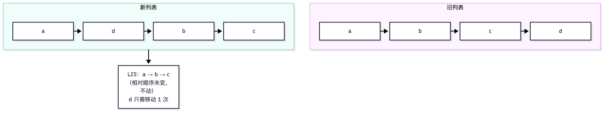

列表 diff 是 Vue 渲染器里算法含量最高的部分：`renderer.ts` 的 `patchKeyedChildren`（L1853）。

它要回答的问题是：旧列表 `[a,b,c,d,e]` 变成新列表 `[a,c,x,f,b]`，**如何用最少的 DOM 移动完成更新**？DOM 操作远贵于内存计算，所以 Vue 3 用一个 O(n log n) 的 LIS 算法把「移动次数」压到最少。

# 一、五步走（源码注释原话）

```
1. sync from start     从头同步（相同前缀直接 patch）
2. sync from end       从尾同步（相同后缀直接 patch）
3. 中间未知序列         处理乱序区
4. 建映射               key → 新下标
5. move & mount        LIS 判断哪些节点不动，其余移动/挂载
```

```ts
// renderer.ts patchKeyedChildren（v3.5.46，节选）
let i = 0
let e1 = c1.length - 1   // prev ending index
let e2 = l2 - 1          // next ending index

// 1. sync from start
while (i <= e1 && i <= e2) {
  if (isSameVNodeType(n1, n2)) {
    patch(n1, n2, ...)    // 前缀相同的：原地更新，绝不动 DOM
  } else break
  i++
}
// 2. sync from end —— 同理从尾部收拢（源码注释：a (b c) / d e (b c)）
```

头尾同步能消化大量真实场景：列表头部插入、尾部追加、以及最常见的「只改了前缀路由的页面」。

# 二、中间乱序区：两步定乾坤

剩下 `[i, e1]` vs `[i, e2]` 的乱序区，分两种边界情况先短路：

- **旧区耗尽（i > e1）**：新区剩余全是新节点 → 全部 mount；
- **新区耗尽（i > e2）**：旧区剩余全要卸载 → 全部 unmount。

然后进入核心两步：

```ts
// ③ 新乱序区的 key → index 映射
const keyToNewIndexMap = new Map()
for (i = s2; i <= e2; i++) {
  keyToNewIndexMap.set(c2[i].key, i)
}

// ④ 遍历旧乱序区，生成 newIndexToOldIndexMap
//    0 表示「新区有但旧区没有」→ 待挂载
const newIndexToOldIndexMap = new Array(toBePatched).fill(0)
//    匹配到的写 旧下标+1（所以 +1 才能用 0 表达「没有」）
```

**最坏情况降级**：如果旧乱序区节点全都匹配上了，且触发 moved 标记，才进入 LIS；没 key 或全量更新场景直接退化为逐个 patch + 移动。

# 三、LIS：让「不需要动」的节点最大化

`newIndexToOldIndexMap` 的含义：新列表里每个节点对应旧列表的位置。**如果一段下标是递增的，说明这些节点在新列表里的相对顺序没变——它们可以原地不动！**

比如旧 `[a,b,c,d]` → 新 `[a,d,b,c]`（忽略同步掉的前缀 a），乱序区映射是 `[4,2,3]`。最长递增子序列是 `[2,3]`（对应 b、c）——**只有 d 需要移动**。

求 LIS 用的是耐心排序（patience sorting），源码 `renderer.ts` 的 `getSequence`：

```ts
// getSequence（v3.5.46 核心逻辑）
const result = [0]           // result[i]：长度为 i+1 的递增子序列的「最小结尾下标」
let resultFinalIndex = 0
for (let i = 0; i < arr.length; i++) {
  const num = arr[i]
  if (num === 0) continue    // 0 = 新节点，不参与
  const j = result[resultFinalIndex]
  if (arr[j] < num) {
    p[i] = j                 // 比「最长结尾」还大 → 直接延长
    result[++resultFinalIndex] = i
  } else {
    // 否则二分找到第一个 >= num 的位置，替换它
    // （让每个长度的结尾尽可能小，给后面更多机会延长）
    result[start] = i
  }
}
// 回溯 p 数组还原真实下标序列
```

注意：LIS 返回的是**下标**，diff 阶段从新列表尾部向前遍历，节点在 LIS 里 → 原地 patch；不在 → 插入到正确锚点前；是 0 → 全新挂载。为什么从尾部向前？因为插入新节点的 DOM anchor 需要后面已就位的节点充当。



# 四、mini 演示：三次对比

`demos/07-mini-diff.mjs` 完整复现五步走（含 LIS），看真实输出：

```
▶ 演示 1：abc → cab（头尾都不相同）
  ③ 中间乱序区：keyToNewIndexMap = { c: 0, a: 1, b: 2 }
  ⑤ newIndexToOldIndexMap = [3,1,2]
  ⑤ 最长递增子序列下标 = [1,2] → a、b 不动
     结论：真正要移动的只有 1 个（c）

▶ 演示 2：abcde → acxfb（经典乱序 + 插入 + 删除）
  ① 头部同步：a（原地 patch，不动）
  ④ 旧节点 d 在新列表中不存在 → 卸载
  ④ 旧节点 e 在新列表中不存在 → 卸载
  ⑤ 最长递增子序列下标 = [3] → b 不动
     结论：patch/挂载 4 处，移动 3 个

▶ 演示 3：abcd → adbc（局部有序）
  ⑤ 最长递增子序列下标 = [1,2] → b、c 不动
     结论：只有 d 移动一次
  LIS = [a, b, c]：Vue3 只把 d 移动一次；Vue2 双端对比则需要更多交换
```

# 五、Vue 2 双端对比 vs Vue 3 LIS

Vue 2 用「四个指针从两头向中间对比」（头头、尾尾、头尾交叉、尾头交叉），简单但只是启发式；Vue 3 先头尾同步、再 LIS 求精确最优移动集，理论上更优且**对「大部分相对有序」的真实场景效果显著**。

| | Vue 2 双端 | Vue 3 LIS |
|---|---|---|
| 思路 | 四指针启发式 | 精确计算最少移动 |
| 复杂度 | O(n) | O(n log n) |
| 相对有序场景 | 可能多余移动 | 最少移动 |
| 实现 | 单文件好读 | 算法密度高 |

# 六、面试考点小结

1. **Vue 3 diff 的五步是什么？** 头同步 → 尾同步 → 新区建 keyMap → 旧区建 newIndexToOldIndexMap → LIS 判定移动集合；
2. **为什么求 LIS 而不是 LDS？** 「相对顺序不变的节点」恰好是 newIndexToOldIndexMap 的最长递增子序列，它们可以原地不动，移动的就是其余的；
3. **key 的作用？** key 是 keyToNewIndexMap 的索引：没 key 的列表退化为逐个 patch，任何插入删除都会牵连后继所有节点。

> **上一篇**：07《渲染器 patch 全流程》｜**下一篇**：09《组件系统：setup 与生命周期在源码中的位置》
