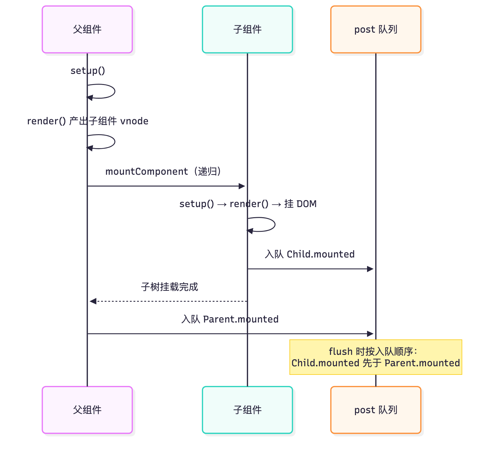

三道高频面试题，读完源码就再也不用背了：

1. `setup` 和 `created` 谁先执行？
2. `onMounted` 到底做了什么？
3. 父子组件的 `mounted` / `updated` 谁先执行？

# 一、mountComponent：组件的一生从这里开始

`renderer.ts` 的 `mountComponent` 流程（对照 07 篇的 patch 分流）：

```
① createComponentInstance   创建实例（uid 全局递增 → 调度排序的依据）
② setupComponent            执行 setup()，拿到返回值
③ setupRenderEffect         用 ReactiveEffect 包住渲染函数 → 数据变化自动重渲染
④ render 内部 patch         子组件递归走完自己的 ①②③
⑤ 队列 flush                mounted 钩子统一在 post 阶段执行
```

**setup 比 created 早**的答案就在第 ② 步：选项式 API 的 created 是在 `setupComponent` 内部「处理完 setup 之后」再被以钩子形式调用的——setup 在组件创建的最开始执行，它就是组合式 API 替代 beforeCreate/created 的位置。

# 二、onMounted 的本质：往实例上挂数组

`packages/runtime-core/src/apiLifecycle.ts`（v3.5.46）：

```ts
// apiLifecycle.ts（节选）
export function injectHook(type, hook, target = currentInstance, prepend = false) {
  if (target) {
    const hooks = target[type] || (target[type] = [])   // ★ instance.m = [fn]
    const wrappedHook = hook.__weh || (hook.__weh = (...args) => {
      pauseTracking()                    // 钩子里不做依赖收集
      const reset = setCurrentInstance(target)   // ★ 执行时恢复 currentInstance
      const res = callWithAsyncErrorHandling(hook, target, type, args)
      reset()
      resetTracking()
      return res
    })
    hooks.push(wrappedHook)              // 按注册顺序入数组
    return wrappedHook
  }
  // target 为空 → 开发环境警告：没有活动实例，钩子永远不会执行
}
```

三个关键设计：

- `onMounted(fn)` 就是把包装后的 fn 存进 `instance.m` 数组（`m` 是 mounted 的缩写，`bm`=beforeMount、`u`=updated、`um`=unmounted）；
- 每个钩子被包了 **with error handling（__weh）**：统一错误处理 + 执行时临时恢复 currentInstance；
- **组合式 API 可以注册多个同名钩子**，它们按注册顺序依次执行——因为就是普通数组。

而这些钩子什么时候执行？在组件渲染后由 **post 队列**（04 篇的 flushPostFlushCbs）统一调用。

# 三、父子组件顺序：两次面试题的源码答案

**mounted：子先父后。** 原因是「入队时机」：父组件 render 过程中递归挂载了子组件，子组件的 mounted 钩子**先**进 post 队列；父组件要等整棵子树挂完，自己的钩子**后**入队。flush 按入队顺序执行 → 子先父后。

**updated：父先子后。** 更新从父组件的渲染 effect 开始（父的 job uid 更小，先执行），patch 自上而下传播触发子组件更新——所以父的 updated 钩子先入队、先执行。



# 四、mini 演示：现场还原

`demos/08-mini-lifecycle.mjs` 用最小模型复现了上述两个队列机制，运行实录：

```
▶ 演示 1：首次挂载 —— mounted 谁先执行？
  [mount] <Parent> setup() 执行
  [mount] <Parent> render() 生成 vnode
  [mount] <Child> setup() 执行          ← 父的 render 过程递归挂载子组件
  [mount] <Child> render() 生成 vnode
  实际顺序： Child.mounted → Parent.mounted
  ✅ 子先父后：父的 mounted 必须等整棵子树挂完

▶ 演示 2：父组件状态变化 —— updated 谁先执行？
  [update] <Parent> 更新 job 执行（uid=0，uid 小的先跑）
  [update] <Child> 更新 job 执行（uid=1）
  实际顺序： Parent.updated → Child.updated
  ✅ 父先子后：更新从父开始，patch 自上而下传播
```

# 五、面试考点小结

1. **setup 为什么比 created 早？** setup 在实例创建最开始执行；created 是 setup 之后的选项式钩子调用，beforeCreate/created 的职能被 setup 天然覆盖；
2. **为什么生命周期钩子要用数组？** 组合式 API 允许注册多个同名钩子，按序执行；__weh 包装统一处理错误与实例上下文；
3. **mounted/updated 顺序为什么相反？** mounted 由「挂载完成」入队（子树先完成），updated 由「更新 job」入队（父 job 先跑）——本质都是**入队顺序决定执行顺序**。

> **上一篇**：08《diff 算法与最长递增子序列》｜**下一篇**：10《内置组件：KeepAlive / Teleport / Suspense》
