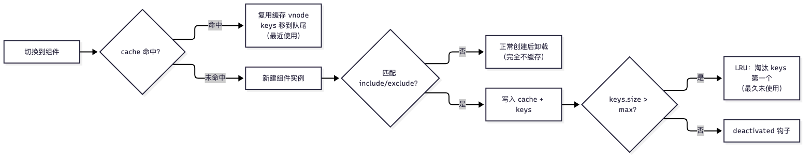

`packages/runtime-core/src/components/` 目录下有三个「内置组件」：KeepAlive、Teleport、Suspense。它们和普通组件不同——**根本不渲染自己，专职编排渲染行为**。本文逐个拆开。

# 一、KeepAlive：一个手写的 LRU 缓存

`KeepAlive.ts` 里数据结构只有两件东西：

```ts
// components/KeepAlive.ts（v3.5.46，节选）
const cache: Cache = new Map()          // key → 缓存的 vnode
const keys: Keys = new Set()            // ★ Set 有序：天然维护「最近使用顺序」
```

核心流程（render 函数内）：

```ts
// KeepAlive.ts（节选）
const key = vnode.key == null ? comp : vnode.key
if (cache.has(key)) {
  vnode.el = cachedVNode.el             // ★ 命中：直接复用旧 DOM，不重新创建
  cachedVNode.el.__vnode = cachedVNode  //    组件状态全在这里，天然保留
}
pendingCacheKey = key                   // 渲染完成后真正写入缓存
// ...渲染结束后：
cache.set(pendingCacheKey, getInnerChild(instance.subTree))
keys.add(key)
if (keys.size > max) pruneCacheEntry(keys.values().next().value!)  // ★ LRU 淘汰
```

命中的细节最讲究：`keys.delete(key); keys.add(key)` 把命中项**移到队尾**（最近使用）；`keys.values().next().value` 取**队首**（最久未使用）淘汰。**一个 Map + 一个 Set 就实现了完整 LRU**——这也是高频算法题。

缓存真正生效靠的是钩子：缓存组件切换时不执行 unmounted，而是执行 `deactivated`（停用）；切回来不执行 mounted，而是 `activated`。

include/exclude 的匹配在 `matches()` 里：正则或字符串数组逐一比对组件名，白名单外的组件连缓存门都不进。



# 二、Teleport：把渲染结果「传送」出去

普通组件的 DOM 挂在父组件位置，Teleport 让你可以指定 `to="body"` 等任意目标。它的实现本质是：

1. 编译阶段：`<Teleport>` 变成一个带 `TELEPORT` shapeFlag 的特殊 vnode；
2. 运行时：`TeleportImpl.mount` 直接把 children **挂载到 target 容器**，而组件树上的父子关系保持不变——**虚拟树和真实 DOM 树解耦**；
3. props disabled 还能动态切换：切换时把 DOM 从原容器搬回父容器。

应用场景：Modal、Drawer、全屏 Loading——弹层的 DOM 在 body 下，不受任何祖先的 `transform: scale()`、`overflow: hidden`、`z-index` 上下文影响。

# 三、Suspense：异步组件的「事务」协调者

Suspense 解决的问题是：子树里有异步依赖（异步组件、async setup）时，**整个子树要么全部就绪一起显示，要么先显示 fallback**——避免「先渲染一半」的尴尬。

源码里的关键状态机（`Suspense.ts`）：

- `isResolved` / `isInFallback` / `isHydrating` 三个布尔位构成状态机；
- 异步依赖完成 → `resolve()`：把 pendingBranch 的内容一次性 patch 进 DOM；
- 中途又来新的异步依赖 → `createFallback`：整体退回 fallback，等待新一轮 resolve。

一个容易被问到的细节：**Suspense 内部的错误会向上冒泡，必须由父级 errorCaptured 捕获**；多个 Suspense 嵌套时，子 Suspense 未 resolve 前父级也处于 pending——它是「传染性」的。

# 四、mini 演示：KeepAlive 的 LRU

`demos/09-mini-keepalive.mjs` 复现了缓存 + 命中移尾 + 超限淘汰的完整逻辑，运行实录：

```
▶ 演示 1：LRU 淘汰（max=3）
  切换到 TabA：❄️ 首次创建  → 缓存 [TabA]
  切换到 TabB：❄️ 首次创建  → 缓存 [TabA, TabB]
  切换到 TabC：❄️ 首次创建  → 缓存 [TabA, TabB, TabC]
  切换到 TabD：❄️ 首次创建
      [LRU] 缓存超限，淘汰最久未使用的 "TabA"
      缓存 [TabB, TabC, TabD]
  切回 TabA —— 已被淘汰，要重新创建
  切换到 TabD：✅ 缓存命中（免重建，状态保留）
      缓存 [TabA, TabB, TabD]      ← TabD 移到了队尾

▶ 演示 2：include 白名单
  切换到 LoginPage：不在 include 里 → 不缓存，正常卸载
```

# 五、面试考点小结

1. **KeepAlive 怎么实现缓存？** Map 存 vnode + Set 维护使用顺序，命中复用旧 DOM（状态天然保留），超限淘汰队首（LRU）；
2. **activated/deactivated 和 mounted/unmounted 的关系？** 缓存组件走前两者，不会被真正销毁重建；
3. **Teleport 为什么能逃离父级样式影响？** 虚拟树父子关系不变，但真实 DOM 直接挂到指定容器，两者解耦；
4. **Suspense 什么时候显示 fallback？** 子树存在未完成的异步依赖时整体退回，全部 resolve 后一次性切换显示。

> **上一篇**：09《setup 与生命周期的真相》｜**下一篇**：11（终章）《性能优化清单 + 面试考点汇总》
