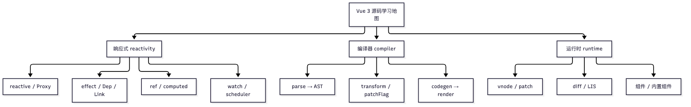

这是系列的最后一篇。前面 10 篇我们走过了三大模块：响应式、编译器、运行时。终章做三件事：**一张地图收束全系列、一份优化清单落地实战、一份考点清单备考面试**。

# 一、知识地图



回望整个系列的逻辑链条：

> **编译器**把模板变成带 patchFlag 的 render 函数 → **运行时**首次渲染时完成依赖收集 → 数据变化 → **响应式**精准通知对应组件的 effect → **调度器**去重排队、父先子后 → **渲染器**按快通道 diff、LIS 最少移动 → DOM 更新。

每一环都只做必要的事——这就是「框架优化」的总纲。

# 二、性能优化清单（双层）

**框架已经替你做了的（读懂即可，别重复造轮子）**：

- 静态提升：纯静态子树只创建一次；
- patchFlag 快通道：diff 只碰编译期标记的动态部分；
- 事件缓存：handler 引用稳定，不触发子组件无谓更新；
- 双向依赖清理 + version 跳过：响应式层面消灭幽灵重渲染；
- 调度队列去重：同 tick 多次修改合并成一次更新。

**你能做的（按性价比排序）**：

1. **v-once / v-memo**：大块纯静态或计算昂贵的内容交给编译器豁免；
2. **列表加 key**（唯一稳定标识，别用 index——插入删除时 LIS 优势全被吃掉）；
3. **精确 watch**：`watch(() => obj.a.b.c)` 替代 deep watch 全量 traverse；
4. **大列表虚拟滚动**：diff 再快也快不过不渲染；
5. **shallowRef**：大对象整体替换场景（如表单草稿、缓存对象）跳过深代理；
6. **组件拆分**：更新粒度从「页面」降到「组件」——响应式按组件收集，粒度越小更新越便宜；
7. **懒加载**：defineAsyncComponent + 路由懒加载，Suspense 协调 loading。

# 三、面试考点汇总（按模块）

**响应式**（01-04 篇）

- Proxy vs defineProperty：新增/删除/索引拦截 + 无初始化递归
- activeSub 机制、为什么要 cleanup（分支切换死依赖）
- 3.5 的 Dep/Link 双向链表：O(1) 摘边 + version 跳过
- ref 的 .value 为什么必须存在；computed 的 DIRTY 惰性求值
- watch 三种 flush 的执行时机；nextTick = Promise.then

**编译器**（05-06 篇）

- 三步走：parse → transform → codegen
- patchFlag 位标记与 dynamicProps 数组
- Block 的 dynamicChildren：diff 从 O(全树) 到 O(动态节点)
- v-if 编译成三元表达式；v-once/v-memo 的产物差异

**运行时**（07-10 篇）

- patch 分流：type + key 判断复用还是重建
- diff 五步走 + LIS 耐心排序 O(n log n)
- 组件更新走调度队列、元素更新同步递归
- mounted 子先父后 / updated 父先子后（入队顺序决定）
- KeepAlive 的 LRU：Map + Set 双结构

**实战开放题**

- 「为什么手写 render 函数比模板慢？」——没有编译期优化标记
- 「怎么让 Vue 更新一个 1000 项的列表？」——key + 虚拟滚动 + 分片渲染
- 「Vue 3.5 的 useTemplateRef 为什么能生效？」——模板 ref 收集进 setupContext

# 四、mini-vue 路线图

如果你想动手造一个自己的 mini-vue（强烈建议，全部素材本系列已备齐），推荐顺序：

```
第 1 周  reactive + effect + track/trigger        → demos/01、02
第 2 周  ref + computed + watch + 调度队列         → demos/03、04
第 3 周  编译器三步走（可以先不做优化标记）         → demos/05
第 4 周  渲染器 mount/patch + patchFlag 快通道     → demos/06
第 5 周  keyed diff + LIS                         → demos/07
第 6 周  组件实例 + 生命周期 + KeepAlive           → demos/08、09
```

全部跑通后你会拥有一个约 1000 行的 mini-vue——面试时说「我自己实现过 Vue 的响应式和 diff」，和背 10 遍八股文，是两种完全不同的底气。

# 五、写在最后

读源码不是为了背 API，而是建立一种「拆解复杂系统」的能力。Vue 3 只有三万行核心代码，却用三个模块的精巧协作支撑了整个生态——**这个范式本身，比任何一个实现细节都值得带走**。

> **上一篇**：10《KeepAlive 与 Teleport 源码》｜**系列完结**。配套 demos 与图示见仓库目录。
