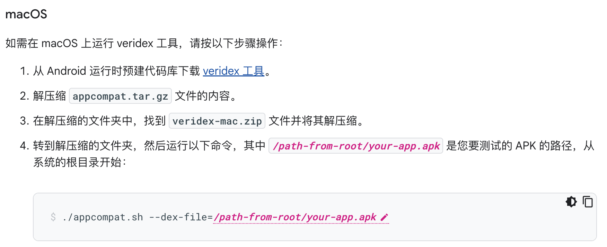
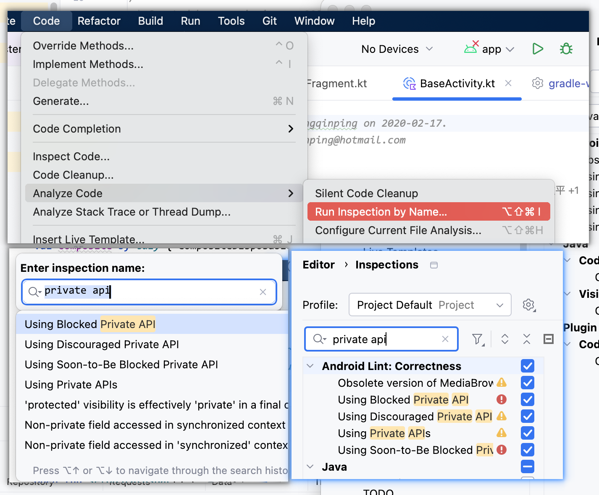

# 【Android】针对非 SDK 接口的限制

- 官方介绍：https://developer.android.google.cn/guide/app-compatibility/restrictions-non-sdk-interfaces?hl=zh-cn

- 工具下载（2024.11月搬运过来）：veridex 及 15-11 非 sdk 接口的名单
  https://www.alipan.com/s/J5t4bFWJzz6 提取码: 9l1b

## 区分 SDK 接口和非 SDK 接口
- sdk 接口：平时开发中可以正常调用到的 android.jar api. `如 ActivityManager.killBackgroundProcesses(String packageName)`
- 非 sdk 接口： android系统源代码中，隐藏的api. 如 ` ActivityManager.forceStopPackage(String packageName)` 这种需要通过反射调用的。当然还包括 jni 层面的句柄。
- 非 android.jar 的api 是不受影响的。

## 非 SDK 接口 的分类
- https://developer.android.google.cn/guide/app-compatibility/restrictions-non-sdk-interfaces?hl=zh-cn#list-names

- 黑名单(blocked)：受限，无论目标 SDK 如何。 平台将表现为似乎接口并不存在。 例如，无论应用何时尝试使用接口，平台都会引发 NoSuchMethodError/NoSuchFieldException，即使应用想要了解某个特殊类别的字段/函数名单，平台也不会包含接口。
- (max-target-x)：这些名单会以应用无法再访问相应名单中的非 SDK 接口之前可以作为目标平台的最高 API 级别 (max-target-x) 进行标记。例如，在 Android Pie 中未被屏蔽，但现在已被 Android 10 屏蔽的非 SDK 接口会列入 max-target-p (greylist-max-p) 名单，其中“p”表示 Pie 或 Android 9（API 级别 28）。
- 灰名单（unsupported）：仍可以访问的非 SDK 函数/字段，但不保证后续不会移到黑名单。
- 白名单：该列表的API可以自由使用。

## 使用 veridex 检测

## 使用 Android Studio lint 工具进行测试

